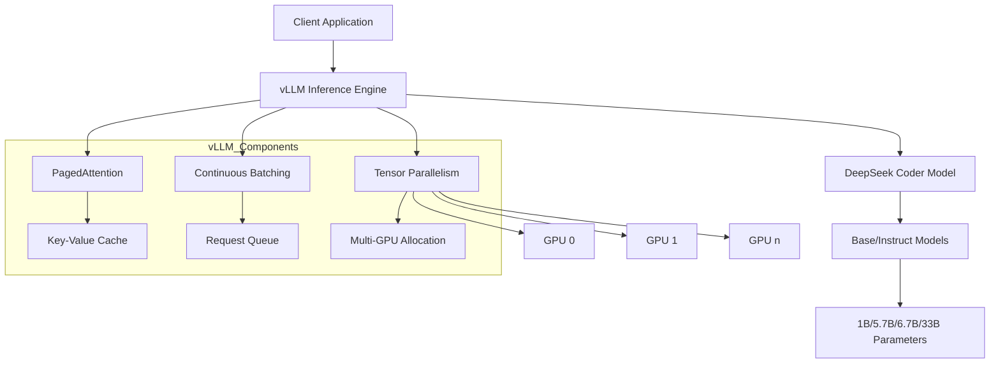
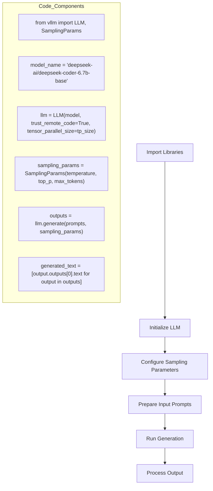
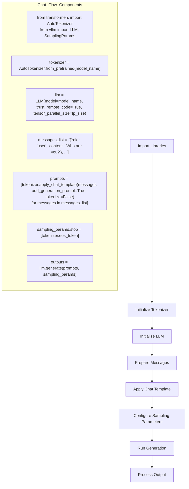
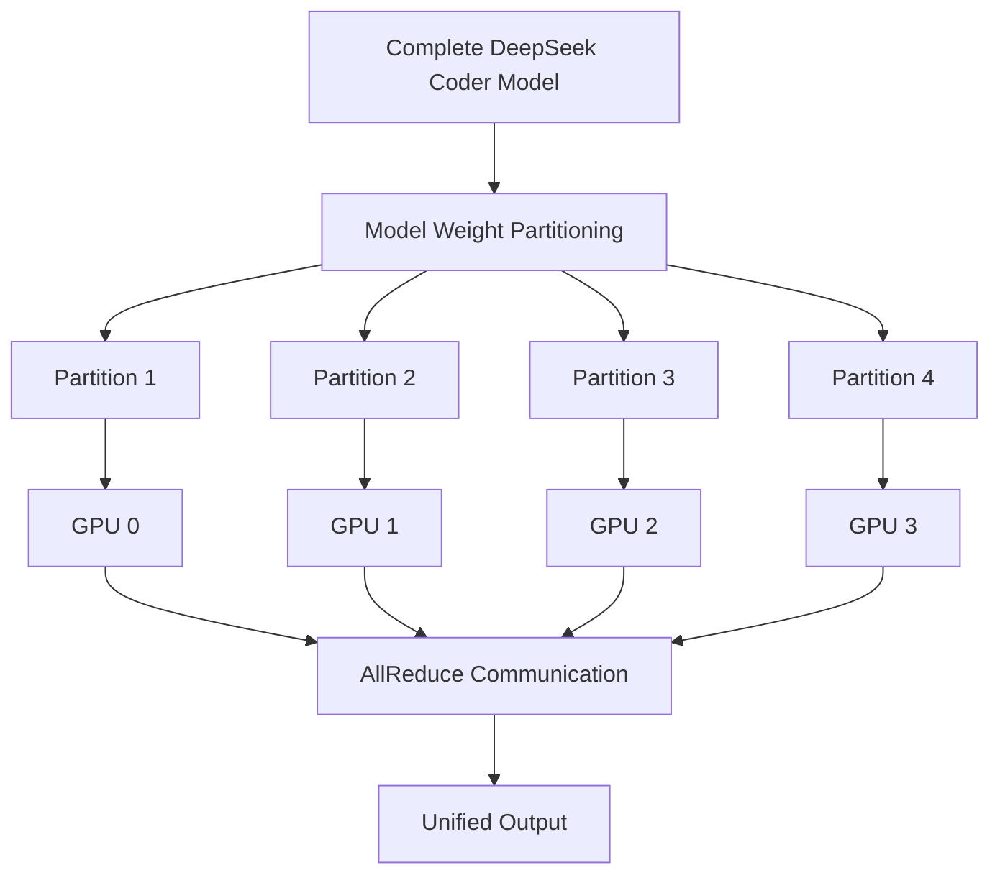

<!-- source: DeepWiki mcp.deepwiki.com · repo deepseek-ai/DeepSeek-Coder · page 3.5 High-throughput Inference with vLLM · fetched 2026-10-30 -->

# High-throughput Inference with vLLM

<details>
<summary>Relevant source files</summary>

The following files were used as context for generating this wiki page:

- [README.md](README.md)

</details>


This document describes how to use vLLM (a high-performance inference engine) with DeepSeek Coder models to achieve significantly higher throughput and reduced latency compared to standard inference methods. For information about standard inference approaches, see [Code Completion](#3.1), [Code Insertion](#3.2), [Chat Model Inference](#3.3), and [Repository-Level Completion](#3.4).

## Introduction to vLLM

vLLM is an open-source library that implements several optimizations for LLM inference:

1. **PagedAttention**: Efficient memory management for key-value caches
2. **Continuous batching**: Dynamic handling of multiple requests with different sequence lengths
3. **Tensor parallelism**: Distribution of model weights across multiple GPUs
4. **Quantization support**: Efficient serving of large models with reduced precision

These features make vLLM particularly valuable for serving DeepSeek Coder models in production environments where throughput and resource utilization are critical.

### vLLM Architecture with DeepSeek Coder



Sources: [README.md:333-382]()

## Setup and Installation

To use vLLM with DeepSeek Coder, you'll need to install the vLLM library:

```bash
pip install vllm
```

## Basic Usage Patterns

vLLM supports both text completion with base models and chat completion with instruction-tuned models.

### Text Completion with Base Models

The following diagram illustrates the flow of text completion with DeepSeek Coder base models:



Sources: [README.md:338-356]()

For text completion with a base model, use the following code pattern:

1. Import the required modules
2. Set up the sampling parameters
3. Initialize the LLM with the DeepSeek Coder base model
4. Prepare your prompts (code snippets or descriptions)
5. Generate completions and process the results

The code example from the repository shows how to run a batch of three prompts simultaneously:

```python
from vllm import LLM, SamplingParams

tp_size = 4  # Tensor Parallelism
sampling_params = SamplingParams(temperature=0.7, top_p=0.9, max_tokens=100)
model_name = "deepseek-ai/deepseek-coder-6.7b-base"
llm = LLM(model=model_name, trust_remote_code=True, gpu_memory_utilization=0.9, tensor_parallel_size=tp_size)

prompts = [
    "If everyone in a country loves one another,",
    "The research should also focus on the technologies",
    "To determine if the label is correct, we need to"
]
outputs = llm.generate(prompts, sampling_params)

generated_text = [output.outputs[0].text for output in outputs]
print(generated_text)
```

Sources: [README.md:338-356]()

### Chat Completion with Instruct Models

For chat-based interactions using the DeepSeek Coder instruct models, the process involves a few additional steps to format the prompts correctly:



Sources: [README.md:358-382]()

The code example for chat completion demonstrates how to:

1. Import the necessary libraries, including the Hugging Face tokenizer
2. Initialize both the tokenizer and the vLLM LLM object
3. Prepare a list of message sequences
4. Apply the DeepSeek Coder chat template to format the prompts
5. Configure the sampling parameters, including setting the EOS token
6. Generate responses and process the outputs

```python
from transformers import AutoTokenizer
from vllm import LLM, SamplingParams

tp_size = 4  # Tensor Parallelism
sampling_params = SamplingParams(temperature=0.7, top_p=0.9, max_tokens=100)
model_name = "deepseek-ai/deepseek-coder-6.7b-instruct"
tokenizer = AutoTokenizer.from_pretrained(model_name)
llm = LLM(model=model_name, trust_remote_code=True, gpu_memory_utilization=0.9, tensor_parallel_size=tp_size)

messages_list = [
    [{"role": "user", "content": "Who are you?"}],
    [{"role": "user", "content": "What can you do?"}],
    [{"role": "user", "content": "Explain Transformer briefly."}],
]
prompts = [tokenizer.apply_chat_template(messages, add_generation_prompt=True, tokenize=False) for messages in messages_list]

sampling_params.stop = [tokenizer.eos_token]
outputs = llm.generate(prompts, sampling_params)

generated_text = [output.outputs[0].text for output in outputs]
print(generated_text)
```

Sources: [README.md:358-382]()

## Advanced Configuration Options

### Tensor Parallelism

Tensor parallelism is a critical feature for efficiently running larger DeepSeek Coder models (especially the 33B parameter model) across multiple GPUs. The `tensor_parallel_size` parameter specifies how many GPUs to use for parallel inference:



Sources: [README.md:343-345](), [README.md:363-365]()

Setting the tensor parallelism value correctly is important:
- For the 1B and 5.7B models, a single GPU may be sufficient
- For the 6.7B model, using 2-4 GPUs can improve throughput
- For the 33B model, tensor parallelism across 4-8 GPUs is typically necessary

### Memory Utilization

The `gpu_memory_utilization` parameter controls how much of the available GPU memory vLLM will use. Setting this to a value like 0.9 (90%) allows vLLM to utilize most of the GPU memory while leaving some headroom for system operations:

```python
llm = LLM(
    model=model_name,
    trust_remote_code=True,
    gpu_memory_utilization=0.9,
    tensor_parallel_size=tp_size
)
```

Sources: [README.md:345](), [README.md:365]()

### Sampling Parameters

The `SamplingParams` class provides control over the generation process:

| Parameter | Description | Typical Values |
|-----------|-------------|----------------|
| temperature | Controls randomness | 0.0 (deterministic) to 1.0 (more random) |
| top_p | Nucleus sampling threshold | 0.9-1.0 |
| top_k | Limit vocabulary to top K tokens | 0-50 (0 disables) |
| max_tokens | Maximum tokens to generate | Depends on context |
| presence_penalty | Penalty for repeated tokens | 0.0-1.0 |
| frequency_penalty | Penalty based on frequency | 0.0-1.0 |
| stop | Stop sequences | [tokenizer.eos_token] |

Sources: [README.md:342](), [README.md:362-377]()

## Performance Considerations

### Batch Size Optimization

vLLM performs best when processing multiple requests simultaneously. The ideal batch size depends on:

- Model size (parameter count)
- Available GPU memory
- Input prompt length
- Expected output length

For most use cases with DeepSeek Coder models, batch sizes between 4 and 32 provide a good balance between throughput and latency.

### Hardware Recommendations

For optimal performance with vLLM and DeepSeek Coder:

| Model Size | Minimum GPU Requirements | Recommended Setup |
|------------|--------------------------|-------------------|
| 1B         | 1× GPU with 8GB VRAM     | 1× NVIDIA T4/V100 |
| 5.7B/6.7B  | 1× GPU with 16GB VRAM    | 1-2× NVIDIA A10/A100 |
| 33B        | 4× GPUs with 40GB VRAM   | 4-8× NVIDIA A100/H100 |

## Common Issues and Solutions

### Out of Memory Errors

If you encounter out-of-memory errors, try:

1. Reducing batch size
2. Increasing tensor parallelism (using more GPUs)
3. Lowering the `gpu_memory_utilization` value
4. Limiting input/output token lengths

### Slow First Inference

The first inference with vLLM may be slow due to model loading and CUDA graph compilation. This is normal and subsequent inferences will be much faster.

## Comparison with Standard Inference

vLLM offers several advantages over standard Hugging Face Transformers inference:

| Feature | Standard Inference | vLLM |
|---------|-------------------|------|
| Throughput | Lower (sequential processing) | Higher (continuous batching) |
| Memory Efficiency | Lower (inefficient KV cache) | Higher (PagedAttention) |
| Multi-GPU Support | Limited | Native tensor parallelism |
| Batch Processing | Less efficient | Highly optimized |
| First Inference Latency | Faster | Slower (compilation overhead) |

Sources: [README.md:333-337]()

## Conclusion

vLLM provides a significant performance boost for DeepSeek Coder inference, especially in scenarios requiring high throughput or when working with larger models. By leveraging tensor parallelism, continuous batching, and efficient memory management, vLLM enables more efficient serving of DeepSeek Coder models in production environments.

For most production deployments of DeepSeek Coder, especially those handling multiple concurrent requests, vLLM is strongly recommended over standard inference methods.

---

