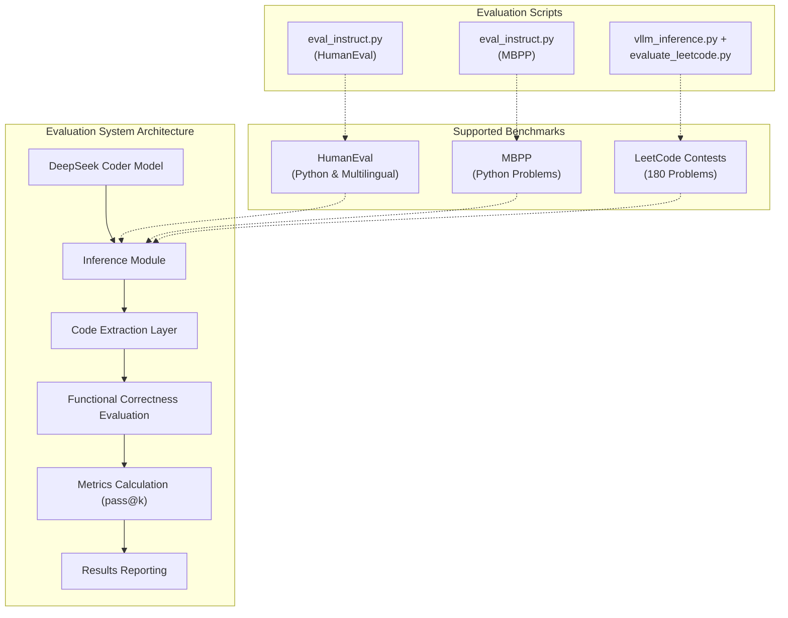
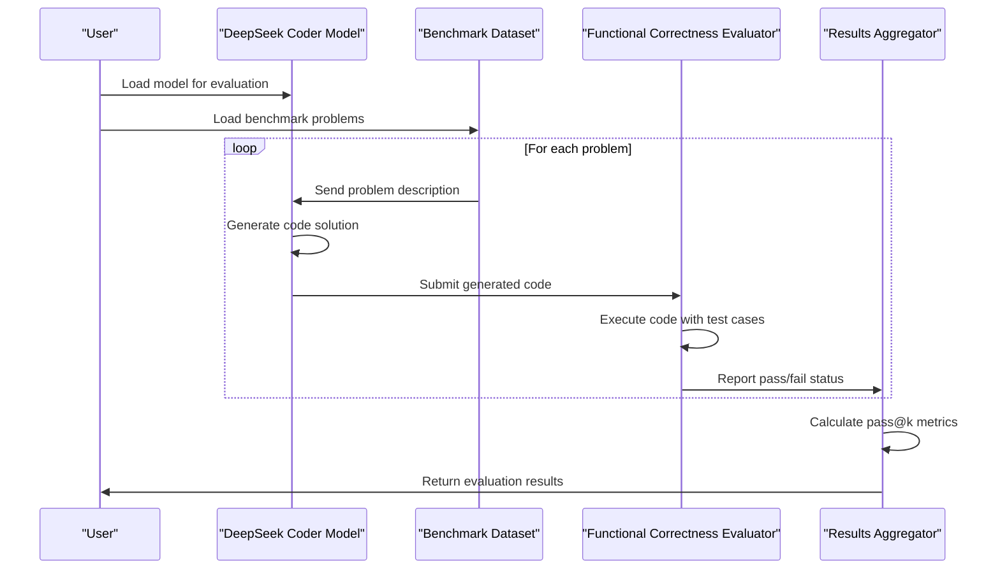
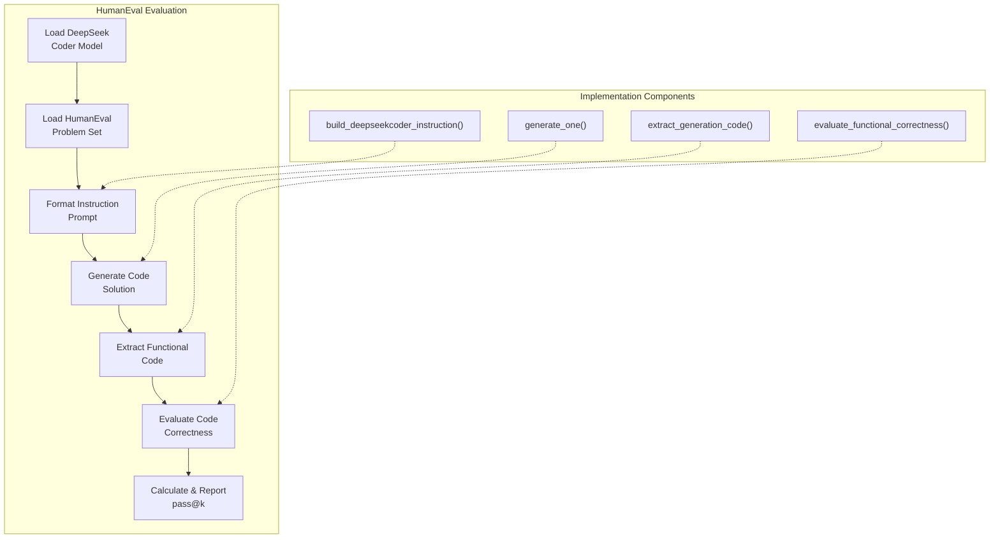
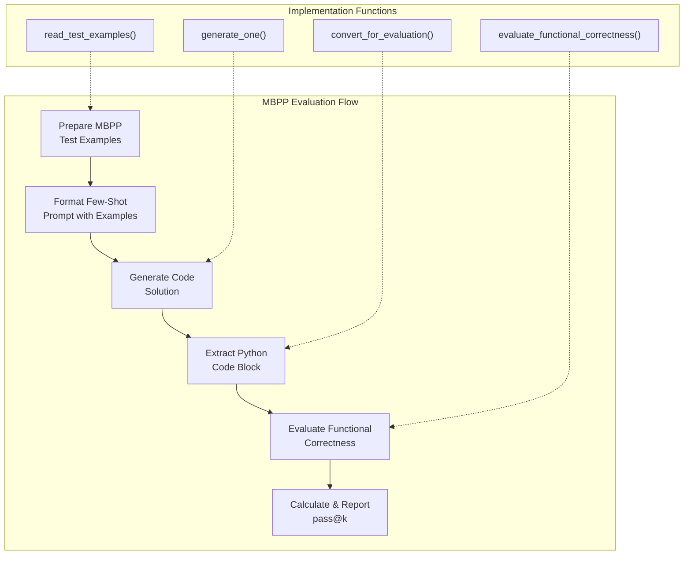
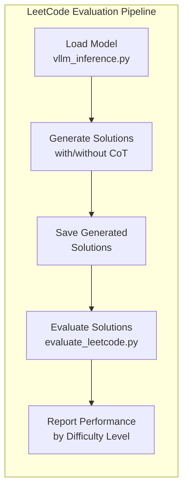
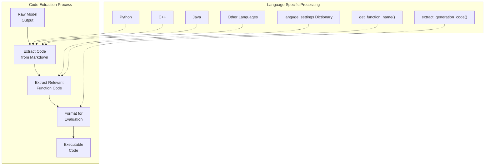
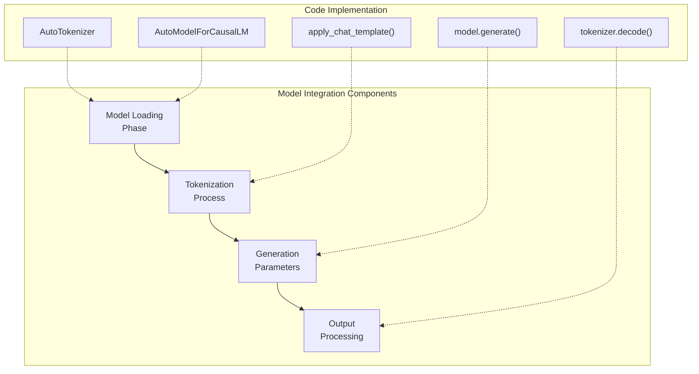

<!-- source: DeepWiki mcp.deepwiki.com · repo deepseek-ai/DeepSeek-Coder · page 4 Evaluation System · fetched 2026-10-30 -->

# Evaluation System

<details>
<summary>Relevant source files</summary>

The following files were used as context for generating this wiki page:

- [Evaluation/HumanEval/eval_instruct.py](Evaluation/HumanEval/eval_instruct.py)
- [Evaluation/HumanEval/utils/utils.py](Evaluation/HumanEval/utils/utils.py)
- [Evaluation/LeetCode/readme.md](Evaluation/LeetCode/readme.md)
- [Evaluation/MBPP/eval_instruct.py](Evaluation/MBPP/eval_instruct.py)
- [README.md](README.md)

</details>


## Purpose and Scope

The Evaluation System is a comprehensive framework for benchmarking DeepSeek Coder models across various programming tasks and languages. It provides standardized testing protocols to assess the code generation capabilities of models on different benchmarks including HumanEval, MBPP, and LeetCode contests. This document covers the architecture, workflow, and implementation details of the evaluation system.

For information about model training and architecture, see [Models](#2). For details on using models for inference, see [Usage and Inference Methods](#3).

## System Architecture

The evaluation system follows a modular architecture that enables consistent evaluation across different benchmarks while accommodating benchmark-specific requirements.



Sources: [Evaluation/HumanEval/eval_instruct.py](), [Evaluation/MBPP/eval_instruct.py](), [Evaluation/LeetCode/readme.md]()

## Evaluation Workflow

The evaluation process follows a standardized workflow across all benchmarks to ensure consistent assessment of model performance.



Sources: [Evaluation/HumanEval/eval_instruct.py:47-89](), [Evaluation/MBPP/eval_instruct.py:89-129]()

## Benchmark Datasets

### HumanEval

HumanEval is a hand-written evaluation set that measures functional correctness for synthesizing programs from docstrings. DeepSeek Coder's evaluation system supports both Python and multilingual variants of HumanEval.

| Feature | Description |
|---------|-------------|
| Languages | Python, C++, Java, JavaScript, TypeScript, PHP, C#, Bash |
| Problem Format | Function signature with docstring |
| Evaluation | Functional correctness through test cases |
| Metrics | pass@k (typically k=1) |

#### HumanEval Evaluation Process



Sources: [Evaluation/HumanEval/eval_instruct.py:14-46](), [Evaluation/HumanEval/utils/utils.py:54-105]()

### MBPP (Mostly Basic Python Programming)

MBPP consists of 974 Python programming problems focused on basic programming and algorithmic tasks. The evaluation system uses a few-shot approach with examples to guide the model's solution generation.

| Feature | Description |
|---------|-------------|
| Language | Python only |
| Problem Format | Problem description + test cases |
| Evaluation Style | Few-shot learning with examples |
| Problem Complexity | Basic programming tasks |

#### MBPP Evaluation Process



Sources: [Evaluation/MBPP/eval_instruct.py:14-53](), [Evaluation/MBPP/eval_instruct.py:53-87]()

### LeetCode Contest Benchmark

The LeetCode benchmark consists of 180 competition-level problems from recent LeetCode Contests (July 2023 to January 2024), categorized as Easy (45), Medium (91), and Hard (44).

| Feature | Description |
|---------|-------------|
| Language | Python |
| Problem Types | Algorithm and data structure challenges |
| Evaluation | 100 test cases per problem |
| Difficulty Levels | Easy, Medium, Hard |
| Optional | Chain-of-Thought (CoT) evaluation |

#### LeetCode Evaluation Process



Sources: [Evaluation/LeetCode/readme.md:6-26]()

## Implementation Details

### Code Extraction and Processing

A critical part of the evaluation process is properly extracting and processing generated code from model outputs. The system includes utilities to handle various programming languages and format conversions.



Sources: [Evaluation/HumanEval/utils/utils.py:1-106]()

### Model Integration

The evaluation system is designed to work with DeepSeek Coder models using the Hugging Face Transformers library. It provides a consistent interface for loading and using different model sizes and variants.



Sources: [Evaluation/HumanEval/eval_instruct.py:22-46](), [Evaluation/MBPP/eval_instruct.py:65-87]()

## Performance Metrics

The primary metric used across all benchmarks is pass@k, which measures the probability that a correct solution is found among k independent samples. The typical configuration uses k=1 for direct comparison with other models.

| Benchmark | DeepSeek-Coder-Base-33B | DeepSeek-Coder-Instruct-33B | CodeLlama-34B | GPT-3.5-Turbo |
|-----------|--------------------------|------------------------------|---------------|---------------|
| HumanEval Python (pass@1) | 73.2% | 75.6% | 65.3% | 72.6% |
| HumanEval Multilingual (pass@1) | 63.8% | - | 54.5% | - |
| MBPP (pass@1) | 72.0% | 74.2% | 61.2% | 74.4% |
| LeetCode Overall | - | 27.8% | 9.4% | 23.3% |
| LeetCode + CoT | - | 28.9% | - | 23.3% |

Sources: [README.md:30-47](), [Evaluation/LeetCode/readme.md:28-48]()

## Running Evaluations

### HumanEval Evaluation

To evaluate a model on HumanEval:

```bash
# From the repository root
cd Evaluation/HumanEval
python eval_instruct.py --model "deepseek-ai/deepseek-coder-6.7b-instruct" --output_path "output/humaneval_results.jsonl" --language "python" --temp_dir "tmp"
```

Sources: [Evaluation/HumanEval/eval_instruct.py:119-129]()

### MBPP Evaluation

To evaluate a model on MBPP:

```bash
# From the repository root
cd Evaluation/MBPP
python eval_instruct.py --model "deepseek-ai/deepseek-coder-6.7b-instruct" --output_path "output/mbpp_results.jsonl" --temp_dir "tmp"
```

Sources: [Evaluation/MBPP/eval_instruct.py:131-140]()

### LeetCode Evaluation

To evaluate a model on LeetCode Contest problems:

```bash
# From the repository root
cd Evaluation/LeetCode

# First, generate solutions
python vllm_inference.py --model_name_or_path "deepseek-ai/deepseek-coder-6.7b-instruct" --saved_path "output/leetcode_results.jsonl"

# Optional: use Chain-of-Thought (CoT)
python vllm_inference.py --model_name_or_path "deepseek-ai/deepseek-coder-6.7b-instruct" --saved_path "output/leetcode_cot_results.jsonl" --cot

# Then evaluate the solutions
python evaluate_leetcode.py --generation_path "output/leetcode_results.jsonl" --result_path "output/leetcode_evaluated.jsonl"
```

Sources: [Evaluation/LeetCode/readme.md:6-26]()

## Integration with Other Systems

The Evaluation System is closely integrated with other components of the DeepSeek Coder ecosystem:

1. **Models**: The system evaluates models of different sizes and types (base vs. instruct).
2. **Inference Methods**: It leverages various inference methods including standard generation and vLLM for high-throughput evaluation.
3. **Fine-tuning**: Performance improvements from fine-tuning can be measured using this evaluation system.

Sources: [README.md:30-47](), [README.md:317-333]()

---

