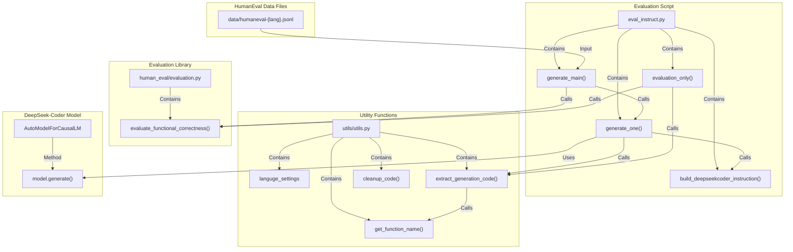
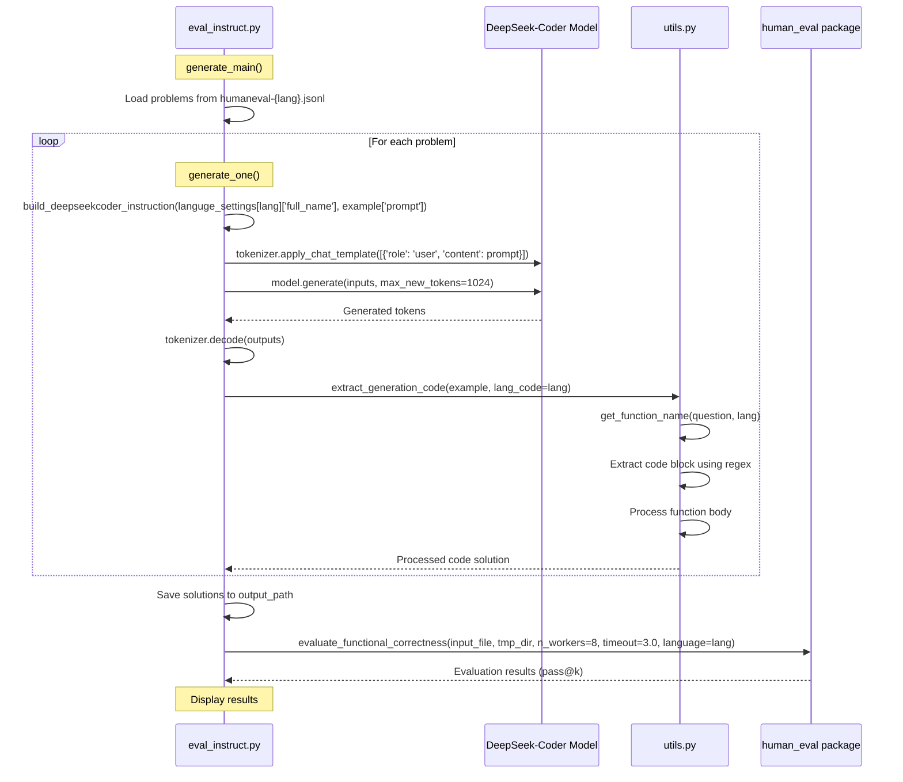
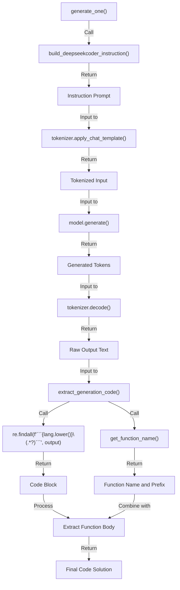
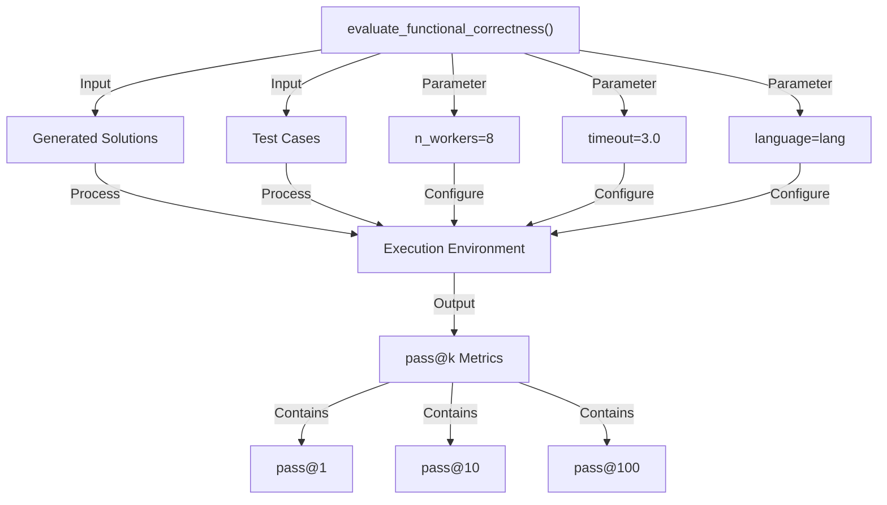

<!-- source: DeepWiki mcp.deepwiki.com · repo deepseek-ai/DeepSeek-Coder · page 4.1 HumanEval Benchmark · fetched 2026-10-30 -->

# HumanEval Benchmark

<details>
<summary>Relevant source files</summary>

The following files were used as context for generating this wiki page:

- [Evaluation/HumanEval/__pycache__/humaneval.cpython-38.pyc](Evaluation/HumanEval/__pycache__/humaneval.cpython-38.pyc)
- [Evaluation/HumanEval/eval_instruct.py](Evaluation/HumanEval/eval_instruct.py)
- [Evaluation/HumanEval/utils/__pycache__/instruct.cpython-38.pyc](Evaluation/HumanEval/utils/__pycache__/instruct.cpython-38.pyc)
- [Evaluation/HumanEval/utils/utils.py](Evaluation/HumanEval/utils/utils.py)
- [pictures/HumanEval.png](pictures/HumanEval.png)
- [pictures/MBPP.png](pictures/MBPP.png)

</details>


## Purpose and Scope

This page documents the HumanEval evaluation system in DeepSeek-Coder, which measures code generation capabilities across multiple programming languages. It covers the evaluation process, architecture, implementation details, and usage instructions. For information about other evaluation methods, see [MBPP Benchmark](#4.2) and [LeetCode Evaluation](#4.3).

## Overview of HumanEval

HumanEval is a standard benchmark created by OpenAI that consists of 164 programming problems designed to test functional correctness of generated code. In DeepSeek-Coder, the benchmark has been extended to support multiple programming languages beyond the original Python implementation.

Each HumanEval problem includes:
- A function signature with docstring describing the task
- A prompt for the model to complete
- Test cases to evaluate functional correctness

The problems cover various programming tasks, from string manipulation to complex algorithms, testing different aspects of coding ability.

## Evaluation System Architecture

### Component Structure



Sources: [Evaluation/HumanEval/eval_instruct.py](), [Evaluation/HumanEval/utils/utils.py]()

### Evaluation Process



Sources: [Evaluation/HumanEval/eval_instruct.py:48-89](), [Evaluation/HumanEval/eval_instruct.py:22-46]()

## Implementation Details

### Instruction Prompt Construction

DeepSeek-Coder uses a specific instruction prompt to guide the model in completing the function:

```python
def build_deepseekcoder_instruction(languge: str, question: str):
    return '''
Please continue to complete the function. You are not allowed to modify the given code and do the completion only. Please return all completed function in a codeblock. Here is the given code to do completion:
```{}
{}
```
'''.strip().format(languge.lower(), question.strip())
```

Sources: [Evaluation/HumanEval/eval_instruct.py:14-20]()

### Code Generation Pipeline



Sources: [Evaluation/HumanEval/eval_instruct.py:22-46](), [Evaluation/HumanEval/utils/utils.py:54-105]()

### Code Extraction Process

The `extract_generation_code()` function processes model output to extract and clean the generated code:

1. Extract the code block from the response using regex
2. Remove main function if present (for languages like C++, Java)
3. Identify function name and prefix from the original prompt
4. Extract the relevant function body
5. Handle language-specific post-processing (e.g., adding closing braces for PHP, TypeScript, JavaScript)
6. Combine prefix and body to form the complete solution

Sources: [Evaluation/HumanEval/utils/utils.py:54-105]()

### Evaluation Metrics



Sources: [Evaluation/HumanEval/eval_instruct.py:80-87]()

The main metric used is pass@k, which measures the probability that at least one correct solution appears in k independently generated samples. This metric is calculated using bootstrap resampling with the following parameters:
- `n_workers`: Number of parallel workers for execution (default: 8)
- `timeout`: Maximum execution time per test case (default: 3.0 seconds)
- `language`: Target programming language

## Language Support

DeepSeek-Coder's HumanEval implementation supports multiple programming languages:

| Language | Full Name | Indent | Main Function Pattern |
|----------|-----------|--------|----------------------|
| Python | Python | 4 | N/A |
| C++ | cpp | 0 | "int main()" |
| Java | Java | 4 | "public static void main" |
| C# | csharp | 0 | "public static void Main" |
| PHP | PHP | 0 | N/A |
| TypeScript | TypeScript | 0 | N/A |
| JavaScript | JavaScript | 0 | N/A |
| Bash | Bash | 0 | N/A |

Sources: [Evaluation/HumanEval/utils/utils.py:3-39]()

## Usage Instructions

To evaluate a model on HumanEval:

```bash
python Evaluation/HumanEval/eval_instruct.py \
    --model /path/to/model \
    --output_path /path/to/output.jsonl \
    --language python \
    --temp_dir /path/to/temp_dir
```

Command-line arguments:
- `--model`: Path to the DeepSeek-Coder model
- `--output_path`: Path to save generated solutions
- `--language`: Target language for evaluation (python, cpp, java, etc.)
- `--temp_dir`: Directory for temporary files during evaluation

To evaluate previously generated solutions without regenerating:

```bash
python Evaluation/HumanEval/eval_instruct.py \
    --output_path /path/to/existing_solutions.jsonl \
    --language python \
    --temp_dir /path/to/temp_dir
```

Sources: [Evaluation/HumanEval/eval_instruct.py:119-129](), [Evaluation/HumanEval/eval_instruct.py:91-117]()

## Performance Results

The DeepSeek-Coder models achieve state-of-the-art results on HumanEval across multiple languages. Results are visualized in the repository's `pictures/HumanEval.png` file, showing comparative performance against other leading code generation models.

Sources: [pictures/HumanEval.png]()

---

