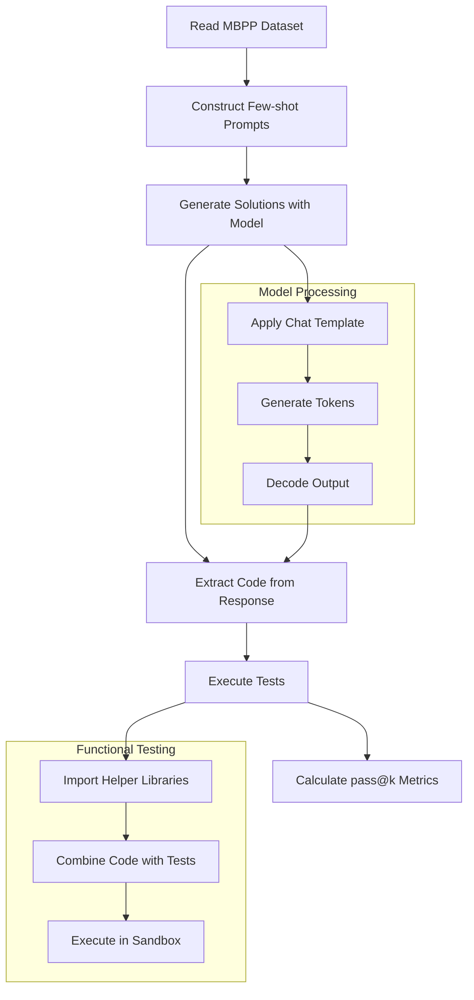
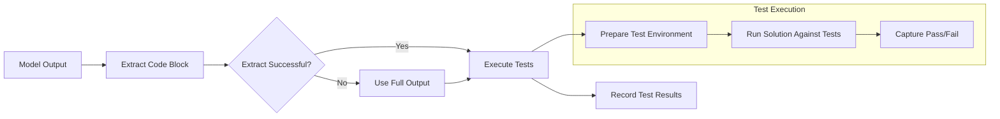
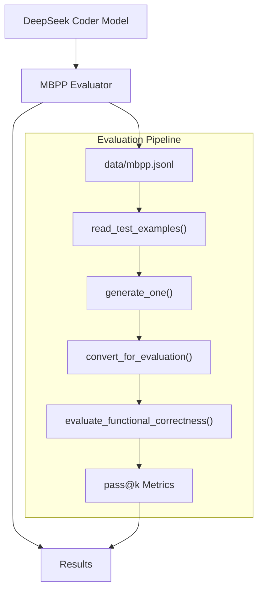

<!-- source: DeepWiki mcp.deepwiki.com · repo deepseek-ai/DeepSeek-Coder · page 4.2 MBPP Benchmark · fetched 2026-10-30 -->

# MBPP Benchmark

<details>
<summary>Relevant source files</summary>

The following files were used as context for generating this wiki page:

- [Evaluation/MBPP/eval_instruct.py](Evaluation/MBPP/eval_instruct.py)
- [Evaluation/MBPP/human_eval/evaluation.py](Evaluation/MBPP/human_eval/evaluation.py)

</details>


## Purpose and Scope

This document details the MBPP (Mostly Basic Python Problems) benchmark implementation in DeepSeek Coder. MBPP is a standard benchmark for evaluating code generation capabilities of language models specifically focused on basic Python programming tasks. The benchmark tests a model's ability to generate functionally correct Python code based on natural language problem descriptions and test cases.

For information about other evaluation benchmarks used in DeepSeek Coder, see [HumanEval Benchmark](#4.1) and [LeetCode Evaluation](#4.3).

## Overview of the MBPP Dataset

The MBPP benchmark in DeepSeek Coder uses a dataset of Python programming problems, each consisting of:

- A task identifier
- A natural language problem description
- A list of test cases
- A reference solution (for evaluation purposes)

The evaluation focuses on problems from index 10 to 509 in the dataset, while using problems 1-3 as few-shot examples to guide the model.

Sources: [Evaluation/MBPP/eval_instruct.py:14-51]()

### Dataset Structure

```mermaid
classDiagram
    class "MBPP Dataset" {
        mbpp.jsonl
        mbpp_test.jsonl
    }
    
    class "Problem Example" {
        task_id: String
        text: String
        test_list: String[]
        code: String
    }
    
    class "Evaluation Input" {
        task_id: String
        prompt: String
    }
    
    class "Evaluation Output" {
        task_id: String
        prompt: String
        gpt_completion: String
        generation: String
    }
    
    "MBPP Dataset" --> "Problem Example" : contains
    "Problem Example" --> "Evaluation Input" : processed into
    "Evaluation Input" --> "Evaluation Output" : model generates
```

Sources: [Evaluation/MBPP/eval_instruct.py:22-51](), [Evaluation/MBPP/eval_instruct.py:86-119]()

## Evaluation Process

The MBPP benchmark evaluation follows a systematic process to test code generation models:

### Prompt Construction

The system constructs prompts with few-shot examples to guide the model. Each prompt includes:

1. Three example problems (index 1-3) with their descriptions, test cases, and solutions
2. The target problem description and test cases (without solution)

The prompt structure uses a consistent template that encourages the model to generate a Python function for the given problem based on the examples provided.

Sources: [Evaluation/MBPP/eval_instruct.py:14-51]()

### Code Generation and Evaluation Flow



Sources: [Evaluation/MBPP/eval_instruct.py:65-87](), [Evaluation/MBPP/eval_instruct.py:118-129](), [Evaluation/MBPP/human_eval/evaluation.py:195-295]()

## Key Components

### Prompt Template Structure

The system uses a specific template for prompting the model:

```
Please refer the given examples and generate a python function for my problem.
Examples are listed as follows:
- Example 1:
>>> Problem:
[problem description]
>>> Test Cases:
[test cases]
>>> Code:
```python
[solution code]
```

- Example 2:
...

- Example 3:
...

Here is my problem:
>>> Problem:
[target problem description]
>>> Test Cases:
[target test cases]
```

This structured format helps the model understand the expected output format and provides reference examples.

Sources: [Evaluation/MBPP/eval_instruct.py:40-47]()

### Code Extraction and Testing



The system attempts to extract code blocks surrounded by Python markdown tags (```python ... ```) from the model's output. If extraction fails, the entire model output is used as the solution code. The solution is then evaluated for functional correctness.

Sources: [Evaluation/MBPP/eval_instruct.py:53-63](), [Evaluation/MBPP/human_eval/evaluation.py:113-176]()

## Metrics

### pass@k Evaluation

The MBPP benchmark uses the pass@k metric, which estimates the probability that at least one of k independent generations will pass all test cases. For example:

- pass@1: The probability that a single generation passes all tests
- pass@10: The probability that at least one of 10 generations passes all tests
- pass@100: The probability that at least one of 100 generations passes all tests

The metric is calculated using the formula:

```
pass@k = 1 - comb(n - c, k) / comb(n, k)
```

Where:
- n is the number of samples per problem
- c is the number of correct samples
- k is the number of generations to consider

Sources: [Evaluation/MBPP/human_eval/evaluation.py:88-111](), [Evaluation/MBPP/human_eval/evaluation.py:279-295]()

## Usage Guide

To run the MBPP evaluation on a DeepSeek Coder model, use the `eval_instruct.py` script with the following parameters:

| Parameter | Description |
|-----------|-------------|
| `--model` | Model name or path (e.g., "deepseek-ai/deepseek-coder-6.7b-instruct") |
| `--output_path` | Path to save generation results |
| `--temp_dir` | Temporary directory for evaluation (default: "tmp") |

Example command:

```bash
python Evaluation/MBPP/eval_instruct.py --model deepseek-ai/deepseek-coder-6.7b-instruct --output_path results/mbpp_results.jsonl --temp_dir tmp_mbpp
```

Sources: [Evaluation/MBPP/eval_instruct.py:131-139]()

## System Integration



The MBPP benchmark integrates with the larger DeepSeek Coder evaluation system, providing standardized metrics that can be compared with other code generation models. The evaluation results help in assessing the model's Python code generation capabilities and identifying areas for improvement.

Sources: [Evaluation/MBPP/eval_instruct.py:89-129]()

---

