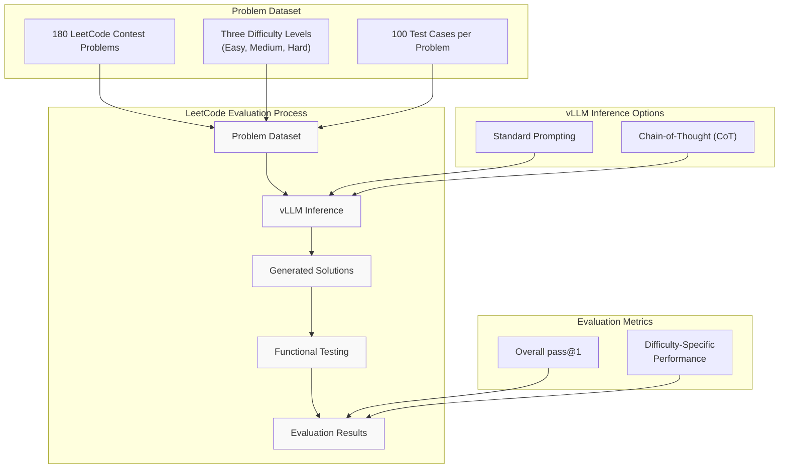
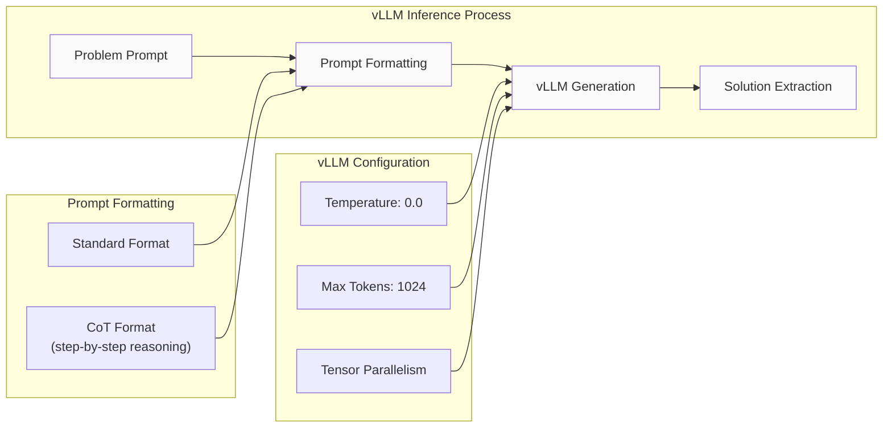
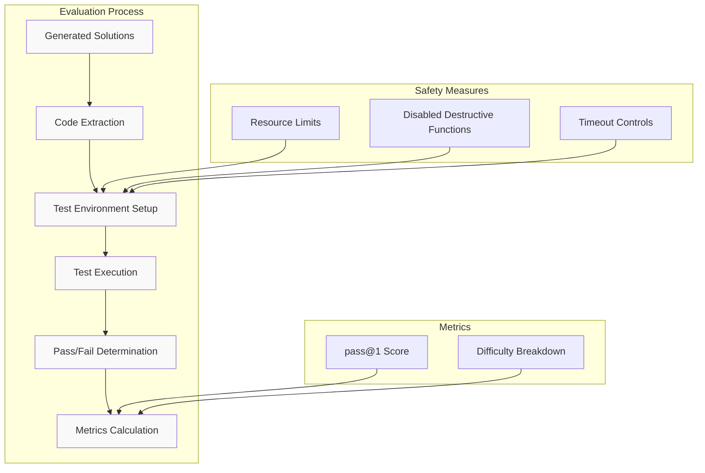
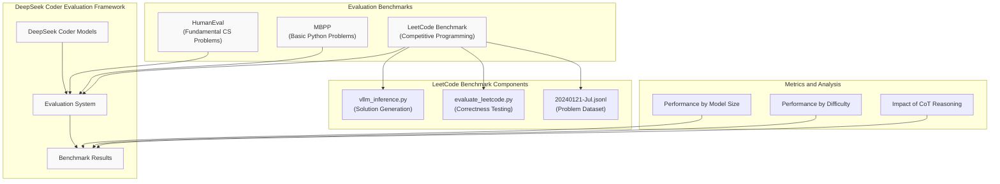

<!-- source: DeepWiki mcp.deepwiki.com · repo deepseek-ai/DeepSeek-Coder · page 4.3 LeetCode Evaluation · fetched 2026-10-30 -->

# LeetCode Evaluation

<details>
<summary>Relevant source files</summary>

The following files were used as context for generating this wiki page:

- [Evaluation/LeetCode/data/20240121-Jul.jsonl](Evaluation/LeetCode/data/20240121-Jul.jsonl)
- [Evaluation/LeetCode/evaluate_leetcode.py](Evaluation/LeetCode/evaluate_leetcode.py)
- [Evaluation/LeetCode/human_eval/evaluation.py](Evaluation/LeetCode/human_eval/evaluation.py)
- [Evaluation/LeetCode/human_eval/execution.py](Evaluation/LeetCode/human_eval/execution.py)
- [Evaluation/LeetCode/readme.md](Evaluation/LeetCode/readme.md)
- [Evaluation/LeetCode/vllm_inference.py](Evaluation/LeetCode/vllm_inference.py)

</details>


This document describes the LeetCode evaluation framework within the DeepSeek Coder system. It explains how real-world programming problems from LeetCode contests are used to benchmark model performance, the evaluation process, and experimental results. For information about other evaluation benchmarks, see [HumanEval Benchmark](#4.1) and [MBPP Benchmark](#4.2).

## 1. Overview

The LeetCode evaluation framework provides a challenging benchmark using competition-level problems from LeetCode contests to test the model's capability in solving complex, real-world programming tasks. Unlike synthetic benchmarks, these problems require advanced problem-solving skills and algorithm knowledge, making them an excellent test for code generation models.

The benchmark consists of 180 problems collected from LeetCode contests between July 2023 and January 2024, carefully selected to ensure they weren't included in the model's pre-training data. Problems span three difficulty levels (Easy, Medium, Hard) and come with comprehensive test cases to verify functional correctness.

Sources: [Evaluation/LeetCode/readme.md:1-3]()

## 2. Evaluation Framework

The LeetCode evaluation process follows a two-stage pipeline: code generation followed by functional correctness testing. The framework supports both standard inference and Chain-of-Thought (CoT) reasoning approaches.

### 2.1 Dataset Structure

Each problem in the dataset includes:

- Task ID: Unique identifier for the problem
- URL: Link to the original LeetCode problem
- Title: Problem name
- Meta information: Difficulty level, question ID, etc.
- Prompt: Problem description including examples and constraints
- Test cases: Comprehensive test suite to verify solution correctness

The problems are stored in JSONL format in the repository.

Sources: [Evaluation/LeetCode/data/20240121-Jul.jsonl:1-3]()

### 2.2 Evaluation Pipeline



Sources: [Evaluation/LeetCode/readme.md:5-21](), [Evaluation/LeetCode/vllm_inference.py:1-85](), [Evaluation/LeetCode/evaluate_leetcode.py:1-87]()

## 3. Implementation Details

### 3.1 Inference System with vLLM

The code generation phase uses vLLM (a high-throughput inference engine) to generate solutions for the LeetCode problems. The system supports both standard prompting and Chain-of-Thought (CoT) prompting, which encourages step-by-step reasoning before providing the final solution.



The inference system:
- Takes a model path and problem dataset as input
- Formats prompts according to the model's expected format
- Configures vLLM with appropriate parameters for efficient generation
- Generates code solutions using zero-temperature sampling
- Saves the generated solutions for evaluation

For Chain-of-Thought inference, an additional prompt component is added: "You need first write a step-by-step outline and then write the code."

Sources: [Evaluation/LeetCode/vllm_inference.py:1-85]()

### 3.2 Evaluation Mechanism

After code generation, the `evaluate_leetcode.py` script processes the generated solutions and evaluates their functional correctness. The evaluation process:

1. Extracts Python code from the generated text
2. Creates a test environment with the necessary imports and setup
3. Executes the solution against the test cases
4. Determines if the solution passes all test cases
5. Calculates metrics including pass@1 and difficulty-specific performance

The system uses a modified version of the `human_eval` framework to evaluate the solutions, with safeguards to prevent malicious code execution.



Sources: [Evaluation/LeetCode/evaluate_leetcode.py:1-87](), [Evaluation/LeetCode/human_eval/evaluation.py:1-305](), [Evaluation/LeetCode/human_eval/execution.py:1-731]()

## 4. Performance Metrics and Results

### 4.1 Evaluation Metrics

The primary metric used for evaluation is pass@1, which measures the percentage of problems for which the model generates a correct solution on the first attempt. Results are also broken down by difficulty level (Easy, Medium, Hard) to provide more detailed performance insights.

### 4.2 Experimental Results

The table below shows the performance of various models on the LeetCode Contest benchmark:

| Model | Size | Easy (45) | Medium (91) | Hard (44) | Overall (180) |
|-------|------|-----------|-------------|-----------|---------------|
| WizardCoder-V1.0 | 15B | 17.8% | 1.1% | 0.0% | 5.0% |
| CodeLlama-Instruct | 34B | 24.4% | 4.4% | 4.5% | 9.4% |
| Phind-CodeLlama-V2 | 34B | 26.7% | 8.8% | 9.1% | 13.3% |
| GPT-3.5-Turbo | - | 46.7% | 15.4% | 15.9% | 23.3% |
| GPT-3.5-Turbo + CoT | - | 42.2% | 15.4% | 20.5% | 23.3% |
| GPT-4-Turbo | - | 73.3% | 31.9% | 25.0% | 40.6% |
| GPT-4-Turbo + CoT | - | 71.1% | 35.2% | 25.0% | 41.8% |
| DeepSeek-Coder-Instruct | 1.3B | 22.2% | 1.1% | 4.5% | 7.2% |
| DeepSeek-Coder-Instruct + CoT | 1.3B | 22.2% | 2.2% | 2.3% | 7.2% |
| DeepSeek-Coder-Instruct | 6.7B | 44.4% | 12.1% | 9.1% | 19.4% |
| DeepSeek-Coder-Instruct + CoT | 6.7B | 44.4% | 17.6% | 4.5% | 21.1% |
| DeepSeek-Coder-Instruct | 33B | 57.8% | 22.0% | 9.1% | 27.8% |
| DeepSeek-Coder-Instruct + CoT | 33B | 53.3% | 25.3% | 11.4% | 28.9% |

Key observations:
- Performance generally improves with model size
- Easy problems have higher success rates than Medium and Hard problems
- Chain-of-Thought (CoT) reasoning improves performance on Medium problems for most models
- DeepSeek-Coder-33B achieves competitive performance against other open-source models

Sources: [Evaluation/LeetCode/readme.md:28-48]()

## 5. Usage Instructions

To evaluate a model on the LeetCode benchmark, follow these two steps:

### 5.1 Generate Solutions

First, generate solutions using the `vllm_inference.py` script:

```bash
cd Evaluation/LeetCode

# Set the model path
MODEL="deepseek-ai/deepseek-coder-7b-instruct"

# Standard prompting
python vllm_inference.py --model_name_or_path $MODEL --saved_path output/20240121-Jul.deepseek-coder-7b-instruct.jsonl

# Or, with Chain-of-Thought prompting
python vllm_inference.py --model_name_or_path $MODEL --saved_path output/20240121-Jul.deepseek-coder-7b-instruct.jsonl --cot
```

This script:
1. Loads problems from the dataset file
2. Formats prompts for the specified model
3. Configures vLLM with appropriate parameters
4. Generates solutions for each problem
5. Saves the generated solutions to the specified output file

Sources: [Evaluation/LeetCode/readme.md:5-21](), [Evaluation/LeetCode/vllm_inference.py:32-67]()

### 5.2 Evaluate Solutions

After generating solutions, evaluate their correctness using the `evaluate_leetcode.py` script:

```bash
python evaluate_leetcode.py --generation_path output/20240121-Jul.deepseek-coder-7b-instruct.jsonl --result_path output/20240121-Jul.deepseek-coder-7b-instruct.result.jsonl
```

This script:
1. Reads the generated solutions
2. Extracts code from the model outputs
3. Executes each solution against test cases
4. Calculates the pass@1 metric and difficulty-specific performance
5. Outputs results to the console and a specified result file

Sources: [Evaluation/LeetCode/readme.md:22-26](), [Evaluation/LeetCode/evaluate_leetcode.py:21-73]()

## 6. Integration with DeepSeek Coder System

The LeetCode evaluation framework is one component of the broader evaluation system in DeepSeek Coder, complementing other benchmarks like HumanEval and MBPP. Together, these benchmarks provide a comprehensive assessment of model capabilities across different types of coding tasks.



The LeetCode evaluation:
- Focuses on competitive programming problems, complementing the more general-purpose problems in HumanEval and MBPP
- Features a higher proportion of complex algorithmic challenges
- Includes problems categorized by difficulty level
- Provides insights into model performance on real-world coding challenges

Sources: [Evaluation/LeetCode/readme.md:1-3]()

## 7. Conclusion

The LeetCode evaluation framework provides a rigorous benchmark for assessing the capabilities of code generation models on competitive programming problems. The results demonstrate that while smaller models struggle with complex algorithmic tasks, larger models like DeepSeek-Coder-33B can achieve reasonable performance on these challenging problems.

Chain-of-Thought prompting shows promise for improving performance on medium-difficulty problems, suggesting that encouraging step-by-step reasoning can help models tackle more complex algorithmic challenges. The framework's integration with vLLM enables efficient solution generation, making it practical to evaluate large models on substantial problem sets.

As the field progresses, this benchmark will continue to serve as an important measure of how well code generation models can handle the types of algorithmic challenges encountered in real-world programming competitions.

Sources: [Evaluation/LeetCode/readme.md:28-48]()

---

