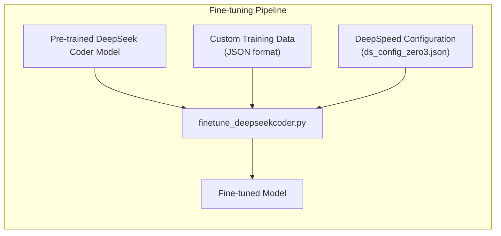
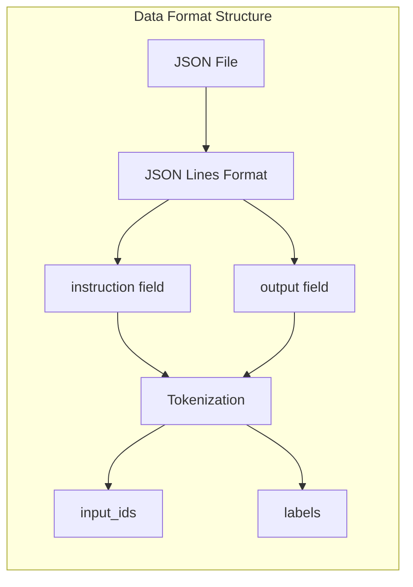
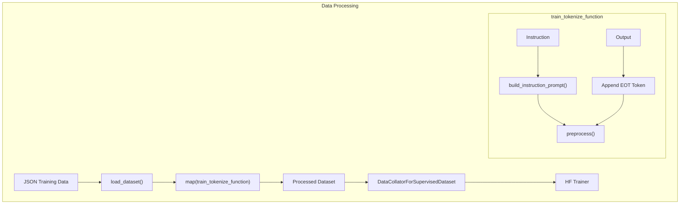
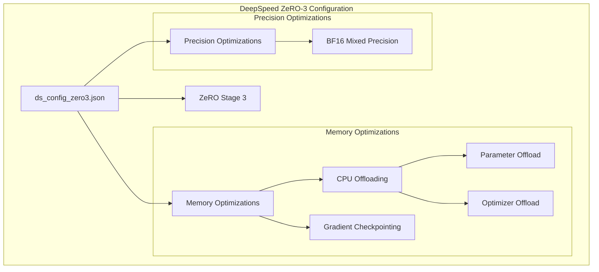
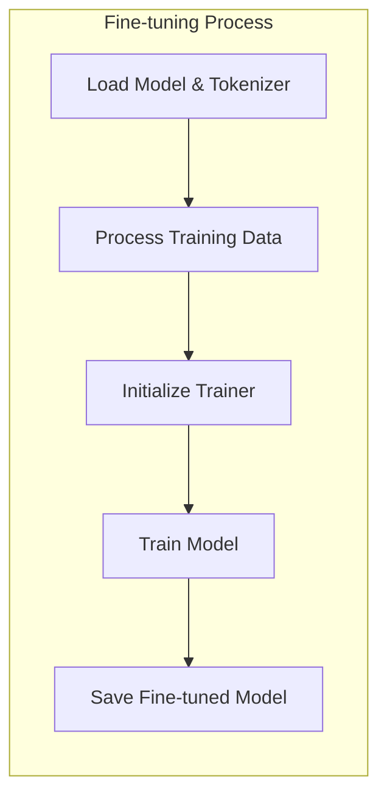

<!-- source: DeepWiki mcp.deepwiki.com · repo deepseek-ai/DeepSeek-Coder · page 5 Fine-tuning · fetched 2026-10-30 -->

# Fine-tuning

<details>
<summary>Relevant source files</summary>

The following files were used as context for generating this wiki page:

- [finetune/README.md](finetune/README.md)
- [finetune/configs/ds_config_zero3.json](finetune/configs/ds_config_zero3.json)
- [finetune/finetune_deepseekcoder.py](finetune/finetune_deepseekcoder.py)
- [finetune/requirements.txt](finetune/requirements.txt)

</details>


This page provides a comprehensive guide to fine-tuning DeepSeek Coder models for specific tasks or domains. The fine-tuning system leverages DeepSpeed for efficient training on custom datasets, enabling users to adapt pre-trained models to their particular use cases while optimizing computational resources.

For information about the available DeepSeek Coder models, see [Models](#2). For details on using the fine-tuned models for inference, see [Usage and Inference Methods](#3).

## Overview of Fine-tuning Architecture

The DeepSeek Coder fine-tuning system enables adaptation of pre-trained models to specific tasks using an optimized training pipeline based on DeepSpeed Zero3. The system is designed to be efficient for large language models while providing flexibility in terms of data formats and training configurations.



Sources: [finetune/README.md:3-16](), [finetune/finetune_deepseekcoder.py:121-189]()

## Prerequisites and Setup

Before fine-tuning DeepSeek Coder models, you need to install the required dependencies:

```
pip install -r requirements.txt
```

The key dependencies include:

| Package | Version | Purpose |
|---------|---------|---------|
| torch | 2.0.1 | Deep learning framework |
| transformers | 4.35.0 | Hugging Face Transformers library |
| accelerate | 0.24.1 | Distributed training utilities |
| deepspeed | 0.12.2 | Optimization library for efficient training |
| tokenizers | 0.14.0 | Fast tokenization |
| datasets | - | Data handling utilities |
| tensorboardX | - | Training visualization |

Sources: [finetune/requirements.txt](), [finetune/README.md:5-9]()

## Data Preparation

DeepSeek Coder fine-tuning requires data in a specific JSON format:



Each line in the training data file should be a JSON-serialized string containing two required fields:
- `instruction`: The input prompt or instruction
- `output`: The expected model response

The script processes these fields by:
1. Wrapping the instruction in a standardized prompt template
2. Appending the output with an EOT (End-of-Text) token
3. Tokenizing the combined text
4. Creating label tensors with appropriate masking for model training

Sources: [finetune/README.md:11-13](), [finetune/finetune_deepseekcoder.py:16-22](), [finetune/finetune_deepseekcoder.py:112-119]()

## Data Processing Workflow

The following diagram illustrates how the input data is processed during the fine-tuning pipeline:



Sources: [finetune/finetune_deepseekcoder.py:50-119](), [finetune/finetune_deepseekcoder.py:153-183]()

## Fine-tuning Configuration

The fine-tuning process is configured through several parameter groups:

### Model Arguments

| Parameter | Description | Default |
|-----------|-------------|---------|
| model_name_or_path | Path or identifier of the pre-trained model | deepseek-ai/deepseek-coder-6.7b-instruct |

### Data Arguments

| Parameter | Description | Default |
|-----------|-------------|---------|
| data_path | Path to the training data file | None |

### Training Arguments

| Parameter | Description | Recommended Setting |
|-----------|-------------|---------------------|
| output_dir | Directory to save model checkpoints | - |
| num_train_epochs | Number of training epochs | 3 |
| model_max_length | Maximum sequence length | 1024 |
| per_device_train_batch_size | Batch size per device | 16 |
| gradient_accumulation_steps | Number of steps for gradient accumulation | 4 |
| learning_rate | Learning rate | 2e-5 |
| warmup_steps | Steps for learning rate warmup | 10 |
| lr_scheduler_type | Learning rate scheduler | cosine |
| gradient_checkpointing | Whether to use gradient checkpointing | True |
| bf16 | Whether to use BF16 precision | True |

Sources: [finetune/README.md:18-44](), [finetune/finetune_deepseekcoder.py:24-40]()

## DeepSpeed Integration

DeepSeek Coder's fine-tuning system leverages DeepSpeed's ZeRO-3 optimization for efficient training, particularly for large models. The architecture of the DeepSpeed integration is shown below:



The DeepSpeed configuration offers several optimization features:

1. **ZeRO Stage 3**: Full parameter, gradient, and optimizer partitioning
2. **CPU Offloading**: Offloads parameters and optimizer states to CPU when not needed
3. **Mixed Precision Training**: Uses BF16 for improved computational efficiency
4. **Gradient Checkpointing**: Reduces memory usage by recomputing activations during backward pass

Sources: [finetune/configs/ds_config_zero3.json](), [finetune/README.md:42]()

## Running the Fine-tuning Process

The fine-tuning process is executed using the DeepSpeed command-line interface with the `finetune_deepseekcoder.py` script:



A sample command to run the fine-tuning process:

```bash
deepspeed finetune_deepseekcoder.py \
    --model_name_or_path "deepseek-ai/deepseek-coder-6.7b-instruct" \
    --data_path "<your_data_path>" \
    --output_dir "<your_output_path>" \
    --num_train_epochs 3 \
    --model_max_length 1024 \
    --per_device_train_batch_size 16 \
    --gradient_accumulation_steps 4 \
    --learning_rate 2e-5 \
    --warmup_steps 10 \
    --lr_scheduler_type "cosine" \
    --gradient_checkpointing True \
    --deepspeed configs/ds_config_zero3.json \
    --bf16 True
```

Sources: [finetune/README.md:18-44](), [finetune/finetune_deepseekcoder.py:121-193]()

## Implementation Details

The fine-tuning implementation consists of several key components:

1. **Prompt Construction**: The `build_instruction_prompt` function formats instructions with a standardized template:
   ```
   You are an AI programming assistant...
   ### Instruction:
   <user instruction>
   ### Response:
   ```

2. **Data Preprocessing**: The tokenization and preprocessing pipeline handles:
   - Converting raw JSON data into tokenized sequences
   - Creating masked labels for training (masking prompt tokens)
   - Handling padding and truncation

3. **Training Logic**: The script initializes the model, tokenizer, dataset, and trainer, leveraging Hugging Face's `Trainer` class with DeepSpeed integration.

4. **Model Saving**: The `safe_save_model_for_hf_trainer` function ensures models are properly saved, handling distributed training scenarios.

Sources: [finetune/finetune_deepseekcoder.py:16-22](), [finetune/finetune_deepseekcoder.py:42-120](), [finetune/finetune_deepseekcoder.py:184-189]()

## Practical Considerations

When fine-tuning DeepSeek Coder models, consider the following recommendations:

1. **Hardware Requirements**: 
   - For 6.7B models: At least 4 GPUs with 24GB+ VRAM each is recommended with ZeRO-3
   - For 33B models: 8+ GPUs with 40GB+ VRAM each is recommended

2. **Hyperparameter Selection**:
   - Start with a lower learning rate (1e-5 to 5e-5) for stable training
   - Adjust batch size and gradient accumulation steps based on available memory
   - Monitor training loss to identify potential issues

3. **Data Quality**:
   - Ensure high-quality instruction-output pairs for effective fine-tuning
   - Balance the dataset for the specific programming languages or tasks of interest

4. **Evaluation**:
   - Test fine-tuned models on relevant benchmarks to verify improvements
   - For code generation, consider functional correctness tests on validation examples

Sources: [finetune/README.md:14-17](), [finetune/finetune_deepseekcoder.py:176-180]()

## Related Topics

For more detailed information about specific aspects of fine-tuning, refer to:

- [DeepSpeed Setup](#5.1) - Detailed instructions for configuring DeepSpeed for optimal performance
- [Training Data Format](#5.2) - In-depth documentation on preparing training data
- [Training Process](#5.3) - Step-by-step guide to the fine-tuning process

---

