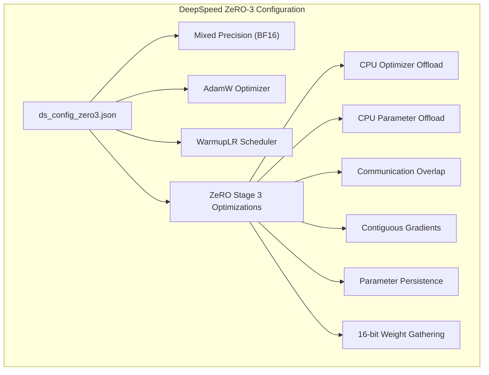
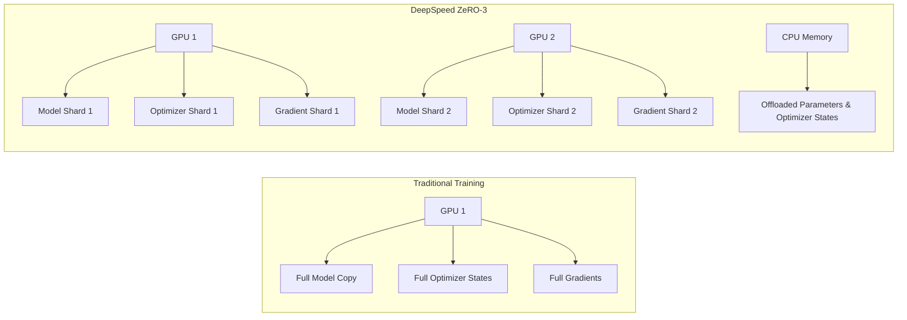
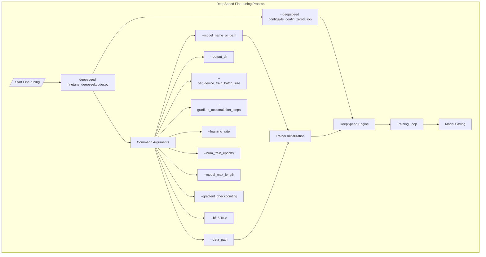
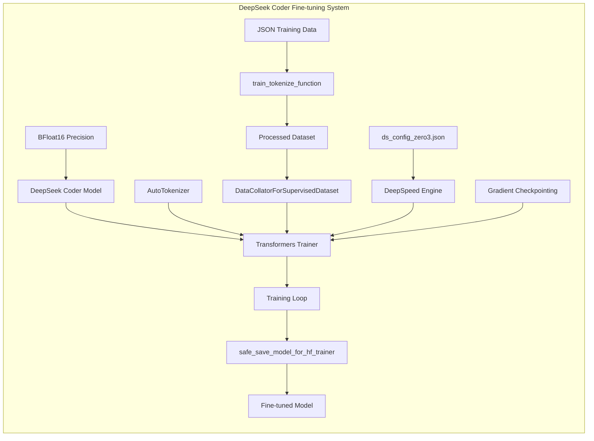

<!-- source: DeepWiki mcp.deepwiki.com · repo deepseek-ai/DeepSeek-Coder · page 5.1 DeepSpeed Setup · fetched 2026-10-30 -->

# DeepSpeed Setup

<details>
<summary>Relevant source files</summary>

The following files were used as context for generating this wiki page:

- [finetune/README.md](finetune/README.md)
- [finetune/configs/ds_config_zero3.json](finetune/configs/ds_config_zero3.json)
- [finetune/finetune_deepseekcoder.py](finetune/finetune_deepseekcoder.py)
- [finetune/requirements.txt](finetune/requirements.txt)

</details>


This document provides detailed instructions for setting up and configuring DeepSpeed to efficiently fine-tune DeepSeek Coder models. DeepSpeed is a deep learning optimization library that enables training of large language models with memory and computational optimizations. This guide focuses specifically on the Zero-3 optimization setup for DeepSeek Coder fine-tuning.

For information about the training data format, see [Training Data Format](#5.2).
For information about the full training process, see [Training Process](#5.3).

## Installation Requirements

To fine-tune DeepSeek Coder models using DeepSpeed, you need to install the following dependencies:

```bash
pip install -r requirements.txt
```

The key dependencies include:

| Dependency | Version | Purpose |
|------------|---------|---------|
| torch | 2.0.1 | PyTorch framework |
| transformers | 4.35.0 | Hugging Face Transformers library |
| deepspeed | 0.12.2 | DeepSpeed optimization library |
| accelerate | 0.24.1 | Hugging Face's training acceleration library |
| tensorboardX | - | For training metrics visualization |

Sources: [finetune/requirements.txt:1-11]()

## DeepSpeed Configuration

DeepSeek Coder uses DeepSpeed's Zero Redundancy Optimizer (ZeRO) Stage 3 for efficient model fine-tuning. This configuration is defined in the `ds_config_zero3.json` file.

### ZeRO-3 Configuration Explained



The DeepSpeed configuration file contains several key settings that optimize the fine-tuning process:

| Setting | Value | Purpose |
|---------|-------|---------|
| `bf16.enabled` | "auto" | Enables BFloat16 precision when supported by hardware |
| `zero_optimization.stage` | 3 | Enables ZeRO Stage 3 with parameter partitioning |
| `offload_optimizer.device` | "cpu" | Offloads optimizer states to CPU memory |
| `offload_param.device` | "cpu" | Offloads model parameters to CPU memory |
| `overlap_comm` | true | Overlaps communication with computation |
| `contiguous_gradients` | true | Uses contiguous memory for gradients |
| `stage3_gather_16bit_weights_on_model_save` | true | Gathers 16-bit weights when saving |

Sources: [finetune/configs/ds_config_zero3.json:1-51]()

## Memory Management in DeepSpeed ZeRO-3



DeepSpeed ZeRO-3 partitions model parameters, gradients, and optimizer states across GPUs and can offload to CPU memory. This significantly reduces the GPU memory footprint, enabling fine-tuning of large models like DeepSeek Coder 33B on limited hardware.

Sources: [finetune/configs/ds_config_zero3.json:24-43]()

## Running Fine-tuning with DeepSpeed

To fine-tune a DeepSeek Coder model using DeepSpeed, use the `finetune_deepseekcoder.py` script with the appropriate DeepSpeed configuration:



### Example Command

```bash
DATA_PATH="<your_data_path>"
OUTPUT_PATH="<your_output_path>"
MODEL_PATH="deepseek-ai/deepseek-coder-6.7b-instruct"

deepspeed finetune_deepseekcoder.py \
    --model_name_or_path $MODEL_PATH \
    --data_path $DATA_PATH \
    --output_dir $OUTPUT_PATH \
    --num_train_epochs 3 \
    --model_max_length 1024 \
    --per_device_train_batch_size 16 \
    --per_device_eval_batch_size 1 \
    --gradient_accumulation_steps 4 \
    --evaluation_strategy "no" \
    --save_strategy "steps" \
    --save_steps 100 \
    --save_total_limit 100 \
    --learning_rate 2e-5 \
    --warmup_steps 10 \
    --logging_steps 1 \
    --lr_scheduler_type "cosine" \
    --gradient_checkpointing True \
    --report_to "tensorboard" \
    --deepspeed configs/ds_config_zero3.json \
    --bf16 True
```

Sources: [finetune/README.md:14-44]()

### Key Command Parameters

| Parameter | Description |
|-----------|-------------|
| `--model_name_or_path` | Path or HF Hub ID of the model to fine-tune |
| `--data_path` | Path to the training data file (JSON format) |
| `--output_dir` | Directory to save the fine-tuned model |
| `--num_train_epochs` | Number of training epochs |
| `--model_max_length` | Maximum sequence length for training |
| `--per_device_train_batch_size` | Batch size per GPU |
| `--gradient_accumulation_steps` | Number of updates before optimizer step |
| `--learning_rate` | Learning rate for optimizer |
| `--gradient_checkpointing` | Memory optimization technique |
| `--deepspeed` | Path to DeepSpeed configuration file |
| `--bf16` | Enable BFloat16 precision training |

Sources: [finetune/README.md:14-44](), [finetune/finetune_deepseekcoder.py:122-193]()

## Fine-tuning System Architecture



The fine-tuning system combines Hugging Face's Trainer API with DeepSpeed's optimization techniques. The script `finetune_deepseekcoder.py` handles data preprocessing, model initialization, and training loop integration with DeepSpeed.

Sources: [finetune/finetune_deepseekcoder.py:121-193]()

## Memory Optimization Strategies

DeepSpeed combines several memory optimization techniques to enable efficient fine-tuning:

1. **ZeRO Stage 3**:
   - Partitions model parameters, gradients, and optimizer states
   - Only materializes parameters when needed for computation

2. **CPU Offloading**:
   - Offloads parameters and optimizer states to CPU memory
   - Uses pinned memory for faster CPU-GPU transfers

3. **Mixed Precision Training**:
   - Uses BF16 precision for model parameters and activations
   - Reduces memory footprint and increases computational efficiency

4. **Gradient Checkpointing**:
   - Trades computation for memory by recomputing activations in the backward pass
   - Enabled in the training script with `--gradient_checkpointing True`

These optimizations together allow fine-tuning of large models like DeepSeek Coder 33B on hardware with limited GPU memory.

Sources: [finetune/configs/ds_config_zero3.json:1-51](), [finetune/README.md:14-44]()

## Troubleshooting and Optimization

When fine-tuning with DeepSpeed, consider the following adjustments if you encounter issues:

- Reduce batch size or increase gradient accumulation steps if you run out of memory
- Adjust offload settings in the DeepSpeed config to balance between GPU usage and training speed
- If your GPU supports BF16, ensure it's enabled for optimal performance
- Monitor training with TensorBoard using the `--report_to "tensorboard"` flag

For large models (33B parameters), you may need multiple high-memory GPUs or adjust the configuration to increase CPU offloading at the cost of training speed.

Sources: [finetune/README.md:14-44](), [finetune/configs/ds_config_zero3.json:24-43]()

---

