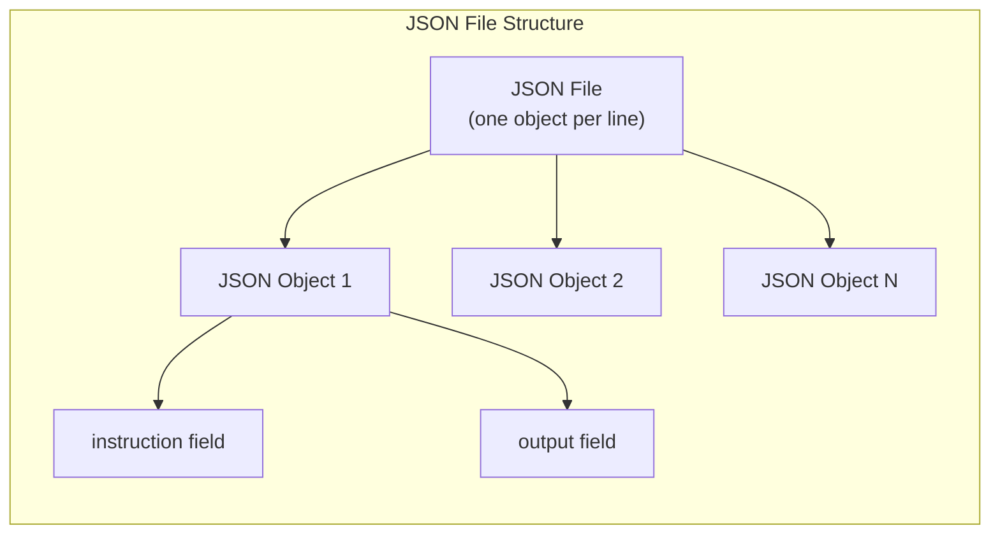
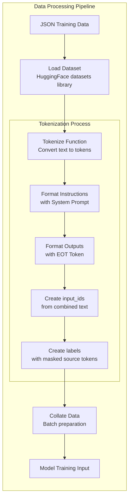
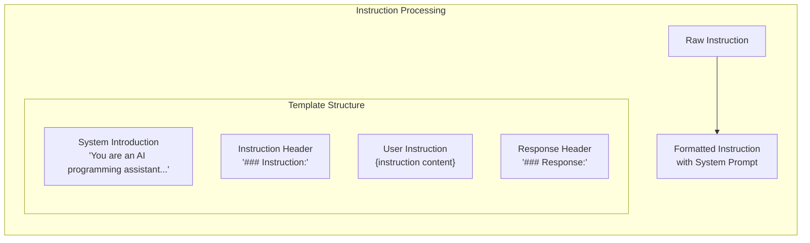
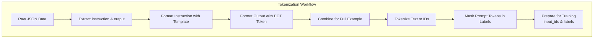
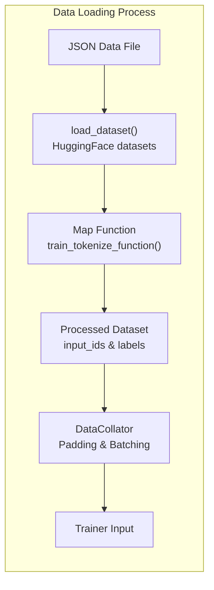

<!-- source: DeepWiki mcp.deepwiki.com · repo deepseek-ai/DeepSeek-Coder · page 5.2 Training Data Format · fetched 2026-10-30 -->

# Training Data Format

<details>
<summary>Relevant source files</summary>

The following files were used as context for generating this wiki page:

- [finetune/README.md](finetune/README.md)
- [finetune/configs/ds_config_zero3.json](finetune/configs/ds_config_zero3.json)
- [finetune/finetune_deepseekcoder.py](finetune/finetune_deepseekcoder.py)
- [finetune/requirements.txt](finetune/requirements.txt)

</details>


This page documents the required data format and preparation process for fine-tuning DeepSeek Coder models. For information about the fine-tuning process itself, see [Training Process](#5.3), and for DeepSpeed configuration, see [DeepSpeed Setup](#5.1).

## Overview

DeepSeek Coder models can be fine-tuned on custom datasets to adapt them to specific domains, programming languages, or code generation styles. The fine-tuning process requires training data in a specific JSON format. This document explains the required format, how the data is processed during training, and best practices for data preparation.

Sources: [finetune/README.md:11-12]()

## Required Data Format

The training data must be provided as a JSON file where each line contains a JSON object with two required fields:

| Field | Description |
|-------|-------------|
| `instruction` | The input prompt or instruction for the model |
| `output` | The expected code or text response |

### Format Specification



Sources: [finetune/README.md:11-12](), [finetune/finetune_deepseekcoder.py:153-158]()

### Example Data Format

Each line in your training data file should look like this:

```json
{"instruction": "Write a Python function to calculate the Fibonacci sequence", "output": "def fibonacci(n):\n    if n <= 0:\n        return []\n    elif n == 1:\n        return [0]\n    elif n == 2:\n        return [0, 1]\n    fib = [0, 1]\n    for i in range(2, n):\n        fib.append(fib[i-1] + fib[i-2])\n    return fib"}
```

Multiple examples should be provided as separate lines in the file:

```
{"instruction": "Example 1 instruction", "output": "Example 1 output"}
{"instruction": "Example 2 instruction", "output": "Example 2 output"}
...
```

Sources: [finetune/README.md:11-12]()

## Data Processing During Training

When your training data is processed, the system applies several transformations to prepare it for the model:



Sources: [finetune/finetune_deepseekcoder.py:112-119](), [finetune/finetune_deepseekcoder.py:77-90]()

### Instruction Formatting

Each instruction is wrapped in a system prompt template. The `build_instruction_prompt` function adds the necessary context around your instruction:



Sources: [finetune/finetune_deepseekcoder.py:16-22](), [finetune/finetune_deepseekcoder.py:113-116]()

The actual system prompt prepends each instruction with:

```
You are an AI programming assistant, utilizing the DeepSeek Coder model, developed by DeepSeek Company, and you only answer questions related to computer science. For politically sensitive questions, security and privacy issues, and other non-computer science questions, you will refuse to answer.
### Instruction:
{instruction}
### Response:
```

Sources: [finetune/finetune_deepseekcoder.py:16-22]()

### Output Formatting

Each output is appended with a newline and an End-of-Text token (`<|EOT|>`):

```
{output}
<|EOT|>
```

This token signals the end of the model's response during both training and inference.

Sources: [finetune/finetune_deepseekcoder.py:117]()

## Input Processing and Tokenization

The training process includes several key steps to transform the raw data into tokenized inputs suitable for model training:



Sources: [finetune/finetune_deepseekcoder.py:77-90](), [finetune/finetune_deepseekcoder.py:50-74]()

During the tokenization process:

1. Raw instructions and outputs are extracted from the JSON data
2. Instructions are formatted with the system prompt template
3. Outputs are appended with the EOT token
4. The formatted instruction and output are combined
5. The combined text is tokenized into input IDs
6. Labels are created by masking tokens corresponding to the instruction part (replacing them with -100/IGNORE_INDEX)
7. The resulting input_ids and labels are used for training

Sources: [finetune/finetune_deepseekcoder.py:112-119](), [finetune/finetune_deepseekcoder.py:77-90]()

## Data Loading and Batch Processing

The training script uses the Hugging Face `datasets` library to load and process the JSON data file:



Sources: [finetune/finetune_deepseekcoder.py:153-158](), [finetune/finetune_deepseekcoder.py:162-171]()

The data is loaded using:
```python
raw_train_datasets = load_dataset(
    'json',
    data_files=data_args.data_path,
    split="train",
    cache_dir=training_args.cache_dir
)
```

Then processed with the tokenization function:
```python
train_dataset = raw_train_datasets.map(
    train_tokenize_function,
    batched=True,
    batch_size=3000,
    num_proc=32,
    remove_columns=raw_train_datasets.column_names,
    load_from_cache_file=True,
    desc="Running Encoding",
    fn_kwargs={ "tokenizer": tokenizer }
)
```

Sources: [finetune/finetune_deepseekcoder.py:153-158](), [finetune/finetune_deepseekcoder.py:162-171]()

## Data Collation

The `DataCollatorForSupervisedDataset` class handles padding and preparing batches of examples for training:

1. Collects input_ids and labels from multiple examples
2. Pads input_ids sequences to the same length with the pad token
3. Pads labels sequences with IGNORE_INDEX (-100)
4. Creates attention masks based on the padding

Sources: [finetune/finetune_deepseekcoder.py:92-110]()

## Best Practices for Training Data Preparation

When preparing your training data for fine-tuning DeepSeek Coder, consider the following best practices:

1. **Data Quality**: Ensure high-quality examples with correct code solutions
2. **Instruction Variety**: Include a diverse range of instructions covering different programming tasks and complexities
3. **Output Correctness**: Verify that all output code is syntactically correct and runs as expected
4. **Consistent Formatting**: Maintain consistent formatting for code indentation and style
5. **Task Representation**: Balance the dataset with examples representing the tasks you want the model to perform
6. **Language Coverage**: If targeting multiple programming languages, ensure balanced representation
7. **Length Consideration**: Be aware of the model's context length limitations (default is set to 1024 tokens in the example script)

Sources: [finetune/README.md:14-16](), [finetune/finetune_deepseekcoder.py:35-40]()

## Model Maximum Length

The default model maximum length is set to 1024 tokens in the example script, but this can be configured using the `--model_max_length` parameter. Ensure your training examples are within this limit or adjust the parameter accordingly.

```
--model_max_length 1024
```

Sources: [finetune/README.md:28](), [finetune/finetune_deepseekcoder.py:35-40]()

## Sample Dataset Reference

For reference, the README points to a sample dataset format on Hugging Face:
- Dataset: [nickrosh/Evol-Instruct-Code-80k-v1](https://huggingface.co/datasets/nickrosh/Evol-Instruct-Code-80k-v1)

This dataset can serve as a template for structuring your own training data.

Sources: [finetune/README.md:11]()

---

