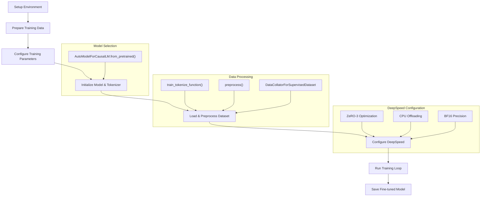
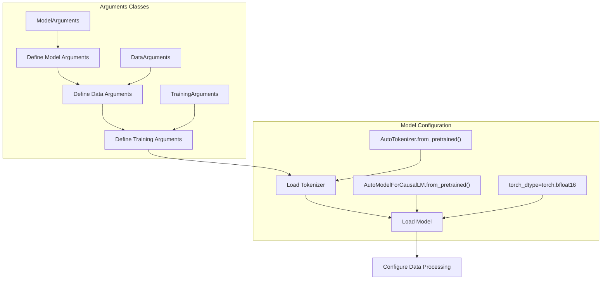
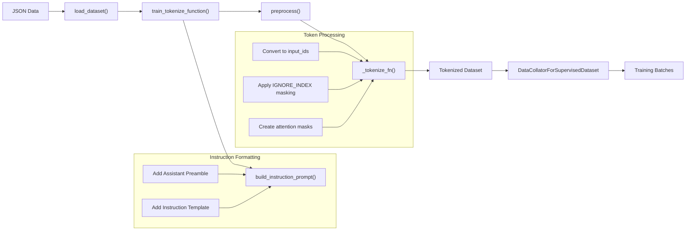
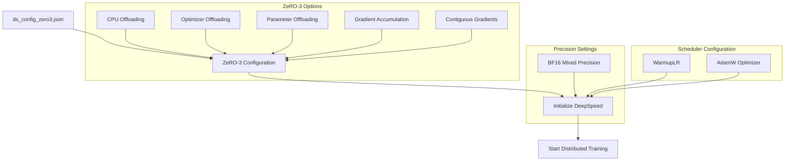
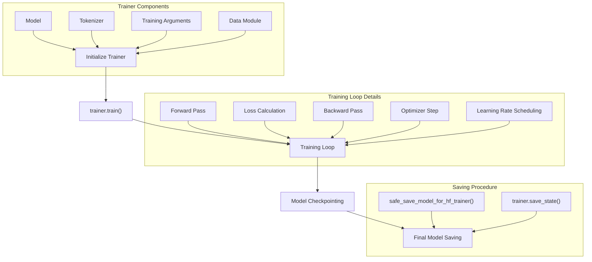
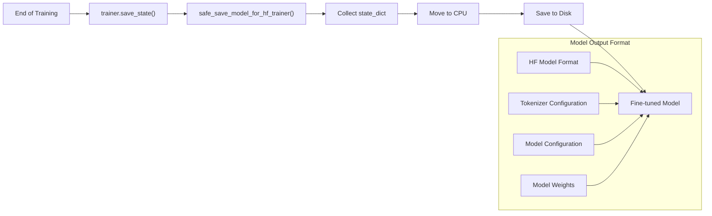

<!-- source: DeepWiki mcp.deepwiki.com · repo deepseek-ai/DeepSeek-Coder · page 5.3 Training Process · fetched 2026-10-30 -->

# Training Process

<details>
<summary>Relevant source files</summary>

The following files were used as context for generating this wiki page:

- [finetune/README.md](finetune/README.md)
- [finetune/configs/ds_config_zero3.json](finetune/configs/ds_config_zero3.json)
- [finetune/finetune_deepseekcoder.py](finetune/finetune_deepseekcoder.py)
- [finetune/requirements.txt](finetune/requirements.txt)

</details>


This page provides a detailed guide to the fine-tuning process for DeepSeek Coder models. It covers the step-by-step procedure for training the models on custom datasets using DeepSpeed with ZeRO-3 optimization. For information about preparing the training data format, see [Training Data Format](#5.2). For DeepSpeed configuration details, see [DeepSpeed Setup](#5.1).

## Training Process Overview

The fine-tuning process for DeepSeek Coder involves several key steps: preparing the environment, configuring training parameters, data preparation, and running the training process with monitoring. The diagram below illustrates this workflow:



Sources: [finetune/finetune_deepseekcoder.py:121-193](), [finetune/README.md:1-44]()

## Prerequisites

Before starting the fine-tuning process, ensure you have the required dependencies installed:

```bash
pip install -r requirements.txt
```

Key dependencies include:

| Dependency | Version | Purpose |
|------------|---------|---------|
| torch | 2.0.1 | PyTorch framework for deep learning |
| transformers | 4.35.0 | Hugging Face Transformers library |
| deepspeed | 0.12.2 | Distributed training optimization |
| accelerate | 0.24.1 | Accelerated training utilities |
| datasets | latest | Data loading and processing |
| tensorboardX | latest | Training visualization |

Sources: [finetune/requirements.txt:1-11]()

## Model Initialization and Configuration

The fine-tuning process begins with initializing the model and tokenizer from a checkpoint. The script supports loading any DeepSeek Coder model, with the default being `deepseek-ai/deepseek-coder-6.7b-instruct`.



The script defines three dataclass configurations:
- `ModelArguments`: Specifies the model path
- `DataArguments`: Specifies the data path
- `TrainingArguments`: Inherits from Hugging Face's `TrainingArguments` with additional parameters

Sources: [finetune/finetune_deepseekcoder.py:24-40](), [finetune/finetune_deepseekcoder.py:129-147]()

## Data Processing Pipeline

The data processing pipeline consists of several steps that transform raw instruction-output pairs into tokenized formats suitable for training:



The data processing steps:

1. Load raw data using `load_dataset()`
2. Apply `train_tokenize_function()` to each example
3. Format instructions with a template via `build_instruction_prompt()`
4. Add appropriate end-of-text (EOT) tokens
5. Tokenize and preprocess with attention to input lengths
6. Create a collator for batching with proper padding

Sources: [finetune/finetune_deepseekcoder.py:50-119](), [finetune/finetune_deepseekcoder.py:153-171]()

## Training Configuration with DeepSpeed

DeepSeek Coder uses DeepSpeed with ZeRO-3 optimization for efficient training of large language models:



The DeepSpeed configuration (`ds_config_zero3.json`) includes:

- ZeRO Stage 3 optimization
- CPU offloading for both optimizer states and parameters
- BF16 mixed precision training
- AdamW optimizer
- Warmup learning rate scheduler
- Automatic configuration of many parameters based on the environment

Sources: [finetune/configs/ds_config_zero3.json:1-51]()

## Running the Training Process

To start the fine-tuning process, use the `deepspeed` command with the `finetune_deepseekcoder.py` script:

| Parameter | Description | Example Value |
|-----------|-------------|---------------|
| model_name_or_path | Path to the base model | deepseek-ai/deepseek-coder-6.7b-instruct |
| data_path | Path to the training data | path/to/training_data.json |
| output_dir | Directory to save outputs | ./output |
| num_train_epochs | Number of training epochs | 3 |
| model_max_length | Maximum sequence length | 1024 |
| per_device_train_batch_size | Batch size per GPU | 16 |
| gradient_accumulation_steps | Steps for gradient accumulation | 4 |
| learning_rate | Learning rate | 2e-5 |
| deepspeed | Path to DeepSpeed config | configs/ds_config_zero3.json |

Example command:

```bash
deepspeed finetune_deepseekcoder.py \
    --model_name_or_path deepseek-ai/deepseek-coder-6.7b-instruct \
    --data_path your_data_path \
    --output_dir your_output_path \
    --num_train_epochs 3 \
    --model_max_length 1024 \
    --per_device_train_batch_size 16 \
    --gradient_accumulation_steps 4 \
    --learning_rate 2e-5 \
    --deepspeed configs/ds_config_zero3.json \
    --bf16 True
```

Sources: [finetune/README.md:18-44](), [finetune/finetune_deepseekcoder.py:185-189]()

## Training Loop and Monitoring

The actual training is handled by Hugging Face's `Trainer` class, which takes care of:



During training, the model performs these steps:
1. Process batches of data according to the configured batch size
2. Calculate losses based on next-token prediction with `IGNORE_INDEX` masking for prompt tokens
3. Update model parameters using DeepSpeed's optimizer
4. Periodically save checkpoints based on the `save_steps` parameter
5. Log training progress with TensorBoard if specified

Sources: [finetune/finetune_deepseekcoder.py:185-189](), [finetune/README.md:32-43]()

## Model Saving and Post-Training Steps

At the end of training, the model is saved using the `safe_save_model_for_hf_trainer()` function, which ensures proper memory management by moving model parameters to CPU before saving.



The saved model follows the Hugging Face Transformers format and can be loaded using `AutoModelForCausalLM.from_pretrained()` for inference or further fine-tuning.

Sources: [finetune/finetune_deepseekcoder.py:42-48](), [finetune/finetune_deepseekcoder.py:188-189]()

## Fine-tuning Recommendations

Based on the provided configuration, here are some recommendations for fine-tuning DeepSeek Coder models:

1. **Hardware Requirements**:
   - For 6.7B models: At least 2-4 GPUs with 24GB+ VRAM each when using ZeRO-3 with offloading
   - For 33B models: 8+ GPUs recommended, or fewer GPUs with extensive CPU offloading

2. **Hyperparameter Settings**:
   - Learning rate: 1e-5 to 5e-5 (2e-5 recommended for most cases)
   - Batch size: Adjust based on available GPU memory
   - Gradient accumulation: Increase for effectively larger batch sizes
   - Training epochs: 2-5 epochs typically sufficient for fine-tuning

3. **DeepSpeed Configuration**:
   - Enable CPU offloading for larger models
   - Use BF16 precision for faster training on supported hardware
   - Adjust `stage3_param_persistence_threshold` for memory/speed tradeoffs

Sources: [finetune/README.md:14-44](), [finetune/configs/ds_config_zero3.json:1-51]()

## Conclusion

The fine-tuning process for DeepSeek Coder models utilizes DeepSpeed with ZeRO-3 optimization to efficiently train large language models on custom datasets. The process involves proper data preparation, model configuration, and training execution with appropriate hyperparameters. By following this guide, users can fine-tune DeepSeek Coder models for their specific code-related tasks and domains.