# Page: Overview

# Overview

<details>
<summary>Relevant source files</summary>

The following files were used as context for generating this wiki page:

- [README.md](README.md)

</details>


This document provides a technical introduction to DeepSeek Coder, a system of code language models designed for advanced code generation, comprehension, and manipulation tasks. DeepSeek Coder includes models ranging from 1B to 33B parameters, supports multiple inference methods, and offers state-of-the-art performance on code generation benchmarks.

For detailed information about specific model architectures, see [Architecture](#2.1). For usage instructions and inference methods, see [Usage and Inference Methods](#3).

## System Description

DeepSeek Coder consists of a family of transformer-based language models specialized for code, trained from scratch on 2 trillion tokens. The training data comprises 87% code and 13% natural language content in both English and Chinese. The models support over 80 programming languages and are designed for tasks ranging from basic code completion to complex cross-file code generation.

The system offers both base models and instruction-tuned variants:
- **Base Models**: Optimized for code completion, infilling, and project-level understanding
- **Instruct Models**: Fine-tuned specifically for interactive code generation through chat interfaces

The models are available in multiple parameter sizes to accommodate different resource constraints and performance requirements:

| Model Size | Variants             | Context Window | Primary Use Cases                         |
|------------|----------------------|----------------|------------------------------------------|
| 1B         | Base                 | 16K tokens     | Lightweight code completion               |
| 5.7B       | Base                 | 16K tokens     | Medium-scale code generation              |
| 6.7B       | Base, Instruct       | 16K tokens     | Versatile code generation and instruction |
| 33B        | Base, Instruct       | 16K tokens     | High-performance code generation          |

Sources: [README.md:11-27]()

## Architecture Overview

DeepSeek Coder follows a modular system architecture that enables flexibility in deployment and usage:

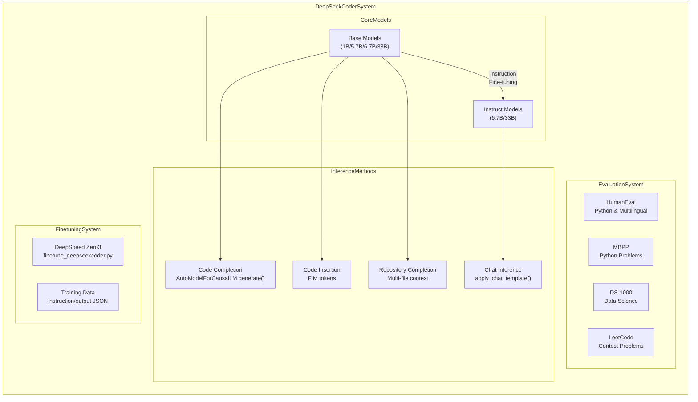

Sources: [README.md:11-27](), [README.md:66-166](), [README.md:273-316]()

## Model Training Workflow

DeepSeek Coder models are trained through a multi-stage process to achieve optimal performance for code-related tasks:

```mermaid
flowchart LR
    subgraph "DataCreation"
        direction TB
        GithubData["GitHub Code<br>Repositories"] -->|"Filtering & Cleaning"| FilteredData["Filtered Code Data"]
        FilteredData -->|"Dependency Parsing"| DependencySorted["Dependency-Sorted Files"]
        DependencySorted -->|"Concatenation &<br>Deduplication"| ProcessedData["Processed Training Data"]
    end
    
    subgraph "TrainingPipeline"
        direction TB
        PretrainingStep1["Initial Pretraining<br>1.8T tokens, 4K window"] -->|"87% code<br>13% text"| BaseModels["Base Models<br>4K context"]
        BaseModels -->|"Extended Pretraining<br>200B tokens, 16K window"| ExtendedModels["Extended Base Models<br>16K context"]
        ExtendedModels -->|"Instruction Finetuning<br>2B tokens"| InstructModels["Instruct Models"]
    end
    
    ProcessedData -->|"Training Data"| PretrainingStep1
```

Sources: [README.md:46-63]()

## Inference Methods

DeepSeek Coder supports several inference methods to accommodate different use cases:

### 1. Code Completion

The base models excel at completing code from comments or partial implementations, generating coherent and contextually appropriate code continuations.

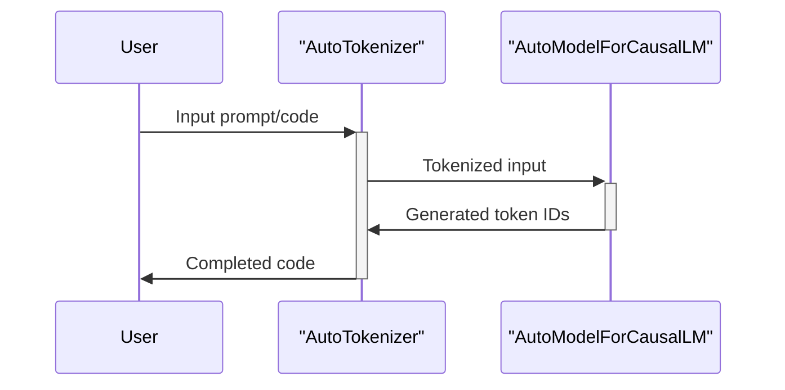

Sources: [README.md:74-100]()

### 2. Code Insertion (Fill-in-the-Middle)

The models support filling gaps in existing code using special FIM tokens to mark the beginning, hole, and end of the context.

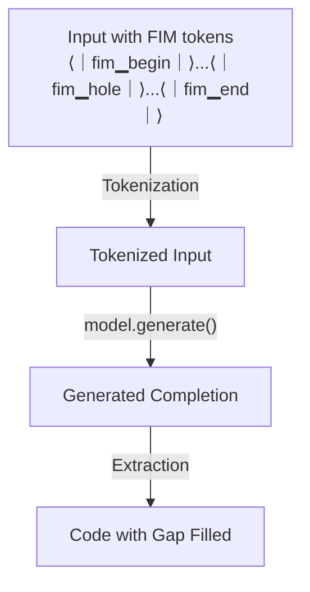

Sources: [README.md:102-127]()

### 3. Chat Model Inference

The instruction-tuned models are designed for interactive code generation through a chat interface, using a specific template format.

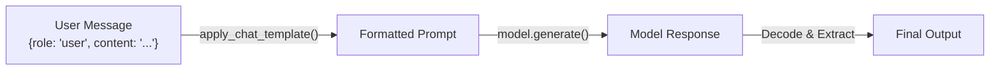

Sources: [README.md:129-175]()

### 4. Repository-Level Completion

DeepSeek Coder can understand and complete code across multiple files in a repository, leveraging its 16K context window to maintain coherence between related files.

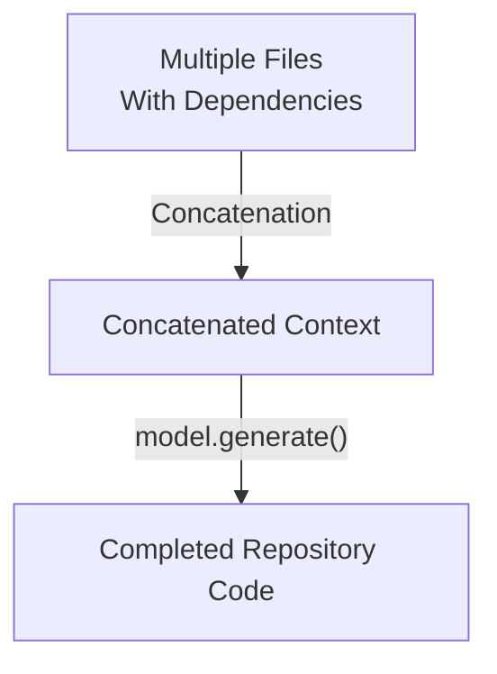

Sources: [README.md:177-272]()

## Evaluation Framework

DeepSeek Coder includes a comprehensive evaluation system to measure performance across standard coding benchmarks:

| Benchmark | Description | Focus Area | Metrics |
|-----------|-------------|------------|---------|
| HumanEval | 164 hand-written programming problems | Algorithm implementation | pass@k |
| MultiPL-E | HumanEval translated to multiple languages | Cross-language capabilities | pass@k |
| MBPP | 974 Python programming problems | Basic Python scripting | pass@k |
| DS-1000 | Data science-specific problems | Data manipulation libraries | pass@k |
| LeetCode | Competitive programming problems | Algorithm efficiency | pass@k |

Sources: [README.md:30-43](), [README.md:319-332]()

## Fine-tuning Capabilities

DeepSeek Coder provides a fine-tuning system built on DeepSpeed for efficient adaptation to specific domains or tasks:

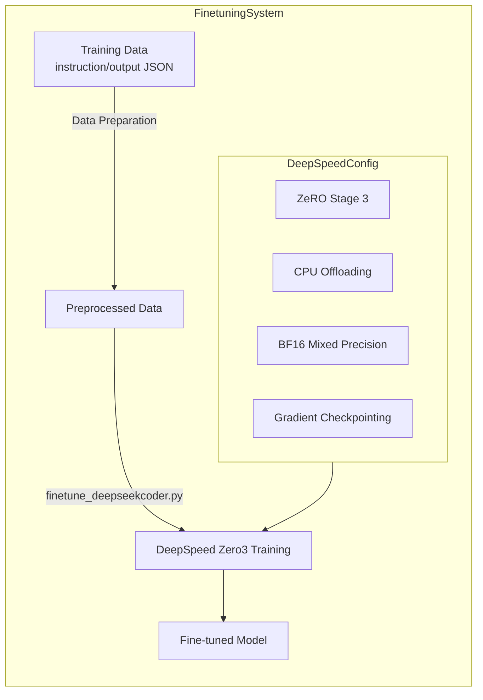

Sources: [README.md:273-316]()

## Inference Deployment Options

DeepSeek Coder models can be deployed for inference using various methods depending on performance and resource requirements:

### Standard Inference with Hugging Face

```python
from transformers import AutoTokenizer, AutoModelForCausalLM
import torch

tokenizer = AutoTokenizer.from_pretrained("deepseek-ai/deepseek-coder-6.7b-base", trust_remote_code=True)
model = AutoModelForCausalLM.from_pretrained("deepseek-ai/deepseek-coder-6.7b-base", trust_remote_code=True, torch_dtype=torch.bfloat16).cuda()
```

### High-throughput Inference with vLLM

For scenarios requiring higher throughput, vLLM provides optimized inference capabilities:

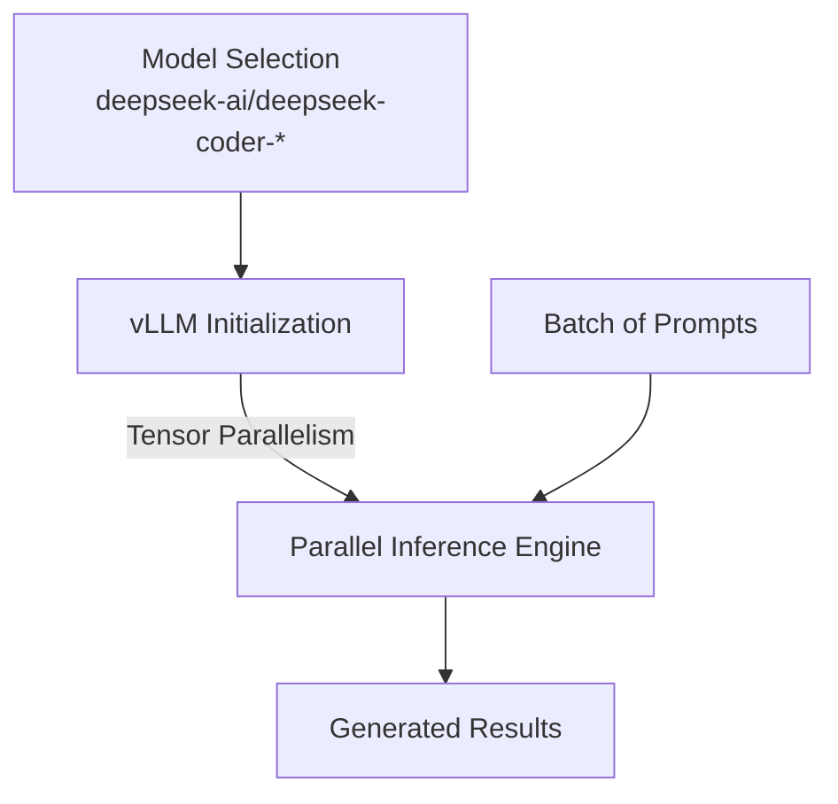

Sources: [README.md:333-382]()

## Supported Programming Languages

DeepSeek Coder supports a wide range of programming languages (over 80), including but not limited to:

- Python, JavaScript, TypeScript, Java, C, C++, C#, Go
- Ruby, Rust, PHP, Scala, Swift, Kotlin
- HTML, CSS, SQL, Shell scripting
- Domain-specific languages like GLSL, Verilog, and more

For the complete list of supported languages, refer to the [Model details](#2).

Sources: [README.md:27-28]()

---

# Page: Models

# Models

<details>
<summary>Relevant source files</summary>

The following files were used as context for generating this wiki page:

- [README.md](README.md)

</details>


This page provides an overview of the DeepSeek Coder model family, including different model sizes, variants, and their general characteristics. For detailed information about the model architecture, refer to [Architecture](#2.1). For comprehensive benchmark results and performance metrics, see [Performance and Benchmarks](#2.2).

## Model Family Overview

DeepSeek Coder consists of a series of transformer-based language models specifically trained for code understanding and generation. All models were trained from scratch on a massive corpus of 2 trillion tokens, with a composition of 87% code and 13% natural language (both English and Chinese).

The model family includes:

1. **Base Models** - Foundation models trained on code and related texts
2. **Instruction-tuned Models** - Enhanced versions fine-tuned on instruction data for interactive coding assistance

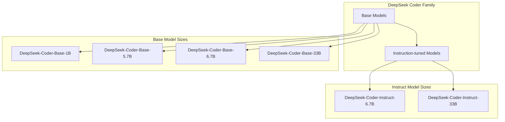

Sources: [README.md:11-26](). [README.md:57-62]()

## Model Size Comparison

The DeepSeek Coder family comes in various parameter sizes to suit different deployment requirements, from more efficient smaller models to higher-capability larger models.

| Model | Parameters | Context Window | Variants Available |
|-------|------------|----------------|-------------------|
| DeepSeek-Coder-1B | 1 billion | 16K tokens | Base |
| DeepSeek-Coder-5.7B | 5.7 billion | 16K tokens | Base |
| DeepSeek-Coder-6.7B | 6.7 billion | 16K tokens | Base, Instruct |
| DeepSeek-Coder-33B | 33 billion | 16K tokens | Base, Instruct |

Sources: [README.md:21-22](). [README.md:25]()

## Training Process

The DeepSeek Coder models underwent a comprehensive multi-stage training process to develop both their general code understanding and specialized capabilities.

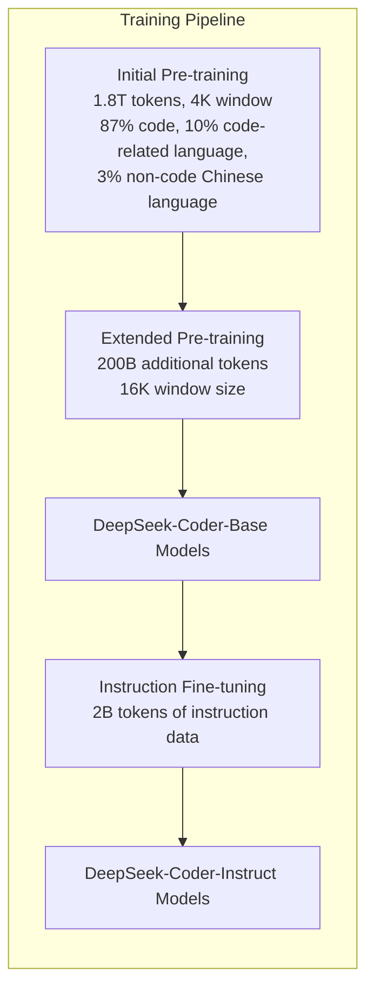

Sources: [README.md:58-62]()

## Supported Programming Languages

The models support a wide range of programming languages, making them versatile for various development environments and coding tasks.

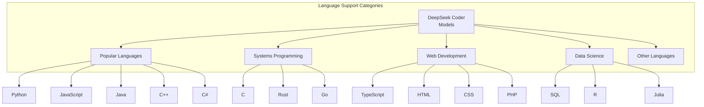

The models support over 80 programming languages in total, including: Ada, Agda, Alloy, ANTLR, AppleScript, Assembly, and many others. See the README for the complete list.

Sources: [README.md:27-28]()

## Model Capabilities

DeepSeek Coder models offer a range of capabilities that make them suitable for various coding tasks:

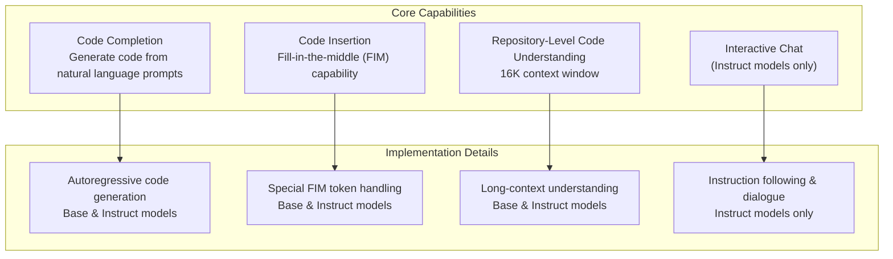

Sources: [README.md:74-104](). [README.md:102-141](). [README.md:178-254]()

### Feature Support by Model Variant

| Feature | Base Models | Instruct Models |
|---------|------------|-----------------|
| Code Completion | ✅ | ✅ |
| Fill-in-the-Middle (FIM) | ✅ | ✅ |
| Repository-Level Understanding | ✅ | ✅ |
| Interactive Chat | ❌ | ✅ |

Sources: [README.md:74-266]()

## Performance Overview

DeepSeek Coder models have demonstrated strong performance across various benchmarks. The largest model, DeepSeek-Coder-Base-33B, outperforms other open-source models of similar size, while even the smaller 6.7B model achieves performance comparable to much larger models from other families.

| Model | HumanEval (Python) | MBPP | DS-1000 |
|-------|-------------------|------|---------|
| DeepSeek-Coder-Base-33B | Leading performance | Leading performance | Leading performance |
| DeepSeek-Coder-Base-6.7B | Comparable to CodeLlama-34B | Comparable to CodeLlama-34B | Comparable to CodeLlama-34B |
| DeepSeek-Coder-Instruct-33B | Outperforms GPT3.5-turbo | Comparable to GPT3.5-turbo | - |

For detailed benchmark results, please refer to [Performance and Benchmarks](#2.2).

Sources: [README.md:30-43]()

## Model Deployment Options

The DeepSeek Coder models support various deployment options to accommodate different hardware and performance requirements.

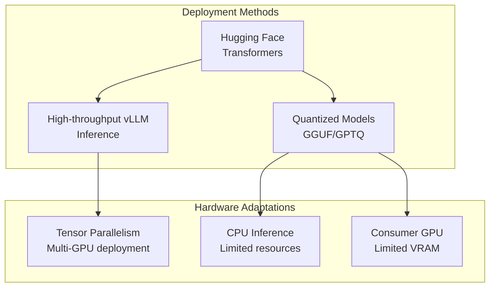

Sources: [README.md:333-382](). [README.md:386-417]()

## Model License and Availability

All DeepSeek Coder models are available for download from Hugging Face and support commercial use. The models are subject to the Model License, while the code in the repository is licensed under the MIT License.

Sources: [README.md:423-426]()

## Conclusion

DeepSeek Coder models represent a family of code language models designed specifically for software development tasks. Available in different sizes and variants, they offer state-of-the-art performance for code completion, code insertion, repository-level understanding, and interactive assistance. The models support a wide range of programming languages and can be deployed through various methods depending on hardware availability and performance requirements.

For more detailed information about these models, refer to:
- [Architecture](#2.1) - Detailed technical architecture information
- [Performance and Benchmarks](#2.2) - Comprehensive benchmark results
- [Usage and Inference Methods](#3) - How to use the models for different tasks

---

# Page: Architecture

# Architecture

<details>
<summary>Relevant source files</summary>

The following files were used as context for generating this wiki page:

- [README.md](README.md)

</details>


This document details the technical architecture of the DeepSeek Coder models, focusing on the transformer structure, parameter configurations, training methodology, and special architectural features designed for code understanding. For information about model performance across various benchmarks, see [Performance and Benchmarks](#2.2).

## Model Overview

DeepSeek Coder consists of a family of decoder-only transformer language models specifically designed for code generation and understanding. The models are available in multiple sizes ranging from 1 billion to 33 billion parameters, with both base and instruction-tuned variants.

Key architectural characteristics:
- Decoder-only transformer architecture
- Extended context window of 16K tokens
- Specialized fill-in-the-middle (FIM) capabilities
- Support for multiple programming languages (80+)
- Models trained from scratch on 2T tokens

Sources: [README.md:11-27]()

## Transformer Architecture

DeepSeek Coder follows a decoder-only transformer architecture with modifications specifically designed for code generation tasks. The model family is available in several sizes, each with different parameter counts and architectural dimensions.

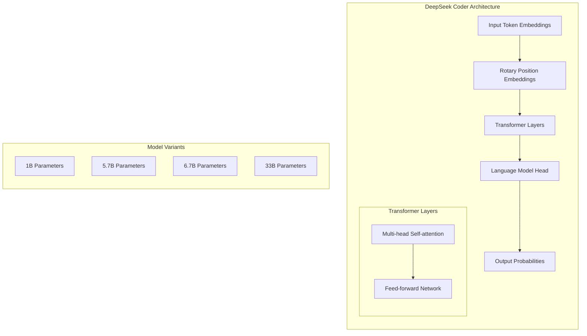

### Model Size Variants

The DeepSeek Coder family includes models of different sizes, each optimized for different use cases:

| Model Size | Parameters | Typical Use Cases |
|------------|------------|-------------------|
| 1B         | 1 billion  | Lightweight applications, edge devices |
| 5.7B       | 5.7 billion | Medium complexity tasks |
| 6.7B       | 6.7 billion | General code generation and understanding |
| 33B        | 33 billion  | Complex code generation, multilingual programming |

Each model size represents a different trade-off between computational requirements and generation capabilities, with the larger models providing higher quality code generation at the cost of increased computational demands.

Sources: [README.md:19-22]()

## Attention Mechanism and Position Encoding

DeepSeek Coder uses a rotary position embedding (RoPE) mechanism for handling positional information. This approach directly encodes relative positional information in the attention matrix, allowing the model to better understand code structure across long distances.

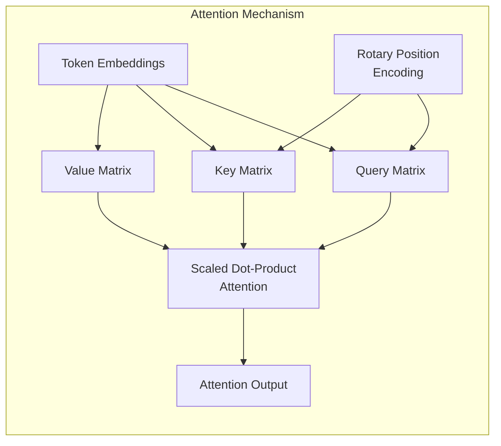

The rotary position encoding is particularly important for the extended context window (16K tokens) as it helps maintain performance over longer sequences, which is essential for understanding large code files or entire repositories.

Sources: [README.md:25-26](), [README.md:412-414]()

## Tokenization Approach

DeepSeek Coder uses a Byte-level BPE (Byte Pair Encoding) tokenization algorithm implemented through the Hugging Face Tokenizers library. The tokenizer is specifically designed to handle code efficiently.

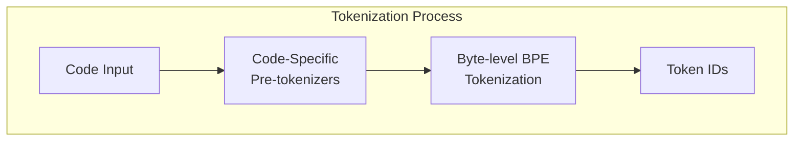

The tokenizer includes special tokens for the fill-in-the-middle task, such as `<｜fim▁begin｜>`, `<｜fim▁hole｜>`, and `<｜fim▁end｜>`, which enable the model to perform code insertion tasks. For instruction-tuned models, additional special tokens like `<|EOT|>` are used to manage the chat dialogue format.

Sources: [README.md:101-127](), [README.md:387-389]()

## Training Methodology

DeepSeek Coder was trained using a multi-stage approach designed to optimize both general code understanding and specific task capabilities.

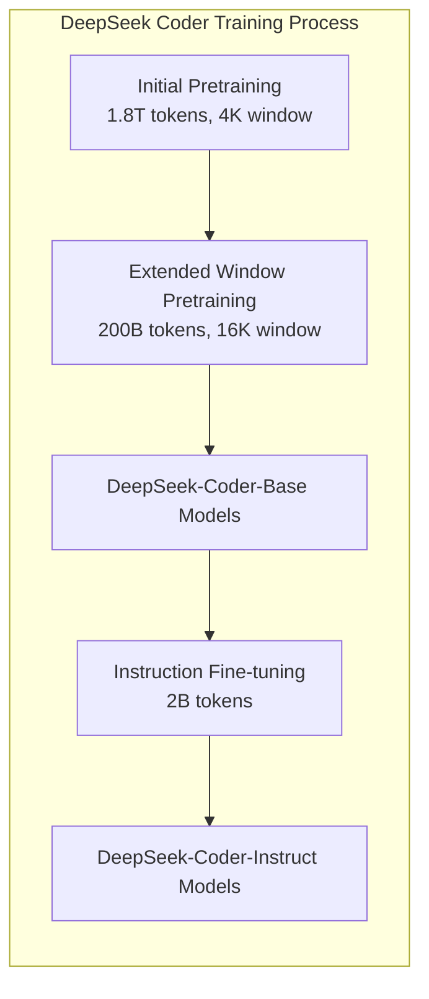

### Training Data Composition

The training data for DeepSeek Coder was carefully curated and processed:

1. **Initial Data Collection**: Code data collected from GitHub with filtering rules similar to StarCoder
2. **Dependency Analysis**: Files within repositories were rearranged based on their dependencies
3. **Example Formation**: Dependent files were concatenated to form cohesive examples
4. **Quality Filtering**: Low-quality code (syntax errors, poor readability) was filtered out

The final training data comprised:
- 87% code from various programming languages
- 10% code-related language (GitHub Markdown, StackExchange)
- 3% non-code-related Chinese language content

Sources: [README.md:48-56](), [README.md:58-62]()

### Training Procedure

The training was conducted in three main phases:

1. **Initial Pretraining**: Models were pretrained on 1.8T tokens with a 4K window size
2. **Extended Window Pretraining**: Further pretraining on an additional 200B tokens with a 16K window size, resulting in the base models
3. **Instruction Fine-tuning**: Base models were fine-tuned on 2B tokens of instruction data, resulting in the instruction-tuned models

This staged approach allowed the models to first learn general code patterns before being optimized for specific tasks and longer context understanding.

Sources: [README.md:58-62]()

## Special Architectural Features

### 16K Context Window

DeepSeek Coder features an extended context window of 16K tokens, which is significantly larger than many other language models. This extended window is particularly valuable for code-related tasks as it allows the model to:

1. Understand large code files in their entirety
2. Maintain context across multiple functions or classes
3. Process repository-level code with dependencies
4. Generate coherent, contextually appropriate code completions for complex projects

The 16K window was achieved through a dedicated pretraining phase focused on extending the context understanding capabilities beyond the initial 4K window.

Sources: [README.md:25-26](), [README.md:59-60]()

### Fill-in-the-Middle (FIM) Capability

DeepSeek Coder was explicitly trained with a fill-in-the-middle task, enabling it to understand and generate code that fits within an existing context. This capability is particularly useful for code editing and insertion tasks.

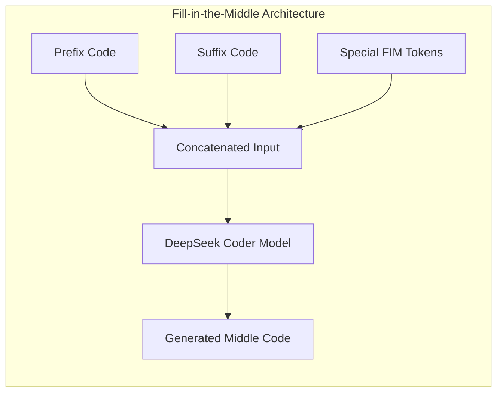

The FIM capability is implemented using special tokens:
- `<｜fim▁begin｜>`: Marks the beginning of a FIM example
- `<｜fim▁hole｜>`: Indicates where the model should insert code
- `<｜fim▁end｜>`: Marks the end of a FIM example

This architecture allows the model to understand both the preceding and following context when generating code insertions, resulting in more coherent and contextually appropriate code.

Sources: [README.md:101-127]()

## Model Variants

### Base Models

DeepSeek Coder Base models are the foundation models trained on the full 2T token dataset. These models excel at code completion, code insertion, and repository-level understanding tasks. Available sizes include 1B, 5.7B, 6.7B, and 33B parameters.

### Instruction-tuned Models

The instruction-tuned variants (DeepSeek Coder Instruct) are fine-tuned from the base models using an additional 2B tokens of instruction data. These models are optimized for interactive coding assistance through natural language instructions and conversations. Currently available in 6.7B and 33B parameter sizes.

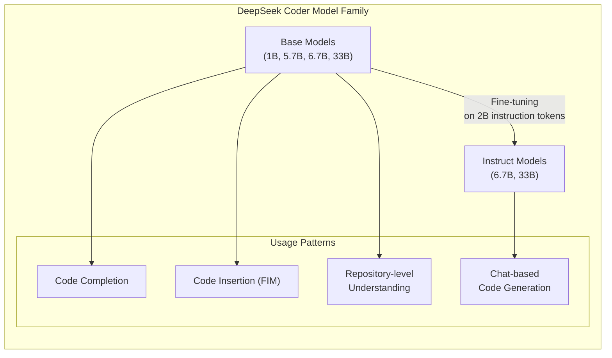

The instruction-tuned models use a specific formatting template for chat interactions, enabling them to follow user instructions and generate appropriate code responses in a conversational manner.

Sources: [README.md:129-176]()

## Inference Optimization

DeepSeek Coder models support various inference optimization techniques:

1. **Tensor Parallelism**: Models can be distributed across multiple GPUs using tensor parallelism for efficient inference
2. **vLLM Integration**: Support for high-throughput inference using the vLLM framework
3. **Quantization Options**: Support for GGUF and GPTQ quantization formats for deployment on resource-constrained environments

These optimizations make DeepSeek Coder adaptable to different deployment scenarios, from high-performance servers to more limited computing environments.

Sources: [README.md:333-382](), [README.md:386-414]()

## Summary

DeepSeek Coder features a decoder-only transformer architecture optimized specifically for code generation tasks. Key architectural features include an extended 16K context window, specialized fill-in-the-middle capabilities, and a staged training process. The model family spans from 1B to 33B parameters with both base and instruction-tuned variants, offering a range of options for different deployment scenarios and use cases.

---

# Page: Performance and Benchmarks

# Performance and Benchmarks

<details>
<summary>Relevant source files</summary>

The following files were used as context for generating this wiki page:

- [README.md](README.md)
- [pictures/HumanEval.png](pictures/HumanEval.png)
- [pictures/MBPP.png](pictures/MBPP.png)
- [pictures/result.png](pictures/result.png)
- [pictures/table.png](pictures/table.png)

</details>


## Purpose and Scope

This page provides a detailed overview of DeepSeek Coder models' performance across standard code generation and understanding benchmarks. It presents quantitative evaluation results, comparison with other leading models, and analysis of performance across different model sizes and variants. For information about model architecture, see [Architecture](#2.1), and for fine-tuning performance, see [Fine-tuning](#5).

## Overview of DeepSeek Coder Performance

DeepSeek Coder models demonstrate strong performance across various standard code-related benchmarks, with the larger models achieving state-of-the-art results among open-source code models. The models have been evaluated on Python-specific tasks (HumanEval, MBPP), multilingual code generation (MultiPL-E), domain-specific tasks (DS-1000), and mathematical reasoning tasks.

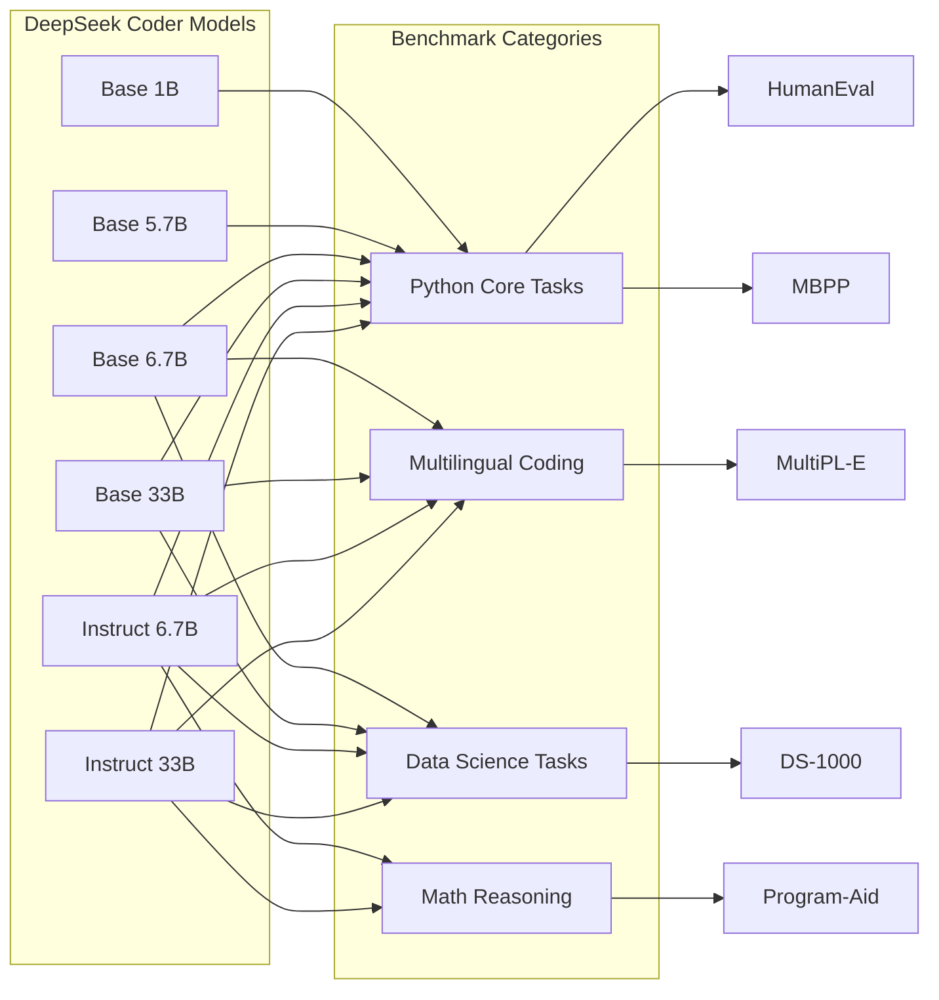

Sources: [README.md:12-26](), [README.md:30-42]()

## Benchmark Methodology

DeepSeek Coder's performance is primarily measured using standard coding benchmarks with a focus on functional correctness. The most commonly reported metric is **pass@k**, which measures the probability that at least one correct solution is generated in k samples.

### Key Benchmarks

| Benchmark | Description | Focus | Programming Languages |
|-----------|-------------|-------|----------------------|
| HumanEval | 164 hand-written programming problems | Algorithm implementation | Python (original) + 18 languages in MultiPL-E |
| MBPP | 974 Python programming problems | Basic programming tasks | Python |
| DS-1000 | 1,000 data science problems | Library-specific tasks | Python (focusing on data science libraries) |
| Program-Aid | Math reasoning problems | Mathematical reasoning | Python |

Sources: [README.md:321-332]()

### Evaluation Process

The evaluation process follows this general workflow:

```mermaid
flowchart TD
    A["Select Benchmark Problems"] --> B["Generate Solutions Using Model"]
    B --> C["Execute Generated Code"]
    C --> D["Verify Correctness Against Test Cases"]
    D --> E["Calculate pass@k Metrics"]
    
    subgraph "Sampling Strategy"
        F["Temperature Sampling"]
        G["Multiple Generations per Problem"]
        H["Majority Voting"]
    end
    
    B --- F
    B --- G
    D --- H
```

Sources: [README.md:321-332]()

## Performance Results

### Overall Results

The following table shows the pass@1 performance of DeepSeek Coder models compared to other code models across key benchmarks:

| Model | HumanEval (Python) | HumanEval (Multilingual) | MBPP | DS-1000 |
|-------|-------------------|--------------------------|------|---------|
| DeepSeek-Coder-Base-33B | 73.2% | 67.8% | 75.8% | 70.6% |
| DeepSeek-Coder-Instruct-33B | 74.4% | - | 70.8% | - |
| CodeLlama-34B | 65.3% | 58.5% | 65.0% | 64.7% |
| GPT-3.5-Turbo | 72.6% | - | 70.8% | - |
| DeepSeek-Coder-Base-6.7B | 64.0% | 56.3% | 61.8% | 61.1% |
| DeepSeek-Coder-Instruct-6.7B | 64.6% | - | 58.8% | - |
| DeepSeek-Coder-Base-5.7B | 61.6% | - | - | - |
| DeepSeek-Coder-Base-1B | 36.6% | - | - | - |

Key findings:
- DeepSeek-Coder-Base-33B outperforms CodeLlama-34B by 7.9%, 9.3%, 10.8%, and 5.9% on HumanEval Python, HumanEval Multilingual, MBPP, and DS-1000 respectively
- DeepSeek-Coder-Base-6.7B reaches performance comparable to CodeLlama-34B despite being 5x smaller
- DeepSeek-Coder-Instruct-33B outperforms GPT-3.5-Turbo on HumanEval and achieves comparable results on MBPP

Sources: [README.md:30-42](), [README.md:321-332]()

### Performance by Model Size

The performance of DeepSeek Coder scales with model size, as shown in the following visualization:

```mermaid
graph TD
    subgraph "HumanEval Python (pass@1)"
        HE1B["Base-1B: 36.6%"]
        HE5B["Base-5.7B: 61.6%"]
        HE6B["Base-6.7B: 64.0%"]
        HE33B["Base-33B: 73.2%"]
        
        HE1B --> HE5B --> HE6B --> HE33B
    end
    
    subgraph "MBPP (pass@1)"
        MBPP6B["Base-6.7B: 61.8%"]
        MBPP33B["Base-33B: 75.8%"]
        
        MBPP6B --> MBPP33B
    end
    
    subgraph "DS-1000 (pass@1)"
        DS6B["Base-6.7B: 61.1%"]
        DS33B["Base-33B: 70.6%"]
        
        DS6B --> DS33B
    end
```

Sources: [README.md:33-42](), [README.md:321-332]()

### Base vs. Instruction-Tuned Models

```mermaid
graph LR
    subgraph "Base Models"
        Base6B["Base-6.7B"]
        Base33B["Base-33B"]
    end
    
    subgraph "Instruction-Tuned Models"
        Inst6B["Instruct-6.7B"]
        Inst33B["Instruct-33B"]
    end
    
    Base6B -- "HumanEval: 64.0% → 64.6%" --> Inst6B
    Base6B -- "MBPP: 61.8% → 58.8%" --> Inst6B
    
    Base33B -- "HumanEval: 73.2% → 74.4%" --> Inst33B
    Base33B -- "MBPP: 75.8% → 70.8%" --> Inst33B
    
    style Base6B fill:white
    style Base33B fill:white
    style Inst6B fill:white
    style Inst33B fill:white
```

Observations:
- Instruction tuning slightly improves HumanEval performance
- However, it may reduce performance on MBPP benchmark
- This suggests instruction-tuned models may excel at following complex instructions but might trade off some performance on straightforward programming tasks

Sources: [README.md:33-42]()

## Multilingual Performance

DeepSeek Coder demonstrates strong multilingual capabilities, performing well across multiple programming languages in the HumanEval benchmark.

```mermaid
flowchart TD
    subgraph "MultiPL-E / HumanEval Multilingual"
        Python["Python: 73.2%"]
        
        subgraph "Statically-Typed Languages"
            Java["Java"]
            CSharp["C#"]
            CPP["C++"]
            Rust["Rust"]
            TS["TypeScript"]
        end
        
        subgraph "Dynamically-Typed Languages"
            JS["JavaScript"]
            Ruby["Ruby"]
            PHP["PHP"]
            Swift["Swift"]
            Go["Go"]
        end
        
        subgraph "Functional Languages"
            Scala["Scala"]
            Kotlin["Kotlin"]
        end
    end
    
    DeepSeek["DeepSeek-Coder-Base-33B"] --> Python
    DeepSeek --> Java
    DeepSeek --> CSharp
    DeepSeek --> CPP
    DeepSeek --> Rust
    DeepSeek --> TS
    DeepSeek --> JS
    DeepSeek --> Ruby
    DeepSeek --> PHP
    DeepSeek --> Swift
    DeepSeek --> Go
    DeepSeek --> Scala
    DeepSeek --> Kotlin
    
    Python -- "MultiPL-E Average: 67.8%" --> Multilingual["Multilingual Performance"]
```

DeepSeek Coder's multilingual performance is attributed to its diverse training corpus, which includes code in multiple programming languages. The model achieves an average of 67.8% pass@1 across multiple programming languages, which is 9.3% higher than CodeLlama-34B.

Sources: [README.md:321-323](), [README.md:27-29]()

## Domain-Specific Performance

### Data Science Tasks (DS-1000)

DeepSeek Coder performs particularly well on data science tasks, demonstrating strong capability in code generation involving popular data science libraries.

```mermaid
graph TD
    DS1000["DS-1000 Benchmark"]
    
    subgraph "Popular Data Science Libraries"
        Pandas["Pandas"]
        NumPy["NumPy"]
        TensorFlow["TensorFlow"]
        PyTorch["PyTorch"]
        SciPy["SciPy"]
        Matplotlib["Matplotlib"]
        Sklearn["Scikit-learn"]
    end
    
    DS1000 --> Pandas
    DS1000 --> NumPy
    DS1000 --> TensorFlow
    DS1000 --> PyTorch
    DS1000 --> SciPy
    DS1000 --> Matplotlib
    DS1000 --> Sklearn
    
    Pandas -- "DeepSeek-Coder-Base-33B: 70.6%" --> Performance["Overall Performance"]
    Performance -- "5.9% better than CodeLlama-34B" --> Comparison["Comparative Performance"]
```

The DS-1000 benchmark tests the model's ability to solve complex data science problems that require understanding of specific libraries and their APIs. DeepSeek-Coder-Base-33B achieves 70.6% pass@1 on this benchmark, outperforming CodeLlama-34B by 5.9%.

Sources: [README.md:328-329]()

### Program-Aided Math Reasoning

DeepSeek Coder also demonstrates capabilities in mathematical reasoning when generating code, as evaluated on the Program-Aid Math Reasoning benchmark.

```mermaid
flowchart LR
    subgraph "Program-Aid Math Reasoning"
        Problem["Math Problem"] --> Code["Generated Code Solution"]
        Code --> Solution["Mathematical Solution"]
    end
    
    subgraph "Models"
        DeepSeek["DeepSeek-Coder-Instruct Models"]
        Other["Other Code LLMs"]
    end
    
    DeepSeek --> Problem
    Other --> Problem
    
    DeepSeek -. "Strong Performance" .-> Evaluation["Evaluation Results"]
```

The ability to solve mathematical problems through code generation is an important aspect of code models' versatility, particularly for scientific and engineering applications.

Sources: [README.md:330-331]()

## Evaluation Insights and Analysis

DeepSeek Coder's strong performance can be attributed to several factors:

1. **Training Data Scale**: Trained on 2T tokens with 87% code content
2. **Model Size Efficiency**: Achieves strong results at both large (33B) and medium (6.7B) scales
3. **Window Size Advantage**: 16K window size enabling understanding of larger code contexts
4. **Fill-in-the-Middle Training**: Special training for code insertion/completion tasks
5. **Diverse Language Coverage**: Training on a wide range of programming languages

The model's superior performance demonstrates the effectiveness of the training methodology, which includes:
- Initial pre-training with 1.8T tokens at 4K window size
- Further pre-training with 200B additional tokens at 16K window size
- Instruction fine-tuning on 2B tokens of instruction data (for Instruct variants)

Sources: [README.md:12-26](), [README.md:47-63]()

## Evaluation Methodology and Reproducibility

The evaluation results presented are reproducible, with code available in the repository's Evaluation directory. The evaluation process typically involves:

1. Loading the model
2. Generating multiple solutions for each problem
3. Executing the generated code against test cases
4. Computing pass@k metrics based on the execution results

For example, to evaluate the model on HumanEval or MBPP benchmarks, the repository provides scripts such as `eval_instruct.py`. For LeetCode evaluation, a combination of `vllm_inference.py` and `evaluate_leetcode.py` is used.

Sources: [README.md:320-332]()

## Conclusion

DeepSeek Coder models demonstrate state-of-the-art performance among open-source code models across various benchmarks. The 33B parameter models outperform comparable-sized competitors, while the smaller 6.7B models offer an excellent balance of performance and efficiency. The instruction-tuned variants show particular strength in following complex instructions while maintaining strong coding capabilities.

The performance results validate DeepSeek's approach to model training, including the use of a large, diverse code corpus, extended context window, and specialized training techniques like fill-in-the-blank tasks.

---

# Page: Usage and Inference Methods

# Usage and Inference Methods

<details>
<summary>Relevant source files</summary>

The following files were used as context for generating this wiki page:

- [README.md](README.md)

</details>


This document provides a comprehensive guide to using DeepSeek Coder for inference across different use cases. It covers the various inference methods supported by the models, including code completion, code insertion, chat-based interaction, repository-level completion, and high-throughput inference with vLLM. For information about fine-tuning the models, see [Fine-tuning](#5).

## Inference Methods Overview

DeepSeek Coder offers multiple inference methods depending on your use case. Each method is optimized for specific scenarios and leverages different capabilities of the models.

```mermaid
flowchart TD
    subgraph "User Interaction"
        UserPrompt["User Input"]
    end
    
    subgraph "Inference Methods"
        CodeCompletion["Code Completion <br> Generate code from comments/prompt"]
        CodeInsertion["Code Insertion (FIM) <br> Fill in gaps in existing code"]
        ChatInference["Chat Model Inference <br> Interactive coding assistance"]
        RepoLevel["Repository-Level Completion <br> Multi-file context understanding"]
        vLLMInference["High-throughput Inference <br> Efficient parallel processing"]
    end
    
    subgraph "Model Types"
        BaseModels["Base Models <br> (1B, 5.7B, 6.7B, 33B)"]
        InstructModels["Instruct Models <br> (6.7B, 33B)"]
    end
    
    UserPrompt --> CodeCompletion
    UserPrompt --> CodeInsertion
    UserPrompt --> ChatInference
    UserPrompt --> RepoLevel
    UserPrompt --> vLLMInference
    
    CodeCompletion --> BaseModels
    CodeInsertion --> BaseModels
    RepoLevel --> BaseModels
    ChatInference --> InstructModels
    vLLMInference --> BaseModels
    vLLMInference --> InstructModels
```

Sources: [README.md:11-27]()

The table below summarizes each inference method, its appropriate model types, and typical use cases:

| Inference Method | Model Type | Use Case | Key Features |
|------------------|------------|----------|--------------|
| Code Completion | Base | Generate code from comments/prompts | Simple, straightforward generation |
| Code Insertion (FIM) | Base | Fill gaps in existing code | Contextual code insertion |
| Chat Model Inference | Instruct | Interactive coding assistance | Dialog-based interaction |
| Repository-Level Completion | Base | Complete code across multiple files | Cross-file understanding |
| vLLM Inference | Both | High-throughput production scenarios | Efficient, parallel processing |

Sources: [README.md:67-269]()

## Inference Process Flow

All inference methods follow a similar process flow, with variations in how inputs are processed and outputs are generated.

```mermaid
sequenceDiagram
    participant User
    participant Tokenizer as "AutoTokenizer"
    participant Model as "AutoModelForCausalLM"
    participant Generation as "generate() method"
    
    User->>Tokenizer: Input text (prompt, code with gaps, etc.)
    Note over Tokenizer: Converts text to token IDs
    Tokenizer->>Model: Tokenized input (tensor)
    Model->>Generation: Process generation request
    Note over Generation: Applies sampling parameters<br>(temperature, top_p, etc.)
    Generation->>Model: Generated token IDs
    Model->>Tokenizer: Output token IDs
    Tokenizer->>User: Decoded text output
```

Sources: [README.md:76-142]()

## Code Completion

Code completion is the most basic inference method, where the model generates code based on a comment or prompt.

### Usage Example

```python
from transformers import AutoTokenizer, AutoModelForCausalLM
import torch

tokenizer = AutoTokenizer.from_pretrained("deepseek-ai/deepseek-coder-6.7b-base", trust_remote_code=True)
model = AutoModelForCausalLM.from_pretrained("deepseek-ai/deepseek-coder-6.7b-base", 
                                            trust_remote_code=True, 
                                            torch_dtype=torch.bfloat16).cuda()

input_text = "#write a quick sort algorithm"
inputs = tokenizer(input_text, return_tensors="pt").to(model.device)
outputs = model.generate(**inputs, max_length=128)
print(tokenizer.decode(outputs[0], skip_special_tokens=True))
```

Sources: [README.md:76-85]()

### Key Parameters for Generation

| Parameter | Description | Example Value |
|-----------|-------------|---------------|
| max_length | Maximum length of generated sequence | 128 |
| max_new_tokens | Maximum number of tokens to generate | 512 |
| do_sample | Whether to use sampling | False (greedy) or True (sampling) |
| temperature | Sampling temperature (higher = more random) | 0.7 |
| top_p | Nucleus sampling probability | 0.95 |
| top_k | Top-k sampling | 50 |

Sources: [README.md:140-141]()

## Code Insertion (FIM)

Code Insertion, also known as Fill-in-the-Middle (FIM), allows the model to fill in gaps in existing code.

### FIM Special Tokens

The FIM task uses special tokens to mark different parts of the input:
- `<｜fim▁begin｜>`: Marks the beginning of the context
- `<｜fim▁hole｜>`: Marks the gap that needs to be filled
- `<｜fim▁end｜>`: Marks the end of the context

### Usage Example

```python
from transformers import AutoTokenizer, AutoModelForCausalLM
import torch

tokenizer = AutoTokenizer.from_pretrained("deepseek-ai/deepseek-coder-6.7b-base", trust_remote_code=True)
model = AutoModelForCausalLM.from_pretrained("deepseek-ai/deepseek-coder-6.7b-base", 
                                            trust_remote_code=True, 
                                            torch_dtype=torch.bfloat16).cuda()

input_text = """<｜fim▁begin｜>def quick_sort(arr):
    if len(arr) <= 1:
        return arr
    pivot = arr[0]
    left = []
    right = []
<｜fim▁hole｜>
        if arr[i] < pivot:
            left.append(arr[i])
        else:
            right.append(arr[i])
    return quick_sort(left) + [pivot] + quick_sort(right)<｜fim▁end｜>"""

inputs = tokenizer(input_text, return_tensors="pt").to(model.device)
outputs = model.generate(**inputs, max_length=128)
print(tokenizer.decode(outputs[0], skip_special_tokens=True)[len(input_text):])
```

Sources: [README.md:102-122]()

## Chat Model Inference

Chat Model Inference uses the instruction-tuned models for interactive, dialog-based code generation.

```mermaid
flowchart TD
    subgraph "Chat Inference Flow"
        UserMessage["User Message"] --> ChatTemplate["Chat Template Processing"]
        ChatTemplate --> TokenizedInput["Tokenized Input"]
        TokenizedInput --> ModelInference["Model Inference"]
        ModelInference --> GeneratedResponse["Generated Response"]
    end
    
    subgraph "Implementation Components"
        ApplyChatTemplate["apply_chat_template()"] --> AutoTokenizer["AutoTokenizer"]
        ModelGenerate["model.generate()"] --> AutoModelForCausalLM["AutoModelForCausalLM"]
        EosTokenId["eos_token_id"] --> GenerationParams["Generation Parameters"]
    end
    
    ChatTemplate --> ApplyChatTemplate
    TokenizedInput --> AutoTokenizer
    ModelInference --> ModelGenerate
    ModelInference --> GenerationParams
```

Sources: [README.md:129-176]()

### Usage Example

```python
from transformers import AutoTokenizer, AutoModelForCausalLM
import torch

tokenizer = AutoTokenizer.from_pretrained("deepseek-ai/deepseek-coder-6.7b-instruct", trust_remote_code=True)
model = AutoModelForCausalLM.from_pretrained("deepseek-ai/deepseek-coder-6.7b-instruct", 
                                            trust_remote_code=True, 
                                            torch_dtype=torch.bfloat16).cuda()

messages = [
    { 'role': 'user', 'content': "write a quick sort algorithm in python."}
]

inputs = tokenizer.apply_chat_template(messages, add_generation_prompt=True, return_tensors="pt").to(model.device)
outputs = model.generate(inputs, max_new_tokens=512, do_sample=False, 
                        top_k=50, top_p=0.95, num_return_sequences=1, 
                        eos_token_id=tokenizer.eos_token_id)

print(tokenizer.decode(outputs[0][len(inputs[0]):], skip_special_tokens=True))
```

Sources: [README.md:129-142]()

### Chat Template

If not using the `apply_chat_template` method, you can manually format the chat input using this template:

```
You are an AI programming assistant, utilizing the DeepSeek Coder model, developed by DeepSeek Company, and you only answer questions related to computer science. For politically sensitive questions, security and privacy issues, and other non-computer science questions, you will refuse to answer.
### Instruction:
['content']
### Response:
['content']
<|EOT|>
### Instruction:
['content']
### Response:

```

Sources: [README.md:164-176]()

## Repository-Level Completion

Repository-Level Completion allows the model to understand and complete code across multiple files, demonstrating cross-file contextual understanding.

### Usage Example

This example shows how the model can understand code dependencies across utility, model, and main files to complete appropriate implementation:

```python
from transformers import AutoTokenizer, AutoModelForCausalLM
import torch

tokenizer = AutoTokenizer.from_pretrained("deepseek-ai/deepseek-coder-6.7b-base", trust_remote_code=True)
model = AutoModelForCausalLM.from_pretrained("deepseek-ai/deepseek-coder-6.7b-base", 
                                            trust_remote_code=True, 
                                            torch_dtype=torch.bfloat16).cuda()

# Input containing multiple files with imports and class references
input_text = """#utils.py
import torch
from sklearn import datasets
from sklearn.model_selection import train_test_split
from sklearn.preprocessing import StandardScaler
from sklearn.metrics import accuracy_score

def load_data():
    # Function implementation...
    
def evaluate_predictions(y_test, y_pred):
    # Function implementation...

# model.py
import torch
import torch.nn as nn
import torch.optim as optim
from torch.utils.data import DataLoader, TensorDataset

class IrisClassifier(nn.Module):
    # Class implementation...

# main.py
from utils import load_data, evaluate_predictions
from model import IrisClassifier as Classifier

def main():
    # Model training and evaluation
"""

inputs = tokenizer(input_text, return_tensors="pt").to(model.device)
outputs = model.generate(**inputs, max_new_tokens=140)
print(tokenizer.decode(outputs[0]))
```

Sources: [README.md:178-266]()

## High-throughput Inference with vLLM

For production scenarios requiring efficient inference, DeepSeek Coder supports integration with vLLM for high-throughput processing.

```mermaid
flowchart LR
    subgraph "vLLM Components"
        LLMClass["LLM class"] --> ModelLoading["Model loading with <br> tensor parallelism"]
        SamplingParams["SamplingParams class"] --> GenerationConfig["Generation configuration"]
        BatchProcessing["Batch processing"] --> Throughput["High throughput"]
    end
    
    subgraph "Integration Points"
        HFTokenizer["HuggingFace Tokenizer"] --> LLMClass
        HFTokenizer --> ChatTemplating["Chat templating"]
        TensorParallelism["tensor_parallel_size"] --> GPUUtilization["Multi-GPU utilization"]
    end
    
    ModelLoading --> Inference["Inference execution"]
    GenerationConfig --> Inference
    Inference --> Results["Generated results"]
```

Sources: [README.md:333-382]()

### Text Completion with vLLM

```python
from vllm import LLM, SamplingParams

tp_size = 4  # Tensor Parallelism
sampling_params = SamplingParams(temperature=0.7, top_p=0.9, max_tokens=100)
model_name = "deepseek-ai/deepseek-coder-6.7b-base"
llm = LLM(model=model_name, trust_remote_code=True, 
          gpu_memory_utilization=0.9, tensor_parallel_size=tp_size)

prompts = [
    "If everyone in a country loves one another,",
    "The research should also focus on the technologies",
    "To determine if the label is correct, we need to"
]
outputs = llm.generate(prompts, sampling_params)

generated_text = [output.outputs[0].text for output in outputs]
print(generated_text)
```

Sources: [README.md:339-356]()

### Chat Completion with vLLM

```python
from transformers import AutoTokenizer
from vllm import LLM, SamplingParams

tp_size = 4  # Tensor Parallelism
sampling_params = SamplingParams(temperature=0.7, top_p=0.9, max_tokens=100)
model_name = "deepseek-ai/deepseek-coder-6.7b-instruct"
tokenizer = AutoTokenizer.from_pretrained(model_name)
llm = LLM(model=model_name, trust_remote_code=True, 
          gpu_memory_utilization=0.9, tensor_parallel_size=tp_size)

messages_list = [
    [{"role": "user", "content": "Who are you?"}],
    [{"role": "user", "content": "What can you do?"}],
    [{"role": "user", "content": "Explain Transformer briefly."}],
]
prompts = [tokenizer.apply_chat_template(messages, add_generation_prompt=True, tokenize=False) 
           for messages in messages_list]

sampling_params.stop = [tokenizer.eos_token]
outputs = llm.generate(prompts, sampling_params)

generated_text = [output.outputs[0].text for output in outputs]
print(generated_text)
```

Sources: [README.md:358-382]()

## Special Configurations

### Using Instruct Models for Code Completion

Although the instruction-tuned models are primarily designed for chat interactions, they can be used for code completion by modifying the `eos_token_id` parameter:

```python
# When using instruct models for code completion, set eos_token_id to 32014
# instead of the default 32021
outputs = model.generate(inputs, max_new_tokens=512, eos_token_id=32014)
```

This adjustment enables the instruction-tuned models to perform code completion by changing how they recognize the end of a sequence.

Sources: [README.md:415-418]()

## Model Variants and Recommended Inference Methods

| Model | Size | Recommended Inference Methods |
|-------|------|------------------------------|
| deepseek-coder-1b-base | 1B | Code Completion, Code Insertion |
| deepseek-coder-5.7b-base | 5.7B | Code Completion, Code Insertion, Repository-Level |
| deepseek-coder-6.7b-base | 6.7B | Code Completion, Code Insertion, Repository-Level |
| deepseek-coder-33b-base | 33B | Code Completion, Code Insertion, Repository-Level |
| deepseek-coder-6.7b-instruct | 6.7B | Chat Model Inference, Code Completion* |
| deepseek-coder-33b-instruct | 33B | Chat Model Inference, Code Completion* |

*Requires modified `eos_token_id` as noted above.

Sources: [README.md:19-26](), [README.md:415-418]()

---

# Page: Code Completion

# Code Completion

<details>
<summary>Relevant source files</summary>

The following files were used as context for generating this wiki page:

- [README.md](README.md)

</details>


## Purpose and Scope

This document describes how to use DeepSeek Coder for code completion tasks. Code completion enables models to generate code snippets or entire functions based on comments, prompts, or partial code. This page focuses specifically on basic code completion from prompts - for other related functionalities, see:
- [Code Insertion](#3.2) for filling gaps in existing code
- [Chat Model Inference](#3.3) for interactive code generation with the instruct models
- [Repository-Level Completion](#3.4) for completing code with awareness of multiple files
- [High-throughput Inference with vLLM](#3.5) for optimized inference performance

## DeepSeek Coder Code Completion Overview

Code completion is a fundamental capability of the DeepSeek Coder base models. These models can transform natural language descriptions or code comments into functional code implementations across more than 80 programming languages.

```mermaid
flowchart LR
    subgraph "Code Completion Process"
        Input["Input Text<br>(Comment/Prompt)"] --> Tokenizer["Tokenizer"]
        Tokenizer --> Model["DeepSeek Coder<br>Base Model"]
        Model --> Generate["Generation Process"]
        Generate --> Output["Generated Code"]
    end
```

Sources: [README.md:75-100]()

## Basic Setup and Usage

### Required Dependencies

To use DeepSeek Coder for code completion, you need the following dependencies:

```
transformers
torch
```

### Loading the Model

The first step is to load the appropriate tokenizer and model:

```mermaid
flowchart TD
    subgraph "Model Loading Flow"
        Install["Install Dependencies"] --> LoadTokenizer["Load AutoTokenizer"]
        LoadTokenizer --> LoadModel["Load AutoModelForCausalLM"]
        LoadModel --> Prepare["Prepare Input Text"]
        Prepare --> Generate["Generate Code"]
    end
    
    subgraph "Available Base Models"
        M1["deepseek-ai/deepseek-coder-1b-base"]
        M2["deepseek-ai/deepseek-coder-5.7b-base"]
        M3["deepseek-ai/deepseek-coder-6.7b-base"] 
        M4["deepseek-ai/deepseek-coder-33b-base"]
    end
    
    LoadModel -.-> M1
    LoadModel -.-> M2
    LoadModel -.-> M3
    LoadModel -.-> M4
```

Sources: [README.md:75-85]()

### Basic Example

The following code demonstrates how to use DeepSeek Coder for a simple code completion task - generating a quick sort algorithm from a comment:

1. Import required libraries
2. Load the tokenizer and model
3. Define the input text (a comment describing what you want)
4. Tokenize the input text
5. Generate the completion
6. Decode and print the result

Sources: [README.md:76-85]()

## Generation Parameters

When using the `generate()` method, you can control various aspects of the code generation process:

| Parameter | Description | Example Value |
|-----------|-------------|---------------|
| max_length | Maximum length of the generated sequence | 128 |
| max_new_tokens | Maximum number of new tokens to generate | 512 |
| do_sample | Whether to use sampling | False |
| temperature | Controls randomness (higher = more random) | 0.7 |
| top_k | Limits sampling to top k most likely tokens | 50 |
| top_p | Nucleus sampling parameter | 0.95 |
| num_return_sequences | Number of sequences to return | 1 |

Sources: [README.md:76-84]()

## Integration with Application Workflows

Code completion can be integrated into various developer workflows, including IDE extensions, CLI tools, and web applications.

```mermaid
flowchart TD
    subgraph "Integration Options"
        CC["DeepSeek Coder<br>Code Completion"]
        
        subgraph "Development Environments"
            IDE["IDE Extensions"]
            CLI["Command Line Tools"]
            WEB["Web Applications"]
        end
        
        subgraph "Code Generation Flow"
            direction LR
            User["User"] --> |"Provides Comment/Prompt"| Interface["Interface"]
            Interface --> |"Sends to Model"| Backend["Backend Service"]
            Backend --> |"Returns Completion"| Interface
            Interface --> |"Displays Result"| User
        end
        
        CC --> IDE
        CC --> CLI
        CC --> WEB
        
        Backend --> |"Uses"| CC
    end
```

Sources: [README.md:75-100]()

## Model Selection Considerations

DeepSeek Coder offers multiple model sizes for code completion, each with different trade-offs:

| Model | Parameters | Advantages | Considerations |
|-------|------------|------------|----------------|
| deepseek-coder-1b-base | 1B | Lightweight, fast inference | Lower quality completions |
| deepseek-coder-5.7b-base | 5.7B | Good balance of quality and resource usage | Moderate resource requirements |
| deepseek-coder-6.7b-base | 6.7B | High quality completions | Higher resource requirements |
| deepseek-coder-33b-base | 33B | Highest quality completions | Significant resource requirements |

Sources: [README.md:19-22]()

## Language Support

DeepSeek Coder supports over 80 programming languages for code completion, including:

- Python, JavaScript, Java, C++, C#, Go, Rust, PHP, Ruby
- TypeScript, Swift, Kotlin, Scala, Perl, Shell
- SQL, HTML, CSS, and many more

The full list of supported languages is available in the README file.

Sources: [README.md:27-28]()

## Performance Optimization

For high-throughput inference scenarios, you can use vLLM with DeepSeek Coder models:

```mermaid
flowchart LR
    subgraph "Standard vs. vLLM Inference"
        direction TB
        
        subgraph "Standard Inference"
            HF["Hugging Face<br>Transformers"] --> SingleBatch["Sequential<br>Processing"]
        end
        
        subgraph "vLLM Optimization"
            VLLM["vLLM Engine"] --> Parallelism["Tensor Parallelism"]
            VLLM --> Continuous["Continuous Batching"]
            VLLM --> PagedAttention["Paged Attention"]
        end
        
        Code["Code Completion<br>Task"] --> HF
        Code --> VLLM
    end
```

Sources: [README.md:335-356]()

## Notes for Instruct Models

While the base models are primarily designed for code completion, the instruct models can also be used for this purpose with a small adjustment:

For DeepSeek Coder instruct models, set `eos_token_id=32014` instead of the default value of 32021 to enable effective code completion.

Sources: [README.md:415-417]()

## Example Use Cases

DeepSeek Coder code completion excels at various programming tasks:

1. Implementing algorithms from descriptions
2. Generating function implementations from signatures and comments
3. Converting pseudocode to actual code
4. Completing partial code snippets
5. Generating boilerplate code

Sources: [README.md:85-100]()

## Comparison with Other Inference Methods

| Inference Method | Primary Use Case | Key Difference from Code Completion |
|------------------|------------------|-------------------------------------|
| Code Completion | Generate code from comments/prompts | Base functionality |
| Code Insertion | Fill in gaps in existing code | Requires context before and after the insertion point |
| Chat Model Inference | Interactive code generation | Uses instruction-tuned models with chat templates |
| Repository-Level Completion | Complete code across multiple files | Maintains awareness of dependencies across files |

Sources: [README.md:75-272]()

---

# Page: Code Insertion

# Code Insertion

<details>
<summary>Relevant source files</summary>

The following files were used as context for generating this wiki page:

- [README.md](README.md)

</details>


## Purpose and Scope

This document explains the Code Insertion feature of DeepSeek Coder, also known as Fill-in-the-Middle (FIM) capability. Code Insertion allows the model to generate code to fill in gaps within existing code, making it useful for code repair, enhancement, or completing missing implementation details in partially written code. For information about standard code completion that generates code after a prompt, see [Code Completion](#3.1).

Sources: [README.md:25-25](), [README.md:102-102]()

## Technical Overview

### What is Fill-in-the-Middle (FIM)?

Fill-in-the-Middle is a specialized capability of DeepSeek Coder models that allows them to understand code context both before and after a gap, and generate appropriate code to fill that gap. Unlike traditional code completion that only considers preceding context, FIM leverages bidirectional context to produce more coherent and contextually appropriate insertions.

The model was trained with a dedicated fill-in-the-blank task as part of its pre-training process, enabling it to understand code structure and dependencies in a more comprehensive way.

```mermaid
flowchart LR
    subgraph "Fill-in-the-Middle Process"
        direction LR
        A["Prefix Code<br>(Before Hole)"] --> B["Missing Code<br>(Hole)"]
        B --> C["Suffix Code<br>(After Hole)"]
        
        D["DeepSeek Coder<br>FIM Capability"] --"Generates"--> B
        A --"Context"--> D
        C --"Context"--> D
    end
```

Sources: [README.md:13-13](), [README.md:25-25]()

### FIM Special Tokens

DeepSeek Coder uses special marker tokens to indicate the beginning, gap, and end of the code section for insertion:

1. `<｜fim▁begin｜>` - Marks the beginning of the entire code section
2. `<｜fim▁hole｜>` - Marks the location where code should be inserted
3. `<｜fim▁end｜>` - Marks the end of the entire code section

These tokens help the model understand which part of the input represents the code segment to consider and where exactly to generate the insertion.

```mermaid
flowchart TD
    subgraph "FIM Token Structure"
        direction TB
        A["Input Text"] --> B["<｜fim▁begin｜>"]
        B --> C["Prefix Code"]
        C --> D["<｜fim▁hole｜>"]
        D --> E["Suffix Code"]
        E --> F["<｜fim▁end｜>"]
        
        G["DeepSeek Coder Model"] --> H["Generated Insertion Code"]
        A --> G
        H --> I["Final Code<br>(Prefix + Insertion + Suffix)"]
    end
```

Sources: [README.md:108-119]()

## Usage Guide

### Basic Usage

To use the Code Insertion feature:

1. Prepare your code with a gap where you want the model to generate content
2. Wrap the entire code with `<｜fim▁begin｜>` and `<｜fim▁end｜>` tokens
3. Mark the insertion point with the `<｜fim▁hole｜>` token
4. Pass this formatted input to the model
5. The model will generate code to fill the gap

Here's the basic implementation pattern:

```mermaid
sequenceDiagram
    participant User
    participant Tokenizer as "AutoTokenizer"
    participant Model as "DeepSeek Coder Model"
    
    User->>Tokenizer: Format code with FIM tokens
    Tokenizer->>Model: Convert to input tensors
    Model->>Model: Generate insertion code
    Model->>User: Return completed code
```

Sources: [README.md:104-123]()

### Example Implementation

The Code Insertion feature can be accessed through the Hugging Face Transformers API, following the pattern shown in the README example:

1. Load the DeepSeek Coder model and tokenizer
2. Format your input with the FIM special tokens
3. Generate text using the model
4. Extract the generated code 

To separate the generated insertion from the input, you may need to slice the output to only include the newly generated content.

Sources: [README.md:104-123]()

## Integration and Applications

### When to Use Code Insertion

Code Insertion is particularly useful in scenarios such as:

1. **Code Refactoring**: Replacing implementation details while maintaining function signatures and return statements
2. **Implementing Missing Functions**: Filling in function bodies between declarations and endings
3. **Fixing Bugs**: Adding missing code in the middle of a function to fix logical errors
4. **Loop and Condition Bodies**: Generating the content inside loop or conditional blocks

```mermaid
flowchart LR
    subgraph "Code Insertion Use Cases"
        direction TB
        A["Code Editing Workflows"] --> B["Bug Fixing"]
        A --> C["Function<br>Implementation"]
        A --> D["Control Flow<br>Completion"]
        A --> E["API Integration"]
        
        F["IDE Integration"] --> G["Suggested<br>Edits"]
        F --> H["Auto-Complete<br>Mid-Function"]
        F --> I["Code Repair<br>Suggestions"]
    end
```

Sources: [README.md:102-127]()

### Comparison with Code Completion

| Feature | Code Completion | Code Insertion |
|---------|----------------|----------------|
| Context Direction | Unidirectional (preceding text only) | Bidirectional (before and after the gap) |
| Use Case | Writing new code sequentially | Filling gaps in existing code |
| Special Tokens | None required | Requires FIM markers |
| Typical Applications | Writing new functions, continuing implementations | Fixing bugs, implementing missing logic, refactoring |

Sources: [README.md:75-100](), [README.md:102-127]()

## Performance Considerations

### Model Size Impact

Larger models generally produce better quality code insertions as they have a better understanding of code structure and can handle more complex contexts. The DeepSeek Coder models are available in sizes from 1B to 33B parameters, with the larger models providing more sophisticated insertions.

### Context Window Utilization

DeepSeek Coder has a context window of 16K tokens, which makes it particularly effective for FIM tasks in larger codebases where understanding the full context is important for generating appropriate insertions.

```mermaid
flowchart TD
    subgraph "Context Window Utilization"
        direction TB
        A["16K Token<br>Context Window"] --> B["Enables Project-Level<br>Understanding"]
        B --> C["Better Code Insertions<br>in Complex Files"]
        B --> D["Multi-File<br>Awareness"]
        
        E["Training with<br>Fill-in-Blank Task"] --> F["Specialized for<br>Bidirectional Context"]
        F --> G["Coherent Code<br>Insertions"]
    end
```

Sources: [README.md:13-13](), [README.md:60-61]()

## Advanced Usage

### Repository-Level Context

One of the strengths of DeepSeek Coder is its ability to understand repository-level context. When using Code Insertion in a multi-file project, you can provide relevant context from other files to help the model generate more accurate insertions that maintain consistency with the overall codebase.

### Combining with Instruction Tuning

While the base models are specifically trained for tasks like code insertion, the instruction-tuned models can also be used for more complex insertion tasks that might require understanding of natural language instructions along with the code context.

Sources: [README.md:178-266]()

## Limitations

Code Insertion has certain limitations to be aware of:

1. The model might struggle with very complex or specialized code that requires deep domain knowledge
2. The quality of insertions depends on the clarity and completeness of the surrounding code
3. For highly interdependent code, the local context might not be sufficient to generate optimal insertions

Understanding these limitations helps in using the feature more effectively and setting appropriate expectations for the results.

Sources: [README.md:102-127]()

---

# Page: Chat Model Inference

# Chat Model Inference

<details>
<summary>Relevant source files</summary>

The following files were used as context for generating this wiki page:

- [README.md](README.md)

</details>


This page documents the Chat Model Inference functionality in DeepSeek Coder, which enables interactive, conversation-based code generation using instruction-tuned models. Unlike basic code completion (see [Code Completion](#3.1)) or code insertion (see [Code Insertion](#3.2)), chat inference supports multi-turn dialogues where the model understands follow-up questions and generates code based on natural language instructions.

## Supported Models and Architecture

Chat Model Inference is specifically designed to work with the instruction-tuned variants of DeepSeek Coder:
- deepseek-coder-6.7b-instruct
- deepseek-coder-33b-instruct

These models were created by fine-tuning the base models on 2B tokens of instruction data, making them capable of understanding and responding to natural language instructions in a conversational context.

### Chat Model Architecture

```mermaid
flowchart TD
    subgraph "DeepSeek Coder Model Family"
        BaseModels["Base Models (1B-33B)"] --> InstructModels["Instruct Models (6.7B & 33B)"]
    end

    subgraph "Inference Methods"
        InstructModels --> ChatInference["Chat Model Inference"]
        BaseModels --> CodeCompletion["Code Completion"]
        BaseModels --> CodeInsertion["Code Insertion (FIM)"]
        BaseModels --> RepoLevel["Repository-Level Completion"]
    end

    subgraph "Chat Components"
        ChatInference --> AutoTokenizer["transformers.AutoTokenizer"]
        ChatInference --> AutoModelForCausalLM["transformers.AutoModelForCausalLM"]
        AutoTokenizer --> ApplyChatTemplate["tokenizer.apply_chat_template()"]
        AutoModelForCausalLM --> Generate["model.generate()"]
        AutoTokenizer --> Decode["tokenizer.decode()"]
    end
```

Sources: [README.md:130-142](), [README.md:164-176]()

## Chat Template Format

DeepSeek Coder uses a structured chat template to format conversations for the model. The standard template is:

```
You are an AI programming assistant, utilizing the DeepSeek Coder model, developed by DeepSeek Company, and you only answer questions related to computer science. For politically sensitive questions, security and privacy issues, and other non-computer science questions, you will refuse to answer.
### Instruction:
['content']
### Response:
['content']
<|EOT|>
### Instruction:
['content']
### Response:
```

Key components of this template:
- System message defining the model's role
- "Instruction" sections for user inputs
- "Response" sections for model outputs
- The special token `<|EOT|>` marking the end of each exchange

The template is stored in the `tokenizer_config.json` file and is automatically loaded when using `tokenizer.apply_chat_template()`.

Sources: [README.md:164-176]()

## Chat Inference Workflow

The following diagram illustrates the data flow in the Chat Model Inference process:

```mermaid
flowchart LR
    subgraph "Input Processing"
        UserInput["User Message"] --> MessagesList["messages = [{'role': 'user', 'content': '...'}]"]
        MessagesList --> ApplyChatTemplate["tokenizer.apply_chat_template()"]
        ApplyChatTemplate --> TokenizedInput["inputs (tensor)"]
    end

    subgraph "Model Inference"
        TokenizedInput --> ModelGenerate["model.generate()"]
        GenParams["Generation Parameters"] --> ModelGenerate
        ModelGenerate --> OutputTokens["outputs (token IDs)"]
    end

    subgraph "Output Processing"
        OutputTokens --> TokenizerDecode["tokenizer.decode()"]
        TokenizerDecode --> ResponseText["Final Text Response"]
    end

    GenParams --> |"Controls"| GenParamsList["
        max_new_tokens
        do_sample
        top_k
        top_p
        temperature
        eos_token_id
    "]
```

Sources: [README.md:130-142]()

## Basic Usage with Hugging Face Transformers

Implementation example:

```python
from transformers import AutoTokenizer, AutoModelForCausalLM
import torch

# Load tokenizer and model
tokenizer = AutoTokenizer.from_pretrained("deepseek-ai/deepseek-coder-6.7b-instruct", trust_remote_code=True)
model = AutoModelForCausalLM.from_pretrained("deepseek-ai/deepseek-coder-6.7b-instruct", trust_remote_code=True, torch_dtype=torch.bfloat16).cuda()

# Prepare messages
messages = [
    { 'role': 'user', 'content': "write a quick sort algorithm in python."}
]

# Apply chat template
inputs = tokenizer.apply_chat_template(messages, add_generation_prompt=True, return_tensors="pt").to(model.device)

# Generate response
outputs = model.generate(inputs, max_new_tokens=512, do_sample=False, top_k=50, top_p=0.95, num_return_sequences=1, eos_token_id=tokenizer.eos_token_id)

# Decode output
response = tokenizer.decode(outputs[0][len(inputs[0]):], skip_special_tokens=True)
print(response)
```

Sources: [README.md:130-142]()

## Multi-turn Conversations

For multi-turn conversations, add previous exchanges to the `messages` list:

```python
messages = [
    { 'role': 'user', 'content': "write a quick sort algorithm in python." },
    { 'role': 'assistant', 'content': "... model's previous response ..." },
    { 'role': 'user', 'content': "Now explain the time complexity of this algorithm." }
]
```

The `apply_chat_template()` method will format this conversation history according to the chat template.

Sources: [README.md:164-176]()

## Generation Parameters

You can control various aspects of the generation process with these parameters:

| Parameter | Description | Typical Values |
|-----------|-------------|----------------|
| `max_new_tokens` | Maximum number of tokens to generate | 512, 1024, 2048 |
| `do_sample` | Whether to use sampling (True) or greedy decoding (False) | True, False |
| `top_k` | Only sample from top k most likely tokens | 50, 100 |
| `top_p` | Only sample from tokens with cumulative probability < top_p | 0.9, 0.95 |
| `temperature` | Controls randomness (higher = more random) | 0.7, 1.0 |
| `num_return_sequences` | Number of sequences to generate | 1 |
| `eos_token_id` | Token ID that signals end of generation | tokenizer.eos_token_id |

Example with temperature control:

```python
# More creative responses
outputs = model.generate(inputs, max_new_tokens=512, do_sample=True, temperature=0.8, top_p=0.95)

# More deterministic responses
outputs = model.generate(inputs, max_new_tokens=512, do_sample=True, temperature=0.2, top_p=0.95)
```

Sources: [README.md:130-142]()

## High-throughput Inference with vLLM

For higher throughput and efficiency, vLLM provides an optimized implementation:

```mermaid
flowchart TD
    subgraph "vLLM Chat Inference Pipeline"
        AutoTokenizer["AutoTokenizer.from_pretrained()"]
        LLM["vLLM.LLM()"]
        SamplingParams["vLLM.SamplingParams()"]
        apply_chat_template["tokenizer.apply_chat_template()"]
        generate["llm.generate()"]
    end

    subgraph "Data Flow"
        messages_list["List of message lists"] --> apply_chat_template
        apply_chat_template --> prompts["Formatted prompts list"]
        SamplingParams --> sampling_params["Configured sampling parameters"]
        prompts --> generate
        sampling_params --> generate
        generate --> outputs["vLLM output objects"]
        outputs --> generated_text["List of generated texts"]
    end

    AutoTokenizer --> apply_chat_template
    LLM --> generate
    SamplingParams --> sampling_params
```

Implementation example:

```python
from transformers import AutoTokenizer
from vllm import LLM, SamplingParams

# Setup
tp_size = 4  # Tensor Parallelism
sampling_params = SamplingParams(temperature=0.7, top_p=0.9, max_tokens=100)
model_name = "deepseek-ai/deepseek-coder-6.7b-instruct"

# Load tokenizer and model
tokenizer = AutoTokenizer.from_pretrained(model_name)
llm = LLM(model=model_name, trust_remote_code=True, gpu_memory_utilization=0.9, tensor_parallel_size=tp_size)

# Prepare batch of conversations
messages_list = [
    [{"role": "user", "content": "Who are you?"}],
    [{"role": "user", "content": "What can you do?"}],
    [{"role": "user", "content": "Explain Transformer briefly."}],
]

# Apply chat template to each conversation
prompts = [tokenizer.apply_chat_template(messages, add_generation_prompt=True, tokenize=False) for messages in messages_list]

# Set stop token and generate
sampling_params.stop = [tokenizer.eos_token]
outputs = llm.generate(prompts, sampling_params)

# Extract generated text
generated_text = [output.outputs[0].text for output in outputs]
print(generated_text)
```

Sources: [README.md:359-382]()

## Code Completion with Instruct Models

While the instruction-tuned models are primarily designed for chat interactions, they can also perform code completion by adjusting the `eos_token_id`:

```python
# For code completion with instruct model
outputs = model.generate(inputs, max_new_tokens=512, eos_token_id=32014)  # Instead of default 32021
```

This modification enables the instruction-tuned model to recognize sequence endings differently for code completion tasks.

Sources: [README.md:415-418]()

## Example Use Case: Interactive Code Generation

The following example demonstrates a multi-turn conversation for code generation and explanation:

**First User Message:**
```
Write a function to check if a string is a palindrome in Python.
```

**Model Response:**
```
Sure, here's a function to check if a string is a palindrome in Python:

def is_palindrome(string):
    """
    Check if a string is a palindrome.
    
    Args:
        string (str): The string to check.
        
    Returns:
        bool: True if the string is a palindrome, False otherwise.
    """
    # Convert to lowercase and remove non-alphanumeric characters
    string = ''.join(char.lower() for char in string if char.isalnum())
    
    # Check if the string equals its reverse
    return string == string[::-1]

# Example usage
test_strings = ["racecar", "A man, a plan, a canal: Panama", "hello"]
for string in test_strings:
    print(f"'{string}' is a palindrome: {is_palindrome(string)}")
```

**Follow-up User Message:**
```
Explain how the string[::-1] syntax works.
```

**Model Response:**
```
The string[::-1] syntax in Python is a slicing operation with a step of -1, which reverses the string. Let me break down the slicing syntax [start:stop:step]:

- start: The index to start slicing from (inclusive). When omitted, it defaults to 0 (beginning of the string).
- stop: The index to stop slicing at (exclusive). When omitted, it defaults to the length of the string.
- step: How many characters to move forward after each character is taken. When omitted, it defaults to 1.

When you use [::-1]:
- The first colon with nothing before it means start from the beginning (default 0)
- The second colon with nothing after it means go until the end (default len(string))
- The -1 means "step backwards by 1 character"

So string[::-1] means "take the entire string and step through it backwards one character at a time," effectively reversing it.
```

This example demonstrates how Chat Model Inference supports multi-turn conversations with follow-up questions and detailed explanations.

Sources: [README.md:130-142](), [README.md:164-176]()

---

# Page: Repository-Level Completion

# Repository-Level Completion

<details>
<summary>Relevant source files</summary>

The following files were used as context for generating this wiki page:

- [README.md](README.md)

</details>


## Purpose and Scope

This document explains the Repository-Level Completion feature of DeepSeek Coder, which enables intelligent code completion across multiple files within a repository. Unlike standard code completion that operates on a single file, repository-level completion allows the model to understand inter-file dependencies and context, resulting in more accurate and contextually relevant completions.

For standard single-file code completion, see [Code Completion](#3.1). For code insertion within files (Fill-in-the-Middle capability), see [Code Insertion](#3.2).

## Overview

Repository-Level Completion enables DeepSeek Coder to understand and generate code while maintaining awareness of multiple files and their interrelationships within a project. This capability is crucial for real-world programming scenarios where code is structured across multiple modules with complex dependencies.

The feature takes advantage of DeepSeek Coder's 16K token context window and special training on project-level code corpus to maintain coherence across files.

Sources: [README.md:13-13](), [README.md:25-25]()

## How Repository-Level Completion Works

Repository-Level Completion processes multiple files simultaneously by:

1. Concatenating the content of multiple files with clear file boundary indicators
2. Maintaining the dependency structure between files
3. Leveraging the model's understanding of file relationships to generate contextually appropriate completions

```mermaid
flowchart TD
    subgraph "Repository-Level Completion Process"
        direction LR
        A["File Collection"] --> B["File Concatenation"]
        B --> C["Context Processing"]
        C --> D["Completion Generation"]
    end

    subgraph "File Collection"
        A1["Identify Related Files"]
        A2["Extract File Content"]
        A3["Determine File Dependencies"]
        A1 --> A2
        A2 --> A3
    end

    subgraph "File Concatenation"
        B1["Add File Markers/Headers"]
        B2["Concatenate in Dependency Order"]
        B3["Format for Model Input"]
        B1 --> B2
        B2 --> B3
    end

    subgraph "Context Processing"
        C1["Process Input through Model"]
        C2["Maintain Cross-File Context"]
        C1 --> C2
    end

    subgraph "Completion Generation"
        D1["Generate Completion"]
        D2["Ensure Cross-File Consistency"]
        D1 --> D2
    end
```

Sources: [README.md:179-271]()

## File Preparation and Structure

When preparing input for repository-level completion, files should be structured with clear headers to maintain separation and provide context to the model. Each file should be prefixed with its filename as a comment.

### File Ordering

Files should ideally be ordered based on their dependency relationships, with base/utility files appearing before the files that depend on them.

```mermaid
graph TD
    subgraph "File Dependency Structure"
        direction LR
        A["Utility Files"] --> B["Core Model Files"]
        B --> C["Application Files"]
    end

    subgraph "Utility Files"
        A1["utils.py<br>Helper Functions"]
    end

    subgraph "Core Model Files"
        B1["model.py<br>Class Definitions"]
    end

    subgraph "Application Files"
        C1["main.py<br>Application Logic"]
    end

    A1 --> B1
    B1 --> C1
```

Sources: [README.md:185-262]()

## Usage Instructions

To use repository-level completion, follow these steps:

1. Concatenate multiple files with clear file headers
2. Pass the concatenated content to the model
3. Specify where the completion should occur

Here's how to implement repository-level completion:

```python
from transformers import AutoTokenizer, AutoModelForCausalLM
import torch

# Load the model and tokenizer
tokenizer = AutoTokenizer.from_pretrained("deepseek-ai/deepseek-coder-6.7b-base", trust_remote_code=True)
model = AutoModelForCausalLM.from_pretrained("deepseek-ai/deepseek-coder-6.7b-base", 
                                            trust_remote_code=True, 
                                            torch_dtype=torch.bfloat16).cuda()

# Prepare input containing multiple files with clear headers
input_text = """# file1.py
def utility_function():
    # Utility code here

# file2.py
# Code that requires completion
"""

# Generate completion
inputs = tokenizer(input_text, return_tensors="pt").to(model.device)
outputs = model.generate(**inputs, max_new_tokens=100)
completed_code = tokenizer.decode(outputs[0])
```

Sources: [README.md:179-265]()

## Example: Iris Classification Project

The following example demonstrates repository-level completion across three Python files that make up a machine learning project for Iris flower classification.

### Project Structure

```mermaid
graph TD
    subgraph "Iris Classification Project"
        direction LR
        A["utils.py"] --> B["model.py"]
        B --> C["main.py"]
    end

    subgraph "File Content Dependencies"
        A1["load_data()"] --> B1["IrisClassifier"]
        A2["evaluate_predictions()"] --> C1["main()"]
        B1 --> C1
    end

    classDef file fill:#f9f9f9,stroke:#333,stroke-width:1px
    class A,B,C file
```

### Input Format

The input to the model consists of three files concatenated together:

1. `utils.py`: Contains data loading and evaluation functions
2. `model.py`: Defines the `IrisClassifier` neural network model
3. `main.py`: Contains a partial `main()` function that needs to be completed

### Generated Completion

When the model is prompted with the partial `main()` function, it generates code that correctly:

1. Loads data using functions from `utils.py`
2. Instantiates the `IrisClassifier` class from `model.py`
3. Trains the model with appropriate parameters
4. Evaluates the model using the utility functions

The completed `main()` function demonstrates the model's understanding of the inter-file relationships and API usage.

Sources: [README.md:185-271]()

## Technical Implementation Details

Repository-level completion leverages several key features of the DeepSeek Coder architecture:

1. **Extended Context Window**: The 16K token window allows processing multiple files simultaneously
2. **Project-level Training**: The model was specifically trained on project-level code corpus using concatenated dependent files
3. **Fill-in-the-Blank Task**: Special training helps the model understand code context across file boundaries

```mermaid
flowchart TD
    subgraph "DeepSeek Coder Architecture Features for Repository-Level Completion"
        A["Extended Context Window<br>16K Tokens"] --> D["Repository-Level<br>Completion Capability"]
        B["Project-level Training"] --> D
        C["Fill-in-the-Blank Task"] --> D
    end

    subgraph "Training Approach"
        E["Parsing File Dependencies"]
        F["Concatenating Dependent Files"]
        G["File Position Rearrangement"]
        E --> F
        F --> G
    end

    subgraph "Model Capabilities"
        H["Cross-File Variable Reference"]
        I["Function/Class Recognition"]
        J["Import Understanding"]
        K["API Usage Completion"]
    end

    D --> H
    D --> I
    D --> J
    D --> K
```

Sources: [README.md:48-56](), [README.md:59-62]()

## Best Practices

For optimal results with repository-level completion:

| Best Practice | Description |
|---------------|-------------|
| Include necessary imports | Make sure all relevant import statements are included in each file |
| Maintain clear file headers | Start each file with a comment containing the filename |
| Order files by dependency | List files in order of dependency (base files first) |
| Keep context concise | Remove unnecessary code to stay within token limits |
| Include complete class/function definitions | Ensure critical classes and functions are completely defined |
| Limit to related files | Only include files that are relevant to the completion task |

Sources: [README.md:179-271]()

## Limitations and Considerations

When using repository-level completion, be aware of the following limitations:

1. **Token Limit**: Despite the 16K token window, very large projects may exceed this limit
2. **Dependency Complexity**: Extremely complex dependency relationships might not be fully captured
3. **Language Mixing**: Performance may vary when mixing multiple programming languages
4. **Partial Context**: The model may not recognize subtle relationships if key context is missing

These limitations can be mitigated by carefully selecting the most relevant files and code sections for inclusion in the prompt.

Sources: [README.md:13-26]()

## Comparison with Other Completion Methods

Repository-level completion differs from standard code completion and code insertion in several key ways:

| Feature | Repository-Level Completion | Standard Code Completion | Code Insertion (FIM) |
|---------|----------------------------|-------------------------|----------------------|
| Context awareness | Multiple files | Single file | Single file |
| Use case | Complex project development | Single file development | Bug fixing, code refinement |
| Input format | Multiple files with headers | Single file or code snippet | Code with marked insertion point |
| Token usage | Higher (multiple files) | Lower (single file) | Medium (requires before/after context) |
| Dependency handling | Handles cross-file dependencies | Limited to file scope | Limited to file scope |

Sources: [README.md:74-128](), [README.md:179-271]()

## Integration with Development Workflows

Repository-level completion can be integrated into various development workflows:

```mermaid
flowchart TD
    subgraph "Development Workflows"
        A["IDE Integration"] 
        B["API Service"]
        C["CI/CD Pipeline"]
    end

    subgraph "IDE Integration"
        A1["Code Editor Plugin"]
        A2["File Selection Interface"]
        A3["Completion Integration"]
    end

    subgraph "API Implementation"
        B1["Repository Analyzer"]
        B2["DeepSeek Coder Engine"]
        B3["Completion API"]
    end

    subgraph "Automation Pipeline"
        C1["Code Repository Scanner"]
        C2["Dependency Mapper"]
        C3["Automated Completion"]
    end

    A --> A1 --> A2 --> A3
    B --> B1 --> B2 --> B3
    C --> C1 --> C2 --> C3
```

Sources: [README.md:179-271]()

## Conclusion

Repository-Level Completion represents a significant advancement in code generation capabilities, enabling DeepSeek Coder to understand and complete code across multiple files while maintaining awareness of their interrelationships. This feature is particularly valuable for complex software development projects where code is distributed across multiple modules with intricate dependencies.

By leveraging DeepSeek Coder's extended context window and project-level training, developers can obtain more contextually appropriate and accurate code completions that respect the structure and dependencies of their projects.

---

# Page: High-throughput Inference with vLLM

# High-throughput Inference with vLLM

<details>
<summary>Relevant source files</summary>

The following files were used as context for generating this wiki page:

- [README.md](README.md)

</details>


This document describes how to use vLLM (a high-performance inference engine) with DeepSeek Coder models to achieve significantly higher throughput and reduced latency compared to standard inference methods. For information about standard inference approaches, see [Code Completion](#3.1), [Code Insertion](#3.2), [Chat Model Inference](#3.3), and [Repository-Level Completion](#3.4).

## Introduction to vLLM

vLLM is an open-source library that implements several optimizations for LLM inference:

1. **PagedAttention**: Efficient memory management for key-value caches
2. **Continuous batching**: Dynamic handling of multiple requests with different sequence lengths
3. **Tensor parallelism**: Distribution of model weights across multiple GPUs
4. **Quantization support**: Efficient serving of large models with reduced precision

These features make vLLM particularly valuable for serving DeepSeek Coder models in production environments where throughput and resource utilization are critical.

### vLLM Architecture with DeepSeek Coder

```mermaid
graph TD
    Client["Client Application"] --> VLLM_LLM["vLLM Inference Engine"]
    VLLM_LLM --> DSC_Model["DeepSeek Coder Model"]
    
    subgraph "vLLM_Components"
        PagedAttn["PagedAttention"] --> KV_Cache["Key-Value Cache"]
        ContBatch["Continuous Batching"] --> RequestQueue["Request Queue"]
        TensorParallel["Tensor Parallelism"] --> GPUAllocation["Multi-GPU Allocation"]
    end
    
    DSC_Model --> ModelVariants["Base/Instruct Models"]
    ModelVariants --> ModelSizes["1B/5.7B/6.7B/33B Parameters"]
    
    VLLM_LLM --> PagedAttn
    VLLM_LLM --> ContBatch
    VLLM_LLM --> TensorParallel
    
    TensorParallel --> GPU0["GPU 0"]
    TensorParallel --> GPU1["GPU 1"]
    TensorParallel --> GPUn["GPU n"]
```

Sources: [README.md:333-382]()

## Setup and Installation

To use vLLM with DeepSeek Coder, you'll need to install the vLLM library:

```bash
pip install vllm
```

## Basic Usage Patterns

vLLM supports both text completion with base models and chat completion with instruction-tuned models.

### Text Completion with Base Models

The following diagram illustrates the flow of text completion with DeepSeek Coder base models:

```mermaid
graph TD
    ImportLibs["Import Libraries"] --> InitLLM["Initialize LLM"]
    InitLLM --> ConfigParams["Configure Sampling Parameters"]
    ConfigParams --> PreparePrompts["Prepare Input Prompts"]
    PreparePrompts --> RunGeneration["Run Generation"]
    RunGeneration --> ProcessOutput["Process Output"]
    
    subgraph "Code_Components"
        VLLMImport["from vllm import LLM, SamplingParams"]
        ModelName["model_name = 'deepseek-ai/deepseek-coder-6.7b-base'"]
        LLMInit["llm = LLM(model, trust_remote_code=True, tensor_parallel_size=tp_size)"]
        SamplingInit["sampling_params = SamplingParams(temperature, top_p, max_tokens)"]
        Generate["outputs = llm.generate(prompts, sampling_params)"]
        ExtractText["generated_text = [output.outputs[0].text for output in outputs]"]
    end
```

Sources: [README.md:338-356]()

For text completion with a base model, use the following code pattern:

1. Import the required modules
2. Set up the sampling parameters
3. Initialize the LLM with the DeepSeek Coder base model
4. Prepare your prompts (code snippets or descriptions)
5. Generate completions and process the results

The code example from the repository shows how to run a batch of three prompts simultaneously:

```python
from vllm import LLM, SamplingParams

tp_size = 4  # Tensor Parallelism
sampling_params = SamplingParams(temperature=0.7, top_p=0.9, max_tokens=100)
model_name = "deepseek-ai/deepseek-coder-6.7b-base"
llm = LLM(model=model_name, trust_remote_code=True, gpu_memory_utilization=0.9, tensor_parallel_size=tp_size)

prompts = [
    "If everyone in a country loves one another,",
    "The research should also focus on the technologies",
    "To determine if the label is correct, we need to"
]
outputs = llm.generate(prompts, sampling_params)

generated_text = [output.outputs[0].text for output in outputs]
print(generated_text)
```

Sources: [README.md:338-356]()

### Chat Completion with Instruct Models

For chat-based interactions using the DeepSeek Coder instruct models, the process involves a few additional steps to format the prompts correctly:

```mermaid
graph TD
    ImportLibs["Import Libraries"] --> InitTokenizer["Initialize Tokenizer"]
    InitTokenizer --> InitLLM["Initialize LLM"]
    InitLLM --> PrepareMessages["Prepare Messages"]
    PrepareMessages --> ApplyTemplate["Apply Chat Template"]
    ApplyTemplate --> ConfigParams["Configure Sampling Parameters"]
    ConfigParams --> RunGeneration["Run Generation"]
    RunGeneration --> ProcessOutput["Process Output"]
    
    subgraph "Chat_Flow_Components"
        Imports["from transformers import AutoTokenizer\nfrom vllm import LLM, SamplingParams"]
        TokenizerInit["tokenizer = AutoTokenizer.from_pretrained(model_name)"]
        LLMSetup["llm = LLM(model=model_name, trust_remote_code=True, tensor_parallel_size=tp_size)"]
        MessagesList["messages_list = [{'role': 'user', 'content': 'Who are you?'}, ...]"]
        TemplateApplication["prompts = [tokenizer.apply_chat_template(messages, add_generation_prompt=True, tokenize=False)\nfor messages in messages_list]"]
        StopToken["sampling_params.stop = [tokenizer.eos_token]"]
        GenerateCall["outputs = llm.generate(prompts, sampling_params)"]
    end
```

Sources: [README.md:358-382]()

The code example for chat completion demonstrates how to:

1. Import the necessary libraries, including the Hugging Face tokenizer
2. Initialize both the tokenizer and the vLLM LLM object
3. Prepare a list of message sequences
4. Apply the DeepSeek Coder chat template to format the prompts
5. Configure the sampling parameters, including setting the EOS token
6. Generate responses and process the outputs

```python
from transformers import AutoTokenizer
from vllm import LLM, SamplingParams

tp_size = 4  # Tensor Parallelism
sampling_params = SamplingParams(temperature=0.7, top_p=0.9, max_tokens=100)
model_name = "deepseek-ai/deepseek-coder-6.7b-instruct"
tokenizer = AutoTokenizer.from_pretrained(model_name)
llm = LLM(model=model_name, trust_remote_code=True, gpu_memory_utilization=0.9, tensor_parallel_size=tp_size)

messages_list = [
    [{"role": "user", "content": "Who are you?"}],
    [{"role": "user", "content": "What can you do?"}],
    [{"role": "user", "content": "Explain Transformer briefly."}],
]
prompts = [tokenizer.apply_chat_template(messages, add_generation_prompt=True, tokenize=False) for messages in messages_list]

sampling_params.stop = [tokenizer.eos_token]
outputs = llm.generate(prompts, sampling_params)

generated_text = [output.outputs[0].text for output in outputs]
print(generated_text)
```

Sources: [README.md:358-382]()

## Advanced Configuration Options

### Tensor Parallelism

Tensor parallelism is a critical feature for efficiently running larger DeepSeek Coder models (especially the 33B parameter model) across multiple GPUs. The `tensor_parallel_size` parameter specifies how many GPUs to use for parallel inference:

```mermaid
graph TD
    FullModel["Complete DeepSeek Coder Model"] --> Partitioning["Model Weight Partitioning"]
    Partitioning --> Partition1["Partition 1"]
    Partitioning --> Partition2["Partition 2"]
    Partitioning --> Partition3["Partition 3"]
    Partitioning --> Partition4["Partition 4"]
    
    Partition1 --> GPU0["GPU 0"]
    Partition2 --> GPU1["GPU 1"]
    Partition3 --> GPU2["GPU 2"]
    Partition4 --> GPU3["GPU 3"]
    
    GPU0 --> AllReduce["AllReduce Communication"]
    GPU1 --> AllReduce
    GPU2 --> AllReduce
    GPU3 --> AllReduce
    
    AllReduce --> FinalOutput["Unified Output"]
```

Sources: [README.md:343-345](), [README.md:363-365]()

Setting the tensor parallelism value correctly is important:
- For the 1B and 5.7B models, a single GPU may be sufficient
- For the 6.7B model, using 2-4 GPUs can improve throughput
- For the 33B model, tensor parallelism across 4-8 GPUs is typically necessary

### Memory Utilization

The `gpu_memory_utilization` parameter controls how much of the available GPU memory vLLM will use. Setting this to a value like 0.9 (90%) allows vLLM to utilize most of the GPU memory while leaving some headroom for system operations:

```python
llm = LLM(
    model=model_name,
    trust_remote_code=True,
    gpu_memory_utilization=0.9,
    tensor_parallel_size=tp_size
)
```

Sources: [README.md:345](), [README.md:365]()

### Sampling Parameters

The `SamplingParams` class provides control over the generation process:

| Parameter | Description | Typical Values |
|-----------|-------------|----------------|
| temperature | Controls randomness | 0.0 (deterministic) to 1.0 (more random) |
| top_p | Nucleus sampling threshold | 0.9-1.0 |
| top_k | Limit vocabulary to top K tokens | 0-50 (0 disables) |
| max_tokens | Maximum tokens to generate | Depends on context |
| presence_penalty | Penalty for repeated tokens | 0.0-1.0 |
| frequency_penalty | Penalty based on frequency | 0.0-1.0 |
| stop | Stop sequences | [tokenizer.eos_token] |

Sources: [README.md:342](), [README.md:362-377]()

## Performance Considerations

### Batch Size Optimization

vLLM performs best when processing multiple requests simultaneously. The ideal batch size depends on:

- Model size (parameter count)
- Available GPU memory
- Input prompt length
- Expected output length

For most use cases with DeepSeek Coder models, batch sizes between 4 and 32 provide a good balance between throughput and latency.

### Hardware Recommendations

For optimal performance with vLLM and DeepSeek Coder:

| Model Size | Minimum GPU Requirements | Recommended Setup |
|------------|--------------------------|-------------------|
| 1B         | 1× GPU with 8GB VRAM     | 1× NVIDIA T4/V100 |
| 5.7B/6.7B  | 1× GPU with 16GB VRAM    | 1-2× NVIDIA A10/A100 |
| 33B        | 4× GPUs with 40GB VRAM   | 4-8× NVIDIA A100/H100 |

## Common Issues and Solutions

### Out of Memory Errors

If you encounter out-of-memory errors, try:

1. Reducing batch size
2. Increasing tensor parallelism (using more GPUs)
3. Lowering the `gpu_memory_utilization` value
4. Limiting input/output token lengths

### Slow First Inference

The first inference with vLLM may be slow due to model loading and CUDA graph compilation. This is normal and subsequent inferences will be much faster.

## Comparison with Standard Inference

vLLM offers several advantages over standard Hugging Face Transformers inference:

| Feature | Standard Inference | vLLM |
|---------|-------------------|------|
| Throughput | Lower (sequential processing) | Higher (continuous batching) |
| Memory Efficiency | Lower (inefficient KV cache) | Higher (PagedAttention) |
| Multi-GPU Support | Limited | Native tensor parallelism |
| Batch Processing | Less efficient | Highly optimized |
| First Inference Latency | Faster | Slower (compilation overhead) |

Sources: [README.md:333-337]()

## Conclusion

vLLM provides a significant performance boost for DeepSeek Coder inference, especially in scenarios requiring high throughput or when working with larger models. By leveraging tensor parallelism, continuous batching, and efficient memory management, vLLM enables more efficient serving of DeepSeek Coder models in production environments.

For most production deployments of DeepSeek Coder, especially those handling multiple concurrent requests, vLLM is strongly recommended over standard inference methods.

---

# Page: Evaluation System

# Evaluation System

<details>
<summary>Relevant source files</summary>

The following files were used as context for generating this wiki page:

- [Evaluation/HumanEval/eval_instruct.py](Evaluation/HumanEval/eval_instruct.py)
- [Evaluation/HumanEval/utils/utils.py](Evaluation/HumanEval/utils/utils.py)
- [Evaluation/LeetCode/readme.md](Evaluation/LeetCode/readme.md)
- [Evaluation/MBPP/eval_instruct.py](Evaluation/MBPP/eval_instruct.py)
- [README.md](README.md)

</details>


## Purpose and Scope

The Evaluation System is a comprehensive framework for benchmarking DeepSeek Coder models across various programming tasks and languages. It provides standardized testing protocols to assess the code generation capabilities of models on different benchmarks including HumanEval, MBPP, and LeetCode contests. This document covers the architecture, workflow, and implementation details of the evaluation system.

For information about model training and architecture, see [Models](#2). For details on using models for inference, see [Usage and Inference Methods](#3).

## System Architecture

The evaluation system follows a modular architecture that enables consistent evaluation across different benchmarks while accommodating benchmark-specific requirements.

```mermaid
flowchart TD
    subgraph "Evaluation System Architecture"
        Model["DeepSeek Coder Model"] --> InferenceModule["Inference Module"]
        InferenceModule --> CodeExtraction["Code Extraction Layer"]
        CodeExtraction --> EvaluationModule["Functional Correctness Evaluation"]
        EvaluationModule --> MetricsCalculation["Metrics Calculation (pass@k)"]
        MetricsCalculation --> Reporting["Results Reporting"]
    end

    subgraph "Supported Benchmarks"
        HumanEval["HumanEval<br>(Python & Multilingual)"] -.-> InferenceModule
        MBPP["MBPP<br>(Python Problems)"] -.-> InferenceModule
        LeetCode["LeetCode Contests<br>(180 Problems)"] -.-> InferenceModule
    end

    subgraph "Evaluation Scripts"
        direction LR
        EvalHumanEval["eval_instruct.py<br>(HumanEval)"] -.-> HumanEval
        EvalMBPP["eval_instruct.py<br>(MBPP)"] -.-> MBPP
        EvalLeetCode["vllm_inference.py +<br>evaluate_leetcode.py"] -.-> LeetCode
    end
```

Sources: [Evaluation/HumanEval/eval_instruct.py](), [Evaluation/MBPP/eval_instruct.py](), [Evaluation/LeetCode/readme.md]()

## Evaluation Workflow

The evaluation process follows a standardized workflow across all benchmarks to ensure consistent assessment of model performance.

```mermaid
sequenceDiagram
    participant User as "User"
    participant Model as "DeepSeek Coder Model"
    participant Benchmark as "Benchmark Dataset"
    participant Evaluator as "Functional Correctness Evaluator"
    participant Results as "Results Aggregator"
    
    User->>Model: Load model for evaluation
    User->>Benchmark: Load benchmark problems
    
    loop For each problem
        Benchmark->>Model: Send problem description
        Model->>Model: Generate code solution
        Model->>Evaluator: Submit generated code
        Evaluator->>Evaluator: Execute code with test cases
        Evaluator->>Results: Report pass/fail status
    end
    
    Results->>Results: Calculate pass@k metrics
    Results->>User: Return evaluation results
```

Sources: [Evaluation/HumanEval/eval_instruct.py:47-89](), [Evaluation/MBPP/eval_instruct.py:89-129]()

## Benchmark Datasets

### HumanEval

HumanEval is a hand-written evaluation set that measures functional correctness for synthesizing programs from docstrings. DeepSeek Coder's evaluation system supports both Python and multilingual variants of HumanEval.

| Feature | Description |
|---------|-------------|
| Languages | Python, C++, Java, JavaScript, TypeScript, PHP, C#, Bash |
| Problem Format | Function signature with docstring |
| Evaluation | Functional correctness through test cases |
| Metrics | pass@k (typically k=1) |

#### HumanEval Evaluation Process

```mermaid
flowchart TD
    subgraph "HumanEval Evaluation"
        direction LR
        LoadModel["Load DeepSeek<br>Coder Model"] --> LoadProblems["Load HumanEval<br>Problem Set"]
        LoadProblems --> FormatPrompt["Format Instruction<br>Prompt"]
        
        FormatPrompt --> Generate["Generate Code<br>Solution"]
        Generate --> ExtractCode["Extract Functional<br>Code"]
        ExtractCode --> EvalCode["Evaluate Code<br>Correctness"]
        
        EvalCode --> Report["Calculate & Report<br>pass@k"]
    end
    
    subgraph "Implementation Components"
        direction TB
        build_deepseekcoder_instruction["build_deepseekcoder_instruction()"] -.-> FormatPrompt
        generate_one["generate_one()"] -.-> Generate
        extract_generation_code["extract_generation_code()"] -.-> ExtractCode
        evaluate_functional_correctness["evaluate_functional_correctness()"] -.-> EvalCode
    end
```

Sources: [Evaluation/HumanEval/eval_instruct.py:14-46](), [Evaluation/HumanEval/utils/utils.py:54-105]()

### MBPP (Mostly Basic Python Programming)

MBPP consists of 974 Python programming problems focused on basic programming and algorithmic tasks. The evaluation system uses a few-shot approach with examples to guide the model's solution generation.

| Feature | Description |
|---------|-------------|
| Language | Python only |
| Problem Format | Problem description + test cases |
| Evaluation Style | Few-shot learning with examples |
| Problem Complexity | Basic programming tasks |

#### MBPP Evaluation Process

```mermaid
flowchart TD
    subgraph "MBPP Evaluation Flow"
        direction LR
        DataPrep["Prepare MBPP<br>Test Examples"] --> FormatPrompt["Format Few-Shot<br>Prompt with Examples"]
        FormatPrompt --> GenerateCode["Generate Code<br>Solution"]
        GenerateCode --> ExtractCodeBlock["Extract Python<br>Code Block"]
        ExtractCodeBlock --> EvaluateCode["Evaluate Functional<br>Correctness"]
        EvaluateCode --> ReportResults["Calculate & Report<br>pass@k"]
    end
    
    subgraph "Implementation Functions"
        direction TB
        read_test_examples["read_test_examples()"] -.-> DataPrep
        generate_one["generate_one()"] -.-> GenerateCode
        convert_for_evaluation["convert_for_evaluation()"] -.-> ExtractCodeBlock
        evaluate_functional_correctness["evaluate_functional_correctness()"] -.-> EvaluateCode
    end
```

Sources: [Evaluation/MBPP/eval_instruct.py:14-53](), [Evaluation/MBPP/eval_instruct.py:53-87]()

### LeetCode Contest Benchmark

The LeetCode benchmark consists of 180 competition-level problems from recent LeetCode Contests (July 2023 to January 2024), categorized as Easy (45), Medium (91), and Hard (44).

| Feature | Description |
|---------|-------------|
| Language | Python |
| Problem Types | Algorithm and data structure challenges |
| Evaluation | 100 test cases per problem |
| Difficulty Levels | Easy, Medium, Hard |
| Optional | Chain-of-Thought (CoT) evaluation |

#### LeetCode Evaluation Process

```mermaid
flowchart LR
    subgraph "LeetCode Evaluation Pipeline"
        direction TB
        LoadModel["Load Model<br>vllm_inference.py"] --> InferencePhase["Generate Solutions<br>with/without CoT"]
        InferencePhase --> SaveResults["Save Generated<br>Solutions"]
        
        SaveResults --> Evaluation["Evaluate Solutions<br>evaluate_leetcode.py"]
        Evaluation --> ReportResults["Report Performance<br>by Difficulty Level"]
    end
```

Sources: [Evaluation/LeetCode/readme.md:6-26]()

## Implementation Details

### Code Extraction and Processing

A critical part of the evaluation process is properly extracting and processing generated code from model outputs. The system includes utilities to handle various programming languages and format conversions.

```mermaid
flowchart TD
    subgraph "Code Extraction Process"
        ModelOutput["Raw Model<br>Output"] --> CodeBlockExtraction["Extract Code<br>from Markdown"]
        CodeBlockExtraction --> FunctionExtraction["Extract Relevant<br>Function Code"]
        FunctionExtraction --> FormatCheck["Format for<br>Evaluation"]
        FormatCheck --> ExecutableCode["Executable<br>Code"]
    end
    
    subgraph "Language-Specific Processing"
        Python["Python"] -.-> CodeBlockExtraction
        Cpp["C++"] -.-> CodeBlockExtraction
        Java["Java"] -.-> CodeBlockExtraction
        OtherLangs["Other Languages"] -.-> CodeBlockExtraction
        
        languge_settings["languge_settings Dictionary"] -.-> FunctionExtraction
        get_function_name["get_function_name()"] -.-> FunctionExtraction
        extract_generation_code["extract_generation_code()"] -.-> FormatCheck
    end
```

Sources: [Evaluation/HumanEval/utils/utils.py:1-106]()

### Model Integration

The evaluation system is designed to work with DeepSeek Coder models using the Hugging Face Transformers library. It provides a consistent interface for loading and using different model sizes and variants.

```mermaid
flowchart TD
    subgraph "Model Integration Components"
        ModelLoading["Model Loading<br>Phase"] --> Tokenization["Tokenization<br>Process"]
        Tokenization --> Generation["Generation<br>Parameters"]
        Generation --> OutputProcessing["Output<br>Processing"]
    end
    
    subgraph "Code Implementation"
        direction LR
        AutoTokenizer["AutoTokenizer"] -.-> ModelLoading
        AutoModelForCausalLM["AutoModelForCausalLM"] -.-> ModelLoading
        apply_chat_template["apply_chat_template()"] -.-> Tokenization
        model_generate["model.generate()"] -.-> Generation
        tokenizer_decode["tokenizer.decode()"] -.-> OutputProcessing
    end
```

Sources: [Evaluation/HumanEval/eval_instruct.py:22-46](), [Evaluation/MBPP/eval_instruct.py:65-87]()

## Performance Metrics

The primary metric used across all benchmarks is pass@k, which measures the probability that a correct solution is found among k independent samples. The typical configuration uses k=1 for direct comparison with other models.

| Benchmark | DeepSeek-Coder-Base-33B | DeepSeek-Coder-Instruct-33B | CodeLlama-34B | GPT-3.5-Turbo |
|-----------|--------------------------|------------------------------|---------------|---------------|
| HumanEval Python (pass@1) | 73.2% | 75.6% | 65.3% | 72.6% |
| HumanEval Multilingual (pass@1) | 63.8% | - | 54.5% | - |
| MBPP (pass@1) | 72.0% | 74.2% | 61.2% | 74.4% |
| LeetCode Overall | - | 27.8% | 9.4% | 23.3% |
| LeetCode + CoT | - | 28.9% | - | 23.3% |

Sources: [README.md:30-47](), [Evaluation/LeetCode/readme.md:28-48]()

## Running Evaluations

### HumanEval Evaluation

To evaluate a model on HumanEval:

```bash
# From the repository root
cd Evaluation/HumanEval
python eval_instruct.py --model "deepseek-ai/deepseek-coder-6.7b-instruct" --output_path "output/humaneval_results.jsonl" --language "python" --temp_dir "tmp"
```

Sources: [Evaluation/HumanEval/eval_instruct.py:119-129]()

### MBPP Evaluation

To evaluate a model on MBPP:

```bash
# From the repository root
cd Evaluation/MBPP
python eval_instruct.py --model "deepseek-ai/deepseek-coder-6.7b-instruct" --output_path "output/mbpp_results.jsonl" --temp_dir "tmp"
```

Sources: [Evaluation/MBPP/eval_instruct.py:131-140]()

### LeetCode Evaluation

To evaluate a model on LeetCode Contest problems:

```bash
# From the repository root
cd Evaluation/LeetCode

# First, generate solutions
python vllm_inference.py --model_name_or_path "deepseek-ai/deepseek-coder-6.7b-instruct" --saved_path "output/leetcode_results.jsonl"

# Optional: use Chain-of-Thought (CoT)
python vllm_inference.py --model_name_or_path "deepseek-ai/deepseek-coder-6.7b-instruct" --saved_path "output/leetcode_cot_results.jsonl" --cot

# Then evaluate the solutions
python evaluate_leetcode.py --generation_path "output/leetcode_results.jsonl" --result_path "output/leetcode_evaluated.jsonl"
```

Sources: [Evaluation/LeetCode/readme.md:6-26]()

## Integration with Other Systems

The Evaluation System is closely integrated with other components of the DeepSeek Coder ecosystem:

1. **Models**: The system evaluates models of different sizes and types (base vs. instruct).
2. **Inference Methods**: It leverages various inference methods including standard generation and vLLM for high-throughput evaluation.
3. **Fine-tuning**: Performance improvements from fine-tuning can be measured using this evaluation system.

Sources: [README.md:30-47](), [README.md:317-333]()

---

# Page: HumanEval Benchmark

# HumanEval Benchmark

<details>
<summary>Relevant source files</summary>

The following files were used as context for generating this wiki page:

- [Evaluation/HumanEval/__pycache__/humaneval.cpython-38.pyc](Evaluation/HumanEval/__pycache__/humaneval.cpython-38.pyc)
- [Evaluation/HumanEval/eval_instruct.py](Evaluation/HumanEval/eval_instruct.py)
- [Evaluation/HumanEval/utils/__pycache__/instruct.cpython-38.pyc](Evaluation/HumanEval/utils/__pycache__/instruct.cpython-38.pyc)
- [Evaluation/HumanEval/utils/utils.py](Evaluation/HumanEval/utils/utils.py)
- [pictures/HumanEval.png](pictures/HumanEval.png)
- [pictures/MBPP.png](pictures/MBPP.png)

</details>


## Purpose and Scope

This page documents the HumanEval evaluation system in DeepSeek-Coder, which measures code generation capabilities across multiple programming languages. It covers the evaluation process, architecture, implementation details, and usage instructions. For information about other evaluation methods, see [MBPP Benchmark](#4.2) and [LeetCode Evaluation](#4.3).

## Overview of HumanEval

HumanEval is a standard benchmark created by OpenAI that consists of 164 programming problems designed to test functional correctness of generated code. In DeepSeek-Coder, the benchmark has been extended to support multiple programming languages beyond the original Python implementation.

Each HumanEval problem includes:
- A function signature with docstring describing the task
- A prompt for the model to complete
- Test cases to evaluate functional correctness

The problems cover various programming tasks, from string manipulation to complex algorithms, testing different aspects of coding ability.

## Evaluation System Architecture

### Component Structure

```mermaid
flowchart TD
    subgraph "HumanEval Data Files"
        A["data/humaneval-{lang}.jsonl"]
    end
    
    subgraph "Evaluation Script"
        B["eval_instruct.py"]
        B1["build_deepseekcoder_instruction()"]
        B2["generate_one()"]
        B3["generate_main()"]
        B4["evaluation_only()"]
        B -->|"Contains"| B1
        B -->|"Contains"| B2
        B -->|"Contains"| B3
        B -->|"Contains"| B4
    end
    
    subgraph "Utility Functions"
        C["utils/utils.py"]
        C1["languge_settings"]
        C2["get_function_name()"]
        C3["extract_generation_code()"]
        C4["cleanup_code()"]
        C -->|"Contains"| C1
        C -->|"Contains"| C2
        C -->|"Contains"| C3
        C -->|"Contains"| C4
    end
    
    subgraph "Evaluation Library"
        D["human_eval/evaluation.py"]
        D1["evaluate_functional_correctness()"]
        D -->|"Contains"| D1
    end
    
    subgraph "DeepSeek-Coder Model"
        E["AutoModelForCausalLM"]
        E1["model.generate()"]
        E -->|"Method"| E1
    end
    
    A -->|"Input"| B3
    B3 -->|"Calls"| B2
    B2 -->|"Calls"| B1
    B2 -->|"Uses"| E1
    B2 -->|"Calls"| C3
    B3 -->|"Calls"| D1
    B4 -->|"Calls"| C3
    B4 -->|"Calls"| D1
    C3 -->|"Calls"| C2
```

Sources: [Evaluation/HumanEval/eval_instruct.py](), [Evaluation/HumanEval/utils/utils.py]()

### Evaluation Process

```mermaid
sequenceDiagram
    participant EP as eval_instruct.py
    participant M as DeepSeek-Coder Model
    participant U as utils.py
    participant HE as human_eval package
    
    Note over EP: generate_main()
    EP->>EP: Load problems from humaneval-{lang}.jsonl
    loop For each problem
        Note over EP: generate_one()
        EP->>EP: build_deepseekcoder_instruction(languge_settings[lang]['full_name'], example['prompt'])
        EP->>M: tokenizer.apply_chat_template([{'role': 'user', 'content': prompt}])
        EP->>M: model.generate(inputs, max_new_tokens=1024)
        M-->>EP: Generated tokens
        EP->>EP: tokenizer.decode(outputs)
        EP->>U: extract_generation_code(example, lang_code=lang)
        U->>U: get_function_name(question, lang)
        U->>U: Extract code block using regex
        U->>U: Process function body
        U-->>EP: Processed code solution
    end
    EP->>EP: Save solutions to output_path
    EP->>HE: evaluate_functional_correctness(input_file, tmp_dir, n_workers=8, timeout=3.0, language=lang)
    HE-->>EP: Evaluation results (pass@k)
    Note over EP: Display results
```

Sources: [Evaluation/HumanEval/eval_instruct.py:48-89](), [Evaluation/HumanEval/eval_instruct.py:22-46]()

## Implementation Details

### Instruction Prompt Construction

DeepSeek-Coder uses a specific instruction prompt to guide the model in completing the function:

```python
def build_deepseekcoder_instruction(languge: str, question: str):
    return '''
Please continue to complete the function. You are not allowed to modify the given code and do the completion only. Please return all completed function in a codeblock. Here is the given code to do completion:
```{}
{}
```
'''.strip().format(languge.lower(), question.strip())
```

Sources: [Evaluation/HumanEval/eval_instruct.py:14-20]()

### Code Generation Pipeline

```mermaid
flowchart TD
    A["generate_one()"] -->|"Call"| B["build_deepseekcoder_instruction()"]
    B -->|"Return"| C["Instruction Prompt"]
    C -->|"Input to"| D["tokenizer.apply_chat_template()"]
    D -->|"Return"| E["Tokenized Input"]
    E -->|"Input to"| F["model.generate()"]
    F -->|"Return"| G["Generated Tokens"]
    G -->|"Input to"| H["tokenizer.decode()"]
    H -->|"Return"| I["Raw Output Text"]
    I -->|"Input to"| J["extract_generation_code()"]
    J -->|"Call"| K["re.findall(f'```{lang.lower()}\\n(.*?)```', output)"]
    K -->|"Return"| L["Code Block"]
    J -->|"Call"| M["get_function_name()"]
    M -->|"Return"| N["Function Name and Prefix"]
    L -->|"Process"| O["Extract Function Body"]
    N -->|"Combine with"| O
    O -->|"Return"| P["Final Code Solution"]
```

Sources: [Evaluation/HumanEval/eval_instruct.py:22-46](), [Evaluation/HumanEval/utils/utils.py:54-105]()

### Code Extraction Process

The `extract_generation_code()` function processes model output to extract and clean the generated code:

1. Extract the code block from the response using regex
2. Remove main function if present (for languages like C++, Java)
3. Identify function name and prefix from the original prompt
4. Extract the relevant function body
5. Handle language-specific post-processing (e.g., adding closing braces for PHP, TypeScript, JavaScript)
6. Combine prefix and body to form the complete solution

Sources: [Evaluation/HumanEval/utils/utils.py:54-105]()

### Evaluation Metrics

```mermaid
flowchart TD
    A["evaluate_functional_correctness()"] -->|"Input"| B["Generated Solutions"]
    A -->|"Input"| C["Test Cases"]
    A -->|"Parameter"| D["n_workers=8"]
    A -->|"Parameter"| E["timeout=3.0"]
    A -->|"Parameter"| F["language=lang"]
    
    B -->|"Process"| G["Execution Environment"]
    C -->|"Process"| G
    D -->|"Configure"| G
    E -->|"Configure"| G
    F -->|"Configure"| G
    
    G -->|"Output"| H["pass@k Metrics"]
    H -->|"Contains"| I["pass@1"]
    H -->|"Contains"| J["pass@10"]
    H -->|"Contains"| K["pass@100"]
```

Sources: [Evaluation/HumanEval/eval_instruct.py:80-87]()

The main metric used is pass@k, which measures the probability that at least one correct solution appears in k independently generated samples. This metric is calculated using bootstrap resampling with the following parameters:
- `n_workers`: Number of parallel workers for execution (default: 8)
- `timeout`: Maximum execution time per test case (default: 3.0 seconds)
- `language`: Target programming language

## Language Support

DeepSeek-Coder's HumanEval implementation supports multiple programming languages:

| Language | Full Name | Indent | Main Function Pattern |
|----------|-----------|--------|----------------------|
| Python | Python | 4 | N/A |
| C++ | cpp | 0 | "int main()" |
| Java | Java | 4 | "public static void main" |
| C# | csharp | 0 | "public static void Main" |
| PHP | PHP | 0 | N/A |
| TypeScript | TypeScript | 0 | N/A |
| JavaScript | JavaScript | 0 | N/A |
| Bash | Bash | 0 | N/A |

Sources: [Evaluation/HumanEval/utils/utils.py:3-39]()

## Usage Instructions

To evaluate a model on HumanEval:

```bash
python Evaluation/HumanEval/eval_instruct.py \
    --model /path/to/model \
    --output_path /path/to/output.jsonl \
    --language python \
    --temp_dir /path/to/temp_dir
```

Command-line arguments:
- `--model`: Path to the DeepSeek-Coder model
- `--output_path`: Path to save generated solutions
- `--language`: Target language for evaluation (python, cpp, java, etc.)
- `--temp_dir`: Directory for temporary files during evaluation

To evaluate previously generated solutions without regenerating:

```bash
python Evaluation/HumanEval/eval_instruct.py \
    --output_path /path/to/existing_solutions.jsonl \
    --language python \
    --temp_dir /path/to/temp_dir
```

Sources: [Evaluation/HumanEval/eval_instruct.py:119-129](), [Evaluation/HumanEval/eval_instruct.py:91-117]()

## Performance Results

The DeepSeek-Coder models achieve state-of-the-art results on HumanEval across multiple languages. Results are visualized in the repository's `pictures/HumanEval.png` file, showing comparative performance against other leading code generation models.

Sources: [pictures/HumanEval.png]()

---

# Page: MBPP Benchmark

# MBPP Benchmark

<details>
<summary>Relevant source files</summary>

The following files were used as context for generating this wiki page:

- [Evaluation/MBPP/eval_instruct.py](Evaluation/MBPP/eval_instruct.py)
- [Evaluation/MBPP/human_eval/evaluation.py](Evaluation/MBPP/human_eval/evaluation.py)

</details>


## Purpose and Scope

This document details the MBPP (Mostly Basic Python Problems) benchmark implementation in DeepSeek Coder. MBPP is a standard benchmark for evaluating code generation capabilities of language models specifically focused on basic Python programming tasks. The benchmark tests a model's ability to generate functionally correct Python code based on natural language problem descriptions and test cases.

For information about other evaluation benchmarks used in DeepSeek Coder, see [HumanEval Benchmark](#4.1) and [LeetCode Evaluation](#4.3).

## Overview of the MBPP Dataset

The MBPP benchmark in DeepSeek Coder uses a dataset of Python programming problems, each consisting of:

- A task identifier
- A natural language problem description
- A list of test cases
- A reference solution (for evaluation purposes)

The evaluation focuses on problems from index 10 to 509 in the dataset, while using problems 1-3 as few-shot examples to guide the model.

Sources: [Evaluation/MBPP/eval_instruct.py:14-51]()

### Dataset Structure

```mermaid
classDiagram
    class "MBPP Dataset" {
        mbpp.jsonl
        mbpp_test.jsonl
    }
    
    class "Problem Example" {
        task_id: String
        text: String
        test_list: String[]
        code: String
    }
    
    class "Evaluation Input" {
        task_id: String
        prompt: String
    }
    
    class "Evaluation Output" {
        task_id: String
        prompt: String
        gpt_completion: String
        generation: String
    }
    
    "MBPP Dataset" --> "Problem Example" : contains
    "Problem Example" --> "Evaluation Input" : processed into
    "Evaluation Input" --> "Evaluation Output" : model generates
```

Sources: [Evaluation/MBPP/eval_instruct.py:22-51](), [Evaluation/MBPP/eval_instruct.py:86-119]()

## Evaluation Process

The MBPP benchmark evaluation follows a systematic process to test code generation models:

### Prompt Construction

The system constructs prompts with few-shot examples to guide the model. Each prompt includes:

1. Three example problems (index 1-3) with their descriptions, test cases, and solutions
2. The target problem description and test cases (without solution)

The prompt structure uses a consistent template that encourages the model to generate a Python function for the given problem based on the examples provided.

Sources: [Evaluation/MBPP/eval_instruct.py:14-51]()

### Code Generation and Evaluation Flow

```mermaid
flowchart TD
    A["Read MBPP Dataset"] --> B["Construct Few-shot Prompts"]
    B --> C["Generate Solutions with Model"]
    C --> D["Extract Code from Response"]
    D --> E["Execute Tests"]
    E --> F["Calculate pass@k Metrics"]
    
    subgraph "Model Processing"
        C1["Apply Chat Template"] --> C2["Generate Tokens"] --> C3["Decode Output"]
    end
    
    subgraph "Functional Testing"
        E1["Import Helper Libraries"] --> E2["Combine Code with Tests"] --> E3["Execute in Sandbox"]
    end
    
    C --> C1
    C3 --> D
    E --> E1
```

Sources: [Evaluation/MBPP/eval_instruct.py:65-87](), [Evaluation/MBPP/eval_instruct.py:118-129](), [Evaluation/MBPP/human_eval/evaluation.py:195-295]()

## Key Components

### Prompt Template Structure

The system uses a specific template for prompting the model:

```
Please refer the given examples and generate a python function for my problem.
Examples are listed as follows:
- Example 1:
>>> Problem:
[problem description]
>>> Test Cases:
[test cases]
>>> Code:
```python
[solution code]
```

- Example 2:
...

- Example 3:
...

Here is my problem:
>>> Problem:
[target problem description]
>>> Test Cases:
[target test cases]
```

This structured format helps the model understand the expected output format and provides reference examples.

Sources: [Evaluation/MBPP/eval_instruct.py:40-47]()

### Code Extraction and Testing

```mermaid
flowchart LR
    A["Model Output"] --> B["Extract Code Block"]
    B --> C{"Extract Successful?"}
    C -->|Yes| D["Execute Tests"]
    C -->|No| E["Use Full Output"]
    E --> D
    D --> F["Record Test Results"]
    
    subgraph "Test Execution"
        G["Prepare Test Environment"] --> H["Run Solution Against Tests"] --> I["Capture Pass/Fail"]
    end
    
    D --> G
```

The system attempts to extract code blocks surrounded by Python markdown tags (```python ... ```) from the model's output. If extraction fails, the entire model output is used as the solution code. The solution is then evaluated for functional correctness.

Sources: [Evaluation/MBPP/eval_instruct.py:53-63](), [Evaluation/MBPP/human_eval/evaluation.py:113-176]()

## Metrics

### pass@k Evaluation

The MBPP benchmark uses the pass@k metric, which estimates the probability that at least one of k independent generations will pass all test cases. For example:

- pass@1: The probability that a single generation passes all tests
- pass@10: The probability that at least one of 10 generations passes all tests
- pass@100: The probability that at least one of 100 generations passes all tests

The metric is calculated using the formula:

```
pass@k = 1 - comb(n - c, k) / comb(n, k)
```

Where:
- n is the number of samples per problem
- c is the number of correct samples
- k is the number of generations to consider

Sources: [Evaluation/MBPP/human_eval/evaluation.py:88-111](), [Evaluation/MBPP/human_eval/evaluation.py:279-295]()

## Usage Guide

To run the MBPP evaluation on a DeepSeek Coder model, use the `eval_instruct.py` script with the following parameters:

| Parameter | Description |
|-----------|-------------|
| `--model` | Model name or path (e.g., "deepseek-ai/deepseek-coder-6.7b-instruct") |
| `--output_path` | Path to save generation results |
| `--temp_dir` | Temporary directory for evaluation (default: "tmp") |

Example command:

```bash
python Evaluation/MBPP/eval_instruct.py --model deepseek-ai/deepseek-coder-6.7b-instruct --output_path results/mbpp_results.jsonl --temp_dir tmp_mbpp
```

Sources: [Evaluation/MBPP/eval_instruct.py:131-139]()

## System Integration

```mermaid
flowchart TD
    A["DeepSeek Coder Model"] --> B["MBPP Evaluator"]
    B --> C["Results"]
    
    subgraph "Evaluation Pipeline"
        D["data/mbpp.jsonl"] --> E["read_test_examples()"]
        E --> F["generate_one()"]
        F --> G["convert_for_evaluation()"]
        G --> H["evaluate_functional_correctness()"]
        H --> I["pass@k Metrics"]
    end
    
    B --> D
    I --> C
```

The MBPP benchmark integrates with the larger DeepSeek Coder evaluation system, providing standardized metrics that can be compared with other code generation models. The evaluation results help in assessing the model's Python code generation capabilities and identifying areas for improvement.

Sources: [Evaluation/MBPP/eval_instruct.py:89-129]()

---

# Page: LeetCode Evaluation

# LeetCode Evaluation

<details>
<summary>Relevant source files</summary>

The following files were used as context for generating this wiki page:

- [Evaluation/LeetCode/data/20240121-Jul.jsonl](Evaluation/LeetCode/data/20240121-Jul.jsonl)
- [Evaluation/LeetCode/evaluate_leetcode.py](Evaluation/LeetCode/evaluate_leetcode.py)
- [Evaluation/LeetCode/human_eval/evaluation.py](Evaluation/LeetCode/human_eval/evaluation.py)
- [Evaluation/LeetCode/human_eval/execution.py](Evaluation/LeetCode/human_eval/execution.py)
- [Evaluation/LeetCode/readme.md](Evaluation/LeetCode/readme.md)
- [Evaluation/LeetCode/vllm_inference.py](Evaluation/LeetCode/vllm_inference.py)

</details>


This document describes the LeetCode evaluation framework within the DeepSeek Coder system. It explains how real-world programming problems from LeetCode contests are used to benchmark model performance, the evaluation process, and experimental results. For information about other evaluation benchmarks, see [HumanEval Benchmark](#4.1) and [MBPP Benchmark](#4.2).

## 1. Overview

The LeetCode evaluation framework provides a challenging benchmark using competition-level problems from LeetCode contests to test the model's capability in solving complex, real-world programming tasks. Unlike synthetic benchmarks, these problems require advanced problem-solving skills and algorithm knowledge, making them an excellent test for code generation models.

The benchmark consists of 180 problems collected from LeetCode contests between July 2023 and January 2024, carefully selected to ensure they weren't included in the model's pre-training data. Problems span three difficulty levels (Easy, Medium, Hard) and come with comprehensive test cases to verify functional correctness.

Sources: [Evaluation/LeetCode/readme.md:1-3]()

## 2. Evaluation Framework

The LeetCode evaluation process follows a two-stage pipeline: code generation followed by functional correctness testing. The framework supports both standard inference and Chain-of-Thought (CoT) reasoning approaches.

### 2.1 Dataset Structure

Each problem in the dataset includes:

- Task ID: Unique identifier for the problem
- URL: Link to the original LeetCode problem
- Title: Problem name
- Meta information: Difficulty level, question ID, etc.
- Prompt: Problem description including examples and constraints
- Test cases: Comprehensive test suite to verify solution correctness

The problems are stored in JSONL format in the repository.

Sources: [Evaluation/LeetCode/data/20240121-Jul.jsonl:1-3]()

### 2.2 Evaluation Pipeline

```mermaid
flowchart TD
    subgraph "LeetCode Evaluation Process"
        direction LR
        A["Problem Dataset"] --> B["vLLM Inference"]
        B --> C["Generated Solutions"]
        C --> D["Functional Testing"]
        D --> E["Evaluation Results"]
    end

    subgraph "Problem Dataset"
        A1["180 LeetCode Contest Problems"] --> A
        A2["Three Difficulty Levels<br>(Easy, Medium, Hard)"] --> A
        A3["100 Test Cases per Problem"] --> A
    end

    subgraph "vLLM Inference Options"
        B1["Standard Prompting"] --> B
        B2["Chain-of-Thought (CoT)"] --> B
    end

    subgraph "Evaluation Metrics"
        E1["Overall pass@1"] --> E
        E2["Difficulty-Specific<br>Performance"] --> E
    end

    style A fill:#f9f9f9
    style B fill:#f9f9f9
    style C fill:#f9f9f9
    style D fill:#f9f9f9
    style E fill:#f9f9f9
```

Sources: [Evaluation/LeetCode/readme.md:5-21](), [Evaluation/LeetCode/vllm_inference.py:1-85](), [Evaluation/LeetCode/evaluate_leetcode.py:1-87]()

## 3. Implementation Details

### 3.1 Inference System with vLLM

The code generation phase uses vLLM (a high-throughput inference engine) to generate solutions for the LeetCode problems. The system supports both standard prompting and Chain-of-Thought (CoT) prompting, which encourages step-by-step reasoning before providing the final solution.

```mermaid
flowchart LR
    subgraph "vLLM Inference Process"
        direction TD
        A["Problem Prompt"] --> B["Prompt Formatting"]
        B --> C["vLLM Generation"]
        C --> D["Solution Extraction"]
    end

    subgraph "Prompt Formatting"
        B1["Standard Format"] --> B
        B2["CoT Format<br>(step-by-step reasoning)"] --> B
    end

    subgraph "vLLM Configuration"
        C1["Temperature: 0.0"] --> C
        C2["Max Tokens: 1024"] --> C
        C3["Tensor Parallelism"] --> C
    end

    style A fill:#f9f9f9
    style B fill:#f9f9f9
    style C fill:#f9f9f9
    style D fill:#f9f9f9
```

The inference system:
- Takes a model path and problem dataset as input
- Formats prompts according to the model's expected format
- Configures vLLM with appropriate parameters for efficient generation
- Generates code solutions using zero-temperature sampling
- Saves the generated solutions for evaluation

For Chain-of-Thought inference, an additional prompt component is added: "You need first write a step-by-step outline and then write the code."

Sources: [Evaluation/LeetCode/vllm_inference.py:1-85]()

### 3.2 Evaluation Mechanism

After code generation, the `evaluate_leetcode.py` script processes the generated solutions and evaluates their functional correctness. The evaluation process:

1. Extracts Python code from the generated text
2. Creates a test environment with the necessary imports and setup
3. Executes the solution against the test cases
4. Determines if the solution passes all test cases
5. Calculates metrics including pass@1 and difficulty-specific performance

The system uses a modified version of the `human_eval` framework to evaluate the solutions, with safeguards to prevent malicious code execution.

```mermaid
flowchart TD
    subgraph "Evaluation Process"
        direction LR
        A["Generated Solutions"] --> B["Code Extraction"]
        B --> C["Test Environment Setup"]
        C --> D["Test Execution"]
        D --> E["Pass/Fail Determination"]
        E --> F["Metrics Calculation"]
    end

    subgraph "Safety Measures"
        C1["Resource Limits"] --> C
        C2["Disabled Destructive Functions"] --> C
        C3["Timeout Controls"] --> C
    end

    subgraph "Metrics"
        F1["pass@1 Score"] --> F
        F2["Difficulty Breakdown"] --> F
    end

    style A fill:#f9f9f9
    style B fill:#f9f9f9
    style C fill:#f9f9f9
    style D fill:#f9f9f9
    style E fill:#f9f9f9
    style F fill:#f9f9f9
```

Sources: [Evaluation/LeetCode/evaluate_leetcode.py:1-87](), [Evaluation/LeetCode/human_eval/evaluation.py:1-305](), [Evaluation/LeetCode/human_eval/execution.py:1-731]()

## 4. Performance Metrics and Results

### 4.1 Evaluation Metrics

The primary metric used for evaluation is pass@1, which measures the percentage of problems for which the model generates a correct solution on the first attempt. Results are also broken down by difficulty level (Easy, Medium, Hard) to provide more detailed performance insights.

### 4.2 Experimental Results

The table below shows the performance of various models on the LeetCode Contest benchmark:

| Model | Size | Easy (45) | Medium (91) | Hard (44) | Overall (180) |
|-------|------|-----------|-------------|-----------|---------------|
| WizardCoder-V1.0 | 15B | 17.8% | 1.1% | 0.0% | 5.0% |
| CodeLlama-Instruct | 34B | 24.4% | 4.4% | 4.5% | 9.4% |
| Phind-CodeLlama-V2 | 34B | 26.7% | 8.8% | 9.1% | 13.3% |
| GPT-3.5-Turbo | - | 46.7% | 15.4% | 15.9% | 23.3% |
| GPT-3.5-Turbo + CoT | - | 42.2% | 15.4% | 20.5% | 23.3% |
| GPT-4-Turbo | - | 73.3% | 31.9% | 25.0% | 40.6% |
| GPT-4-Turbo + CoT | - | 71.1% | 35.2% | 25.0% | 41.8% |
| DeepSeek-Coder-Instruct | 1.3B | 22.2% | 1.1% | 4.5% | 7.2% |
| DeepSeek-Coder-Instruct + CoT | 1.3B | 22.2% | 2.2% | 2.3% | 7.2% |
| DeepSeek-Coder-Instruct | 6.7B | 44.4% | 12.1% | 9.1% | 19.4% |
| DeepSeek-Coder-Instruct + CoT | 6.7B | 44.4% | 17.6% | 4.5% | 21.1% |
| DeepSeek-Coder-Instruct | 33B | 57.8% | 22.0% | 9.1% | 27.8% |
| DeepSeek-Coder-Instruct + CoT | 33B | 53.3% | 25.3% | 11.4% | 28.9% |

Key observations:
- Performance generally improves with model size
- Easy problems have higher success rates than Medium and Hard problems
- Chain-of-Thought (CoT) reasoning improves performance on Medium problems for most models
- DeepSeek-Coder-33B achieves competitive performance against other open-source models

Sources: [Evaluation/LeetCode/readme.md:28-48]()

## 5. Usage Instructions

To evaluate a model on the LeetCode benchmark, follow these two steps:

### 5.1 Generate Solutions

First, generate solutions using the `vllm_inference.py` script:

```bash
cd Evaluation/LeetCode

# Set the model path
MODEL="deepseek-ai/deepseek-coder-7b-instruct"

# Standard prompting
python vllm_inference.py --model_name_or_path $MODEL --saved_path output/20240121-Jul.deepseek-coder-7b-instruct.jsonl

# Or, with Chain-of-Thought prompting
python vllm_inference.py --model_name_or_path $MODEL --saved_path output/20240121-Jul.deepseek-coder-7b-instruct.jsonl --cot
```

This script:
1. Loads problems from the dataset file
2. Formats prompts for the specified model
3. Configures vLLM with appropriate parameters
4. Generates solutions for each problem
5. Saves the generated solutions to the specified output file

Sources: [Evaluation/LeetCode/readme.md:5-21](), [Evaluation/LeetCode/vllm_inference.py:32-67]()

### 5.2 Evaluate Solutions

After generating solutions, evaluate their correctness using the `evaluate_leetcode.py` script:

```bash
python evaluate_leetcode.py --generation_path output/20240121-Jul.deepseek-coder-7b-instruct.jsonl --result_path output/20240121-Jul.deepseek-coder-7b-instruct.result.jsonl
```

This script:
1. Reads the generated solutions
2. Extracts code from the model outputs
3. Executes each solution against test cases
4. Calculates the pass@1 metric and difficulty-specific performance
5. Outputs results to the console and a specified result file

Sources: [Evaluation/LeetCode/readme.md:22-26](), [Evaluation/LeetCode/evaluate_leetcode.py:21-73]()

## 6. Integration with DeepSeek Coder System

The LeetCode evaluation framework is one component of the broader evaluation system in DeepSeek Coder, complementing other benchmarks like HumanEval and MBPP. Together, these benchmarks provide a comprehensive assessment of model capabilities across different types of coding tasks.

```mermaid
flowchart TD
    subgraph "DeepSeek Coder Evaluation Framework"
        direction LR
        A["DeepSeek Coder Models"] --> B["Evaluation System"]
        B --> C["Benchmark Results"]
    end

    subgraph "Evaluation Benchmarks"
        B1["HumanEval<br>(Fundamental CS Problems)"] --> B
        B2["MBPP<br>(Basic Python Problems)"] --> B
        B3["LeetCode Benchmark<br>(Competitive Programming)"] --> B
    end

    subgraph "LeetCode Benchmark Components"
        B3 --> L1["vllm_inference.py<br>(Solution Generation)"]
        B3 --> L2["evaluate_leetcode.py<br>(Correctness Testing)"]
        B3 --> L3["20240121-Jul.jsonl<br>(Problem Dataset)"]
    end

    subgraph "Metrics and Analysis"
        C1["Performance by Model Size"] --> C
        C2["Performance by Difficulty"] --> C
        C3["Impact of CoT Reasoning"] --> C
    end

    style A fill:#f9f9f9
    style B fill:#f9f9f9
    style C fill:#f9f9f9
    style B1 fill:#f9f9f9
    style B2 fill:#f9f9f9
    style B3 fill:#f9f9f9
```

The LeetCode evaluation:
- Focuses on competitive programming problems, complementing the more general-purpose problems in HumanEval and MBPP
- Features a higher proportion of complex algorithmic challenges
- Includes problems categorized by difficulty level
- Provides insights into model performance on real-world coding challenges

Sources: [Evaluation/LeetCode/readme.md:1-3]()

## 7. Conclusion

The LeetCode evaluation framework provides a rigorous benchmark for assessing the capabilities of code generation models on competitive programming problems. The results demonstrate that while smaller models struggle with complex algorithmic tasks, larger models like DeepSeek-Coder-33B can achieve reasonable performance on these challenging problems.

Chain-of-Thought prompting shows promise for improving performance on medium-difficulty problems, suggesting that encouraging step-by-step reasoning can help models tackle more complex algorithmic challenges. The framework's integration with vLLM enables efficient solution generation, making it practical to evaluate large models on substantial problem sets.

As the field progresses, this benchmark will continue to serve as an important measure of how well code generation models can handle the types of algorithmic challenges encountered in real-world programming competitions.

Sources: [Evaluation/LeetCode/readme.md:28-48]()

---

# Page: Fine-tuning

# Fine-tuning

<details>
<summary>Relevant source files</summary>

The following files were used as context for generating this wiki page:

- [finetune/README.md](finetune/README.md)
- [finetune/configs/ds_config_zero3.json](finetune/configs/ds_config_zero3.json)
- [finetune/finetune_deepseekcoder.py](finetune/finetune_deepseekcoder.py)
- [finetune/requirements.txt](finetune/requirements.txt)

</details>


This page provides a comprehensive guide to fine-tuning DeepSeek Coder models for specific tasks or domains. The fine-tuning system leverages DeepSpeed for efficient training on custom datasets, enabling users to adapt pre-trained models to their particular use cases while optimizing computational resources.

For information about the available DeepSeek Coder models, see [Models](#2). For details on using the fine-tuned models for inference, see [Usage and Inference Methods](#3).

## Overview of Fine-tuning Architecture

The DeepSeek Coder fine-tuning system enables adaptation of pre-trained models to specific tasks using an optimized training pipeline based on DeepSpeed Zero3. The system is designed to be efficient for large language models while providing flexibility in terms of data formats and training configurations.

```mermaid
flowchart TD
    subgraph "Fine-tuning Pipeline"
        direction TB
        BaseModel["Pre-trained DeepSeek Coder Model"]
        TrainingData["Custom Training Data\n(JSON format)"]
        FinetuneScript["finetune_deepseekcoder.py"]
        DeepSpeedConfig["DeepSpeed Configuration\n(ds_config_zero3.json)"]
        FineTunedModel["Fine-tuned Model"]

        BaseModel --> FinetuneScript
        TrainingData --> FinetuneScript
        DeepSpeedConfig --> FinetuneScript
        FinetuneScript --> FineTunedModel
    end
```

Sources: [finetune/README.md:3-16](), [finetune/finetune_deepseekcoder.py:121-189]()

## Prerequisites and Setup

Before fine-tuning DeepSeek Coder models, you need to install the required dependencies:

```
pip install -r requirements.txt
```

The key dependencies include:

| Package | Version | Purpose |
|---------|---------|---------|
| torch | 2.0.1 | Deep learning framework |
| transformers | 4.35.0 | Hugging Face Transformers library |
| accelerate | 0.24.1 | Distributed training utilities |
| deepspeed | 0.12.2 | Optimization library for efficient training |
| tokenizers | 0.14.0 | Fast tokenization |
| datasets | - | Data handling utilities |
| tensorboardX | - | Training visualization |

Sources: [finetune/requirements.txt](), [finetune/README.md:5-9]()

## Data Preparation

DeepSeek Coder fine-tuning requires data in a specific JSON format:

```mermaid
flowchart LR
    subgraph "Data Format Structure"
        direction TB
        JSON["JSON File"]
        JSON --> Lines["JSON Lines Format"]
        Lines --> InstField["instruction field"]
        Lines --> OutField["output field"]
        
        InstField --> Tokenization["Tokenization"]
        OutField --> Tokenization
        
        Tokenization --> InputIDs["input_ids"]
        Tokenization --> Labels["labels"]
    end
```

Each line in the training data file should be a JSON-serialized string containing two required fields:
- `instruction`: The input prompt or instruction
- `output`: The expected model response

The script processes these fields by:
1. Wrapping the instruction in a standardized prompt template
2. Appending the output with an EOT (End-of-Text) token
3. Tokenizing the combined text
4. Creating label tensors with appropriate masking for model training

Sources: [finetune/README.md:11-13](), [finetune/finetune_deepseekcoder.py:16-22](), [finetune/finetune_deepseekcoder.py:112-119]()

## Data Processing Workflow

The following diagram illustrates how the input data is processed during the fine-tuning pipeline:

```mermaid
flowchart TD
    subgraph "Data Processing"
        JSON["JSON Training Data"] --> LoadDataset["load_dataset()"]
        LoadDataset --> MapFunction["map(train_tokenize_function)"]
        
        subgraph "train_tokenize_function"
            Instruction["Instruction"] --> BuildPrompt["build_instruction_prompt()"]
            Output["Output"] --> AppendEOT["Append EOT Token"]
            BuildPrompt --> Preprocess["preprocess()"]
            AppendEOT --> Preprocess
        end
        
        MapFunction --> ProcessedDataset["Processed Dataset"]
        ProcessedDataset --> DataCollator["DataCollatorForSupervisedDataset"]
        DataCollator --> Trainer["HF Trainer"]
    end
```

Sources: [finetune/finetune_deepseekcoder.py:50-119](), [finetune/finetune_deepseekcoder.py:153-183]()

## Fine-tuning Configuration

The fine-tuning process is configured through several parameter groups:

### Model Arguments

| Parameter | Description | Default |
|-----------|-------------|---------|
| model_name_or_path | Path or identifier of the pre-trained model | deepseek-ai/deepseek-coder-6.7b-instruct |

### Data Arguments

| Parameter | Description | Default |
|-----------|-------------|---------|
| data_path | Path to the training data file | None |

### Training Arguments

| Parameter | Description | Recommended Setting |
|-----------|-------------|---------------------|
| output_dir | Directory to save model checkpoints | - |
| num_train_epochs | Number of training epochs | 3 |
| model_max_length | Maximum sequence length | 1024 |
| per_device_train_batch_size | Batch size per device | 16 |
| gradient_accumulation_steps | Number of steps for gradient accumulation | 4 |
| learning_rate | Learning rate | 2e-5 |
| warmup_steps | Steps for learning rate warmup | 10 |
| lr_scheduler_type | Learning rate scheduler | cosine |
| gradient_checkpointing | Whether to use gradient checkpointing | True |
| bf16 | Whether to use BF16 precision | True |

Sources: [finetune/README.md:18-44](), [finetune/finetune_deepseekcoder.py:24-40]()

## DeepSpeed Integration

DeepSeek Coder's fine-tuning system leverages DeepSpeed's ZeRO-3 optimization for efficient training, particularly for large models. The architecture of the DeepSpeed integration is shown below:

```mermaid
flowchart TD
    subgraph "DeepSpeed ZeRO-3 Configuration"
        Config["ds_config_zero3.json"]
        
        Config --> Stage["ZeRO Stage 3"]
        Config --> MemOpt["Memory Optimizations"]
        Config --> PrecisionOpt["Precision Optimizations"]
        
        subgraph "Memory Optimizations"
            MemOpt --> CPUOffloadOpt["CPU Offloading"]
            MemOpt --> GradCheck["Gradient Checkpointing"]
            CPUOffloadOpt --> OffloadParam["Parameter Offload"]
            CPUOffloadOpt --> OffloadOptim["Optimizer Offload"]
        end
        
        subgraph "Precision Optimizations"
            PrecisionOpt --> BF16["BF16 Mixed Precision"]
        end
    end
```

The DeepSpeed configuration offers several optimization features:

1. **ZeRO Stage 3**: Full parameter, gradient, and optimizer partitioning
2. **CPU Offloading**: Offloads parameters and optimizer states to CPU when not needed
3. **Mixed Precision Training**: Uses BF16 for improved computational efficiency
4. **Gradient Checkpointing**: Reduces memory usage by recomputing activations during backward pass

Sources: [finetune/configs/ds_config_zero3.json](), [finetune/README.md:42]()

## Running the Fine-tuning Process

The fine-tuning process is executed using the DeepSpeed command-line interface with the `finetune_deepseekcoder.py` script:

```mermaid
flowchart LR
    subgraph "Fine-tuning Process"
        LoadModel["Load Model & Tokenizer"] --> ProcessData["Process Training Data"]
        ProcessData --> InitTrainer["Initialize Trainer"]
        InitTrainer --> TrainModel["Train Model"]
        TrainModel --> SaveModel["Save Fine-tuned Model"]
    end
```

A sample command to run the fine-tuning process:

```bash
deepspeed finetune_deepseekcoder.py \
    --model_name_or_path "deepseek-ai/deepseek-coder-6.7b-instruct" \
    --data_path "<your_data_path>" \
    --output_dir "<your_output_path>" \
    --num_train_epochs 3 \
    --model_max_length 1024 \
    --per_device_train_batch_size 16 \
    --gradient_accumulation_steps 4 \
    --learning_rate 2e-5 \
    --warmup_steps 10 \
    --lr_scheduler_type "cosine" \
    --gradient_checkpointing True \
    --deepspeed configs/ds_config_zero3.json \
    --bf16 True
```

Sources: [finetune/README.md:18-44](), [finetune/finetune_deepseekcoder.py:121-193]()

## Implementation Details

The fine-tuning implementation consists of several key components:

1. **Prompt Construction**: The `build_instruction_prompt` function formats instructions with a standardized template:
   ```
   You are an AI programming assistant...
   ### Instruction:
   <user instruction>
   ### Response:
   ```

2. **Data Preprocessing**: The tokenization and preprocessing pipeline handles:
   - Converting raw JSON data into tokenized sequences
   - Creating masked labels for training (masking prompt tokens)
   - Handling padding and truncation

3. **Training Logic**: The script initializes the model, tokenizer, dataset, and trainer, leveraging Hugging Face's `Trainer` class with DeepSpeed integration.

4. **Model Saving**: The `safe_save_model_for_hf_trainer` function ensures models are properly saved, handling distributed training scenarios.

Sources: [finetune/finetune_deepseekcoder.py:16-22](), [finetune/finetune_deepseekcoder.py:42-120](), [finetune/finetune_deepseekcoder.py:184-189]()

## Practical Considerations

When fine-tuning DeepSeek Coder models, consider the following recommendations:

1. **Hardware Requirements**: 
   - For 6.7B models: At least 4 GPUs with 24GB+ VRAM each is recommended with ZeRO-3
   - For 33B models: 8+ GPUs with 40GB+ VRAM each is recommended

2. **Hyperparameter Selection**:
   - Start with a lower learning rate (1e-5 to 5e-5) for stable training
   - Adjust batch size and gradient accumulation steps based on available memory
   - Monitor training loss to identify potential issues

3. **Data Quality**:
   - Ensure high-quality instruction-output pairs for effective fine-tuning
   - Balance the dataset for the specific programming languages or tasks of interest

4. **Evaluation**:
   - Test fine-tuned models on relevant benchmarks to verify improvements
   - For code generation, consider functional correctness tests on validation examples

Sources: [finetune/README.md:14-17](), [finetune/finetune_deepseekcoder.py:176-180]()

## Related Topics

For more detailed information about specific aspects of fine-tuning, refer to:

- [DeepSpeed Setup](#5.1) - Detailed instructions for configuring DeepSpeed for optimal performance
- [Training Data Format](#5.2) - In-depth documentation on preparing training data
- [Training Process](#5.3) - Step-by-step guide to the fine-tuning process

---

# Page: DeepSpeed Setup

# DeepSpeed Setup

<details>
<summary>Relevant source files</summary>

The following files were used as context for generating this wiki page:

- [finetune/README.md](finetune/README.md)
- [finetune/configs/ds_config_zero3.json](finetune/configs/ds_config_zero3.json)
- [finetune/finetune_deepseekcoder.py](finetune/finetune_deepseekcoder.py)
- [finetune/requirements.txt](finetune/requirements.txt)

</details>


This document provides detailed instructions for setting up and configuring DeepSpeed to efficiently fine-tune DeepSeek Coder models. DeepSpeed is a deep learning optimization library that enables training of large language models with memory and computational optimizations. This guide focuses specifically on the Zero-3 optimization setup for DeepSeek Coder fine-tuning.

For information about the training data format, see [Training Data Format](#5.2).
For information about the full training process, see [Training Process](#5.3).

## Installation Requirements

To fine-tune DeepSeek Coder models using DeepSpeed, you need to install the following dependencies:

```bash
pip install -r requirements.txt
```

The key dependencies include:

| Dependency | Version | Purpose |
|------------|---------|---------|
| torch | 2.0.1 | PyTorch framework |
| transformers | 4.35.0 | Hugging Face Transformers library |
| deepspeed | 0.12.2 | DeepSpeed optimization library |
| accelerate | 0.24.1 | Hugging Face's training acceleration library |
| tensorboardX | - | For training metrics visualization |

Sources: [finetune/requirements.txt:1-11]()

## DeepSpeed Configuration

DeepSeek Coder uses DeepSpeed's Zero Redundancy Optimizer (ZeRO) Stage 3 for efficient model fine-tuning. This configuration is defined in the `ds_config_zero3.json` file.

### ZeRO-3 Configuration Explained

```mermaid
flowchart TD
    subgraph "DeepSpeed ZeRO-3 Configuration"
        config["ds_config_zero3.json"]
        
        config --> precision["Mixed Precision (BF16)"]
        config --> optimizer["AdamW Optimizer"]
        config --> scheduler["WarmupLR Scheduler"]
        config --> zero3["ZeRO Stage 3 Optimizations"]
        
        zero3 --> offload_optimizer["CPU Optimizer Offload"]
        zero3 --> offload_param["CPU Parameter Offload"]
        zero3 --> overlap["Communication Overlap"]
        zero3 --> contiguous["Contiguous Gradients"]
        zero3 --> persistence["Parameter Persistence"]
        zero3 --> model_save["16-bit Weight Gathering"]
    end
```

The DeepSpeed configuration file contains several key settings that optimize the fine-tuning process:

| Setting | Value | Purpose |
|---------|-------|---------|
| `bf16.enabled` | "auto" | Enables BFloat16 precision when supported by hardware |
| `zero_optimization.stage` | 3 | Enables ZeRO Stage 3 with parameter partitioning |
| `offload_optimizer.device` | "cpu" | Offloads optimizer states to CPU memory |
| `offload_param.device` | "cpu" | Offloads model parameters to CPU memory |
| `overlap_comm` | true | Overlaps communication with computation |
| `contiguous_gradients` | true | Uses contiguous memory for gradients |
| `stage3_gather_16bit_weights_on_model_save` | true | Gathers 16-bit weights when saving |

Sources: [finetune/configs/ds_config_zero3.json:1-51]()

## Memory Management in DeepSpeed ZeRO-3

```mermaid
flowchart LR
    subgraph "Traditional Training"
        direction TB
        tgpu1["GPU 1"] --> tm1["Full Model Copy"]
        tgpu1 --> to1["Full Optimizer States"]
        tgpu1 --> tg1["Full Gradients"]
    end
    
    subgraph "DeepSpeed ZeRO-3"
        direction TB
        zgpu1["GPU 1"] --> zms1["Model Shard 1"]
        zgpu1 --> zos1["Optimizer Shard 1"]
        zgpu1 --> zgs1["Gradient Shard 1"]
        
        zgpu2["GPU 2"] --> zms2["Model Shard 2"]
        zgpu2 --> zos2["Optimizer Shard 2"]
        zgpu2 --> zgs2["Gradient Shard 2"]
        
        zcpu["CPU Memory"] --> zoffload["Offloaded Parameters & Optimizer States"]
    end
```

DeepSpeed ZeRO-3 partitions model parameters, gradients, and optimizer states across GPUs and can offload to CPU memory. This significantly reduces the GPU memory footprint, enabling fine-tuning of large models like DeepSeek Coder 33B on limited hardware.

Sources: [finetune/configs/ds_config_zero3.json:24-43]()

## Running Fine-tuning with DeepSpeed

To fine-tune a DeepSeek Coder model using DeepSpeed, use the `finetune_deepseekcoder.py` script with the appropriate DeepSpeed configuration:

```mermaid
flowchart TD
    subgraph "DeepSpeed Fine-tuning Process"
        start[/"Start Fine-tuning"/] --> cmd["deepspeed finetune_deepseekcoder.py"]
        cmd --> args["Command Arguments"]
        cmd --> ds_config["--deepspeed configs/ds_config_zero3.json"]
        
        args --> model["--model_name_or_path"]
        args --> data["--data_path"]
        args --> output["--output_dir"]
        args --> batch["--per_device_train_batch_size"]
        args --> accum["--gradient_accumulation_steps"]
        args --> lr["--learning_rate"]
        args --> epoch["--num_train_epochs"]
        args --> length["--model_max_length"]
        args --> checkpointing["--gradient_checkpointing"]
        args --> bf16["--bf16 True"]
        
        model --> trainer["Trainer Initialization"]
        data --> trainer
        ds_config --> deepspeed["DeepSpeed Engine"]
        
        trainer --> deepspeed
        deepspeed --> train["Training Loop"]
        train --> save["Model Saving"]
    end
```

### Example Command

```bash
DATA_PATH="<your_data_path>"
OUTPUT_PATH="<your_output_path>"
MODEL_PATH="deepseek-ai/deepseek-coder-6.7b-instruct"

deepspeed finetune_deepseekcoder.py \
    --model_name_or_path $MODEL_PATH \
    --data_path $DATA_PATH \
    --output_dir $OUTPUT_PATH \
    --num_train_epochs 3 \
    --model_max_length 1024 \
    --per_device_train_batch_size 16 \
    --per_device_eval_batch_size 1 \
    --gradient_accumulation_steps 4 \
    --evaluation_strategy "no" \
    --save_strategy "steps" \
    --save_steps 100 \
    --save_total_limit 100 \
    --learning_rate 2e-5 \
    --warmup_steps 10 \
    --logging_steps 1 \
    --lr_scheduler_type "cosine" \
    --gradient_checkpointing True \
    --report_to "tensorboard" \
    --deepspeed configs/ds_config_zero3.json \
    --bf16 True
```

Sources: [finetune/README.md:14-44]()

### Key Command Parameters

| Parameter | Description |
|-----------|-------------|
| `--model_name_or_path` | Path or HF Hub ID of the model to fine-tune |
| `--data_path` | Path to the training data file (JSON format) |
| `--output_dir` | Directory to save the fine-tuned model |
| `--num_train_epochs` | Number of training epochs |
| `--model_max_length` | Maximum sequence length for training |
| `--per_device_train_batch_size` | Batch size per GPU |
| `--gradient_accumulation_steps` | Number of updates before optimizer step |
| `--learning_rate` | Learning rate for optimizer |
| `--gradient_checkpointing` | Memory optimization technique |
| `--deepspeed` | Path to DeepSpeed configuration file |
| `--bf16` | Enable BFloat16 precision training |

Sources: [finetune/README.md:14-44](), [finetune/finetune_deepseekcoder.py:122-193]()

## Fine-tuning System Architecture

```mermaid
flowchart TD
    subgraph "DeepSeek Coder Fine-tuning System"
        direction TB
        
        data["JSON Training Data"] --> preprocess["train_tokenize_function"]
        preprocess --> dataset["Processed Dataset"]
        
        model["DeepSeek Coder Model"] --> trainer["Transformers Trainer"]
        tokenizer["AutoTokenizer"] --> trainer
        dataset --> data_collator["DataCollatorForSupervisedDataset"]
        data_collator --> trainer
        
        ds_config["ds_config_zero3.json"] --> ds_engine["DeepSpeed Engine"]
        ds_engine --> trainer
        
        bf16["BFloat16 Precision"] --> model
        gradient_ckpt["Gradient Checkpointing"] --> trainer
        
        trainer --> train_loop["Training Loop"]
        train_loop --> save["safe_save_model_for_hf_trainer"]
        save --> output["Fine-tuned Model"]
    end
```

The fine-tuning system combines Hugging Face's Trainer API with DeepSpeed's optimization techniques. The script `finetune_deepseekcoder.py` handles data preprocessing, model initialization, and training loop integration with DeepSpeed.

Sources: [finetune/finetune_deepseekcoder.py:121-193]()

## Memory Optimization Strategies

DeepSpeed combines several memory optimization techniques to enable efficient fine-tuning:

1. **ZeRO Stage 3**:
   - Partitions model parameters, gradients, and optimizer states
   - Only materializes parameters when needed for computation

2. **CPU Offloading**:
   - Offloads parameters and optimizer states to CPU memory
   - Uses pinned memory for faster CPU-GPU transfers

3. **Mixed Precision Training**:
   - Uses BF16 precision for model parameters and activations
   - Reduces memory footprint and increases computational efficiency

4. **Gradient Checkpointing**:
   - Trades computation for memory by recomputing activations in the backward pass
   - Enabled in the training script with `--gradient_checkpointing True`

These optimizations together allow fine-tuning of large models like DeepSeek Coder 33B on hardware with limited GPU memory.

Sources: [finetune/configs/ds_config_zero3.json:1-51](), [finetune/README.md:14-44]()

## Troubleshooting and Optimization

When fine-tuning with DeepSpeed, consider the following adjustments if you encounter issues:

- Reduce batch size or increase gradient accumulation steps if you run out of memory
- Adjust offload settings in the DeepSpeed config to balance between GPU usage and training speed
- If your GPU supports BF16, ensure it's enabled for optimal performance
- Monitor training with TensorBoard using the `--report_to "tensorboard"` flag

For large models (33B parameters), you may need multiple high-memory GPUs or adjust the configuration to increase CPU offloading at the cost of training speed.

Sources: [finetune/README.md:14-44](), [finetune/configs/ds_config_zero3.json:24-43]()

---

# Page: Training Data Format

# Training Data Format

<details>
<summary>Relevant source files</summary>

The following files were used as context for generating this wiki page:

- [finetune/README.md](finetune/README.md)
- [finetune/configs/ds_config_zero3.json](finetune/configs/ds_config_zero3.json)
- [finetune/finetune_deepseekcoder.py](finetune/finetune_deepseekcoder.py)
- [finetune/requirements.txt](finetune/requirements.txt)

</details>


This page documents the required data format and preparation process for fine-tuning DeepSeek Coder models. For information about the fine-tuning process itself, see [Training Process](#5.3), and for DeepSpeed configuration, see [DeepSpeed Setup](#5.1).

## Overview

DeepSeek Coder models can be fine-tuned on custom datasets to adapt them to specific domains, programming languages, or code generation styles. The fine-tuning process requires training data in a specific JSON format. This document explains the required format, how the data is processed during training, and best practices for data preparation.

Sources: [finetune/README.md:11-12]()

## Required Data Format

The training data must be provided as a JSON file where each line contains a JSON object with two required fields:

| Field | Description |
|-------|-------------|
| `instruction` | The input prompt or instruction for the model |
| `output` | The expected code or text response |

### Format Specification

```mermaid
flowchart LR
    subgraph "JSON File Structure"
        direction TB
        JsonFile["JSON File\n(one object per line)"] --> JsonObj1["JSON Object 1"]
        JsonFile --> JsonObj2["JSON Object 2"]
        JsonFile --> JsonObjN["JSON Object N"]
        
        JsonObj1 --> Instruction1["instruction field"]
        JsonObj1 --> Output1["output field"]
    end
```

Sources: [finetune/README.md:11-12](), [finetune/finetune_deepseekcoder.py:153-158]()

### Example Data Format

Each line in your training data file should look like this:

```json
{"instruction": "Write a Python function to calculate the Fibonacci sequence", "output": "def fibonacci(n):\n    if n <= 0:\n        return []\n    elif n == 1:\n        return [0]\n    elif n == 2:\n        return [0, 1]\n    fib = [0, 1]\n    for i in range(2, n):\n        fib.append(fib[i-1] + fib[i-2])\n    return fib"}
```

Multiple examples should be provided as separate lines in the file:

```
{"instruction": "Example 1 instruction", "output": "Example 1 output"}
{"instruction": "Example 2 instruction", "output": "Example 2 output"}
...
```

Sources: [finetune/README.md:11-12]()

## Data Processing During Training

When your training data is processed, the system applies several transformations to prepare it for the model:

```mermaid
flowchart TB
    subgraph "Data Processing Pipeline"
        direction TB
        RawData["JSON Training Data"] --> LoadDataset["Load Dataset\nHuggingFace datasets library"]
        LoadDataset --> Tokenize["Tokenize Function\nConvert text to tokens"]
        
        subgraph "Tokenization Process"
            Tokenize --> FormatSources["Format Instructions\nwith System Prompt"]
            FormatSources --> FormatTargets["Format Outputs\nwith EOT Token"]
            FormatTargets --> CreateInputIds["Create input_ids\nfrom combined text"]
            CreateInputIds --> CreateLabels["Create labels\nwith masked source tokens"]
        end
        
        CreateLabels --> CollateData["Collate Data\nBatch preparation"]
        CollateData --> ModelInput["Model Training Input"]
    end
```

Sources: [finetune/finetune_deepseekcoder.py:112-119](), [finetune/finetune_deepseekcoder.py:77-90]()

### Instruction Formatting

Each instruction is wrapped in a system prompt template. The `build_instruction_prompt` function adds the necessary context around your instruction:

```mermaid
flowchart LR
    subgraph "Instruction Processing"
        RawInstruction["Raw Instruction"] --> FormattedInstruction["Formatted Instruction\nwith System Prompt"]
        
        subgraph "Template Structure"
            direction TB
            SysIntro["System Introduction\n'You are an AI programming assistant...'"]
            InstHeader["Instruction Header\n'### Instruction:'"]
            UserInstruction["User Instruction\n{instruction content}"]
            ResponseHeader["Response Header\n'### Response:'"]
        end
    end
```

Sources: [finetune/finetune_deepseekcoder.py:16-22](), [finetune/finetune_deepseekcoder.py:113-116]()

The actual system prompt prepends each instruction with:

```
You are an AI programming assistant, utilizing the DeepSeek Coder model, developed by DeepSeek Company, and you only answer questions related to computer science. For politically sensitive questions, security and privacy issues, and other non-computer science questions, you will refuse to answer.
### Instruction:
{instruction}
### Response:
```

Sources: [finetune/finetune_deepseekcoder.py:16-22]()

### Output Formatting

Each output is appended with a newline and an End-of-Text token (`<|EOT|>`):

```
{output}
<|EOT|>
```

This token signals the end of the model's response during both training and inference.

Sources: [finetune/finetune_deepseekcoder.py:117]()

## Input Processing and Tokenization

The training process includes several key steps to transform the raw data into tokenized inputs suitable for model training:

```mermaid
flowchart TD
    subgraph "Tokenization Workflow"
        RawData["Raw JSON Data"] --> ExtractFields["Extract instruction & output"]
        ExtractFields --> FormatInput["Format Instruction with Template"]
        FormatInput --> FormatOutput["Format Output with EOT Token"]
        FormatOutput --> Combine["Combine for Full Example"]
        Combine --> Tokenize["Tokenize Text to IDs"]
        Tokenize --> MaskPrompt["Mask Prompt Tokens in Labels"]
        MaskPrompt --> PrepareTraining["Prepare for Training\ninput_ids & labels"]
    end
```

Sources: [finetune/finetune_deepseekcoder.py:77-90](), [finetune/finetune_deepseekcoder.py:50-74]()

During the tokenization process:

1. Raw instructions and outputs are extracted from the JSON data
2. Instructions are formatted with the system prompt template
3. Outputs are appended with the EOT token
4. The formatted instruction and output are combined
5. The combined text is tokenized into input IDs
6. Labels are created by masking tokens corresponding to the instruction part (replacing them with -100/IGNORE_INDEX)
7. The resulting input_ids and labels are used for training

Sources: [finetune/finetune_deepseekcoder.py:112-119](), [finetune/finetune_deepseekcoder.py:77-90]()

## Data Loading and Batch Processing

The training script uses the Hugging Face `datasets` library to load and process the JSON data file:

```mermaid
flowchart LR
    subgraph "Data Loading Process"
        JsonFile["JSON Data File"] --> LoadDataset["load_dataset()\nHuggingFace datasets"]
        LoadDataset --> MapFunction["Map Function\ntrain_tokenize_function()"]
        MapFunction --> ProcessedDataset["Processed Dataset\ninput_ids & labels"]
        ProcessedDataset --> DataCollator["DataCollator\nPadding & Batching"]
        DataCollator --> TrainerInput["Trainer Input"]
    end
```

Sources: [finetune/finetune_deepseekcoder.py:153-158](), [finetune/finetune_deepseekcoder.py:162-171]()

The data is loaded using:
```python
raw_train_datasets = load_dataset(
    'json',
    data_files=data_args.data_path,
    split="train",
    cache_dir=training_args.cache_dir
)
```

Then processed with the tokenization function:
```python
train_dataset = raw_train_datasets.map(
    train_tokenize_function,
    batched=True,
    batch_size=3000,
    num_proc=32,
    remove_columns=raw_train_datasets.column_names,
    load_from_cache_file=True,
    desc="Running Encoding",
    fn_kwargs={ "tokenizer": tokenizer }
)
```

Sources: [finetune/finetune_deepseekcoder.py:153-158](), [finetune/finetune_deepseekcoder.py:162-171]()

## Data Collation

The `DataCollatorForSupervisedDataset` class handles padding and preparing batches of examples for training:

1. Collects input_ids and labels from multiple examples
2. Pads input_ids sequences to the same length with the pad token
3. Pads labels sequences with IGNORE_INDEX (-100)
4. Creates attention masks based on the padding

Sources: [finetune/finetune_deepseekcoder.py:92-110]()

## Best Practices for Training Data Preparation

When preparing your training data for fine-tuning DeepSeek Coder, consider the following best practices:

1. **Data Quality**: Ensure high-quality examples with correct code solutions
2. **Instruction Variety**: Include a diverse range of instructions covering different programming tasks and complexities
3. **Output Correctness**: Verify that all output code is syntactically correct and runs as expected
4. **Consistent Formatting**: Maintain consistent formatting for code indentation and style
5. **Task Representation**: Balance the dataset with examples representing the tasks you want the model to perform
6. **Language Coverage**: If targeting multiple programming languages, ensure balanced representation
7. **Length Consideration**: Be aware of the model's context length limitations (default is set to 1024 tokens in the example script)

Sources: [finetune/README.md:14-16](), [finetune/finetune_deepseekcoder.py:35-40]()

## Model Maximum Length

The default model maximum length is set to 1024 tokens in the example script, but this can be configured using the `--model_max_length` parameter. Ensure your training examples are within this limit or adjust the parameter accordingly.

```
--model_max_length 1024
```

Sources: [finetune/README.md:28](), [finetune/finetune_deepseekcoder.py:35-40]()

## Sample Dataset Reference

For reference, the README points to a sample dataset format on Hugging Face:
- Dataset: [nickrosh/Evol-Instruct-Code-80k-v1](https://huggingface.co/datasets/nickrosh/Evol-Instruct-Code-80k-v1)

This dataset can serve as a template for structuring your own training data.

Sources: [finetune/README.md:11]()

---

# Page: Training Process

# Training Process

<details>
<summary>Relevant source files</summary>

The following files were used as context for generating this wiki page:

- [finetune/README.md](finetune/README.md)
- [finetune/configs/ds_config_zero3.json](finetune/configs/ds_config_zero3.json)
- [finetune/finetune_deepseekcoder.py](finetune/finetune_deepseekcoder.py)
- [finetune/requirements.txt](finetune/requirements.txt)

</details>


This page provides a detailed guide to the fine-tuning process for DeepSeek Coder models. It covers the step-by-step procedure for training the models on custom datasets using DeepSpeed with ZeRO-3 optimization. For information about preparing the training data format, see [Training Data Format](#5.2). For DeepSpeed configuration details, see [DeepSpeed Setup](#5.1).

## Training Process Overview

The fine-tuning process for DeepSeek Coder involves several key steps: preparing the environment, configuring training parameters, data preparation, and running the training process with monitoring. The diagram below illustrates this workflow:

```mermaid
flowchart TD
    A["Setup Environment"] --> B["Prepare Training Data"]
    B --> C["Configure Training Parameters"]
    C --> D["Initialize Model & Tokenizer"]
    D --> E["Load & Preprocess Dataset"]
    E --> F["Configure DeepSpeed"]
    F --> G["Run Training Loop"]
    G --> H["Save Fine-tuned Model"]
    
    subgraph "Model Selection"
        D1["AutoModelForCausalLM.from_pretrained()"] --> D
    end
    
    subgraph "Data Processing"
        E1["train_tokenize_function()"] --> E
        E2["preprocess()"] --> E
        E3["DataCollatorForSupervisedDataset"] --> E
    end
    
    subgraph "DeepSpeed Configuration"
        F1["ZeRO-3 Optimization"] --> F
        F2["CPU Offloading"] --> F
        F3["BF16 Precision"] --> F
    end
```

Sources: [finetune/finetune_deepseekcoder.py:121-193](), [finetune/README.md:1-44]()

## Prerequisites

Before starting the fine-tuning process, ensure you have the required dependencies installed:

```bash
pip install -r requirements.txt
```

Key dependencies include:

| Dependency | Version | Purpose |
|------------|---------|---------|
| torch | 2.0.1 | PyTorch framework for deep learning |
| transformers | 4.35.0 | Hugging Face Transformers library |
| deepspeed | 0.12.2 | Distributed training optimization |
| accelerate | 0.24.1 | Accelerated training utilities |
| datasets | latest | Data loading and processing |
| tensorboardX | latest | Training visualization |

Sources: [finetune/requirements.txt:1-11]()

## Model Initialization and Configuration

The fine-tuning process begins with initializing the model and tokenizer from a checkpoint. The script supports loading any DeepSeek Coder model, with the default being `deepseek-ai/deepseek-coder-6.7b-instruct`.

```mermaid
flowchart TD
    A["Define Model Arguments"] --> B["Define Data Arguments"]
    B --> C["Define Training Arguments"]
    C --> D["Load Tokenizer"]
    D --> E["Load Model"]
    E --> F["Configure Data Processing"]
    
    subgraph "Model Configuration"
        D1["AutoTokenizer.from_pretrained()"] --> D
        E1["AutoModelForCausalLM.from_pretrained()"] --> E
        E2["torch_dtype=torch.bfloat16"] --> E
    end
    
    subgraph "Arguments Classes"
        A1["ModelArguments"] --> A
        B1["DataArguments"] --> B
        C1["TrainingArguments"] --> C
    end
```

The script defines three dataclass configurations:
- `ModelArguments`: Specifies the model path
- `DataArguments`: Specifies the data path
- `TrainingArguments`: Inherits from Hugging Face's `TrainingArguments` with additional parameters

Sources: [finetune/finetune_deepseekcoder.py:24-40](), [finetune/finetune_deepseekcoder.py:129-147]()

## Data Processing Pipeline

The data processing pipeline consists of several steps that transform raw instruction-output pairs into tokenized formats suitable for training:

```mermaid
flowchart LR
    A["JSON Data"] --> B["load_dataset()"]
    B --> C["train_tokenize_function()"]
    C --> D["build_instruction_prompt()"]
    C --> E["preprocess()"]
    E --> F["_tokenize_fn()"]
    F --> G["Tokenized Dataset"]
    G --> H["DataCollatorForSupervisedDataset"]
    H --> I["Training Batches"]
    
    subgraph "Instruction Formatting"
        D1["Add Assistant Preamble"] --> D
        D2["Add Instruction Template"] --> D
    end
    
    subgraph "Token Processing"
        F1["Convert to input_ids"] --> F
        F2["Apply IGNORE_INDEX masking"] --> F
        F3["Create attention masks"] --> F
    end
```

The data processing steps:

1. Load raw data using `load_dataset()`
2. Apply `train_tokenize_function()` to each example
3. Format instructions with a template via `build_instruction_prompt()`
4. Add appropriate end-of-text (EOT) tokens
5. Tokenize and preprocess with attention to input lengths
6. Create a collator for batching with proper padding

Sources: [finetune/finetune_deepseekcoder.py:50-119](), [finetune/finetune_deepseekcoder.py:153-171]()

## Training Configuration with DeepSpeed

DeepSeek Coder uses DeepSpeed with ZeRO-3 optimization for efficient training of large language models:

```mermaid
flowchart TD
    A["ds_config_zero3.json"] --> B["ZeRO-3 Configuration"]
    B --> C["Initialize DeepSpeed"]
    C --> D["Start Distributed Training"]
    
    subgraph "ZeRO-3 Options"
        B1["CPU Offloading"] --> B
        B2["Optimizer Offloading"] --> B
        B3["Parameter Offloading"] --> B
        B4["Gradient Accumulation"] --> B
        B5["Contiguous Gradients"] --> B
    end
    
    subgraph "Precision Settings"
        C1["BF16 Mixed Precision"] --> C
    end
    
    subgraph "Scheduler Configuration"
        C2["WarmupLR"] --> C
        C3["AdamW Optimizer"] --> C
    end
```

The DeepSpeed configuration (`ds_config_zero3.json`) includes:

- ZeRO Stage 3 optimization
- CPU offloading for both optimizer states and parameters
- BF16 mixed precision training
- AdamW optimizer
- Warmup learning rate scheduler
- Automatic configuration of many parameters based on the environment

Sources: [finetune/configs/ds_config_zero3.json:1-51]()

## Running the Training Process

To start the fine-tuning process, use the `deepspeed` command with the `finetune_deepseekcoder.py` script:

| Parameter | Description | Example Value |
|-----------|-------------|---------------|
| model_name_or_path | Path to the base model | deepseek-ai/deepseek-coder-6.7b-instruct |
| data_path | Path to the training data | path/to/training_data.json |
| output_dir | Directory to save outputs | ./output |
| num_train_epochs | Number of training epochs | 3 |
| model_max_length | Maximum sequence length | 1024 |
| per_device_train_batch_size | Batch size per GPU | 16 |
| gradient_accumulation_steps | Steps for gradient accumulation | 4 |
| learning_rate | Learning rate | 2e-5 |
| deepspeed | Path to DeepSpeed config | configs/ds_config_zero3.json |

Example command:

```bash
deepspeed finetune_deepseekcoder.py \
    --model_name_or_path deepseek-ai/deepseek-coder-6.7b-instruct \
    --data_path your_data_path \
    --output_dir your_output_path \
    --num_train_epochs 3 \
    --model_max_length 1024 \
    --per_device_train_batch_size 16 \
    --gradient_accumulation_steps 4 \
    --learning_rate 2e-5 \
    --deepspeed configs/ds_config_zero3.json \
    --bf16 True
```

Sources: [finetune/README.md:18-44](), [finetune/finetune_deepseekcoder.py:185-189]()

## Training Loop and Monitoring

The actual training is handled by Hugging Face's `Trainer` class, which takes care of:

```mermaid
flowchart TD
    A["Initialize Trainer"] --> B["trainer.train()"]
    B --> C["Training Loop"]
    C --> D["Model Checkpointing"]
    D --> E["Final Model Saving"]
    
    subgraph "Trainer Components"
        A1["Model"] --> A
        A2["Tokenizer"] --> A
        A3["Training Arguments"] --> A
        A4["Data Module"] --> A
    end
    
    subgraph "Training Loop Details"
        C1["Forward Pass"] --> C
        C2["Loss Calculation"] --> C
        C3["Backward Pass"] --> C
        C4["Optimizer Step"] --> C
        C5["Learning Rate Scheduling"] --> C
    end
    
    subgraph "Saving Procedure"
        E1["safe_save_model_for_hf_trainer()"] --> E
        E2["trainer.save_state()"] --> E
    end
```

During training, the model performs these steps:
1. Process batches of data according to the configured batch size
2. Calculate losses based on next-token prediction with `IGNORE_INDEX` masking for prompt tokens
3. Update model parameters using DeepSpeed's optimizer
4. Periodically save checkpoints based on the `save_steps` parameter
5. Log training progress with TensorBoard if specified

Sources: [finetune/finetune_deepseekcoder.py:185-189](), [finetune/README.md:32-43]()

## Model Saving and Post-Training Steps

At the end of training, the model is saved using the `safe_save_model_for_hf_trainer()` function, which ensures proper memory management by moving model parameters to CPU before saving.

```mermaid
flowchart LR
    A["End of Training"] --> B["trainer.save_state()"]
    B --> C["safe_save_model_for_hf_trainer()"]
    C --> D["Collect state_dict"]
    D --> E["Move to CPU"]
    E --> F["Save to Disk"]
    F --> G["Fine-tuned Model"]
    
    subgraph "Model Output Format"
        G1["HF Model Format"] --> G
        G2["Tokenizer Configuration"] --> G
        G3["Model Configuration"] --> G
        G4["Model Weights"] --> G
    end
```

The saved model follows the Hugging Face Transformers format and can be loaded using `AutoModelForCausalLM.from_pretrained()` for inference or further fine-tuning.

Sources: [finetune/finetune_deepseekcoder.py:42-48](), [finetune/finetune_deepseekcoder.py:188-189]()

## Fine-tuning Recommendations

Based on the provided configuration, here are some recommendations for fine-tuning DeepSeek Coder models:

1. **Hardware Requirements**:
   - For 6.7B models: At least 2-4 GPUs with 24GB+ VRAM each when using ZeRO-3 with offloading
   - For 33B models: 8+ GPUs recommended, or fewer GPUs with extensive CPU offloading

2. **Hyperparameter Settings**:
   - Learning rate: 1e-5 to 5e-5 (2e-5 recommended for most cases)
   - Batch size: Adjust based on available GPU memory
   - Gradient accumulation: Increase for effectively larger batch sizes
   - Training epochs: 2-5 epochs typically sufficient for fine-tuning

3. **DeepSpeed Configuration**:
   - Enable CPU offloading for larger models
   - Use BF16 precision for faster training on supported hardware
   - Adjust `stage3_param_persistence_threshold` for memory/speed tradeoffs

Sources: [finetune/README.md:14-44](), [finetune/configs/ds_config_zero3.json:1-51]()

## Conclusion

The fine-tuning process for DeepSeek Coder models utilizes DeepSpeed with ZeRO-3 optimization to efficiently train large language models on custom datasets. The process involves proper data preparation, model configuration, and training execution with appropriate hyperparameters. By following this guide, users can fine-tune DeepSeek Coder models for their specific code-related tasks and domains.