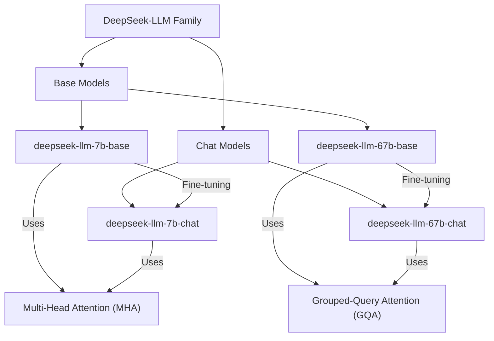
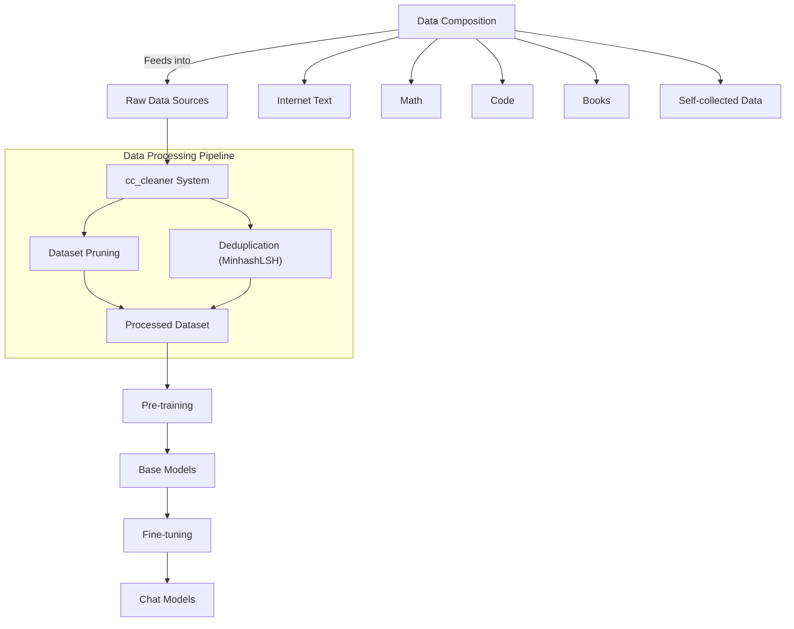
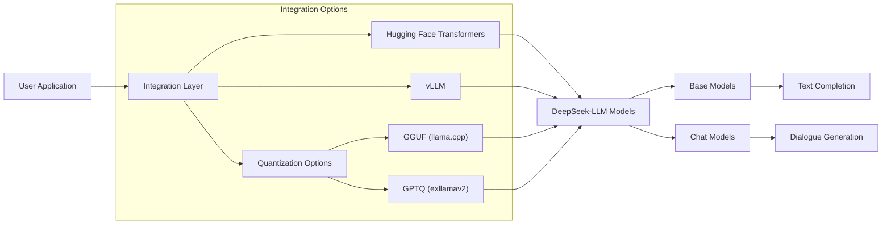
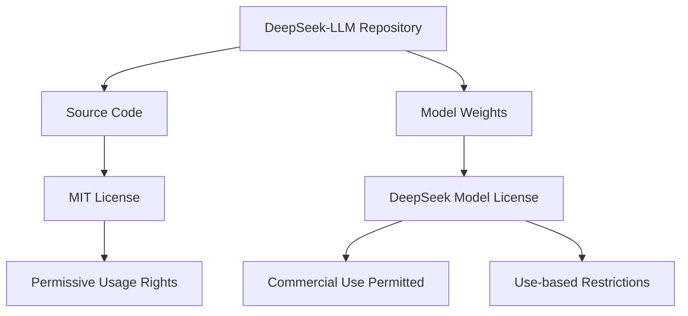

<!-- source: DeepWiki mcp.deepwiki.com · repo deepseek-ai/DeepSeek-LLM · page 1 Overview · fetched 2026-10-30 -->

# Overview

<details>
<summary>Relevant source files</summary>

The following files were used as context for generating this wiki page:

- [README.md](README.md)

</details>


This page provides an introduction to the DeepSeek-LLM repository, a collection of large language models developed by DeepSeek-AI. It covers the model family structure, architectural design, capabilities, and integration options. For detailed usage instructions, see [Usage Guide](#3), and for comprehensive evaluation results, refer to [Evaluation and Benchmarks](#4).

## What is DeepSeek-LLM?

DeepSeek-LLM is an advanced language model family trained on a diverse dataset of 2 trillion tokens in both English and Chinese. The repository contains multiple model variants with different parameter sizes and optimization targets, making them suitable for various applications ranging from text completion to specialized tasks like coding and mathematics.

### Key Features

- **Parameter Scales**: Models available in 7B and 67B parameter sizes
- **Variants**: Base models for general purpose use and chat models optimized for dialogue
- **Context Length**: All models support a sequence length of 4096 tokens
- **Capabilities**: Strong performance in reasoning, coding, math, and Chinese language understanding
- **Open License**: Supports commercial use under the DeepSeek Model License

Sources: [README.md:63-76]()

## Model Family Structure

DeepSeek-LLM consists of four main models organized in a hierarchical structure, with chat models being fine-tuned versions of their base counterparts.

### Model Family Diagram



Sources: [README.md:77-89](), [README.md:195-197]()

## Model Architecture

DeepSeek-LLM uses an auto-regressive transformer decoder architecture similar to LLaMA. The models employ different attention mechanisms based on their size:

- **7B Models**: Use Multi-Head Attention (MHA)
- **67B Models**: Use Grouped-Query Attention (GQA) for improved efficiency

The models were pre-trained with AdamW optimizer using the following configurations:

| Model Size | Batch Size | Learning Rate | Sequence Length |
|------------|------------|---------------|-----------------|
| 7B         | 2304       | 4.2e-4        | 4096            |
| 67B        | 4608       | 3.2e-4        | 4096            |

Sources: [README.md:195-198]()

## Data Pipeline and Training

DeepSeek-LLM was trained on approximately 2 trillion tokens using a sophisticated data processing pipeline.

### Data Pipeline Diagram



Key aspects of the data pipeline:

- **Data Composition**: Diverse mix of Internet text, math, code, books, and self-collected data
- **Dataset Pruning**: Heuristic rules and models to filter low-quality content
- **Deduplication**: MinhashLSH technique used to remove duplicates at document and string levels

Sources: [README.md:182-194]()

## Model Integration and Usage

DeepSeek-LLM models can be integrated through multiple interfaces, providing flexibility for different deployment scenarios.

### Integration Options Diagram



The models support two primary usage patterns:

1. **Text Completion**: Generating text continuations from a given prompt
2. **Chat Completion**: Generating conversational responses in a dialogue format

Sources: [README.md:210-328]()

## Model Capabilities and Performance

DeepSeek-LLM demonstrates strong performance across various benchmarks, with particular strengths in specific domains.

### Capability Comparison

```mermaid
radar
    title "DeepSeek-LLM-67B Capability Profile"
    axisLabel "Performance Level"
        
    axis "General Reasoning"
    axis "Code Generation" 
    axis "Mathematical Problem Solving"
    axis "Chinese Language"
    axis "Instruction Following"
        
    series "DeepSeek-LLM-67B-Chat"
    "General Reasoning" 85
    "Code Generation" 90
    "Mathematical Problem Solving" 87
    "Chinese Language" 88
    "Instruction Following" 82
```

Performance highlights include:

- **Coding Proficiency**: 73.78% pass@1 on HumanEval for the 67B chat model
- **Mathematical Reasoning**: 84.1% accuracy on GSM8K and 65/100 score on the Hungarian National High School Exam
- **Chinese Language Understanding**: Strong performance on CEval and CMMLU benchmarks

Sources: [README.md:104-166]()

## Limitations

Despite their capabilities, DeepSeek LLMs have several limitations to be aware of:

1. **Potential Data Bias**: May reflect biases present in training data
2. **Hallucination**: Can generate plausible-sounding but factually incorrect information
3. **Repetition**: May exhibit repetitive patterns in generated responses

Sources: [README.md:371-380]()

## Licensing

DeepSeek-LLM employs a dual licensing structure:



- **Code License**: MIT License (found in LICENSE-CODE)
- **Model License**: DeepSeek Model License (found in LICENSE-MODEL) which permits commercial use with certain restrictions

Sources: [README.md:382-383]()

---

