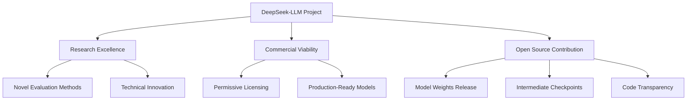
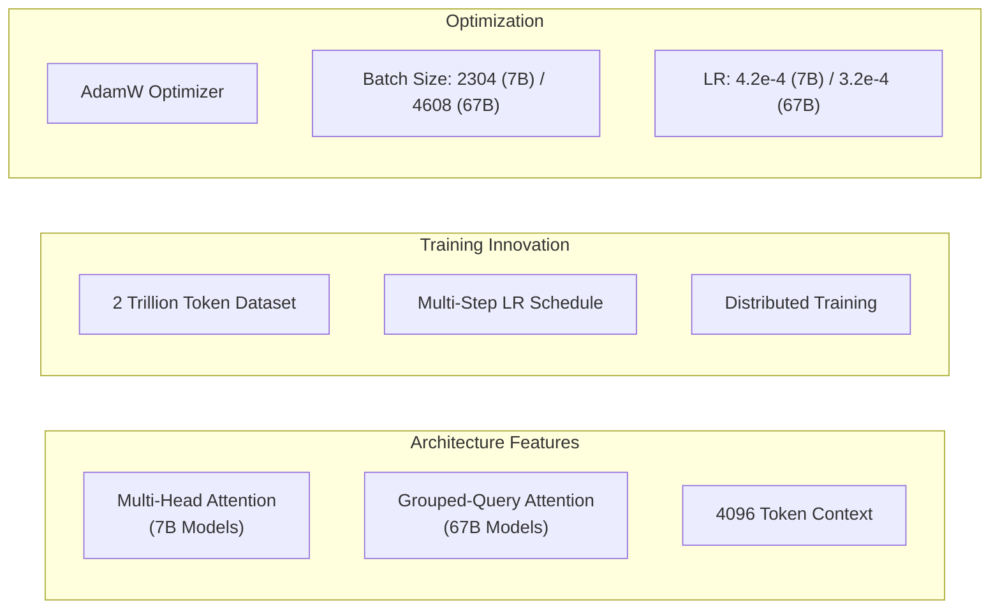
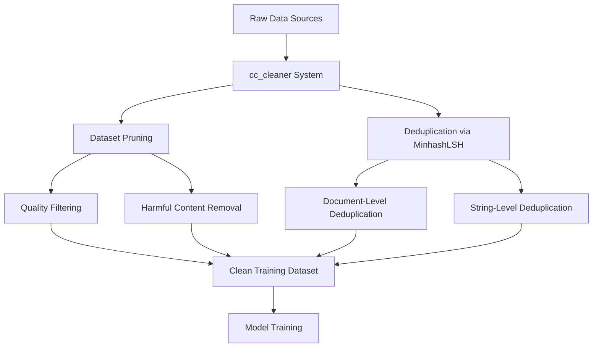
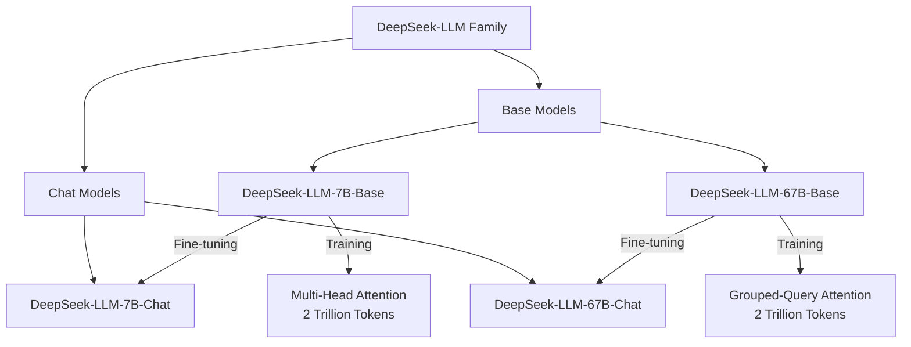
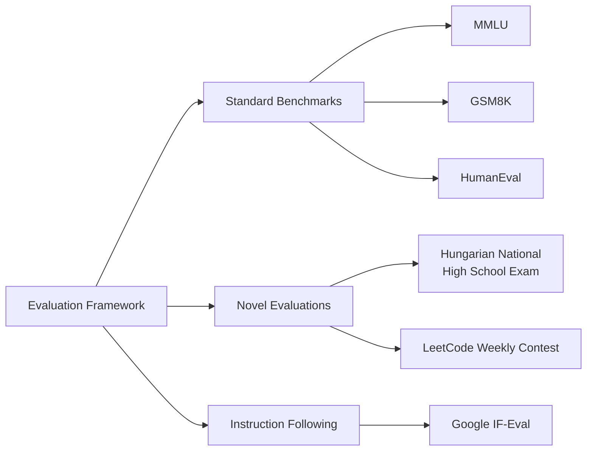

<!-- source: DeepWiki mcp.deepwiki.com · repo deepseek-ai/DeepSeek-LLM · page 1.1 Project Goals and Features · fetched 2026-10-30 -->

# Project Goals and Features

Relevant source files

The following files were used as context for generating this wiki page:

- [README.md](README.md)

## Purpose and Scope

This document outlines the primary goals and key features of the DeepSeek-LLM project. It covers the project's overall objectives, the distinctive capabilities of the models, and the technical innovations that differentiate this project in the large language model landscape. For detailed information about specific model variants, see [Model Family](#1.2). For technical architecture details, see [Model Architecture](#2).

## Project Overview

DeepSeek-LLM is an advanced large language model project aimed at creating powerful, open-source models for both research and commercial applications. The primary goal is to develop models that excel in general capabilities while demonstrating particular strength in specialized domains such as mathematics, coding, and multilingual comprehension.

Sources: [README.md:63-65]()

## Core Goals

The DeepSeek-LLM project pursues several foundational goals:

1. **Create Powerful Base Models**: Develop high-performing foundation models trained on diverse, high-quality data at scale (2 trillion tokens)

2. **Specialized Excellence**: Achieve superior performance in targeted domains, particularly mathematics, coding, and Chinese language comprehension

3. **Research Enablement**: Provide open access to models and intermediate checkpoints to foster innovation in the AI research community

4. **Commercial Applicability**: Support commercial use through permissive licensing while maintaining ethical safeguards

5. **Multilingual Capability**: Ensure strong performance across multiple languages with particular emphasis on English and Chinese

Sources: [README.md:63-76]()

## Key Features

### Advanced Architecture and Training

The DeepSeek-LLM models utilize a transformer-based architecture with specific optimizations:

- 7B models employ Multi-Head Attention (MHA)
- 67B models use Grouped-Query Attention (GQA)
- Training on 2 trillion tokens with 4096 sequence length
- Sophisticated learning rate scheduling with multiple step-downs

Sources: [README.md:195-199]()

### Data Processing Pipeline

A distinguishing feature of the project is its sophisticated data processing system:

- **cc_cleaner**: A distributed batch processing system for data refinement
- **Dataset Pruning**: Heuristic rules and models to filter low-quality content
- **Deduplication**: MinhashLSH-based removal of duplicates at document and string levels

Sources: [README.md:182-194]()

### Domain-Specific Excellence

The DeepSeek-LLM models demonstrate exceptional performance in several key domains:

#### Mathematics and Reasoning

- GSM8K: 84.1% (67B Chat model, 0-shot)
- MATH: 32.6% (67B Chat model, 0-shot)
- Hungarian National High School Exam: 65/100 points

#### Coding Proficiency

- HumanEval Pass@1: 73.78% (67B Chat model)
- Performance on LeetCode Weekly Contest problems
- Strong performance on MBPP benchmark

#### Multilingual Capabilities

- Strong performance on Chinese benchmarks (C-Eval, CMMLU)
- Specialized Chinese question-answering performance
- Balanced training across English and Chinese data

Sources: [README.md:70-76](), [README.md:123-177]()

## Model Family Design

DeepSeek-LLM consists of a range of models designed for different use cases:

Sources: [README.md:77-89](), [README.md:195-199]()

## Evaluation Framework

A comprehensive evaluation system is a core feature of the project, including:

1. **Standard Benchmarks**: MMLU, GSM8K, HumanEval, BBH, etc.
2. **Novel Evaluation Methods**: Hungarian National High School Exam, LeetCode Weekly Contest
3. **Instruction Following Evaluation**: Using Google's instruction following benchmark

This evaluation framework goes beyond typical LLM benchmarks to test capabilities in never-before-seen problems, addressing concerns about data contamination in standard benchmarks.

| Model | TriviaQA | MMLU | GSM8K | HumanEval | BBH | C-Eval | CMMLU |
|-------|----------|------|-------|-----------|-----|--------|-------|
| DeepSeek-LLM 7B Chat | 57.9 | 49.4 | 62.6 | 48.2 | 42.3 | 47.0 | 49.7 |
| DeepSeek-LLM 67B Chat | 81.5 | 71.1 | 84.1 | 73.8 | 71.7 | 65.2 | 67.8 |

Sources: [README.md:104-177]()

## Licensing Strategy

A distinctive feature of the DeepSeek-LLM project is its dual licensing approach:

- **Code**: Released under the MIT License, enabling broad code reuse
- **Model Weights**: Released under a custom DeepSeek Model License that permits commercial use while maintaining ethical safeguards

This approach balances open-source principles with responsible AI deployment.

Sources: [README.md:381-383]()

## Infrastructure Features

The project includes several notable infrastructure components:

- Support for inference through Hugging Face Transformers
- High-throughput inference via vLLM integration
- Compatibility with quantization methods (GGUF/GPTQ)
- Intermediate checkpoint access for research

These features enhance the accessibility and utility of the models for various deployment scenarios.

Sources: [README.md:210-327]()

---

