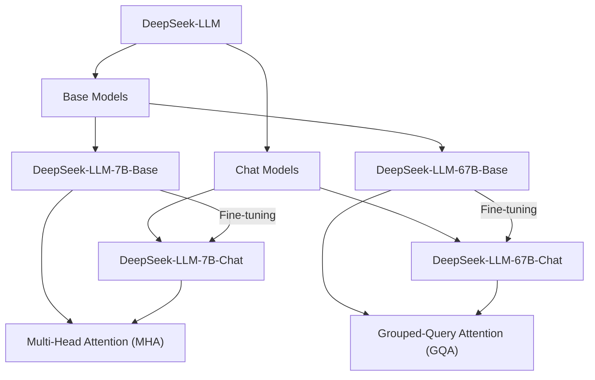
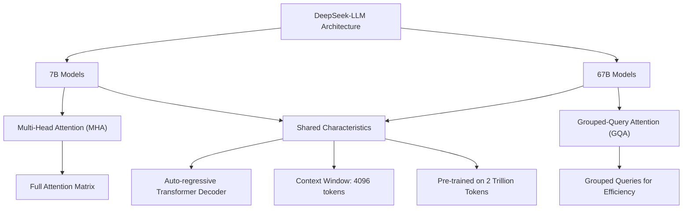
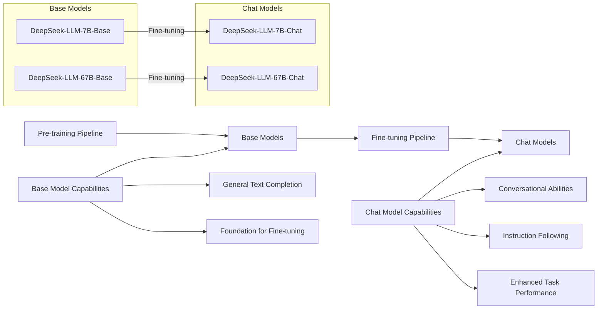
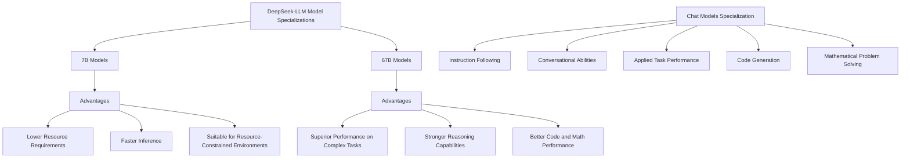

<!-- source: DeepWiki mcp.deepwiki.com · repo deepseek-ai/DeepSeek-LLM · page 1.2 Model Family · fetched 2026-10-30 -->

# Model Family

<details>
<summary>Relevant source files</summary>

The following files were used as context for generating this wiki page:

- [README.md](README.md)

</details>


This document provides a comprehensive overview of the DeepSeek-LLM model family, explaining the different variants, their architectures, capabilities, and relationships. It covers both base and chat models across different parameter sizes, along with their technical specifications and performance characteristics.

For information about the training methodology used for these models, see [Training Methodology](#2.1).

## Model Variants Overview

DeepSeek-LLM consists of four primary model variants organized in a hierarchical structure:



Sources: [README.md:82-88]()

The model family is structured into two main categories:

1. **Base Models**: Pre-trained from scratch on a diverse dataset of 2 trillion tokens.
   - **DeepSeek-LLM-7B-Base**: Smaller model with 7 billion parameters
   - **DeepSeek-LLM-67B-Base**: Larger model with 67 billion parameters

2. **Chat Models**: Fine-tuned versions of the base models optimized for conversational interactions.
   - **DeepSeek-LLM-7B-Chat**: Fine-tuned from the 7B base model
   - **DeepSeek-LLM-67B-Chat**: Fine-tuned from the 67B base model

## Model Architecture

All DeepSeek-LLM models follow an auto-regressive transformer decoder architecture similar to LLaMA, with key differences between the 7B and 67B variants:



Sources: [README.md:196-198]()

### Architectural Differences

- **7B Models**: Utilize standard Multi-Head Attention (MHA) mechanism
- **67B Models**: Employ Grouped-Query Attention (GQA) for improved efficiency at larger scale

### Shared Characteristics

All models in the family share:
- Auto-regressive transformer decoder design
- Context window of 4096 tokens
- Pre-training on a dataset of 2 trillion tokens with diverse content

## Technical Specifications

### Model Parameters and Architecture

| Model | Parameters | Attention Mechanism | Context Length | Training Tokens |
|-------|------------|---------------------|----------------|-----------------|
| DeepSeek-LLM-7B-Base | 7 billion | MHA | 4096 | 2 trillion |
| DeepSeek-LLM-7B-Chat | 7 billion | MHA | 4096 | 2 trillion |
| DeepSeek-LLM-67B-Base | 67 billion | GQA | 4096 | 2 trillion |
| DeepSeek-LLM-67B-Chat | 67 billion | GQA | 4096 | 2 trillion |

Sources: [README.md:82-88](), [README.md:196-198]()

### Performance Benchmarks

The models show different performance profiles across various benchmarks:

| Model | MMLU | GSM8K | HumanEval | C-Eval | CMMLU |
|-------|------|-------|-----------|--------|-------|
| DeepSeek-LLM-7B-Base | 48.2 | 17.4 | 26.2 | 45.0 | 47.2 |
| DeepSeek-LLM-67B-Base | 71.3 | 63.4 | 42.7 | 66.1 | 70.8 |
| DeepSeek-LLM-7B-Chat | 49.4 | 62.6 | 48.2 | 47.0 | 49.7 |
| DeepSeek-LLM-67B-Chat | 71.1 | 84.1 | 73.8 | 65.2 | 67.8 |

Sources: [README.md:158-166]()

## Base and Chat Model Relationship

The relationship between base and chat models is a fundamental aspect of the DeepSeek-LLM family:



Sources: [README.md:63-76](), [README.md:158-166]()

### Development Flow

1. **Base Model Creation**: Pre-trained from scratch on 2 trillion tokens
2. **Chat Model Derivation**: Fine-tuned from base models on conversational data

### Capability Differences

- **Base Models**: Excel at general text completion and serve as foundations for further fine-tuning
- **Chat Models**: Optimized for conversation, instruction following, and show enhanced performance on applied tasks

### Performance Differences

Fine-tuning significantly improves performance on practical tasks. For example:
- GSM8K performance jumps from 17.4 to 62.6 for the 7B model after fine-tuning
- HumanEval performance increases from 26.2 to 48.2 for the 7B model

## Hardware Requirements

The models have different GPU memory requirements based on batch size and sequence length:

### DeepSeek-LLM-7B (1 NVIDIA A100-40GB)

| Batch Size | 256 tokens | 512 tokens | 1024 tokens | 2048 tokens | 4096 tokens |
|------------|------------|------------|-------------|-------------|-------------|
| 1 | 13.29 GB | 13.63 GB | 14.47 GB | 16.37 GB | 21.25 GB |
| 2 | 13.63 GB | 14.39 GB | 15.98 GB | 19.82 GB | 29.59 GB |
| 4 | 14.47 GB | 15.82 GB | 19.04 GB | 26.65 GB | OOM |
| 8 | 15.99 GB | 18.71 GB | 25.14 GB | 35.19 GB | OOM |
| 16 | 19.06 GB | 24.52 GB | 37.28 GB | OOM | OOM |

### DeepSeek-LLM-67B (8 NVIDIA A100-40GB)

| Batch Size | 256 tokens | 512 tokens | 1024 tokens | 2048 tokens | 4096 tokens |
|------------|------------|------------|-------------|-------------|-------------|
| 1 | 16.92 GB | 17.11 GB | 17.66 GB | 20.01 GB | 33.23 GB |
| 2 | 17.04 GB | 17.28 GB | 18.55 GB | 25.27 GB | OOM |
| 4 | 17.20 GB | 17.80 GB | 21.28 GB | 33.71 GB | OOM |
| 8 | 17.59 GB | 19.25 GB | 25.69 GB | OOM | OOM |
| 16 | 18.17 GB | 21.69 GB | 34.54 GB | OOM | OOM |

Sources: [README.md:364-369]()

## Usage Examples

Both base and chat models have different usage patterns. Here are examples of how to use them with Hugging Face's Transformers:

### Base Model (Text Completion)

```python
import torch
from transformers import AutoTokenizer, AutoModelForCausalLM, GenerationConfig

model_name = "deepseek-ai/deepseek-llm-7b-base"  # or "deepseek-ai/deepseek-llm-67b-base"
tokenizer = AutoTokenizer.from_pretrained(model_name)
model = AutoModelForCausalLM.from_pretrained(model_name, torch_dtype=torch.bfloat16, device_map="auto")
model.generation_config = GenerationConfig.from_pretrained(model_name)
model.generation_config.pad_token_id = model.generation_config.eos_token_id

text = "An attention function can be described as mapping a query and a set of key-value pairs to an output, where the query, keys, values, and output are all vectors. The output is"
inputs = tokenizer(text, return_tensors="pt")
outputs = model.generate(**inputs.to(model.device), max_new_tokens=100)

result = tokenizer.decode(outputs[0], skip_special_tokens=True)
print(result)
```

### Chat Model (Conversation)

```python
import torch
from transformers import AutoTokenizer, AutoModelForCausalLM, GenerationConfig

model_name = "deepseek-ai/deepseek-llm-7b-chat"  # or "deepseek-ai/deepseek-llm-67b-chat"
tokenizer = AutoTokenizer.from_pretrained(model_name)
model = AutoModelForCausalLM.from_pretrained(model_name, torch_dtype=torch.bfloat16, device_map="auto")
model.generation_config = GenerationConfig.from_pretrained(model_name)
model.generation_config.pad_token_id = model.generation_config.eos_token_id

messages = [
    {"role": "user", "content": "Who are you?"}
]
input_tensor = tokenizer.apply_chat_template(messages, add_generation_prompt=True, return_tensors="pt")
outputs = model.generate(input_tensor.to(model.device), max_new_tokens=100)

result = tokenizer.decode(outputs[0][input_tensor.shape[1]:], skip_special_tokens=True)
print(result)
```

Sources: [README.md:224-274]()

## Model Strengths and Specializations

Each model in the family has particular strengths:



Sources: [README.md:71-76](), [README.md:158-166]()

### 7B Models

- Suitable for environments with limited GPU resources
- Faster inference speed
- Good balance between performance and efficiency

### 67B Models

- Superior general capabilities
- Exceptional performance in reasoning
- Strong abilities in coding and mathematics
- Excellent Chinese language comprehension

### Chat Models (Highlighted Capabilities)

- **DeepSeek LLM 67B Chat**: 
  - Outstanding coding performance (HumanEval Pass@1: 73.78)
  - Strong mathematical reasoning (GSM8K 0-shot: 84.1, MATH 0-shot: 32.6)
  - Exceptional generalization abilities (Hungarian National High School Exam score: 65)

Sources: [README.md:71-76]()

---

