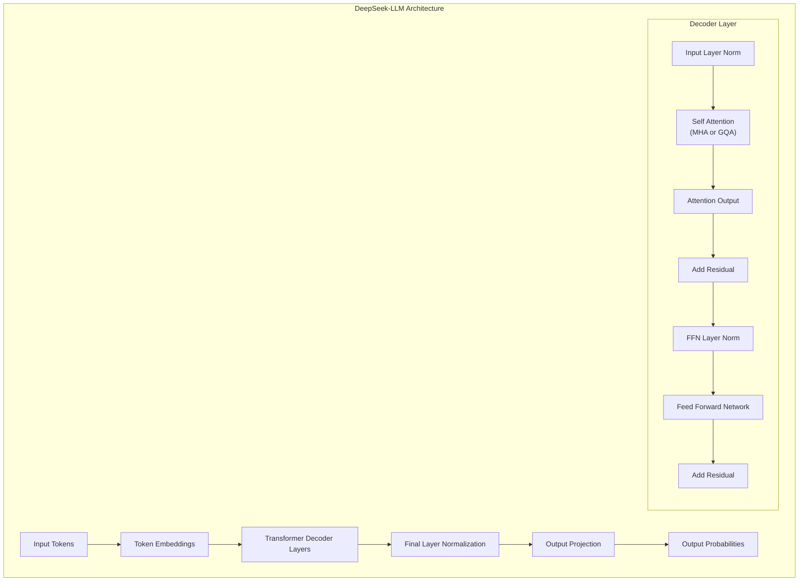
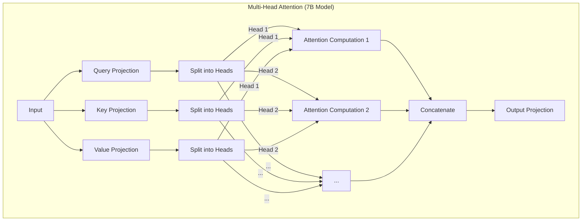
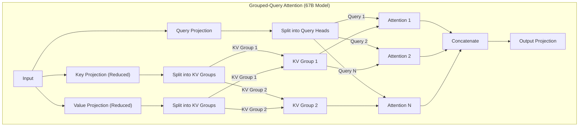
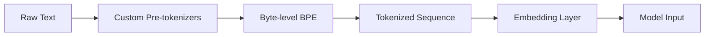
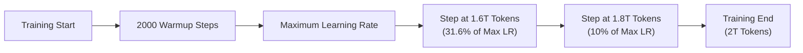
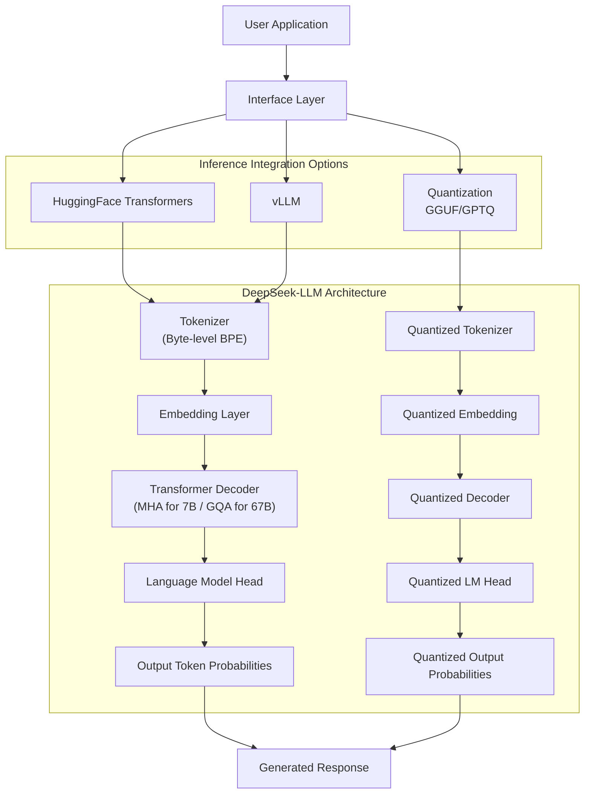

<!-- source: DeepWiki mcp.deepwiki.com · repo deepseek-ai/DeepSeek-LLM · page 2 Model Architecture · fetched 2026-10-30 -->

# Model Architecture

Relevant source files

The following files were used as context for generating this wiki page:

- [README.md](README.md)

This document describes the technical architecture of DeepSeek-LLM models, including their internal structure, parameter configurations, and implementation details. For information about training methodology and data composition, see [Training Methodology](#2.1), and for details about the data processing pipeline, see [Data Pipeline](#2.2).

## Overview

DeepSeek-LLM follows the auto-regressive transformer decoder architecture similar to LLaMA. The models are available in two main parameter sizes (7B and 67B), each with base and chat variants. Both sizes support a context length of 4096 tokens, enabling them to process and generate long-form content.

### High-Level Architecture

Sources: [README.md:196-197]()

## Model Variants and Specifications

DeepSeek-LLM is available in two main parameter sizes, each with specific architectural choices optimized for performance and efficiency.

| Parameter | DeepSeek-LLM 7B | DeepSeek-LLM 67B |
|-----------|----------------|------------------|
| Total Parameters | 7 billion | 67 billion |
| Attention Mechanism | Multi-Head Attention (MHA) | Grouped-Query Attention (GQA) |
| Context Length | 4096 tokens | 4096 tokens |
| Training Batch Size | 2304 | 4608 |
| Learning Rate | 4.2e-4 | 3.2e-4 |
| Tokenizer | Byte-level BPE | Byte-level BPE |

Sources: [README.md:196-197](), [README.md:198-199]()

## Attention Mechanisms

The DeepSeek-LLM models implement different attention mechanisms depending on model size to balance computational efficiency and model capability.

### Multi-Head Attention (7B Model)

The 7B model uses traditional Multi-Head Attention where queries, keys, and values are projected into multiple heads, each operating independently before being concatenated.

### Grouped-Query Attention (67B Model)

The 67B model uses Grouped-Query Attention (GQA), which reduces computational requirements by sharing keys and values across multiple query heads, making large models more efficient.

GQA allows the 67B model to maintain strong performance while reducing memory footprint and computational requirements compared to standard Multi-Head Attention at that scale.

Sources: [README.md:196-197]()

## Tokenization

DeepSeek-LLM uses a custom implementation of the Byte-level BPE (Byte Pair Encoding) algorithm through the Hugging Face Tokenizer library, with specially designed pre-tokenizers for optimal performance.

Unlike some other models, DeepSeek-LLM does not use SentencePiece tokenization, which has implications for compatibility with certain quantization methods.

Sources: [README.md:333-334]()

## Training Configuration

DeepSeek-LLM models were trained using the AdamW optimizer on a dataset of 2 trillion tokens. The training employed a multi-step learning rate schedule:

Sources: [README.md:198-199]()

## Memory Requirements for Inference

The memory requirements for inference vary based on model size, batch size, and sequence length:

### 7B Model (1 NVIDIA A100-40GB GPU)

| Batch Size | 256 tokens | 512 tokens | 1024 tokens | 2048 tokens | 4096 tokens |
|------------|------------|------------|-------------|-------------|-------------|
| 1          | 13.29 GB   | 13.63 GB   | 14.47 GB    | 16.37 GB    | 21.25 GB    |
| 2          | 13.63 GB   | 14.39 GB   | 15.98 GB    | 19.82 GB    | 29.59 GB    |
| 4          | 14.47 GB   | 15.82 GB   | 19.04 GB    | 26.65 GB    | OOM         |
| 8          | 15.99 GB   | 18.71 GB   | 25.14 GB    | 35.19 GB    | OOM         |
| 16         | 19.06 GB   | 24.52 GB   | 37.28 GB    | OOM         | OOM         |

### 67B Model (8 NVIDIA A100-40GB GPUs)

| Batch Size | 256 tokens | 512 tokens | 1024 tokens | 2048 tokens | 4096 tokens |
|------------|------------|------------|-------------|-------------|-------------|
| 1          | 16.92 GB   | 17.11 GB   | 17.66 GB    | 20.01 GB    | 33.23 GB    |
| 2          | 17.04 GB   | 17.28 GB   | 18.55 GB    | 25.27 GB    | OOM         |
| 4          | 17.20 GB   | 17.80 GB   | 21.28 GB    | 33.71 GB    | OOM         |
| 8          | 17.59 GB   | 19.25 GB   | 25.69 GB    | OOM         | OOM         |
| 16         | 18.17 GB   | 21.69 GB   | 34.54 GB    | OOM         | OOM         |

Sources: [README.md:365-369]()

## Model Integration Architecture

The following diagram shows how DeepSeek-LLM's architecture integrates with inference systems and user applications:

Sources: [README.md:196-197](), [README.md:337-358]()

## Base and Chat Model Variants

For each parameter size (7B and 67B), DeepSeek-LLM offers two variants:

1. **Base Models**: Foundation models trained on the full 2 trillion token dataset
2. **Chat Models**: Fine-tuned versions of the base models optimized for conversational interactions

The underlying architecture remains consistent between base and chat variants of the same parameter size, with differences only in the training objectives used during fine-tuning.

Sources: [README.md:77-78]()

---

