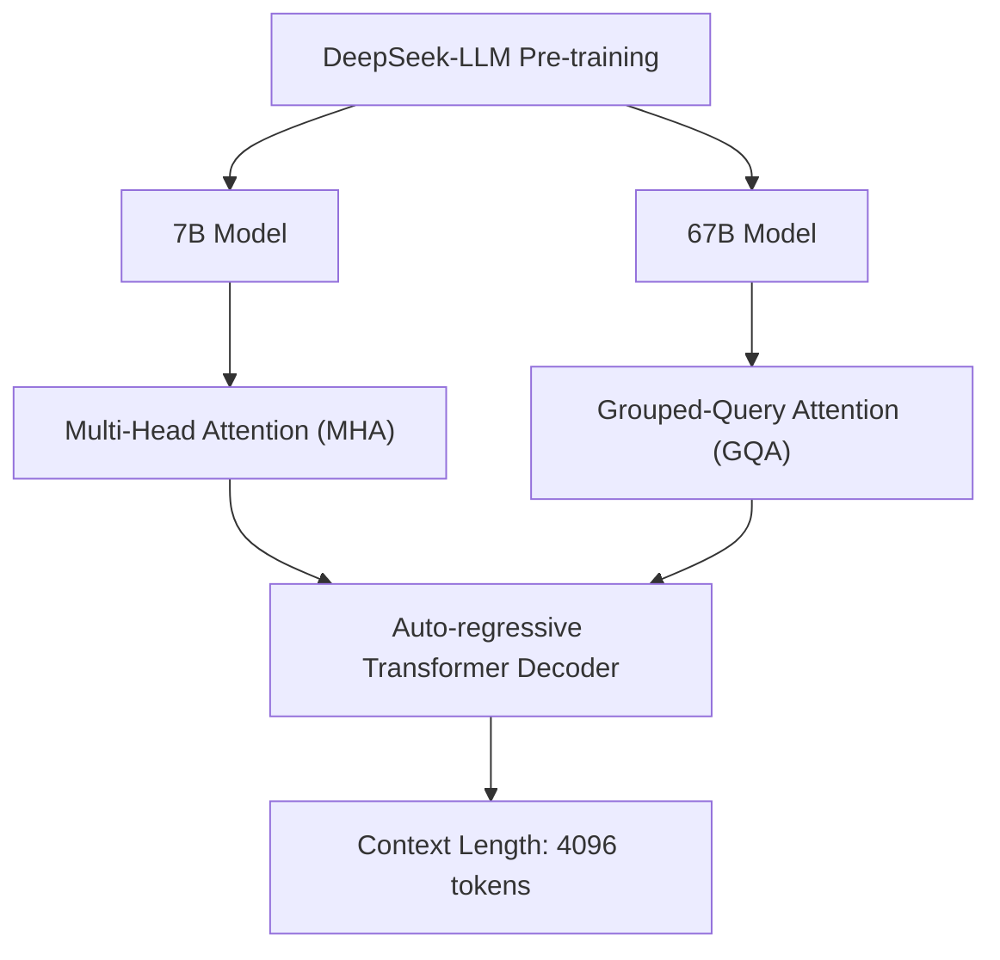
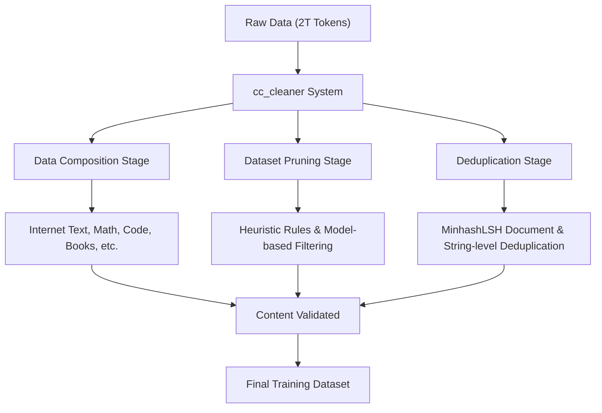
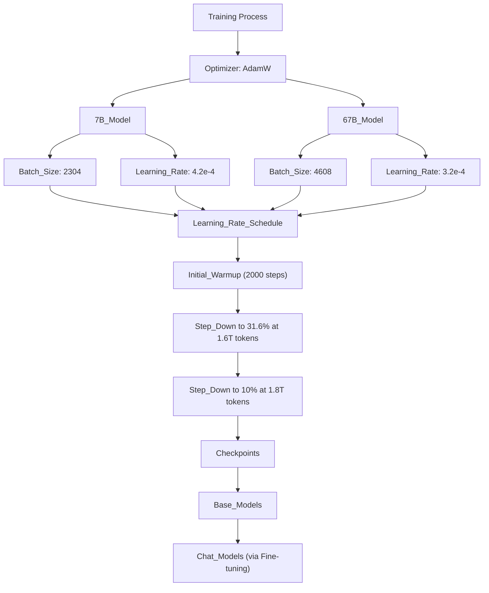
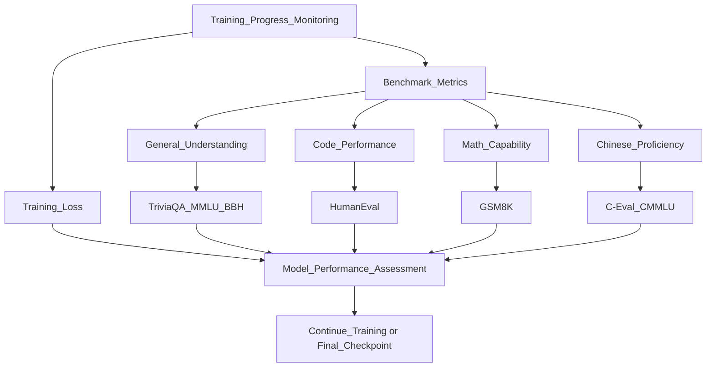

<!-- source: DeepWiki mcp.deepwiki.com · repo deepseek-ai/DeepSeek-LLM · page 2.1 Training Methodology · fetched 2026-10-30 -->

# Training Methodology

Relevant source files

The following files were used as context for generating this wiki page:

- [README.md](README.md)

This document details the training methodology used for DeepSeek-LLM models, covering the pre-training process, data composition, and optimization methods. For more detailed information about the model architecture itself, see [Model Architecture](#2), and for a deeper explanation of the data pipeline, see [Data Pipeline](#2.2).

## Overview

DeepSeek-LLM models were trained from scratch on 2 trillion tokens in both English and Chinese. The training methodology was designed to produce models with strong general capabilities, particularly in coding, mathematics, and Chinese language understanding.

## Pre-training Architecture and Configuration

DeepSeek-LLM follows the LLaMA architecture pattern, using an auto-regressive transformer decoder model with different attention mechanisms based on parameter size:

The training process used the following configurations:

| Parameter | 7B Model | 67B Model |
|-----------|----------|-----------|
| Batch Size | 2304 | 4608 |
| Learning Rate | 4.2e-4 | 3.2e-4 |
| Optimizer | AdamW | AdamW |
| Sequence Length | 4096 | 4096 |

Sources: [README.md:196-197]()

## Data Processing

DeepSeek-LLM training utilized a sophisticated data pipeline called "cc_cleaner", a distributed batch processing system with frequent checkpointing to ensure data quality and diversity.

### Data Composition

The training corpus was deliberately diverse, including:
- Internet text
- Mathematical content
- Programming code
- Books
- Self-collected data (respecting robots.txt)

All personal information and copyright-restricted content was systematically removed from the dataset.

### Dataset Pruning

The pipeline employed both heuristic rules and model-based filtering to:
- Remove low-quality web content
- Preserve valuable low-resource knowledge
- Eliminate harmful or toxic content
- Improve overall corpus quality

### Deduplication Process

An advanced deduplication system using MinhashLSH was implemented to ensure data uniqueness:
- Document-level deduplication to remove duplicate documents
- String-level deduplication to remove repeated content across different documents
- Rigorous integrity checks for large-scale dataset processing

Sources: [README.md:182-194]()

## Training Process

The training process employed a multi-stage approach with careful optimization to ensure model quality throughout the 2 trillion token training run.

### Learning Rate Schedule

A multi-step learning rate schedule was employed:
1. Initial warmup with 2000 steps
2. Learning rate stepped down to 31.6% of maximum at 1.6 trillion tokens
3. Further reduced to 10% of maximum at 1.8 trillion tokens

Sources: [README.md:195-199]()

## Training Progress Monitoring

The training progress was continuously monitored using:
1. Training loss curve
2. Performance on multiple benchmark metrics

### Benchmark Metrics

Various benchmarks were tracked throughout training to evaluate model performance across different capability dimensions:

| Category | Benchmarks |
|----------|------------|
| General Understanding | TriviaQA, MMLU, BBH |
| Code | HumanEval |
| Mathematics | GSM8K |
| Chinese | C-Eval, CMMLU |

The loss curve shows continuous improvement throughout training, with the model progressively improving on all benchmark metrics:

| Training Progress | Loss | TriviaQA | MMLU | GSM8K | HumanEval |
|-------------------|------|----------|------|-------|-----------|
| 500B tokens | Higher | Lower | Lower | Lower | Lower |
| 1T tokens | Medium | Medium | Medium | Medium | Medium |
| 2T tokens | Lowest | Highest | Highest | Highest | Highest |

Sources: [README.md:200-208]()

## Intermediate Checkpoints

As part of the training methodology, intermediate model checkpoints were preserved to enable research on model development over time. These checkpoints are available for both the 7B and 67B parameter models, allowing researchers to analyze the progression of model capabilities throughout the training process.

Sources: [README.md:90-102]()

---

