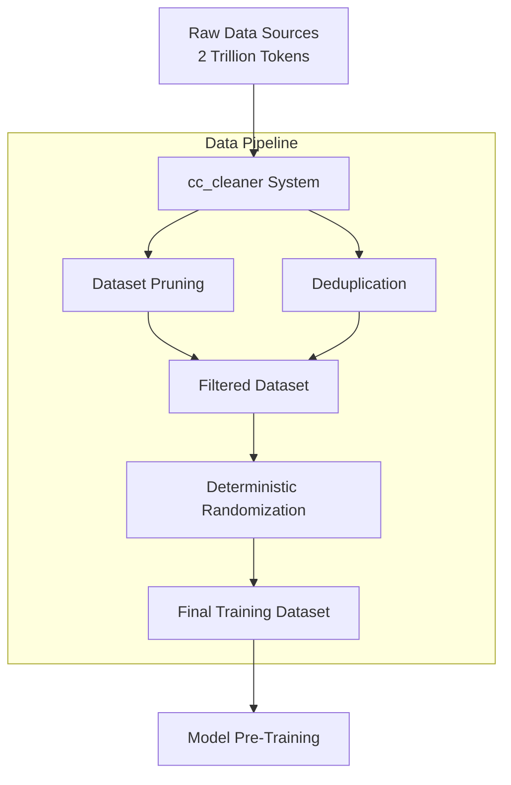
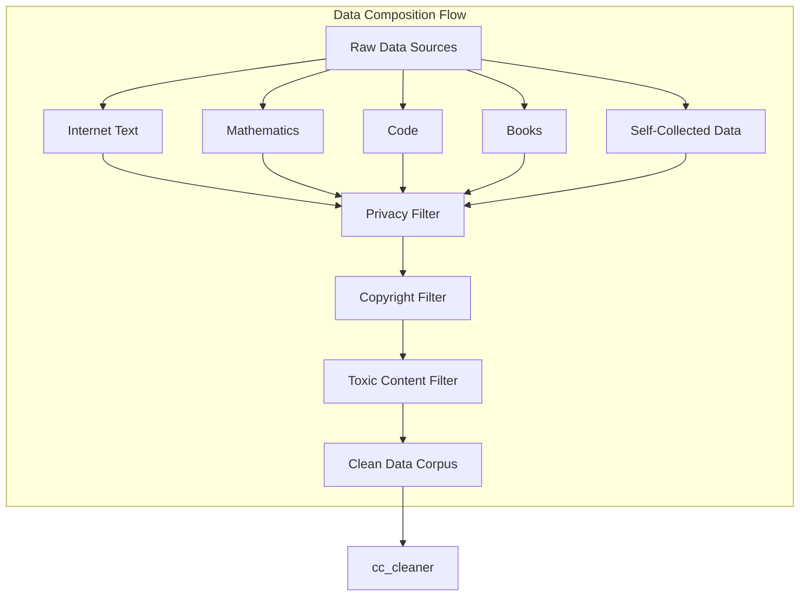
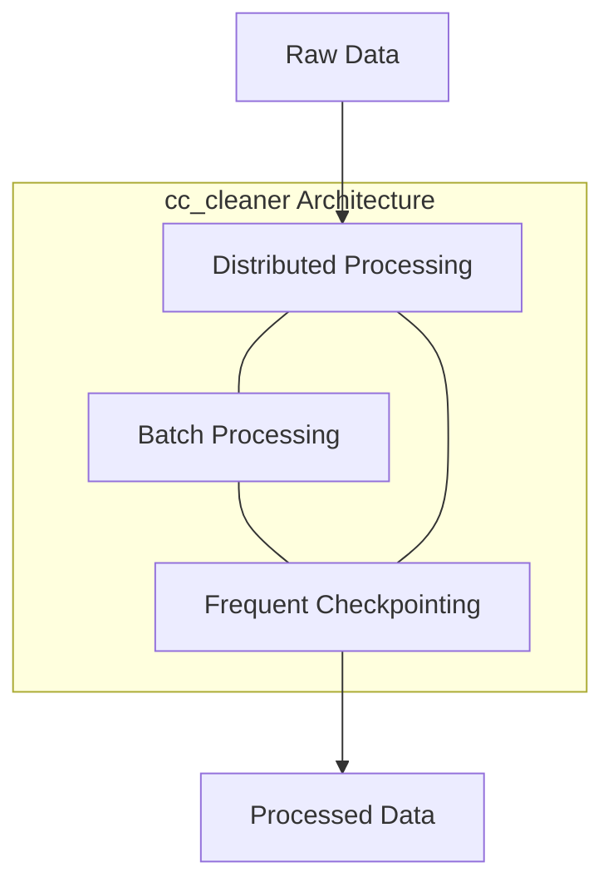
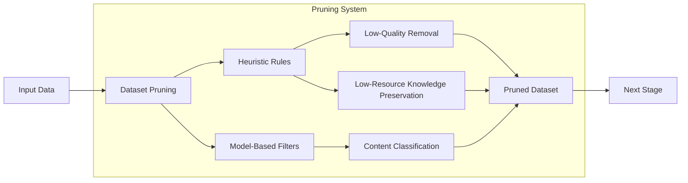
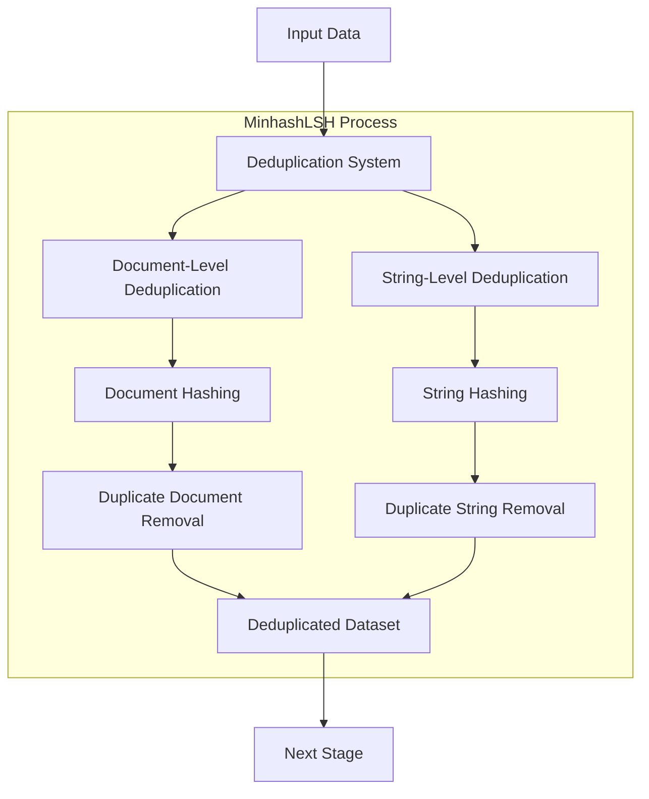
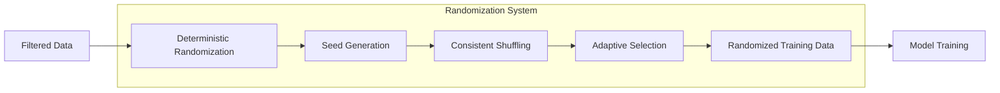
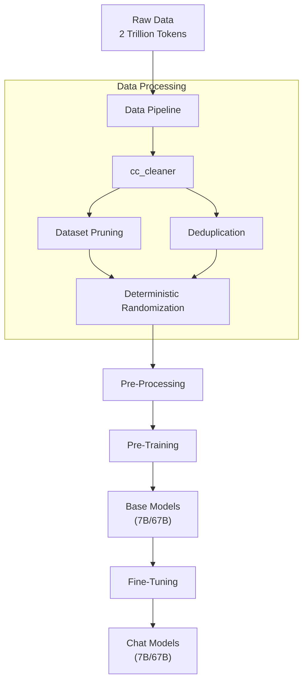

<!-- source: DeepWiki mcp.deepwiki.com · repo deepseek-ai/DeepSeek-LLM · page 2.2 Data Pipeline · fetched 2026-10-30 -->

# Data Pipeline

Relevant source files

The following files were used as context for generating this wiki page:

- [README.md](README.md)

## Purpose and Scope

This document describes the data processing pipeline used to prepare and clean the massive dataset for training DeepSeek-LLM models. The pipeline handles approximately 2 trillion tokens of diverse content, ensuring data quality, uniqueness, and ethical compliance throughout the training process.

For information about how this processed data is used in model training, see [Training Methodology](#2.1).

## System Overview

The DeepSeek-LLM data pipeline is built around "cc_cleaner," a distributed batch processing system with frequent checkpointing capabilities. This system transforms raw data from various sources into a clean, deduplicated, and high-quality dataset suitable for large language model training.

Sources: [README.md:182-194]()

## Data Composition

The training data comprises a diverse mixture of content types to provide the models with broad knowledge and capabilities:

| Content Type | Description | Purpose |
|--------------|-------------|---------|
| Internet text | Web pages, articles, forums | General knowledge and language patterns |
| Mathematics | Math problems, solutions, explanations | Mathematical reasoning capabilities |
| Code | Programming code from various languages | Coding and technical abilities |
| Books | Literary works, textbooks, research papers | Deep knowledge and complex reasoning |
| Self-collected data | Custom datasets respecting robots.txt | Specialized knowledge and capabilities |

A critical aspect of the data composition process is strict adherence to privacy and copyright considerations. The pipeline systematically removes:
- Content containing personal information
- Material subject to copyright restrictions
- Harmful or toxic content

Sources: [README.md:189-194]()

## Data Processing Components

### cc_cleaner System

The "cc_cleaner" system is the backbone of the data pipeline, providing a distributed framework for batch processing with frequent checkpointing. This system coordinates all data processing components and ensures efficient and reliable operation at web scale.

Sources: [README.md:183-184]()

### Dataset Pruning

The pruning component applies both heuristic rules and model-based approaches to filter content:

The pruning system serves several key functions:
1. Removing low-quality web data using various quality metrics
2. Preserving valuable low-resource knowledge even if it comes from otherwise lower-quality sources
3. Improving overall corpus quality
4. Eliminating harmful or toxic content

Sources: [README.md:191-193]()

### Deduplication System

The deduplication system uses MinhashLSH (Locality-Sensitive Hashing) to detect and remove duplicate content at two levels:

This rigorous deduplication approach ensures:
1. Document-level deduplication - Removes entire documents that are duplicates or near-duplicates
2. String-level deduplication - Identifies and removes duplicate text passages within and across documents
3. Exceptional data uniqueness and integrity to prevent the model from overlearning specific patterns

Sources: [README.md:193-194]()

### Deterministic Randomization

The pipeline incorporates deterministic randomization techniques to continuously enhance the data throughout the training process:

This approach allows for:
1. Adaptive data selection - Dynamically adjusting which data is presented to the model
2. Consistent reproducibility - Maintaining reproducible results despite randomization
3. Training stability - Providing varied but consistent data throughout the lengthy training process

Sources: [README.md:186-187]()

## Integration with Training Process

The data pipeline directly feeds into the pre-training process for DeepSeek-LLM models, providing a continuous stream of high-quality, diverse data:

This workflow shows how the data pipeline connects to the broader training process, ultimately resulting in both base and chat models. The processed dataset significantly impacts model performance, with DeepSeek-LLM demonstrating strong capabilities in areas like reasoning, coding, math, and Chinese comprehension.

Sources: [README.md:182-194](), [README.md:63-76]()

## Implementation Considerations

The implementation of the data pipeline prioritizes several key factors:

| Factor | Implementation Approach |
|--------|-------------------------|
| Scalability | Distributed architecture capable of handling trillions of tokens |
| Reliability | Frequent checkpointing to preserve progress and recover from failures |
| Efficiency | Batch processing to maximize throughput and resource utilization |
| Quality | Multi-layered filtering and verification for data integrity |
| Ethical compliance | Systematic removal of personal information and copyrighted content |

The pipeline represents a significant departure from simpler approaches like RefinedWeb + CCNet, offering more sophisticated processing capabilities tailored to the specific needs of training large language models like DeepSeek-LLM.

Sources: [README.md:183-194]()

---

