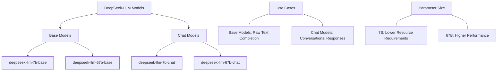
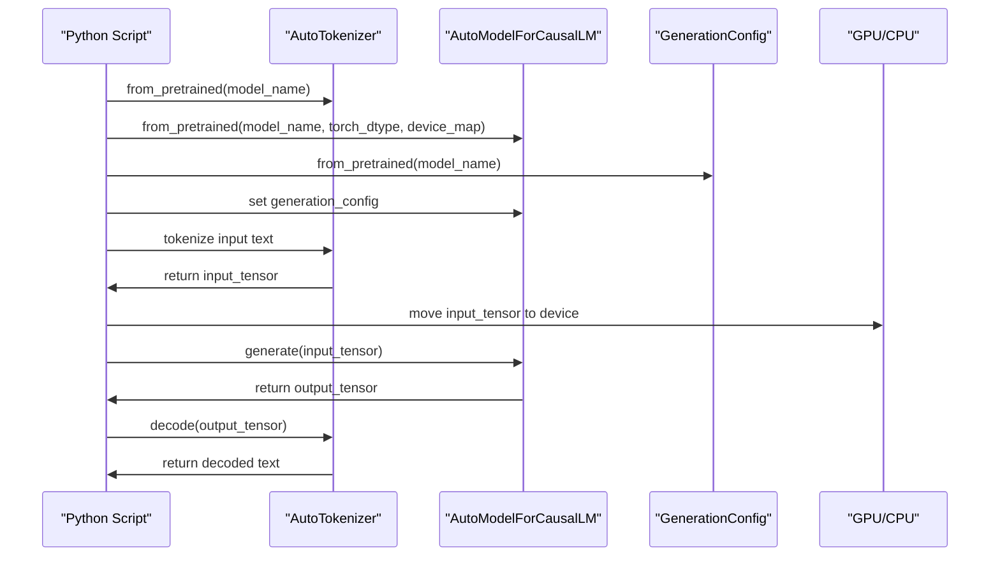
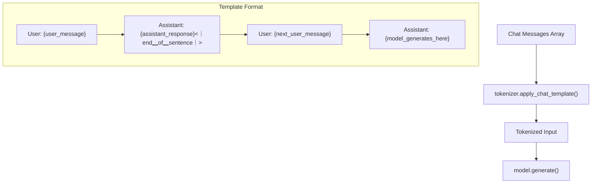

<!-- source: DeepWiki mcp.deepwiki.com · repo deepseek-ai/DeepSeek-LLM · page 3 Usage Guide · fetched 2026-10-30 -->

# Usage Guide

<details>
<summary>Relevant source files</summary>

The following files were used as context for generating this wiki page:

- [README.md](README.md)

</details>


This guide provides comprehensive instructions for utilizing DeepSeek-LLM models in various inference scenarios. It covers model loading, inference methods, hardware requirements, and optimization techniques for both base and chat model variants.

For information about model architecture and training methodology, see [Model Architecture](#2).

## Model Selection and Setup

DeepSeek-LLM comes in various sizes and types, each optimized for different use cases.

### Available Model Variants



Sources: [README.md:63-76]()

### Installation Requirements

Before using DeepSeek-LLM, ensure you have Python 3.8 or higher and install the necessary dependencies:

```bash
pip install -r requirements.txt
```

Sources: [README.md:214-218]()

## Inference with Transformers Library

The primary method for utilizing DeepSeek-LLM is through the Hugging Face Transformers library, which provides a standardized interface for model loading and text generation.

### Model Loading and Inference Flow



Sources: [README.md:220-242](), [README.md:246-265]()

### Text Completion with Base Models

For general text completion tasks, use the base models as follows:

```python
import torch
from transformers import AutoTokenizer, AutoModelForCausalLM, GenerationConfig

model_name = "deepseek-ai/deepseek-llm-67b-base"
tokenizer = AutoTokenizer.from_pretrained(model_name)
model = AutoModelForCausalLM.from_pretrained(model_name, torch_dtype=torch.bfloat16, device_map="auto")
model.generation_config = GenerationConfig.from_pretrained(model_name)
model.generation_config.pad_token_id = model.generation_config.eos_token_id

text = "An attention function can be described as mapping a query and a set of key-value pairs to an output, where the query, keys, values, and output are all vectors. The output is"
inputs = tokenizer(text, return_tensors="pt")
outputs = model.generate(**inputs.to(model.device), max_new_tokens=100)

result = tokenizer.decode(outputs[0], skip_special_tokens=True)
print(result)
```

Sources: [README.md:222-242]()

### Chat Completion with Chat Models

For conversational interactions, use the chat models with properly formatted inputs:

```python
import torch
from transformers import AutoTokenizer, AutoModelForCausalLM, GenerationConfig

model_name = "deepseek-ai/deepseek-llm-67b-chat"
tokenizer = AutoTokenizer.from_pretrained(model_name)
model = AutoModelForCausalLM.from_pretrained(model_name, torch_dtype=torch.bfloat16, device_map="auto")
model.generation_config = GenerationConfig.from_pretrained(model_name)
model.generation_config.pad_token_id = model.generation_config.eos_token_id

messages = [
    {"role": "user", "content": "Who are you?"}
]
input_tensor = tokenizer.apply_chat_template(messages, add_generation_prompt=True, return_tensors="pt")
outputs = model.generate(input_tensor.to(model.device), max_new_tokens=100)

result = tokenizer.decode(outputs[0][input_tensor.shape[1]:], skip_special_tokens=True)
print(result)
```

Sources: [README.md:246-265]()

### Chat Template Structure

DeepSeek-LLM chat models use a specific format for conversations. While `apply_chat_template()` handles this automatically, understanding the format is useful for troubleshooting or manual formatting:



If not using `apply_chat_template()`, you can format conversations manually:

```
User: {messages[0]['content']}

---

