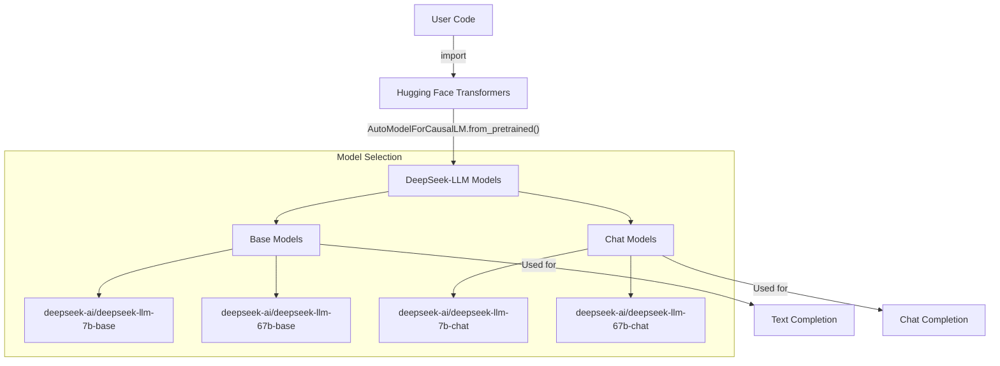

<!-- source: DeepWiki mcp.deepwiki.com · repo deepseek-ai/DeepSeek-LLM · page 3.1 Using with Hugging Face Transformers · fetched 2026-10-30 -->

# Using with Hugging Face Transformers

<details>
<summary>Relevant source files</summary>

The following files were used as context for generating this wiki page:

- [README.md](README.md)

</details>


This document provides a comprehensive guide on how to use DeepSeek-LLM models with the Hugging Face Transformers library. For using DeepSeek-LLM with vLLM for high-throughput inference, see [Using with vLLM](#3.2). For quantization options to run DeepSeek-LLM on lower-end hardware, see [Quantization Options](#3.3).

## Installation Requirements

Before using DeepSeek-LLM with Hugging Face Transformers, you need to set up the required dependencies:

```bash
# Requires Python >= 3.8
pip install -r requirements.txt
```

Sources: [README.md:212-218]()

## Model Variants and Selection

DeepSeek-LLM offers multiple model variants with different parameter sizes and capabilities. When using with Hugging Face Transformers, you must select the appropriate model variant for your use case.



Sources: [README.md:82-88]()

## Using Base Models for Text Completion

Base models are designed for general text completion tasks. They continue text based on the provided prompt without specific conversational capabilities.

### Basic Text Completion Example

```python
import torch
from transformers import AutoTokenizer, AutoModelForCausalLM, GenerationConfig

model_name = "deepseek-ai/deepseek-llm-67b-base"
tokenizer = AutoTokenizer.from_pretrained(model_name)
model = AutoModelForCausalLM.from_pretrained(model_name, torch_dtype=torch.bfloat16, device_map="auto")
model.generation_config = GenerationConfig.from_pretrained(model_name)
model.generation_config.pad_token_id = model.generation_config.eos_token_id

text = "An attention function can be described as mapping a query and a set of key-value pairs to an output, where the query, keys, values, and output are all vectors. The output is"
inputs = tokenizer(text, return_tensors="pt")
outputs = model.generate(**inputs.to(model.device), max_new_tokens=100)

result = tokenizer.decode(outputs[0], skip_special_tokens=True)
print(result)
```

Sources: [README.md:226-241]()

## Using Chat Models for Conversation

Chat models are optimized for conversational interactions and follow a specific dialog format. They're fine-tuned versions of the base models that understand turn-taking in conversations.

### Chat Completion Workflow

```mermaid
flowchart TD
    subgraph "Chat Completion Process"
        CreateMessages["Create Messages Array"] --> ApplyTemplate["Apply Chat Template"]
        ApplyTemplate --> Generate["Generate Response"]
        Generate --> DecodeOutput["Decode Output"]
    end
    
    subgraph "Code Entities"
        Messages["messages = [{role, content}, ...]"] --> |"Input to"| Template["tokenizer.apply_chat_template()"]
        Template --> |"Creates"| InputTensor["input_tensor"]
        InputTensor --> |"Input to"| ModelGenerate["model.generate()"]
        ModelGenerate --> |"Creates"| Outputs["outputs"]
        Outputs --> |"Processed by"| TokenizerDecode["tokenizer.decode()"]
        TokenizerDecode --> |"Produces"| Result["result"]
    end
```



### Basic Chat Completion Example

```python
import torch
from transformers import AutoTokenizer, AutoModelForCausalLM, GenerationConfig

model_name = "deepseek-ai/deepseek-llm-67b-chat"
tokenizer = AutoTokenizer.from_pretrained(model_name)
model = AutoModelForCausalLM.from_pretrained(model_name, torch_dtype=torch.bfloat16, device_map="auto")
model.generation_config = GenerationConfig.from_pretrained(model_name)
model.generation_config.pad_token_id = model.generation_config.eos_token_id

messages = [
    {"role": "user", "content": "Who are you?"}
]
input_tensor = tokenizer.apply_chat_template(messages, add_generation_prompt=True, return_tensors="pt")
outputs = model.generate(input_tensor.to(model.device), max_new_tokens=100)

result = tokenizer.decode(outputs[0][input_tensor.shape[1]:], skip_special_tokens=True)
print(result)
```

Sources: [README.md:246-264]()

### Chat Template Format

If you prefer not to use the `apply_chat_template` method, you can manually format your input using the following template:

```
User: {messages[0]['content']}

---

