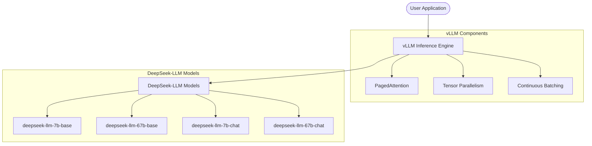
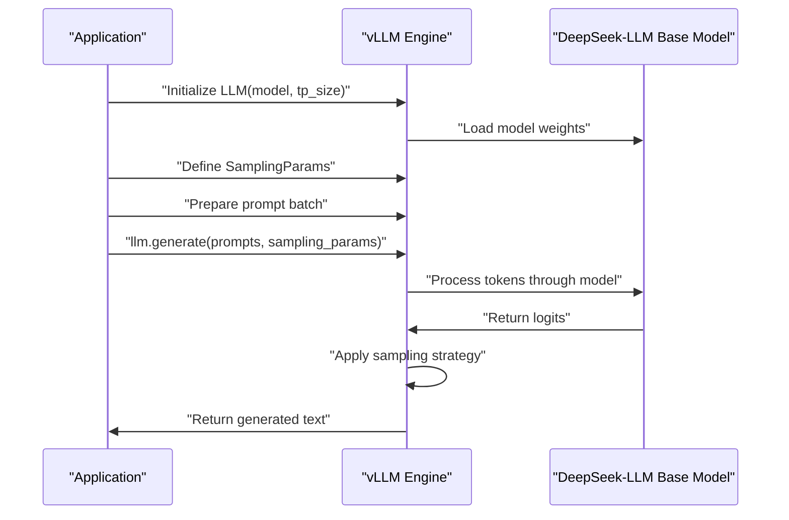
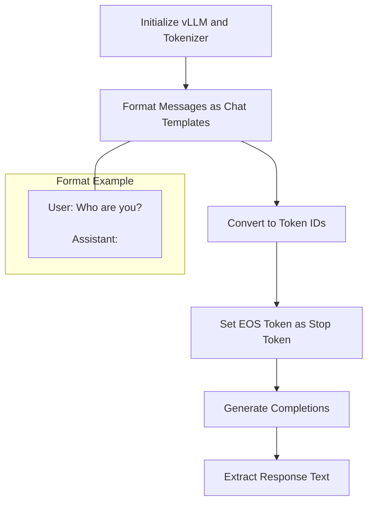
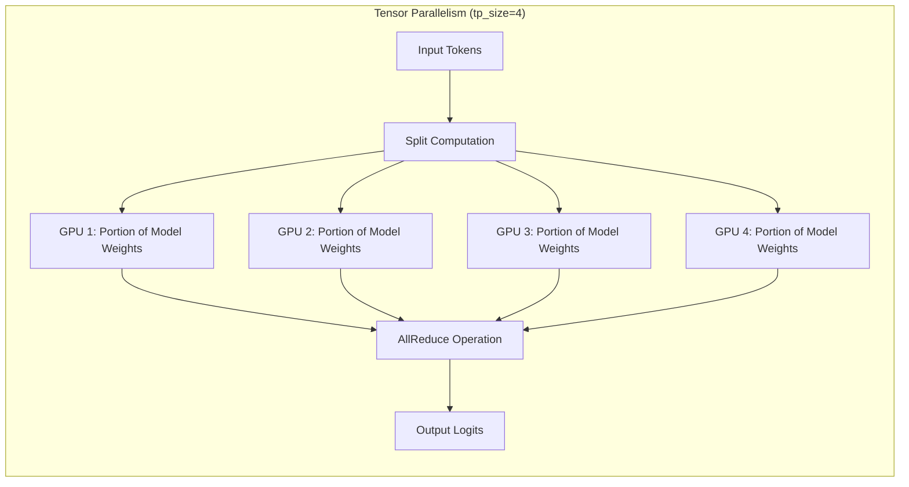

<!-- source: DeepWiki mcp.deepwiki.com · repo deepseek-ai/DeepSeek-LLM · page 3.2 Using with vLLM · fetched 2026-10-30 -->

# Using with vLLM

<details>
<summary>Relevant source files</summary>

The following files were used as context for generating this wiki page:

- [README.md](README.md)

</details>


This page provides a technical guide for integrating DeepSeek-LLM models with vLLM for high-throughput inference. vLLM is a fast and memory-efficient inference engine that optimizes LLM serving through techniques such as PagedAttention for efficient memory management. For standard integration with Hugging Face Transformers, see [Using with Hugging Face Transformers](#3.1).

## What is vLLM?

vLLM is a high-performance inference framework designed to maximize throughput and minimize latency when serving large language models. It offers several advantages when used with DeepSeek-LLM:

- Significantly higher throughput for batch processing
- More efficient memory management
- Support for tensor parallelism across multiple GPUs
- Continuous batching capabilities for production scenarios

## vLLM Integration Architecture



Sources: [README.md:280-329]()

## Setup and Configuration

Before using vLLM with DeepSeek-LLM, you need to install the vLLM library:

```bash
pip install vllm
```

Key configuration parameters when initializing a model with vLLM include:

| Parameter | Description | Recommended Value |
|-----------|-------------|------------------|
| `model` | HuggingFace model identifier or local path | `"deepseek-ai/deepseek-llm-7b-base"` |
| `trust_remote_code` | Required for custom model code | `True` |
| `gpu_memory_utilization` | Fraction of GPU memory to use | `0.9` (90%) |
| `tensor_parallel_size` | Number of GPUs for tensor parallelism | `1` for 7B, `4+` for 67B |

## Text Completion with Base Models

The inference workflow with vLLM for DeepSeek-LLM base models follows this pattern:



Sources: [README.md:284-301]()

### Example Usage for Base Models

For text completion with base models like `deepseek-llm-7b-base` or `deepseek-llm-67b-base`:

1. Initialize the LLM with vLLM
2. Define sampling parameters
3. Prepare batch of prompts
4. Generate completions
5. Extract generated text from outputs

## Chat Completion with Chat Models

For chat models (`deepseek-llm-7b-chat` or `deepseek-llm-67b-chat`), the process requires tokenizer integration to properly format chat templates:



Sources: [README.md:305-328]()

### Example Usage for Chat Models

The workflow for chat completion requires both the vLLM engine and HuggingFace tokenizer:

1. Initialize both the tokenizer and vLLM engine
2. Format chat messages using the tokenizer's `apply_chat_template`
3. Generate completions with token IDs instead of raw text
4. Set the model's EOS token as the stop token
5. Extract the generated text from outputs

## Memory Requirements and Performance

Memory usage varies significantly based on batch size and sequence length. The following tables show peak memory usage for different configurations:

### DeepSeek-LLM 7B (on 1×A100-40GB)

| Batch Size | 256 tokens | 512 tokens | 1024 tokens | 2048 tokens | 4096 tokens |
|------------|------------|------------|-------------|-------------|-------------|
| 1          | 13.29 GB   | 13.63 GB   | 14.47 GB    | 16.37 GB    | 21.25 GB    |
| 2          | 13.63 GB   | 14.39 GB   | 15.98 GB    | 19.82 GB    | 29.59 GB    |
| 4          | 14.47 GB   | 15.82 GB   | 19.04 GB    | 26.65 GB    | OOM         |
| 8          | 15.99 GB   | 18.71 GB   | 25.14 GB    | 35.19 GB    | OOM         |
| 16         | 19.06 GB   | 24.52 GB   | 37.28 GB    | OOM         | OOM         |

### DeepSeek-LLM 67B (on 8×A100-40GB)

| Batch Size | 256 tokens | 512 tokens | 1024 tokens | 2048 tokens | 4096 tokens |
|------------|------------|------------|-------------|-------------|-------------|
| 1          | 16.92 GB   | 17.11 GB   | 17.66 GB    | 20.01 GB    | 33.23 GB    |
| 2          | 17.04 GB   | 17.28 GB   | 18.55 GB    | 25.27 GB    | OOM         |
| 4          | 17.20 GB   | 17.80 GB   | 21.28 GB    | 33.71 GB    | OOM         |
| 8          | 17.59 GB   | 19.25 GB   | 25.69 GB    | OOM         | OOM         |
| 16         | 18.17 GB   | 21.69 GB   | 34.54 GB    | OOM         | OOM         |

Sources: [README.md:362-369]()

## Tensor Parallelism for Large Models

For the 67B model variant, tensor parallelism is essential for efficient inference. This technique distributes the model across multiple GPUs:



Sources: [README.md:288](), [README.md:310](), [README.md:362-369]()

## Optimization Tips

For optimal performance with vLLM:

1. Set appropriate `gpu_memory_utilization` value (typically 0.9)
2. Choose tensor parallelism based on model size and available GPUs
3. Adjust batch size and sequence length to avoid OOM errors
4. Configure sampling parameters to balance quality and speed
5. Use token IDs directly for chat models to avoid tokenization overhead

For quantized versions of DeepSeek-LLM with reduced memory requirements, see [Quantization Options](#3.3).

---

