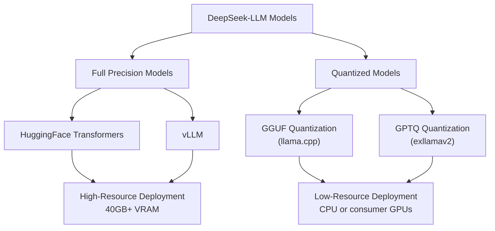
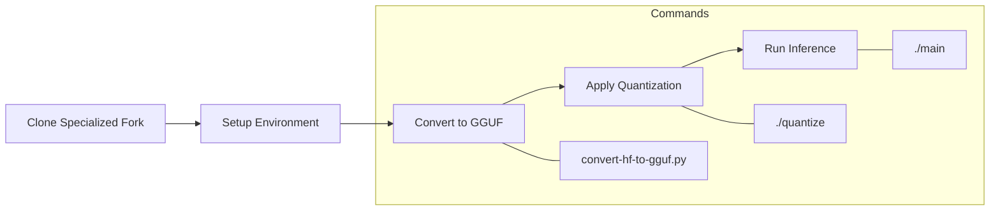
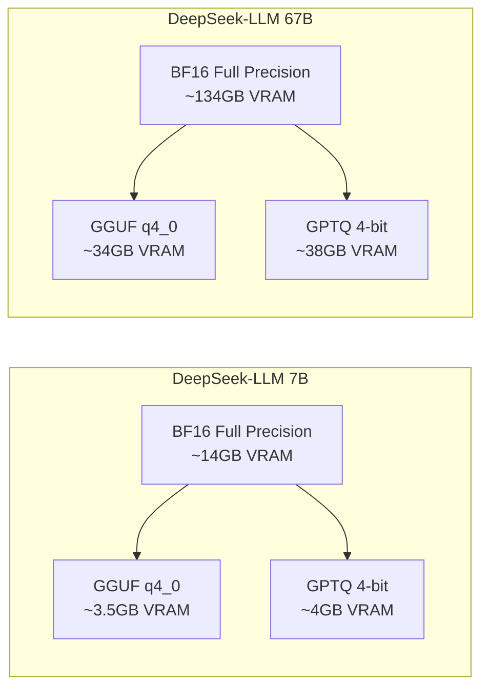

<!-- source: DeepWiki mcp.deepwiki.com · repo deepseek-ai/DeepSeek-LLM · page 3.3 Quantization Options · fetched 2026-10-30 -->

# Quantization Options

<details>
<summary>Relevant source files</summary>

The following files were used as context for generating this wiki page:

- [README.md](README.md)

</details>


This page explains the quantization options available for DeepSeek-LLM models. Quantization reduces memory requirements and improves inference speed by decreasing the precision of model weights, enabling deployment on hardware with limited resources. For information about using DeepSeek-LLM with Hugging Face Transformers, see [Using with Hugging Face Transformers](#3.1). For high-throughput inference information, see [Using with vLLM](#3.2).

## Quantization Overview

DeepSeek-LLM supports two primary quantization approaches for reduced resource usage: GGUF (llama.cpp) and GPTQ (exllamav2). These methods allow running models on consumer hardware by trading off a small amount of model quality for significantly reduced memory requirements.

### Deployment Workflow with Quantization



Sources: [README.md:332-357]()

## GGUF Quantization (llama.cpp)

GGUF (GPT-Generated Unified Format) is designed for efficiently storing and running large language models on consumer hardware. DeepSeek-LLM uses a Byte-level BPE algorithm with specially designed pre-tokenizers that requires specific handling during quantization.

### GGUF Implementation Status

A pull request has been submitted to the llama.cpp repository to fully support all HuggingFace pre-tokenizers, including those used by DeepSeek-LLM. While waiting for this PR to be merged, a specialized fork can be used.

### GGUF Quantization Steps



To convert DeepSeek-LLM models to GGUF format:

1. Clone the specialized fork supporting DeepSeek's tokenizer:
   ```bash
   git clone https://github.com/DOGEwbx/llama.cpp.git
   cd llama.cpp
   git checkout regex_gpt2_preprocess
   ```

2. Set up the environment:
   ```bash
   make
   python3 -m pip install -r requirements.txt
   ```

3. Generate and quantize the GGUF model:
   ```bash
   python convert-hf-to-gguf.py <MODEL_PATH> --outfile <GGUF_PATH> --model-name deepseekllm
   ./quantize <GGUF_PATH> <OUTPUT_PATH> q4_0
   ./main -m <OUTPUT_PATH> -n 128 -p <PROMPT>
   ```

Sources: [README.md:338-345]()

### GGUF Quantization Levels

The quantization level determines the trade-off between model size, inference speed, and quality:

| Quantization Level | Description | Memory Reduction | Quality Impact |
|-------------------|-------------|-----------------|---------------|
| q4_0 | 4-bit quantization | ~4x | Moderate |
| q4_1 | 4-bit with lookup tables | ~4x | Moderate-Low |
| q5_0 | 5-bit quantization | ~3.2x | Low |
| q5_1 | 5-bit with lookup tables | ~3.2x | Very Low |
| q8_0 | 8-bit quantization | ~2x | Minimal |

Sources: [README.md:346-354]()

## GPTQ Quantization (exllamav2)

GPTQ is a one-shot weight quantization method designed specifically for large language models. It optimizes for GPU inference with minimal quality loss.

### GPTQ Implementation Status

The exllamav2 library now supports HuggingFace Tokenizer, making it compatible with DeepSeek-LLM models. This means no special fork is required for using GPTQ quantization with DeepSeek-LLM models.

Sources: [README.md:356-357]()

### Memory Efficiency Comparison

The following diagram illustrates approximate memory usage reduction achieved through quantization compared to full-precision models:



## Memory Requirements

Memory requirements for full-precision DeepSeek-LLM models are documented in the project's README. These requirements can be significantly reduced through quantization.

### Full-Precision Memory Usage (7B Model)

For DeepSeek-LLM 7B on 1 NVIDIA A100-PCIE-40GB GPU:

| Batch Size | 256 tokens | 512 tokens | 1024 tokens | 2048 tokens | 4096 tokens |
|------------|------------|------------|-------------|-------------|-------------|
| 1          | 13.29 GB   | 13.63 GB   | 14.47 GB    | 16.37 GB    | 21.25 GB    |
| 2          | 13.63 GB   | 14.39 GB   | 15.98 GB    | 19.82 GB    | 29.59 GB    |
| 4          | 14.47 GB   | 15.82 GB   | 19.04 GB    | 26.65 GB    | OOM         |
| 8          | 15.99 GB   | 18.71 GB   | 25.14 GB    | 35.19 GB    | OOM         |
| 16         | 19.06 GB   | 24.52 GB   | 37.28 GB    | OOM         | OOM         |

### Full-Precision Memory Usage (67B Model)

For DeepSeek-LLM 67B on 8 NVIDIA A100-PCIE-40GB GPUs:

| Batch Size | 256 tokens | 512 tokens | 1024 tokens | 2048 tokens | 4096 tokens |
|------------|------------|------------|-------------|-------------|-------------|
| 1          | 16.92 GB   | 17.11 GB   | 17.66 GB    | 20.01 GB    | 33.23 GB    |
| 2          | 17.04 GB   | 17.28 GB   | 18.55 GB    | 25.27 GB    | OOM         |
| 4          | 17.20 GB   | 17.80 GB   | 21.28 GB    | 33.71 GB    | OOM         |
| 8          | 17.59 GB   | 19.25 GB   | 25.69 GB    | OOM         | OOM         |
| 16         | 18.17 GB   | 21.69 GB   | 34.54 GB    | OOM         | OOM         |

Sources: [README.md:360-369]()

## Choosing the Right Quantization Method

When selecting a quantization method, consider:

1. **Hardware**: 
   - For CPU deployment or older GPUs, GGUF with llama.cpp is generally the better choice
   - For modern NVIDIA GPUs, GPTQ with exllamav2 may provide better performance

2. **Use Case**:
   - For applications requiring high accuracy, higher precision quantization (8-bit) or full precision may be necessary
   - For general-purpose applications, 4-bit or 5-bit quantization often provides a good balance

3. **Model Size**:
   - Larger models (67B) see more dramatic memory savings from quantization
   - Smaller models (7B) can often run in full precision on high-end consumer GPUs

| Feature | GGUF (llama.cpp) | GPTQ (exllamav2) |
|---------|------------------|------------------|
| Primary Use | CPU & GPU | NVIDIA GPU |
| Integration Complexity | Standalone C++ application | Python library |
| Memory Efficiency | Very high | High |
| Inference Speed | Good | Excellent (on supported GPUs) |
| Quality Preservation | Good | Very good |
| Supported Platforms | Windows, Linux, macOS | Windows, Linux |

Sources: [README.md:332-357]()

---

