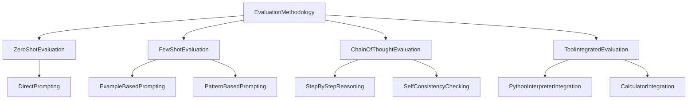
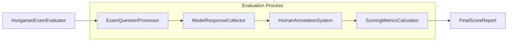
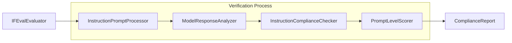
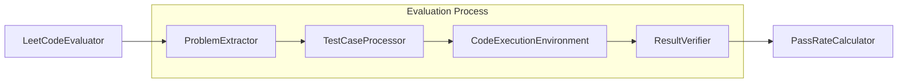

<!-- source: DeepWiki mcp.deepwiki.com · repo deepseek-ai/DeepSeek-LLM · page 4 Evaluation and Benchmarks · fetched 2026-10-30 -->

# Evaluation and Benchmarks

Relevant source files

The following files were used as context for generating this wiki page:

- [README.md](README.md)
- [evaluation/more_results.md](evaluation/more_results.md)
- [images/mathexam.png](images/mathexam.png)

## Purpose and Scope

This page documents the comprehensive evaluation framework and benchmarking system used to assess DeepSeek-LLM models across various capabilities including language understanding, knowledge, reasoning, mathematics, coding, and multilingual proficiency. For detailed examination of specific benchmark scores, see [Benchmark Results](#4.1), and for in-depth analysis of mathematical performance, see [Mathematical Problem Solving](#4.2).

## Evaluation Framework Architecture

The DeepSeek-LLM evaluation framework is organized as a modular system that measures model performance across multiple capability domains:

```mermaid
graph TD
    A["DeepSeekEvalSystem"] --> B["LanguageUnderstandingEvals"]
    A --> C["KnowledgeReasoningEvals"]
    A --> D["MathProblemSolvingEvals"]
    A --> E["CodeGenerationEvals"]
    A --> F["MultilingualEvals"]
    
    B --> B1["HellaSwagEvaluator"]
    B --> B2["PIQAEvaluator"]
    B --> B3["WinoGrandeEvaluator"]
    
    C --> C1["MMLUEvaluator"]
    C --> C2["ARCEvaluator"]
    C --> C3["TriviaQAEvaluator"]
    
    D --> D1["GSM8KEvaluator"]
    D --> D2["MATHEvaluator"]
    D --> D3["HungarianExamEvaluator"]
    
    E --> E1["HumanEvalEvaluator"]
    E --> E2["MBPPEvaluator"]
    E --> E3["LeetCodeEvaluator"]
    
    F --> F1["CMMULEvaluator"]
    F --> F2["CEvalEvaluator"]
    
    G["SpecializedEvaluators"] --> G1["IFEvalEvaluator"]
    G --> G2["CoTEvaluator"]
    G --> G3["ToolReasoningEvaluator"]
```

Sources: [README.md:104-119]()

## Evaluation Methodologies

The evaluation system implements multiple methodologies to assess model capabilities under different conditions:

Sources: [README.md:118-119](), [evaluation/more_results.md:16-19]()

## Standard Benchmark Suite

The evaluation framework includes a comprehensive suite of benchmarks that assess different aspects of model capabilities:

### Language Understanding Benchmarks

- **HellaSwag**: Tests common sense reasoning through sentence completion tasks
- **PIQA**: Physical Interaction Question Answering for physical commonsense reasoning
- **WinoGrande**: Assesses pronoun resolution and common sense reasoning

### Knowledge and Reasoning Benchmarks

- **MMLU** (Massive Multitask Language Understanding): Covers 57 subjects across STEM, humanities, social sciences, etc.
- **ARC-Easy/Challenge**: Elementary/middle school science questions requiring reasoning
- **TriviaQA**: Fact-based question answering dataset requiring world knowledge
- **BBH** (Big Bench Hard): Collection of challenging language tasks

### Mathematical Problem-Solving Benchmarks

- **GSM8K**: Grade school math word problems
- **MATH**: Competition-level mathematics problems
- **Hungarian National High-School Exam**: Real high school exam problems

### Code Generation Benchmarks

- **HumanEval**: Hand-written programming problems for function synthesis
- **MBPP**: Programming problems for Python code generation
- **LeetCode Weekly Contest**: Recent competitive programming problems

### Multilingual Benchmarks

- **CMMLU**: Chinese version of MMLU covering 67 topics
- **CEval**: Comprehensive Chinese evaluation suite
- **ChineseQA**: In-house Chinese question answering benchmark

Sources: [README.md:110-166](), [evaluation/more_results.md:1-14]()

## Novel Evaluation Approaches

DeepSeek-LLM introduces several novel evaluation approaches to address data contamination concerns and provide more robust assessment of model capabilities.

### Hungarian National High-School Exam Evaluation

This evaluation uses the Hungarian National High School Exam containing 33 mathematics problems. The process involves:

1. Extracting exam questions from the dataset repository
2. Prompting the model in a zero-shot setting
3. Collecting complete solution attempts
4. Human evaluation following the official scoring metric in the solution.pdf
5. Calculating total score across all problems

This approach provides assessment of mathematical reasoning capabilities on content models haven't encountered during training.

Sources: [README.md:128-135]()

### Instruction Following Evaluation (IFEval)

This evaluation uses Google's instruction following dataset released on November 15th, 2023. The system:

1. Uses 25 types of verifiable instructions across approximately 500 prompts
2. Evaluates model responses using the prompt-level loose metric
3. Measures the model's ability to correctly follow explicit instructions
4. Produces a compliance score reflecting instruction following capability

Sources: [README.md:139-143]()

### LeetCode Weekly Contest Evaluation

This evaluation assesses coding proficiency using problems from recent LeetCode contests:

1. Sources 126 problems from LeetCode Weekly Contests (351-372) and Bi-Weekly Contests (108-117)
2. Processes over 20 test cases for each problem
3. Executes model-generated solutions against all test cases
4. Considers a problem solved only if all test cases pass
5. Calculates a pass@1 score similar to HumanEval methodology

Sources: [README.md:147-153]()

## Benchmark Results

### Base Model Performance

The following table summarizes DeepSeek-LLM base models compared to other base models across standard benchmarks:

| Model | HellaSwag | TriviaQA | MMLU | GSM8K | HumanEval | BBH | CEval | CMMLU | ChineseQA |
|-------|-----------|----------|------|-------|-----------|-----|-------|-------|-----------|
| LLaMA-2 7B | 75.6 | 63.8 | 45.8 | 15.5 | 14.6 | 38.5 | 33.9 | 32.6 | 21.5 |
| LLaMA-2 70B | 84.0 | 79.5 | 69.0 | 58.4 | 28.7 | 62.9 | 51.4 | 53.1 | 50.2 |
| DeepSeek LLM 7B Base | 75.4 | 59.7 | 48.2 | 17.4 | 26.2 | 39.5 | 45.0 | 47.2 | 78.0 |
| DeepSeek LLM 67B Base | 84.0 | 78.9 | 71.3 | 63.4 | 42.7 | 68.7 | 66.1 | 70.8 | 87.6 |

Sources: [README.md:110-116]()

### Chat Model Performance

Performance of DeepSeek-LLM chat models on standard benchmarks:

| Model | TriviaQA | MMLU | GSM8K | HumanEval | BBH | CEval | CMMLU | ChineseQA |
|-------|----------|------|-------|-----------|-----|-------|-------|-----------|
| DeepSeek LLM 7B Chat | 57.9 | 49.4 | 62.6 | 48.2 | 42.3 | 47.0 | 49.7 | 75.0 |
| DeepSeek LLM 67B Chat | 81.5 | 71.1 | 84.1 | 73.8 | 71.7 | 65.2 | 67.8 | 85.1 |

Sources: [README.md:160-166]()

### Novel Evaluation Results

#### Hungarian National High-School Exam

| Model | Score (out of 100) |
|-------|-----------|
| DeepSeek LLM 67B Chat | 58 |
| Qwen-14B-Chat | 36.5 |
| ChatGLM3-6B | 32 |
| Baichuan2-Chat-13B | 19.5 |
| Yi-Chat-34B | 39 |
| GPT-3.5-Turbo | 41 |
| Grok-1 | 59 |
| Claude 2 | 55 |
| GPT-4 | 68 |

Sources: [README.md:132-135](), [evaluation/more_results.md:23-26]()

#### Instruction Following Evaluation

| Model | Prompt-level Instruction Following |
|-------|-----------------------------------|
| Qwen-14B-Chat | 48.9 |
| ChatGLM3-6B | 35.0 |
| Baichuan2-Chat-13B | 51.0 |
| Yi-Chat-34B | 51.2 |
| PaLM2 Small | 46.9 |
| DeepSeek LLM 67B Chat | 59.1 |
| GPT-4 | 79.3 |

Sources: [README.md:140-143](), [evaluation/more_results.md:28-31]()

#### LeetCode Weekly Contest

| Model | LeetCode Weekly Contest |
|-------|------------------------|
| Qwen-14B-Chat | 11.1 |
| ChatGLM3-6B | 2.38 |
| Baichuan2-Chat-13B | 1.58 |
| Yi-Chat-34B | 7.9 |
| GPT-3.5-Turbo | 20.6 |
| Phind-CodeLlama-34B-v2 | 12.6 |
| DeepSeek LLM 67B Chat | 17.5 |
| DeepSeek Coder 33B | 31.7 |
| GPT-4 | 48.4 |

Sources: [README.md:148-153](), [evaluation/more_results.md:32-35]()

## Mathematical Problem-Solving with Advanced Methods

The evaluation system assessed mathematical problem-solving capabilities using different reasoning approaches:

| Inference Method | GSM8k | MATH | MGSM-zh | CMATH | Gaokao-MathCloze | Gaokao-MathQA |
|-----------------|-------|------|---------|-------|------------------|---------------|
| Chain-of-Thought | 84.1% | 32.6% | 74.0% | 80.3% | 16.9% | 20.2% |
| Tool-Integrated Reasoning | 86.7% | 51.1% | 76.4% | 85.4% | 21.2% | 28.2% |

Sources: [evaluation/more_results.md:16-19]()

## Multiple-Choice Question Benchmark Analysis

The DeepSeek evaluation team found that performance on multiple-choice question benchmarks can be artificially enhanced. Adding Chinese multiple-choice questions to training data resulted in significant score improvements:

| Model | MMLU | C-Eval | CMMLU |
|-------|------|--------|-------|
| DeepSeek LLM 7B Chat | 49.4 | 47.0 | 49.7 |
| DeepSeek LLM 7B Chat + MC | 60.9 | 71.3 | 73.8 |

However, this approach led to benchmark overfitting without improving actual model knowledge on other tasks. Consequently, the team chose not to incorporate multiple-choice data in the pre-training or fine-tuning process, prioritizing genuine capability development over benchmark optimization.

Sources: [README.md:170-178]()

## Comprehensive Evaluation Results

The evaluation framework provides more extensive results for both base and chat models across dozens of standard benchmarks, including:

- HellaSwag, PIQA, WinoGrande (common sense reasoning)
- RACE-Middle, RACE-High (reading comprehension)
- TriviaQA, NaturalQuestions (question answering)
- MMLU, ARC-Easy, ARC-Challenge (knowledge and reasoning)
- GSM8K, MATH (mathematical reasoning)
- HumanEval, MBPP (code generation)
- DROP (reading comprehension with numerical reasoning)
- OpenBookQA, Pile-test (general knowledge)
- BBH, AGIEval (advanced reasoning)
- CLUEWSC, CHID, CEval, CMMLU (Chinese language understanding)

For complete benchmark details, refer to the `evaluation/more_results.md` file.

Sources: [evaluation/more_results.md:1-14]()

---

