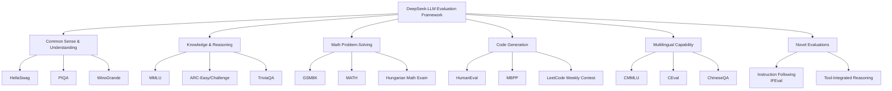
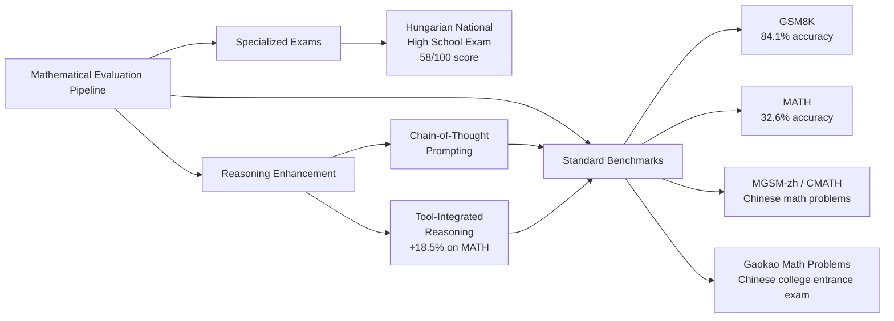
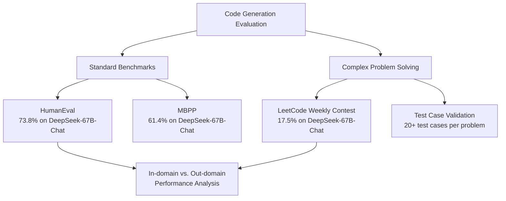
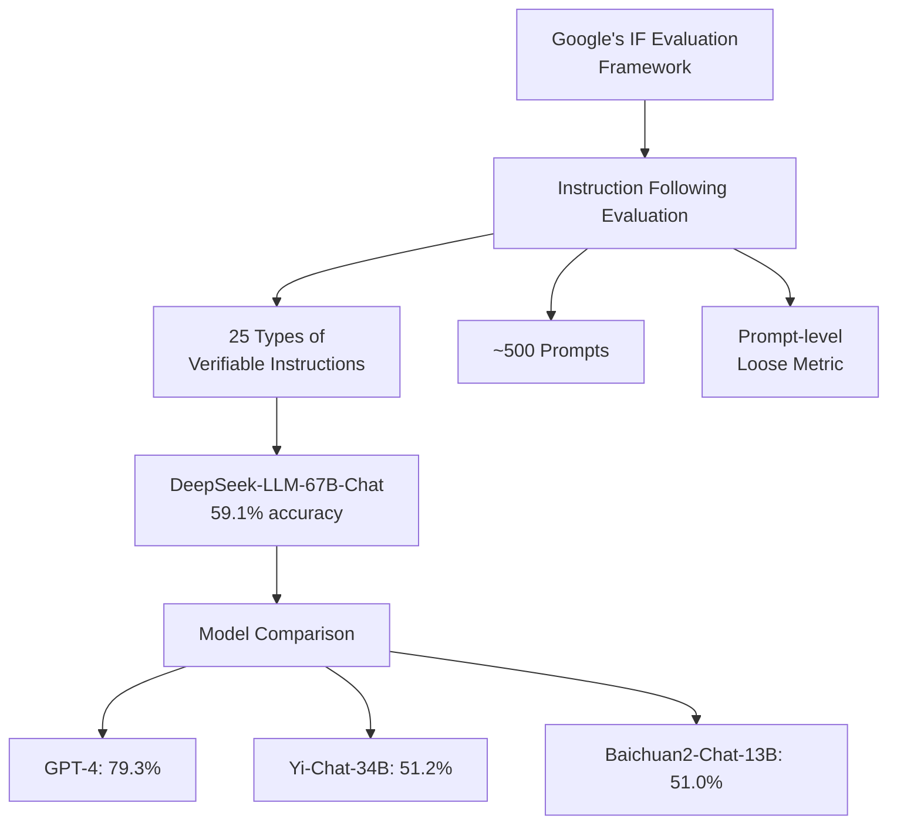
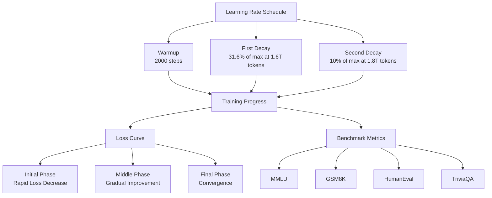

<!-- source: DeepWiki mcp.deepwiki.com · repo deepseek-ai/DeepSeek-LLM · page 4.1 Benchmark Results · fetched 2026-10-30 -->

# Benchmark Results

Relevant source files

The following files were used as context for generating this wiki page:

- [README.md](README.md)
- [evaluation/more_results.md](evaluation/more_results.md)

This page provides a comprehensive analysis of DeepSeek-LLM's performance across a wide range of standardized benchmarks. The evaluation framework covers language understanding, reasoning, mathematical problem-solving, coding abilities, and multilingual capabilities. For information about the mathematical problem-solving specifically, see [Mathematical Problem Solving](#4.2), and for instruction following evaluation details, see [Instruction Following Evaluation](#4.3).

## Evaluation Framework Overview

DeepSeek-LLM has been evaluated using a comprehensive benchmark framework that spans multiple capability domains. The framework is designed to assess both the base and chat models across different parameter scales (7B and 67B).

Sources: [README.md:105-167]()

## Base Model Benchmark Results

The base models (7B and 67B) have been evaluated against popular baseline models across various benchmarks. The results demonstrate DeepSeek-LLM's strong performance, particularly for the 67B variant which outperforms comparable models in many tasks.

### Core Benchmark Results

The following table presents the performance of DeepSeek-LLM base models compared to other baseline models on key benchmarks:

| Model | HellaSwag | TriviaQA | MMLU | GSM8K | HumanEval | BBH | CEval | CMMLU | ChineseQA |
|:---------------:|:-------------:|:------------:|:------:|:------:|:-------------:|:------:|:------:|:------:|:-------------:|
| LLaMA-2-7B | 75.6 | 63.8 | 45.8 | 15.5 | 14.6 | 38.5 | 33.9 | 32.6 | 21.5 |
| LLaMA-2-70B | 84.0 | 79.5 | 69.0 | 58.4 | 28.7 | 62.9 | 51.4 | 53.1 | 50.2 |
| DeepSeek-LLM-7B-Base | 75.4 | 59.7 | 48.2 | 17.4 | 26.2 | 39.5 | 45.0 | 47.2 | 78.0 |
| DeepSeek-LLM-67B-Base | 84.0 | 78.9 | 71.3 | 63.4 | 42.7 | 68.7 | 66.1 | 70.8 | 87.6 |

Sources: [README.md:103-118](), [evaluation/more_results.md:1-14]()

### Extended Benchmark Results

The following table provides a more comprehensive view of DeepSeek-LLM performance across additional benchmarks:

| Model | PIQA | WinoGrande | RACE-Middle | RACE-High | NaturalQuestions | ARC-Easy | ARC-Challenge | MBPP | DROP (EM) | DROP (F1) | OpenBookQA |
|:---------------:|:----:|:----------:|:-----------:|:---------:|:----------------:|:--------:|:-------------:|:----:|:---------:|:---------:|:----------:|
| DeepSeek-LLM-7B-Base | 79.2 | 70.5 | 63.2 | 46.5 | 22.2 | 67.9 | 48.1 | 39.0 | 34.9 | 41.0 | 55.8 |
| DeepSeek-LLM-67B-Base | 83.6 | 79.8 | 69.9 | 50.7 | 36.6 | 76.9 | 59.0 | 57.4 | 61.0 | 67.9 | 60.2 |

Sources: [evaluation/more_results.md:1-14]()

## Chat Model Benchmark Results

The chat models show significant improvements over their base counterparts, especially on reasoning tasks like GSM8K and coding tasks like HumanEval, demonstrating the effectiveness of the instruction fine-tuning process.

### Core Benchmark Results

| Model | TriviaQA | MMLU | GSM8K | HumanEval | BBH | CEval | CMMLU | ChineseQA |
|:---------------:|:------------:|:------:|:------:|:-------------:|:------:|:------:|:------:|:-------------:|
| DeepSeek-LLM-7B-Chat | 57.9 | 49.4 | 62.6 | 48.2 | 42.3 | 47.0 | 49.7 | 75.0 |
| DeepSeek-LLM-67B-Chat | 81.5 | 71.1 | 84.1 | 73.8 | 71.7 | 65.2 | 67.8 | 85.1 |

Sources: [README.md:158-166](), [evaluation/more_results.md:1-14]()

### Extended Benchmark Results

| Model | HellaSwag | PIQA | WinoGrande | RACE-Middle | RACE-High | NaturalQuestions | ARC-Easy | ARC-Challenge | MBPP | DROP (EM) | DROP (F1) | OpenBookQA |
|:---------------:|:---------:|:----:|:----------:|:-----------:|:---------:|:----------------:|:--------:|:-------------:|:----:|:---------:|:---------:|:----------:|
| DeepSeek-LLM-7B-Chat | 68.5 | 77.6 | 66.9 | 65.2 | 50.8 | 32.5 | 71.0 | 49.4 | 35.2 | 37.5 | 49.1 | 54.8 |
| DeepSeek-LLM-67B-Chat | 75.7 | 82.6 | 76.0 | 70.9 | 56.0 | 47.0 | 81.6 | 64.1 | 61.4 | 59.4 | 71.9 | 63.2 |

Sources: [evaluation/more_results.md:1-14]()

## Mathematical Problem Solving

DeepSeek-LLM demonstrates exceptional mathematical problem-solving capabilities, particularly in the 67B Chat variant. Performance is measured across a variety of math-focused benchmarks, including standard datasets and specialized exams.

### Standard Math Benchmarks

DeepSeek-LLM-67B-Chat achieves state-of-the-art performance on GSM8K (84.1%) and strong results on MATH (32.6%) using Chain-of-Thought (CoT) prompting. When enhanced with Tool-Integrated Reasoning, performance increases to 86.7% on GSM8K and 51.1% on MATH.

| Inference | GSM8K | MATH | MGSM-zh | CMATH | Gaokao-MathCloze | Gaokao-MathQA |
|-----------|-------|------|---------|-------|-------------------|---------------|
| CoT       | 84.1% | 32.6%| 74.0%   | 80.3% | 16.9%             | 20.2%         |
| Tool-Integrated Reasoning | 86.7% | 51.1% | 76.4% | 85.4% | 21.2% | 28.2% |

Sources: [evaluation/more_results.md:15-19](), [README.md:163-166]()

### Hungarian National High-School Exam

DeepSeek-LLM-67B-Chat was evaluated on the Hungarian National High School Exam, which comprises 33 complex mathematical problems. This represents a "never-seen-before" evaluation to test the model's ability to generalize to novel mathematical challenges.

| Model | Score (out of 100) |
|-------|------------------|
| DeepSeek-LLM-67B-Chat | 58 |
| GPT-3.5-Turbo | 41 |
| Grok-1 | 59 |
| Claude 2 | 55 |
| GPT-4 | 68 |
| Yi-Chat-34B | 39 |
| Qwen-14B-Chat | 36.5 |
| ChatGLM3-6B | 32 |
| Baichuan2-Chat-13B | 19.5 |

Sources: [README.md:126-135](), [evaluation/more_results.md:21-26]()

Sources: [README.md:124-135](), [evaluation/more_results.md:15-26]()

## Coding Performance

DeepSeek-LLM demonstrates strong performance in code generation tasks, with the 67B Chat variant achieving particularly impressive results on standard coding benchmarks.

### Standard Coding Benchmarks

| Model | HumanEval | MBPP |
|:---------------:|:---------:|:----:|
| DeepSeek-LLM-7B-Base | 26.2 | 39.0 |
| DeepSeek-LLM-67B-Base | 42.7 | 57.4 |
| DeepSeek-LLM-7B-Chat | 48.2 | 35.2 |
| DeepSeek-LLM-67B-Chat | 73.8 | 61.4 |

Sources: [README.md:163-166](), [evaluation/more_results.md:1-14]()

### LeetCode Weekly Contest

To evaluate coding capabilities on more complex, unseen problems, DeepSeek-LLM was tested on problems from LeetCode Weekly Contests (Weekly Contest 351-372, Bi-Weekly Contest 108-117). This evaluation consists of 126 problems with over 20 test cases each.

| Model | Pass@1 Score (%) |
|:---------------------:|:----------------:|
| DeepSeek-LLM-67B-Chat | 17.5 |
| DeepSeek-Coder-33B | 31.7 |
| GPT-3.5-Turbo | 20.6 |
| GPT-4 | 48.4 |
| Phind-CodeLlama-34B-v2 | 12.6 |
| Yi-Chat-34B | 7.9 |
| Qwen-14B-Chat | 11.1 |
| ChatGLM3-6B | 2.38 |
| Baichuan2-Chat-13B | 1.58 |

Sources: [README.md:147-156](), [evaluation/more_results.md:32-35]()

Sources: [README.md:147-156](), [evaluation/more_results.md:32-35]()

## Multilingual Capability

DeepSeek-LLM was designed with strong multilingual capabilities, particularly in Chinese. This is evaluated through specialized Chinese benchmarks.

| Model | CEval | CMMLU | ChineseQA |
|:---------------:|:------:|:------:|:-------------:|
| LLaMA-2-70B | 51.4 | 53.1 | 50.2 |
| DeepSeek-LLM-67B-Base | 66.1 | 70.8 | 87.6 |
| DeepSeek-LLM-67B-Chat | 65.2 | 67.8 | 85.1 |

Sources: [README.md:116-118](), [README.md:163-166]()

## Instruction Following Evaluation

DeepSeek-LLM was evaluated using Google's instruction following evaluation dataset, which contains approximately 500 prompts with verifiable instructions across 25 instruction types.

| Model | Prompt-level Instruction Following Score (%) |
|:---------------------:|:--------------------------------:|
| DeepSeek-LLM-67B-Chat | 59.1 |
| GPT-4 | 79.3 |
| Yi-Chat-34B | 51.2 |
| Qwen-14B-Chat | 48.9 |
| PaLM2 Small | 46.9 |
| Baichuan2-Chat-13B | 51.0 |
| ChatGLM3-6B | 35.0 |

Sources: [README.md:139-144](), [evaluation/more_results.md:28-31]()

Sources: [README.md:139-144](), [evaluation/more_results.md:28-31]()

## Benchmark Evolution During Training

The DeepSeek-LLM models were trained on 2 trillion tokens, with benchmark performance tracked throughout the training process. The training loss curve and benchmark metrics show continuous improvement over time.

Sources: [README.md:195-208]()

## Multiple-Choice Benchmark Considerations

While multiple-choice benchmarks like MMLU, CMMLU, and C-Eval are commonly used to evaluate language models, the DeepSeek team found that these benchmarks can be easily gamed through specific fine-tuning. Their experiments showed dramatic improvements when adding Chinese multiple-choice questions to the training data.

| Model | MMLU | C-Eval | CMMLU |
|:---------------------------:|:-----:|:------:|:-----:|
| DeepSeek-LLM-7B-Chat | 49.4 | 47.0 | 49.7 |
| DeepSeek-LLM-7B-Chat + MC | 60.9 | 71.3 | 73.8 |

The results highlight the importance of considering a broad range of evaluation metrics beyond multiple-choice benchmarks.

Sources: [README.md:169-178]()

---

