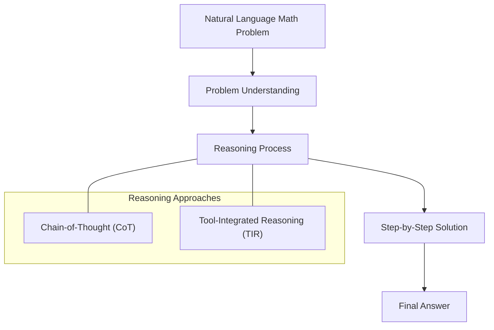
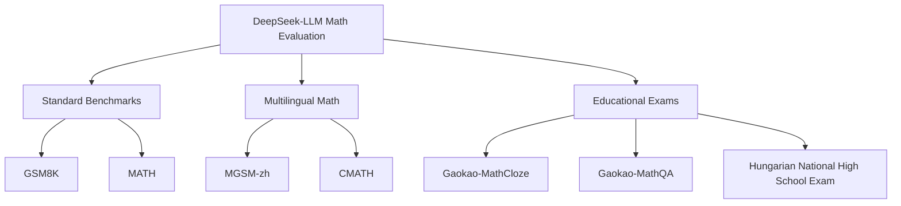
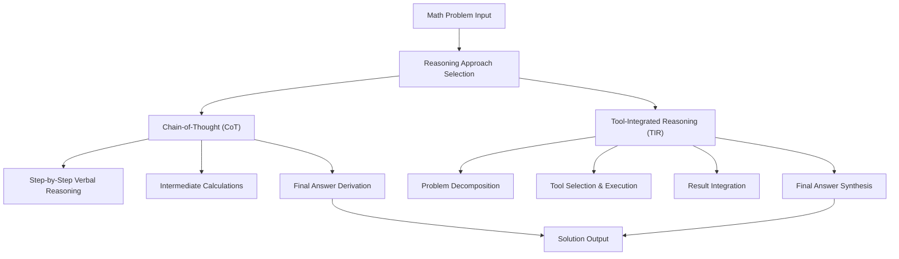
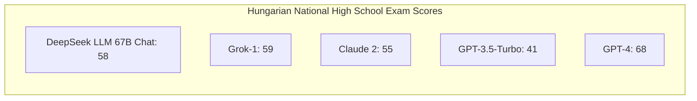
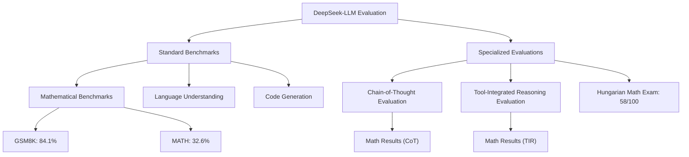

<!-- source: DeepWiki mcp.deepwiki.com · repo deepseek-ai/DeepSeek-LLM · page 4.2 Mathematical Problem Solving · fetched 2026-10-30 -->

# Mathematical Problem Solving

Relevant source files

The following files were used as context for generating this wiki page:

- [README.md](README.md)
- [evaluation/more_results.md](evaluation/more_results.md)
- [images/mathexam.png](images/mathexam.png)

This document details DeepSeek-LLM's mathematical problem-solving capabilities, including benchmark performance, reasoning approaches, and evaluation on specialized mathematical tests. For information about the overall evaluation framework, see [Evaluation and Benchmarks](#4) and [Benchmark Results](#4.1).

## Overview

DeepSeek-LLM demonstrates strong performance in mathematical reasoning tasks, particularly with the 67B Chat model. The model has been evaluated on:

- Standard benchmarks (GSM8K, MATH)
- Multilingual math problems (MGSM-zh, CMATH)
- Educational exams (Gaokao Math, Hungarian National High School Exam)

The mathematical problem-solving capabilities have been tested through two main reasoning approaches:
1. **Chain-of-Thought (CoT)**: Step-by-step reasoning for problem-solving
2. **Tool-Integrated Reasoning (TIR)**: Enhanced reasoning with external computational tools

### Mathematical Reasoning Flow

Sources: README.md:73-74, evaluation/more_results.md:15-19

## Benchmark Performance

DeepSeek-LLM 67B Chat demonstrates impressive mathematical problem-solving capabilities across various benchmarks, with particularly strong results on GSM8K.

### Mathematical Evaluation Framework

Sources: README.md:128-135, evaluation/more_results.md:15-19

### Performance Metrics

The table below summarizes DeepSeek-LLM 67B Chat's performance on mathematical benchmarks using different reasoning approaches:

| Benchmark | Chain-of-Thought | Tool-Integrated Reasoning |
|:----------|:----------------:|:-------------------------:|
| GSM8K | 84.1% | 86.7% |
| MATH | 32.6% | 51.1% |
| MGSM-zh | 74.0% | 76.4% |
| CMATH | 80.3% | 85.4% |
| Gaokao-MathCloze | 16.9% | 21.2% |
| Gaokao-MathQA | 20.2% | 28.2% |

Key observations:
- Tool-Integrated Reasoning consistently outperforms Chain-of-Thought across all benchmarks
- The most significant improvement is seen on the MATH dataset (18.5 percentage point increase)
- Strong performance on GSM8K demonstrates the model's capability with grade school math problems

Sources: evaluation/more_results.md:15-19, README.md:73-74

## Reasoning Approaches

DeepSeek-LLM employs two primary mathematical reasoning approaches, each with distinct characteristics:

### Reasoning Methods Comparison

Sources: evaluation/more_results.md:15-19

### Chain-of-Thought (CoT)

Chain-of-Thought reasoning is a prompting technique where the model generates step-by-step explanations of its problem-solving process. This approach helps the model break down complex problems into simpler steps, similar to human mathematical reasoning.

For example, when solving a word problem, the model would:
1. Identify key variables and relationships
2. Perform intermediate calculations
3. Track progress toward the final answer
4. Present the solution with justification

### Tool-Integrated Reasoning (TIR)

Tool-Integrated Reasoning extends Chain-of-Thought by allowing the model to use external computational tools for specific mathematical operations. This approach enhances the model's ability to:

1. Perform precise calculations
2. Execute complex mathematical functions
3. Reduce computational errors
4. Handle multi-step problems more effectively

The significant performance improvements with TIR (particularly the 51.1% vs. 32.6% on MATH) demonstrate the value of augmenting language models with specialized mathematical tools.

Sources: evaluation/more_results.md:15-19

## Novel Mathematical Evaluations

Beyond standard benchmarks, DeepSeek-LLM 67B Chat has been evaluated on unique test sets to demonstrate its generalization capabilities.

### Hungarian National High School Exam

The Hungarian National High School Exam consists of 33 mathematical problems. Similar to the approach taken by Grok-1, DeepSeek-LLM was evaluated on this exam to test its mathematical reasoning capabilities on previously unseen problems.

DeepSeek-LLM 67B Chat achieved a score of 58 out of 100 possible points, which is:
- Nearly identical to Grok-1 (59)
- Higher than Claude 2 (55)
- Significantly outperforming GPT-3.5-Turbo (41)
- Approaching but not matching GPT-4 (68)

This performance on a previously unseen exam format demonstrates the model's strong generalization capabilities for mathematical reasoning.

Sources: README.md:128-135, evaluation/more_results.md:21-25

## Comparative Performance

The table below shows DeepSeek-LLM 67B Chat's mathematical problem-solving capabilities compared to other leading models:

| Model | GSM8K | MATH | Hungarian National High-School Exam |
|:------|:-----:|:----:|:----------------------------------:|
| DeepSeek LLM 67B Chat | 84.1% | 32.6% | 58 |
| GPT-3.5-Turbo | - | - | 41 |
| Grok-1 | - | - | 59 |
| Claude 2 | - | - | 55 |
| GPT-4 | - | - | 68 |

For a broader context of how mathematical performance fits into the overall evaluation framework:

Sources: README.md:160-166, evaluation/more_results.md:21-25

## Conclusion

DeepSeek-LLM 67B Chat demonstrates strong mathematical problem-solving capabilities, particularly excelling on the GSM8K benchmark (84.1% with CoT, 86.7% with TIR). The model performs competitively on novel evaluations like the Hungarian National High School Exam, where it achieves results comparable to specialized models like Grok-1.

The significant improvement in performance when using Tool-Integrated Reasoning compared to Chain-of-Thought reasoning highlights the value of augmenting language models with specialized tools for complex mathematical tasks. This is especially evident in the MATH dataset results, where TIR improves performance by 18.5 percentage points (32.6% to 51.1%).

Sources: README.md:73-74, README.md:128-135, evaluation/more_results.md:15-35

---

