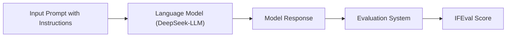
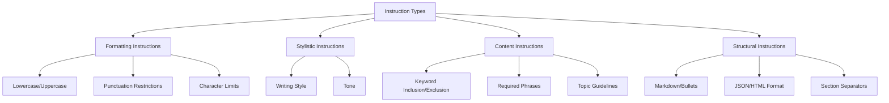
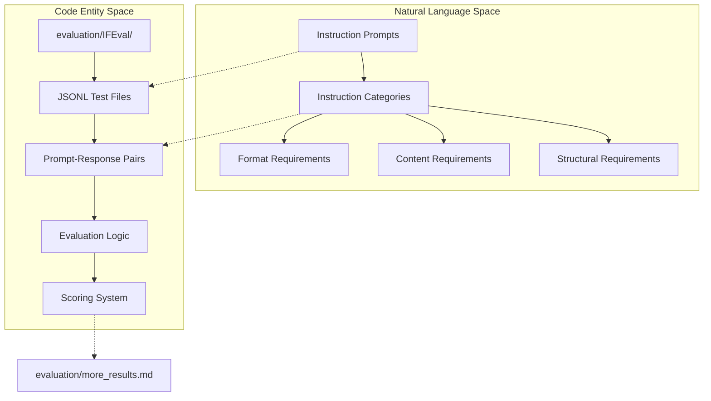
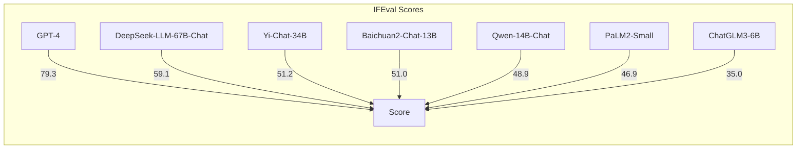

<!-- source: DeepWiki mcp.deepwiki.com · repo deepseek-ai/DeepSeek-LLM · page 4.3 Instruction Following Evaluation · fetched 2026-10-30 -->

# Instruction Following Evaluation

Relevant source files

The following files were used as context for generating this wiki page:

- [evaluation/IFEval/baichuan13B.jsonl](evaluation/IFEval/baichuan13B.jsonl)
- [evaluation/more_results.md](evaluation/more_results.md)

## Purpose and Scope

Instruction Following Evaluation (IFEval) is a benchmarking framework for assessing how well language models adhere to specific instructions embedded in prompts. This evaluation is crucial for determining a model's practical usability in assistant-like roles, where following user instructions accurately is a fundamental capability for real-world applications.

The DeepSeek-LLM project implements and utilizes IFEval to measure its models' ability to follow a wide range of instruction types, from formatting requirements to structural specifications, providing a quantitative assessment of the model's instruction-following capabilities.

Sources: evaluation/more_results.md

## Methodology

IFEval works by providing language models with prompts that contain explicit instructions and evaluating how well their responses adhere to those instructions. The evaluation covers various instruction categories and complexity levels.

### IFEval Process Diagram

Sources: evaluation/more_results.md

The evaluation process typically involves:
1. Preparing a diverse set of prompts with explicit instructions
2. Running these prompts through the model being evaluated
3. Analyzing responses to determine adherence to the given instructions
4. Calculating an overall score based on instruction following accuracy

## Instruction Categories

IFEval evaluates a language model's ability to follow various types of instructions, as evidenced by the test prompts in the evaluation dataset:

### Instruction Categories Diagram

Sources: evaluation/IFEval/baichuan13B.jsonl

Example instruction types from the evaluation dataset include:
- Writing text without using commas
- Using all lowercase or all uppercase letters
- Including specific keywords in the response
- Excluding certain keywords from the response
- Following a particular writing style (poetry, rap, formal, etc.)
- Formatting output in JSON or other structured formats
- Highlighting sections using markdown
- Adding specific elements like postscripts
- Separating responses in a specified manner
- Limiting the number of words or characters

## Implementation Structure

The following diagram shows the conceptual relationship between the natural language instructions and the evaluation system's code entities:

### IFEval Structure Diagram

Sources: evaluation/IFEval/baichuan13B.jsonl, evaluation/more_results.md

## Performance of DeepSeek-LLM

The DeepSeek-LLM 67B Chat model achieved a score of 59.1 on prompt-level instruction following, positioning it competitively among other open-source language models but still below GPT-4's performance.

### IFEval Benchmark Results

Sources: evaluation/more_results.md:30

This evaluation demonstrates that DeepSeek-LLM has strong instruction-following capabilities compared to other models of similar size, making it suitable for various assistant-like applications.

## Evaluation Dataset Examples

The IFEval benchmark uses a diverse set of prompts to test different aspects of instruction following. Here are examples from the evaluation dataset:

| Instruction Type | Example Prompt |
|------------------|----------------|
| Format Instructions | "Write a poem about how I am missing my classes. The poem must have 4 sections marked with SECTION X. Finish the poem with Any other questions?." |
| Content Requirements | "Write a poem that has the word "robyn" and "forest". It should be about nature and love. It should also contain the word "elgin" and be written in English, with all letters lowercased." |
| Structural Requirements | "Write an ad copy for a new product, a digital photo frame that connects to your social media accounts and displays your photos. It should be less than 344 words." |
| Combined Instructions | "Write a 4 section resume for professional clown Phil Larkin. Each section should be noted as Section X." |

Sources: evaluation/IFEval/baichuan13B.jsonl

## Types of Instructions Tested

The IFEval framework tests a wide range of instruction types to comprehensively assess a model's instruction-following capabilities:

1. **Text Formatting**
   - Case requirements (lowercase, uppercase)
   - Punctuation restrictions (no commas, specific separators)
   - Character or word count limitations

2. **Content Requirements**
   - Keyword inclusion (must include specific words)
   - Keyword exclusion (must not include certain words)
   - Specific phrases at beginning or end of response

3. **Structural Formatting**
   - Markdown formatting (bullet points, highlighting)
   - Output in specific formats (JSON, HTML)
   - Section organization (numbered sections, headings)

4. **Stylistic Requirements**
   - Writing in specific styles (formal, casual, Shakespearean)
   - Using specific tones (angry, professional, weird)
   - Writing in specific formats (poem, story, song)

5. **Language Requirements**
   - Writing in specified languages
   - Translating content between languages
   - Avoiding specific language elements

Sources: evaluation/IFEval/baichuan13B.jsonl

## Conclusion

Instruction Following Evaluation provides a crucial metric for assessing the practical usability of language models as assistants. The DeepSeek-LLM's strong performance on this benchmark indicates its effectiveness at understanding and following user instructions, which is essential for real-world applications.

The IFEval framework helps quantify a model's ability to adhere to various instruction types, from simple formatting requirements to complex content and structural specifications. As shown in the benchmarks, DeepSeek-LLM demonstrates competitive instruction-following capabilities compared to other models of similar size, though there remains room for improvement to reach the performance levels of the most advanced models like GPT-4.

The continued enhancement of instruction-following capabilities remains an important focus in the development of more capable and useful language models.

---

