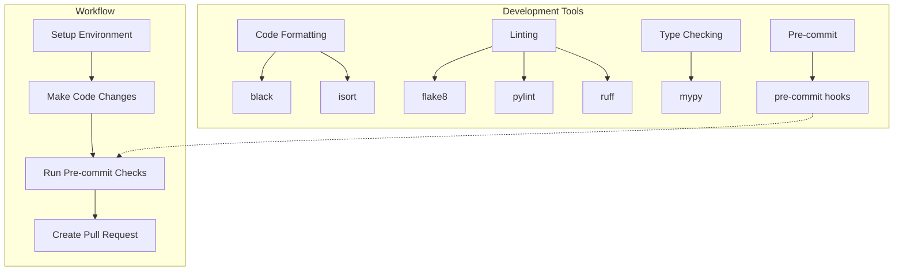
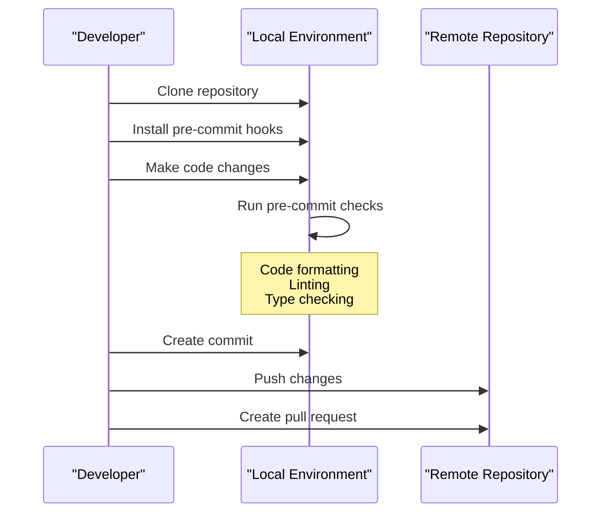
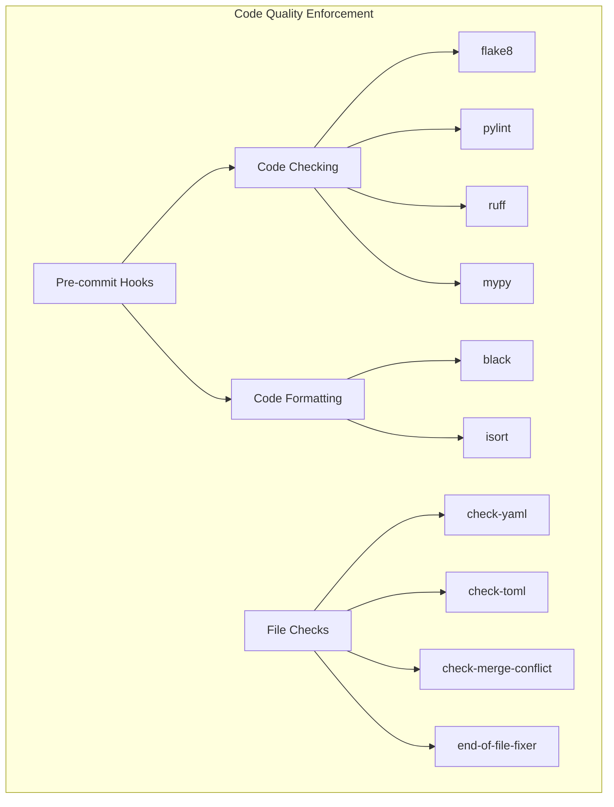
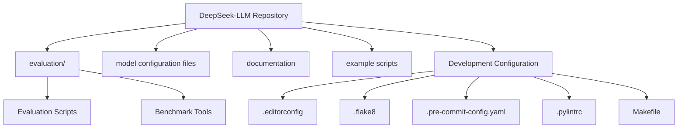

<!-- source: DeepWiki mcp.deepwiki.com · repo deepseek-ai/DeepSeek-LLM · page 5 Development and Contribution · fetched 2026-10-30 -->

# Development and Contribution

<details>
<summary>Relevant source files</summary>

The following files were used as context for generating this wiki page:

- [.editorconfig](.editorconfig)
- [.flake8](.flake8)
- [.gitattributes](.gitattributes)
- [.gitignore](.gitignore)
- [.pre-commit-config.yaml](.pre-commit-config.yaml)
- [.pylintrc](.pylintrc)
- [Makefile](Makefile)

</details>


This page provides comprehensive guidance for developers who want to contribute to the DeepSeek-LLM project. It covers development environment setup, coding standards, and the contribution workflow. For information about using the models, see [Usage Guide](#3), and for licensing details, see [Licensing](#6).

## Overview of Development Environment

DeepSeek-LLM uses a structured development environment with enforced code quality standards through various tools and configurations. This ensures consistency and maintainability across the codebase.



Sources: [.pre-commit-config.yaml](), [Makefile]()

## Setting Up the Development Environment

To contribute to DeepSeek-LLM, you need to set up a proper development environment with all the required tools and configurations.

### Prerequisites

- Python 3.8 or higher
- Git
- Make (for Unix-based systems)

### Installation Steps

1. **Clone the repository**:
   ```bash
   git clone https://github.com/deepseek-ai/DeepSeek-LLM.git
   cd DeepSeek-LLM
   ```

2. **Set up development tools**:

   The project includes a Makefile with commands to install all necessary development tools:

   ```bash
   make pre-commit-install  # Install pre-commit hooks
   ```

   This will install all the required linting and formatting tools configured for the project.

3. **Install additional dependencies as needed**:

   The Makefile provides commands for installing specific tools:

   ```bash
   make py-format-install   # Install code formatters
   make flake8-install      # Install flake8 and plugins
   make pylint-install      # Install pylint
   make ruff-install        # Install ruff
   make mypy-install        # Install mypy
   ```

Sources: [Makefile:14-52]()

## Development Workflow

The typical development workflow for contributing to DeepSeek-LLM follows these steps:



### Key Development Commands

The Makefile provides various utility commands to help with development:

| Command | Description |
|---------|-------------|
| `make lint` | Run all linting checks |
| `make format` | Format all Python files |
| `make clean` | Clean Python cache files |
| `make pylint` | Run pylint checks |
| `make flake8` | Run flake8 checks |
| `make mypy` | Run mypy type checking |
| `make ruff` | Run ruff linter |
| `make pre-commit` | Run all pre-commit hooks |

Sources: [Makefile:83-96]()

## Coding Standards

DeepSeek-LLM maintains strict coding standards enforced by automated tools. These standards are defined in configuration files within the repository.

### Code Formatting

Code formatting is handled by:
- **Black** - For consistent Python code formatting
- **isort** - For organizing and sorting imports

#### Editor Configuration

The project includes an `.editorconfig` file that defines basic formatting rules for different file types:

| File Type | Indentation | Line Endings | Other Rules |
|-----------|-------------|--------------|-------------|
| Python (.py) | 4 spaces | LF | UTF-8 encoding |
| YAML/JSON | 2 spaces | LF | UTF-8 encoding |
| Markdown (.md) | 2 spaces | LF | Soft wrap text |
| RST (.rst) | 4 spaces | LF | Soft wrap text |
| C/C++ (.cpp, .h, .cu, .cuh) | 2 spaces | LF | UTF-8 encoding |

Sources: [.editorconfig]()

### Linting Configuration

Multiple linters are used to ensure code quality:

1. **Flake8** with plugins:
   - flake8-bugbear
   - flake8-comprehensions
   - flake8-docstrings
   - flake8-pyi
   - flake8-simplify

   Configured in [.flake8]() with settings like:
   - Maximum line length: 120 characters
   - Ignoring specific rules: E203, W503, W504, E501, W505

2. **Pylint** with comprehensive configuration:
   - Naming conventions (snake_case for functions/variables, PascalCase for classes)
   - Code complexity limits
   - Docstring requirements

   Configured in [.pylintrc]() with settings for code structure, formatting, and error checking.

3. **Ruff** for fast Python linting



Sources: [.flake8](), [.pylintrc](), [.pre-commit-config.yaml]()

## Pre-commit Hooks

The project uses pre-commit hooks to automate code quality checks before each commit. These hooks are defined in [.pre-commit-config.yaml]() and include:

1. **Basic checks**:
   - Trailing whitespace
   - End-of-file fixes
   - YAML/TOML validation
   - Merge conflict detection
   - Large file checks

2. **Code formatters**:
   - ruff (with auto-fix)
   - isort
   - black for Python and Jupyter notebooks

3. **Linters**:
   - flake8 with multiple plugins
   - pylint

To use pre-commit hooks:

1. Install pre-commit: `make pre-commit-install`
2. Pre-commit will automatically run on `git commit`
3. Run manually on all files: `make pre-commit`

Sources: [.pre-commit-config.yaml:1-76]()

## Contribution Guidelines

When contributing to DeepSeek-LLM, please follow these guidelines:

### Pull Request Process

1. Ensure all pre-commit hooks pass locally
2. Make focused commits with clear commit messages
3. Include documentation updates when adding features
4. Reference any related issues in your pull request

### Code Review Expectations

- Address review comments promptly
- Be open to feedback and suggestions
- Maintain a respectful and collaborative attitude

### Testing Requirements

Before submitting a pull request, ensure:
- All existing tests pass
- New features include appropriate tests
- Code coverage is maintained or improved

## Useful Development Commands

The project's Makefile provides several useful commands for development:

```bash
# Format code
make format

# Run all linters
make lint

# Run specific linters
make flake8
make pylint
make ruff

# Type checking
make mypy

# Clean Python cache files
make clean-py
```

Sources: [Makefile:83-96]()

## Repository Organization

The DeepSeek-LLM repository is organized with a focus on clear separation of concerns:



## Conclusion

Contributing to DeepSeek-LLM involves adhering to established coding standards and using the provided development tools. By following the workflow and guidelines outlined in this document, you can ensure that your contributions maintain the quality and consistency of the project.

For further information about the project, refer to:
- [Project Overview](#1) for general information
- [Model Architecture](#2) for technical details
- [Usage Guide](#3) for using the models
- [Evaluation and Benchmarks](#4) for performance metrics

Sources: [.editorconfig](), [.flake8](), [.pre-commit-config.yaml](), [.pylintrc](), [Makefile]()

---

