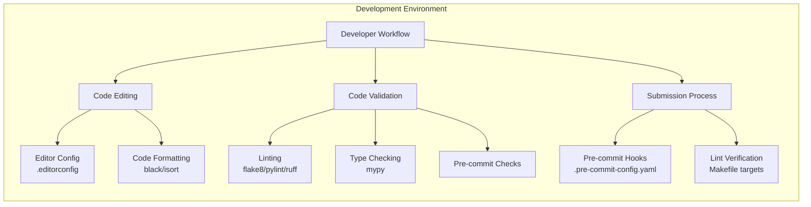
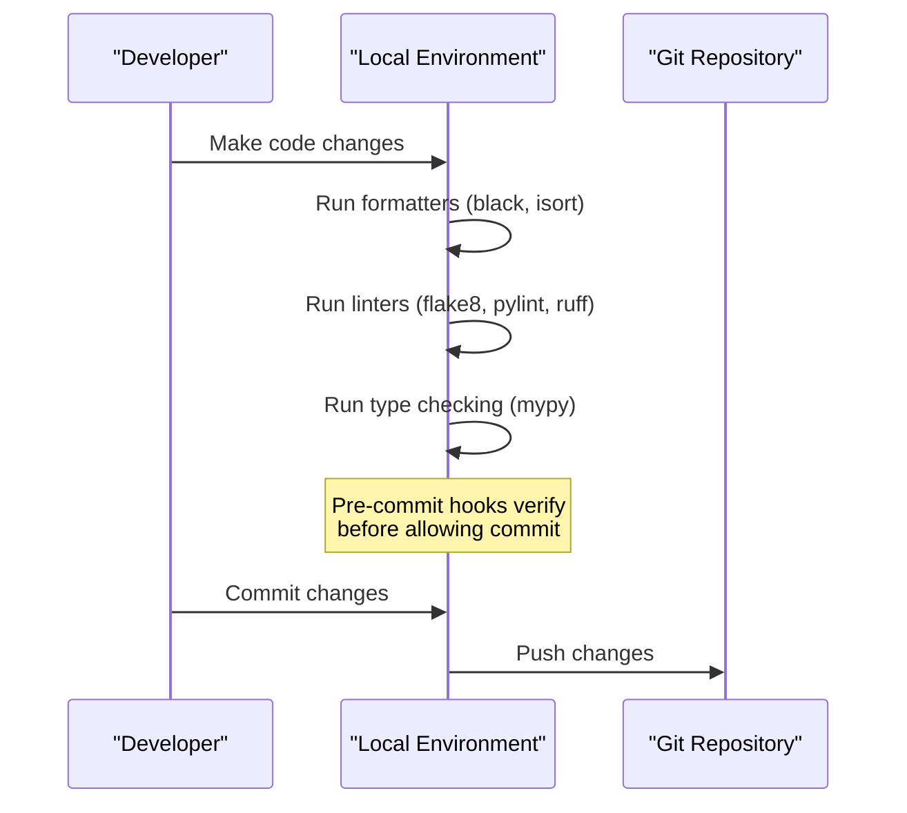
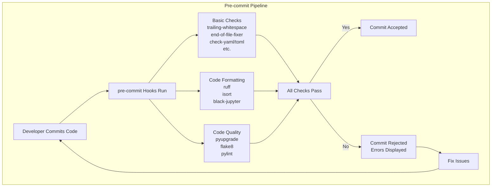
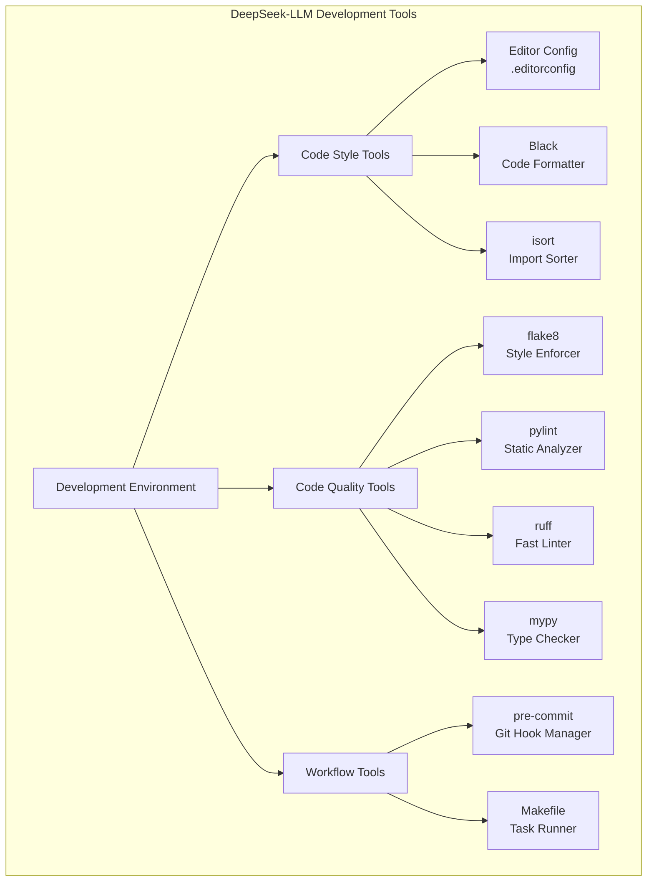

<!-- source: DeepWiki mcp.deepwiki.com · repo deepseek-ai/DeepSeek-LLM · page 5.1 Development Environment Setup · fetched 2026-10-30 -->

# Development Environment Setup

<details>
<summary>Relevant source files</summary>

The following files were used as context for generating this wiki page:

- [.editorconfig](.editorconfig)
- [.flake8](.flake8)
- [.pre-commit-config.yaml](.pre-commit-config.yaml)
- [.pylintrc](.pylintrc)
- [Makefile](Makefile)

</details>


This page describes how to set up a development environment for working with the DeepSeek-LLM codebase. It covers the required tools, configuration settings, and recommended workflows for effective contribution to the project.

For information about coding standards, see [Coding Standards](#5.2).

## Overview of Development Tools

DeepSeek-LLM uses a comprehensive set of development tools to ensure code quality and consistency. These tools include code formatters, linters, type checkers, and pre-commit hooks.



Sources: [.editorconfig](), [.flake8](), [.pre-commit-config.yaml](), [.pylintrc](), [Makefile]()

## Setting Up Your Environment

### Prerequisites

Before contributing to DeepSeek-LLM, ensure you have the following prerequisites:

1. Python 3.8 or higher (as indicated in [.pylintrc:87]())
2. Git for version control
3. Make (for running Makefile commands)

### Installation Steps

1. Clone the repository:
   ```bash
   git clone https://github.com/deepseek-ai/DeepSeek-LLM.git
   cd DeepSeek-LLM
   ```

2. Install development tools:
   ```bash
   make pre-commit-install
   ```

This installs all necessary development tools including pre-commit hooks, linters, and formatters.

Sources: [Makefile:43-46]()

### Editor Configuration

The project uses `.editorconfig` to maintain consistent coding styles across different editors and IDEs. Ensure your editor supports EditorConfig or install the appropriate plugin.

Key settings include:

| File Type | Indent Style | Indent Size | Line Endings | Other |
|-----------|--------------|-------------|--------------|-------|
| Python | Spaces | 4 | LF | UTF-8, trim trailing whitespace |
| YAML/JSON | Spaces | 2 | LF | UTF-8, trim trailing whitespace |
| Markdown | Spaces | 2 | LF | UTF-8, soft wrap text |
| C++/CUDA | Spaces | 2 | LF | UTF-8, trim trailing whitespace |

Sources: [.editorconfig:5-42]()

## Development Workflow



Sources: [.pre-commit-config.yaml:9-75](), [Makefile:58-89]()

### Code Formatting and Linting

The project enforces code style using several tools:

1. **Black** - Code formatter that enforces a consistent style
2. **isort** - Sorts imports alphabetically and separates them into sections
3. **ruff** - Fast Python linter
4. **flake8** - Code style enforcer with plugins
5. **pylint** - Static code analyzer for detecting errors and enforcing conventions

To format your code:
```bash
make format
```

To check code quality without modifying files:
```bash
make lint
```

Sources: [Makefile:58-89](), [.flake8:1-41](), [.pylintrc]()

## Code Quality Tools Configuration

### Pre-commit Hooks

Pre-commit hooks automatically run before each commit to ensure code quality. The configuration is defined in `.pre-commit-config.yaml`.



Sources: [.pre-commit-config.yaml:10-75]()

### Makefile Targets

The project provides a Makefile with various targets to streamline development tasks:

| Target | Description |
|--------|-------------|
| `make pylint` | Run pylint linter |
| `make flake8` | Run flake8 linter |
| `make py-format` | Check code formatting with isort and black |
| `make ruff` | Run ruff linter |
| `make mypy` | Run mypy type checker |
| `make lint` | Run all linters and formatters in check mode |
| `make format` | Format code using isort, black, and ruff |
| `make clean` | Clean Python cache files |
| `make pre-commit` | Run all pre-commit hooks |

Sources: [Makefile:13-97]()

## Tool-specific Configurations

### Flake8 Configuration

Flake8 is configured with a maximum line length of 120 characters and several ignored rules to align with black's formatting style.

```python
# Key flake8 settings
max-line-length = 120
ignore = E203,W503,W504,E501,W505  # Compatible with black formatting
```

Sources: [.flake8:1-40]()

### Pylint Configuration

Pylint is extensively configured to enforce code quality standards:

```python
# Key pylint settings
max-line-length = 120
py-version = 3.8  # Minimum supported Python version
good-names = i,j,k,ex,Run,_,op,fn,f,g,p,u,t,lr,mu,nu,x,y  # Allowed short variable names
```

Pylint has specialized configurations for:
- Naming conventions (PascalCase for classes, snake_case for functions)
- Code complexity limits (max branches, statements, etc.)
- Documentation standards
- Import organization

Sources: [.pylintrc:86-87](), [.pylintrc:178-195](), [.pylintrc:288-316]()

### Editor Support

The `.editorconfig` file ensures consistent settings across different editors:

```
[*.py]
indent_size = 4

[*.{yaml,yml,json}]
indent_size = 2

[*.md]
indent_size = 2
x-soft-wrap-text = true
```

Most modern editors support EditorConfig natively or through plugins.

Sources: [.editorconfig:5-42]()

## Recommended Workflow

Here's the recommended workflow for contributing to DeepSeek-LLM:

1. Set up your development environment as described above
2. Create a new branch for your feature or fix
3. Write your code following the project's style guidelines
4. Run `make format` to automatically format your code
5. Run `make lint` to check for any remaining issues
6. Commit your changes (pre-commit hooks will verify compliance)
7. Push your changes and create a pull request

This workflow ensures your contributions meet the project's quality standards and can be easily integrated.

Sources: [Makefile:83-89](), [.pre-commit-config.yaml:10-75]()

## Troubleshooting Common Issues

### Pre-commit Hook Failures

If pre-commit hooks fail, review the error messages carefully. Common issues include:

- Formatting inconsistencies (fixable with `make format`)
- Linting errors (review and fix according to the specific error)
- Import ordering issues (fixable with `isort`)

To bypass pre-commit hooks in exceptional cases (not recommended for regular use):
```bash
git commit --no-verify
```

### Clean Environment

If you encounter strange behavior, try cleaning your environment:

```bash
make clean
```

This removes Python cache files that might cause unexpected behavior.

Sources: [Makefile:91-97]()

## Development Environment Components



Sources: [.editorconfig](), [.flake8](), [.pre-commit-config.yaml](), [.pylintrc](), [Makefile]()

By following these guidelines and using the provided development tools, you can ensure that your contributions to DeepSeek-LLM maintain the project's high quality standards.

---

