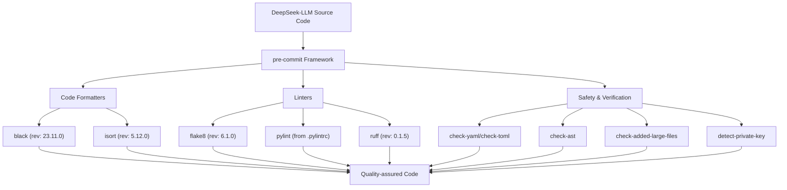
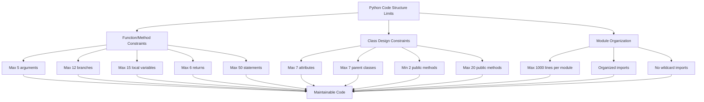
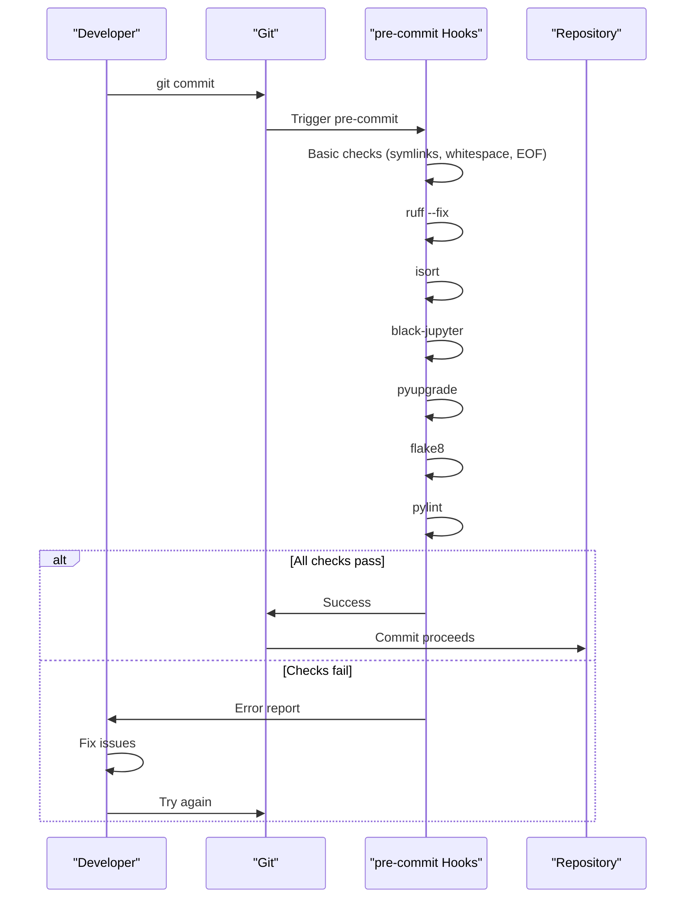

<!-- source: DeepWiki mcp.deepwiki.com · repo deepseek-ai/DeepSeek-LLM · page 5.2 Coding Standards · fetched 2026-10-30 -->

# Coding Standards

<details>
<summary>Relevant source files</summary>

The following files were used as context for generating this wiki page:

- [.editorconfig](.editorconfig)
- [.flake8](.flake8)
- [.pre-commit-config.yaml](.pre-commit-config.yaml)
- [.pylintrc](.pylintrc)

</details>


## Introduction and Purpose

This document details the coding standards and style guidelines enforced in the DeepSeek-LLM repository. These standards ensure code quality, maintainability, and consistency throughout the codebase. The guidelines apply to all Python code, configuration files, and documentation in the repository.

For information about setting up a development environment, see [Development Environment Setup](#5.1).

## Code Quality Tools Overview

DeepSeek-LLM employs multiple automated tools to enforce coding standards through a comprehensive pre-commit framework:



Sources: [.pre-commit-config.yaml]()

## File Format Standards

The EditorConfig system defines consistent formatting rules for different file types in the codebase:

| File Type | Indentation | Line Ending | Final Newline | Trailing Whitespace |
|-----------|-------------|-------------|---------------|---------------------|
| Python (.py) | 4 spaces | LF | Yes | No |
| YAML/JSON (.yaml, .yml, .json) | 2 spaces | LF | Yes | No |
| Markdown (.md) | 2 spaces | LF | Yes | No |
| RST (.rst) | 4 spaces | LF | Yes | No |
| C++/CUDA (.cpp, .h, .cu, .cuh) | 2 spaces | LF | Yes | No |
| Makefiles, Shell scripts | Tabs | LF | Yes | No |
| Batch files (.bat) | Tabs | CRLF | Yes | No |

Sources: [.editorconfig:5-42]()

## Python Code Style Guidelines

### Naming Conventions

DeepSeek-LLM follows consistent naming conventions defined in the Pylint configuration:

| Element | Style | Examples |
|---------|-------|----------|
| Variables | snake_case | `user_count`, `total_items` |
| Functions | snake_case | `calculate_total()`, `get_user()` |
| Classes | PascalCase | `UserAccount`, `DataProcessor` |
| Constants | UPPER_CASE | `MAX_SIZE`, `API_KEY` |
| Methods | snake_case | `get_items()`, `calculate_total()` |
| Modules | snake_case | `data_processor.py`, `model_utils.py` |

Additionally, the project maintains an allowlist of common short variable names that are exempt from the naming conventions, including `i`, `j`, `k`, `x`, `y`, `f`, `g`, `p`, `lr`, and several others commonly used in machine learning code.

Sources: [.pylintrc:106-195]()

### Code Structure Limitations

To maintain code quality and readability, the DeepSeek-LLM codebase enforces structural limitations:



Sources: [.pylintrc:289-316](), [.pylintrc:345](), [.pylintrc:362-367]()

### Formatting Rules

- Maximum line length: 120 characters ([.flake8:2]())
- Maximum docstring length: 100 characters ([.flake8:3]())
- 4-space indentation for Python files ([.editorconfig:14]())
- Black for consistent code formatting ([.pre-commit-config.yaml:37-40]())
- isort for consistent import organization ([.pre-commit-config.yaml:33-36]())

## Linter Configurations

### Flake8

Flake8 is configured with:
- Maximum line length: 120
- Selected checks: B,C,E,F,W,Y,SIM (including bugbear, simplify)
- Ignored errors: E203, W503, W504 (conflicts with Black)
- Ignored errors: E501, W505 (line length/docstring length exceptions)
- File exclusions: `.git`, `.vscode`, `venv`, `third-party`, etc.

Sources: [.flake8:1-40]()

### Pylint

Pylint provides comprehensive static analysis with:
- Python 3.8+ compatibility ([.pylintrc:87]())
- Complexity metrics (described in Code Structure section)
- Disabled checks: duplicate-code, consider-using-from-import ([.pylintrc:423-424]())
- Generated member allowances for numpy and torch libraries ([.pylintrc:551-552]())

Sources: [.pylintrc]()

### Ruff

Ruff provides fast Python linting with automatic fixes where possible:
- Configured to fix issues automatically when possible ([.pre-commit-config.yaml:32]())
- Runs before other linters in the pre-commit sequence

Sources: [.pre-commit-config.yaml:28-32]()

## Pre-commit Workflow

The pre-commit framework automates code quality checks before each commit:



Sources: [.pre-commit-config.yaml:9-75]()

### Key Pre-commit Hooks

| Hook | Purpose | Auto-fix? |
|------|---------|-----------|
| check-symlinks | Validate symlinks | No |
| trailing-whitespace | Remove trailing whitespace | Yes |
| end-of-file-fixer | Ensure files end with newline | Yes |
| check-yaml/toml | Validate YAML/TOML files | No |
| check-ast | Ensure valid Python syntax | No |
| double-quote-string-fixer | Use single quotes consistently | Yes |
| ruff | Fast Python linter | Yes |
| isort | Sort imports | Yes |
| black-jupyter | Format Python/Jupyter code | Yes |
| pyupgrade | Upgrade Python syntax | Yes |
| flake8 | Comprehensive Python linter | No |
| pylint | Static code analyzer | No |

Sources: [.pre-commit-config.yaml:11-75]()

## Development Workflow Integration

To integrate these coding standards into your development workflow:

1. Install pre-commit hooks:
   ```bash
   pip install pre-commit
   pre-commit install
   ```

2. Run pre-commit manually for all files:
   ```bash
   pre-commit run --all-files
   ```

3. When commits fail due to pre-commit checks:
   - Review the reported issues
   - Fix problems manually or let auto-fixes apply
   - Stage the changes (`git add`)
   - Try committing again

The pre-commit framework is also configured for CI environments:
- Automatic PR fixes for fixable issues ([.pre-commit-config.yaml:6]())
- Monthly autoupdates of pre-commit hooks ([.pre-commit-config.yaml:8]())
- CI skips slower checks like pylint ([.pre-commit-config.yaml:4]())

Sources: [.pre-commit-config.yaml:3-8]()

## Editor Integration Recommendations

For the best development experience, configure your editor to use the project's coding standards:

1. **VSCode**:
   - Install EditorConfig, Black, Flake8, and Pylint extensions
   - Configure them to use project-specific configuration files

2. **PyCharm**:
   - Enable EditorConfig support
   - Install and configure the Black, Flake8, and Pylint plugins

3. **Vim/Emacs**:
   - Install appropriate plugins for EditorConfig, Black, Flake8, and Pylint
   - Configure them to respect project configuration files

This ensures real-time feedback on coding standard violations while you work, reducing the need for corrections during the commit process.

---

