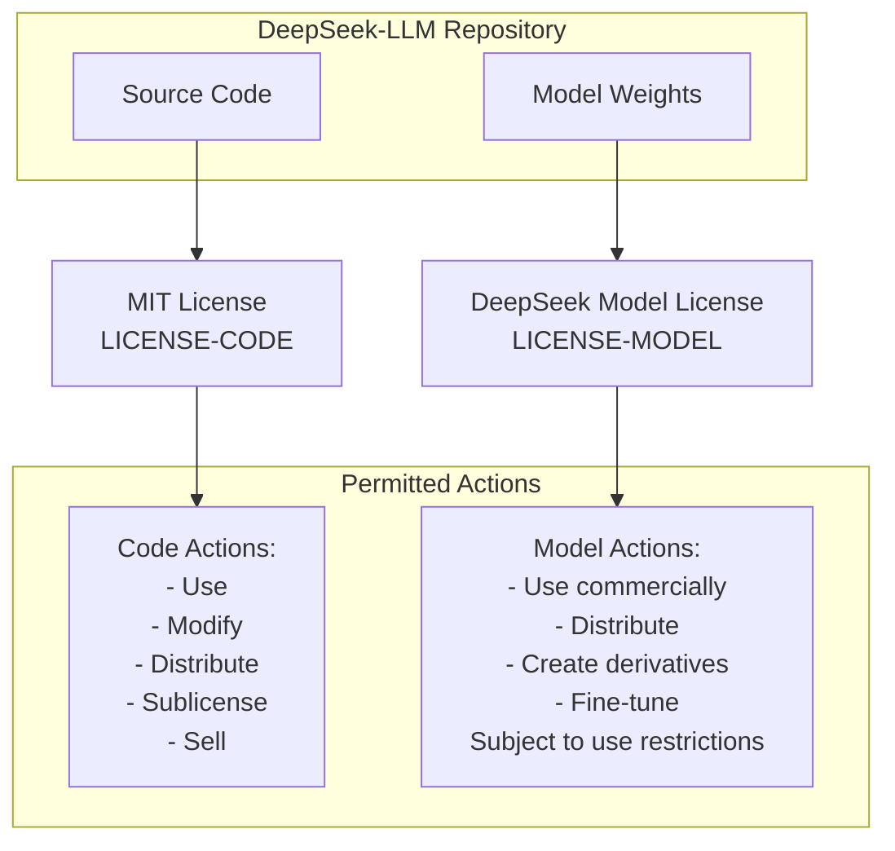
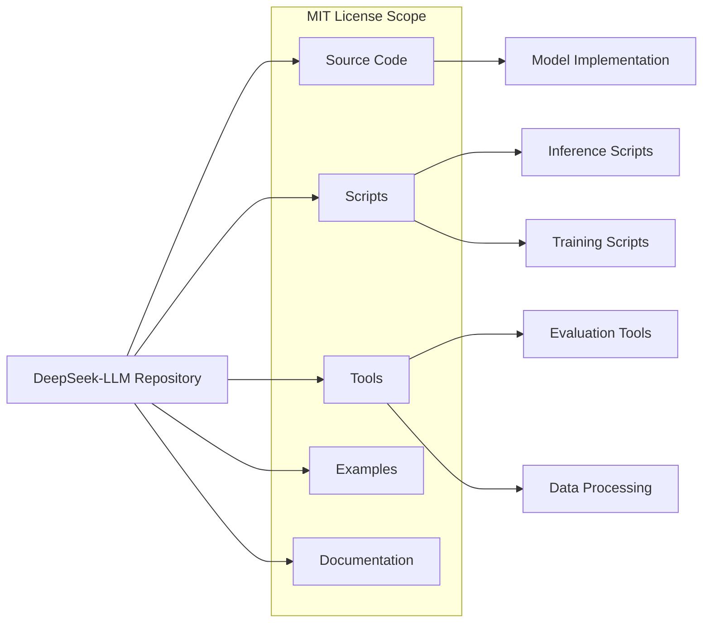
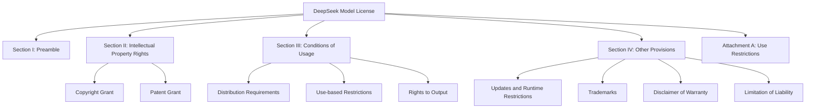
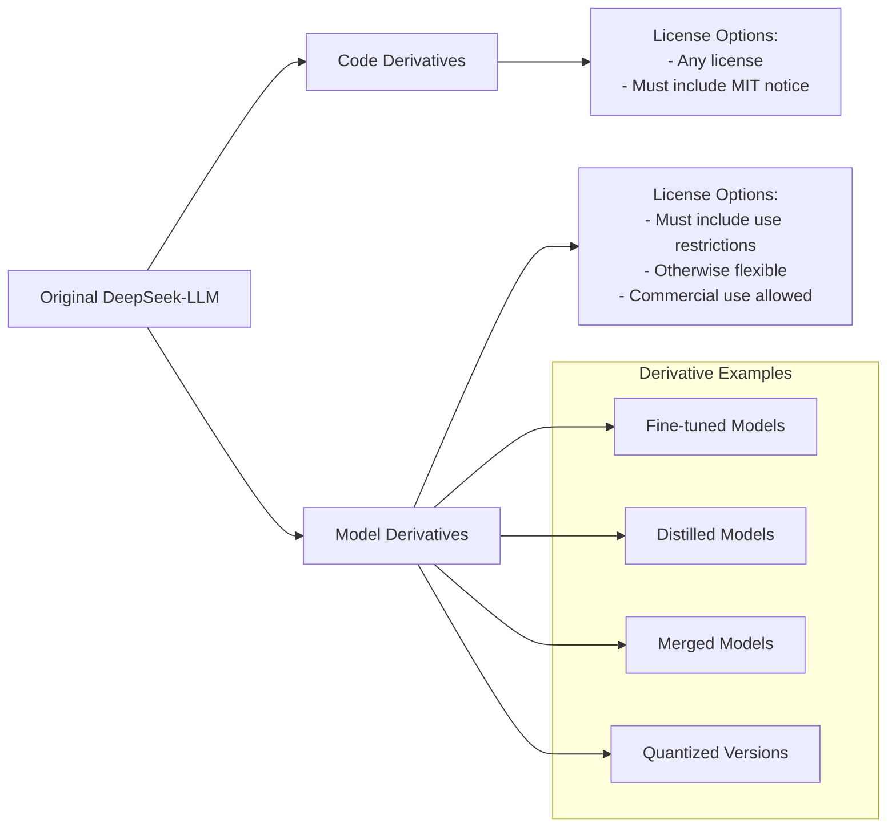
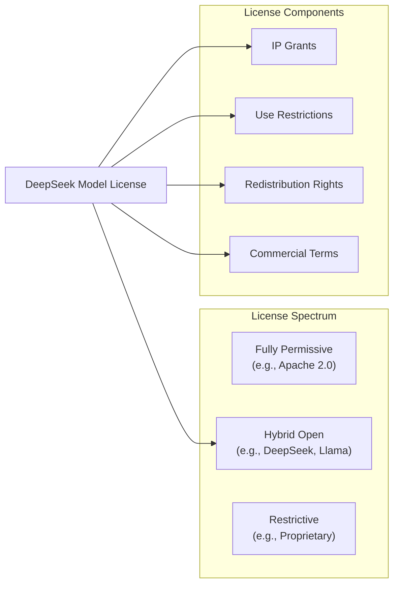

<!-- source: DeepWiki mcp.deepwiki.com · repo deepseek-ai/DeepSeek-LLM · page 6 Licensing · fetched 2026-10-30 -->

# Licensing

Relevant source files

The following files were used as context for generating this wiki page:

- [LICENSE-CODE](LICENSE-CODE)
- [LICENSE-MODEL](LICENSE-MODEL)
- [README.md](README.md)

This document outlines the licensing structure of the DeepSeek-LLM repository, explaining the dual licensing approach that governs the use of both source code and model weights. Understanding these licenses is crucial for anyone looking to use, modify, distribute, or build upon the DeepSeek-LLM models or codebase.

## Licensing Overview

DeepSeek-LLM uses a dual licensing structure that distinguishes between the source code and the model weights:

1. **Source Code**: Licensed under the MIT License
2. **Model Weights**: Licensed under the custom DeepSeek Model License

This approach allows for open-source collaboration on the codebase while imposing certain use restrictions on the model weights to ensure responsible AI deployment.

Sources: [README.md:382-383](), [LICENSE-CODE](), [LICENSE-MODEL]()

## MIT License (Code)

The source code of the DeepSeek-LLM repository is licensed under the MIT License, one of the most permissive open-source licenses.

### Key Provisions

| Provision | Description |
|-----------|-------------|
| Rights Granted | Permission to use, copy, modify, merge, publish, distribute, sublicense, and sell copies of the software |
| Conditions | Include the copyright notice and permission notice in all copies or substantial portions of the software |
| Warranty | No warranty of any kind, express or implied |
| Liability | Authors or copyright holders not liable for any claims, damages or liability |

### Scope of Application

The MIT License applies specifically to:
- Source code for model implementation
- Inference scripts
- Evaluation tools
- Example code
- Documentation

Sources: [LICENSE-CODE](), [README.md:40-42]()

## DeepSeek Model License (Model Weights)

The model weights are governed by the DeepSeek Model License, a custom license designed to balance open innovation with responsible use.

### Structure and Key Components

The DeepSeek Model License consists of four main sections:

1. **Preamble**: Explains the license philosophy
2. **Intellectual Property Rights**: Grants copyright and patent licenses
3. **Conditions of Usage, Distribution and Redistribution**: Outlines terms for using and sharing models
4. **Other Provisions**: Contains disclaimers, limitations, and governing law

Sources: [LICENSE-MODEL:7-72]()

### Licensed Model Variants

The DeepSeek Model License applies to all model weights in the DeepSeek-LLM family:

| Model | Size | Type | License |
|-------|------|------|---------|
| DeepSeek-LLM-7B-Base | 7B parameters | Base model | DeepSeek Model License |
| DeepSeek-LLM-7B-Chat | 7B parameters | Chat model | DeepSeek Model License |
| DeepSeek-LLM-67B-Base | 67B parameters | Base model | DeepSeek Model License |
| DeepSeek-LLM-67B-Chat | 67B parameters | Chat model | DeepSeek Model License |

Sources: [README.md:82-88]()

### Use-Based Restrictions

Attachment A of the DeepSeek Model License specifies prohibited uses of the models. These restrictions apply to both the original models and any derivatives.

Key prohibited uses include:

- Violating applicable laws or regulations
- Military use
- Exploiting or harming minors
- Generating false information to harm others
- Generating inappropriate content
- Unauthorized use of personal identifiable information
- Defamation or harassment
- Fully automated decision-making affecting legal rights
- Discriminatory applications
- Exploiting vulnerabilities of specific groups

Sources: [LICENSE-MODEL:75-91]()

## Derivatives and Redistribution

The licenses have specific provisions for derivatives and redistribution of both code and models.

### Code Derivatives

Under the MIT License, derivative works based on the code:
- Can be distributed under different licenses
- Must include the original MIT license notice
- Have no obligation to release source code

### Model Derivatives

Under the DeepSeek Model License, derivatives of the models:
- Must include the same use-based restrictions as the original license
- Can be distributed under different licensing terms otherwise
- May be used commercially, subject to the use restrictions

Sources: [LICENSE-MODEL:44-49](), [LICENSE-CODE:5-10]()

## Commercial Use

### Commercial Use of Code

Under the MIT License, the source code may be used for commercial purposes without restriction, including:
- Integration into commercial products
- Offering commercial services based on the code
- Selling derivative works

### Commercial Use of Models

The DeepSeek Model License explicitly permits commercial use of the model weights, subject to:
- Compliance with the use-based restrictions
- No misrepresentation of endorsement by DeepSeek
- All disclaimers and limitations of liability

The README.md explicitly states: "DeepSeek LLM series (including Base and Chat) supports commercial use."

Sources: [README.md:383](), [LICENSE-MODEL:44-45]()

## License Enforcement and Governing Law

### Code License

The MIT License is enforced according to applicable copyright law in the jurisdiction of use.

### Model License

The DeepSeek Model License specifies:
- PRC (People's Republic of China) laws govern the agreement
- Courts in the domicile of Hangzhou DeepSeek AI have exclusive jurisdiction
- DeepSeek reserves the right to restrict usage in violation of the license

Sources: [LICENSE-MODEL:71-72](), [LICENSE-MODEL:57-58]()

## Using DeepSeek-LLM in Projects

When incorporating DeepSeek-LLM into your projects, ensure compliance with both licenses:

| Action | Requirement |
|--------|-------------|
| Using code | Include MIT License notice |
| Modifying code | Include MIT License notice in modified files |
| Using model | Comply with use restrictions |
| Distributing model | Include DeepSeek Model License |
| Creating model derivatives | Include same use restrictions |
| Commercial use | Allowed, subject to use restrictions |

Sources: [LICENSE-CODE:12-13](), [LICENSE-MODEL:44-49]()

## Relationship to Other Open LLM Licenses

The DeepSeek Model License follows a pattern similar to other recent AI model licenses that balance openness with responsible use:

Sources: [LICENSE-MODEL:9-15]()

## Summary

The DeepSeek-LLM repository employs a dual licensing approach:
- MIT License for source code, offering permissive terms for code use and modification
- DeepSeek Model License for model weights, balancing open access with responsible use restrictions

This structure allows for extensive use, including commercial applications, while maintaining ethical safeguards through use-based restrictions. Users should carefully review both licenses before incorporating DeepSeek-LLM into their projects.

---

