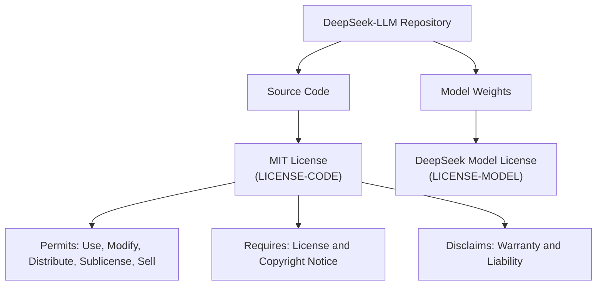
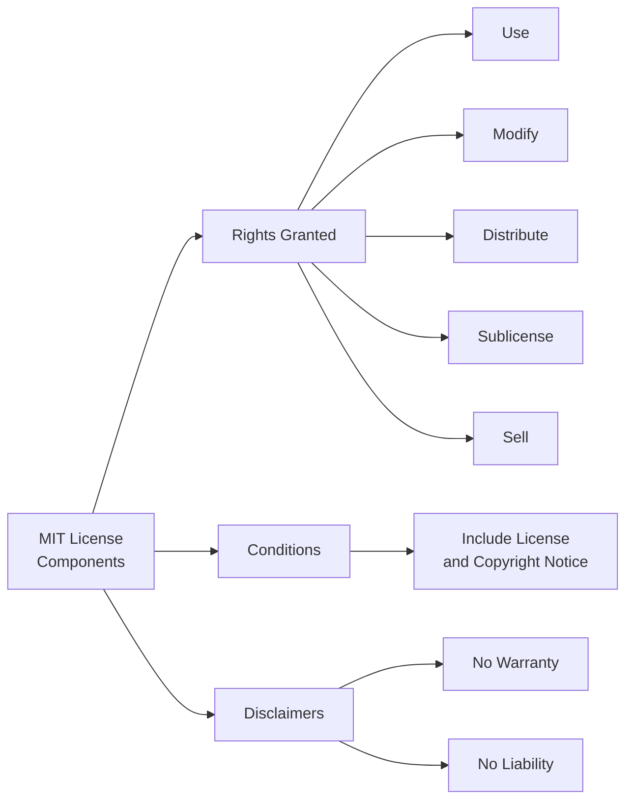
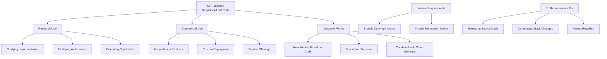
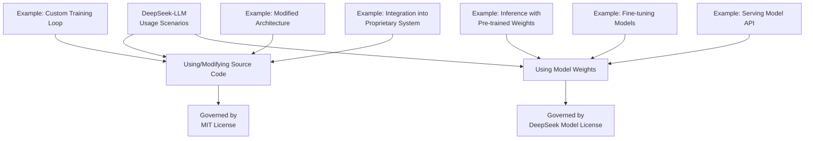

<!-- source: DeepWiki mcp.deepwiki.com · repo deepseek-ai/DeepSeek-LLM · page 6.1 Code License · fetched 2026-10-30 -->

# Code License

<details>
<summary>Relevant source files</summary>

The following files were used as context for generating this wiki page:

- [LICENSE-CODE](LICENSE-CODE)
- [README.md](README.md)

</details>


This document details the licensing terms applicable to the source code of the DeepSeek-LLM repository. For information about the license governing the model weights and their usage, see [Model License](#6.2).

## 1. Overview

The DeepSeek-LLM repository employs a dual licensing structure: the source code is licensed under the MIT License, while the model weights are governed by a separate DeepSeek Model License. This page specifically addresses the MIT License that applies to all code in the repository.



Sources: [README.md:40-45](), [LICENSE-CODE:1-21]()

## 2. MIT License Structure and Terms

The MIT License is one of the most permissive open-source licenses, designed to give users extensive freedom with minimal restrictions.

### 2.1 Key Provisions

The MIT License contains three main components:

1. **Grant of Rights**: Permission to use, copy, modify, merge, publish, distribute, sublicense, and/or sell copies of the software
2. **Condition**: The copyright notice and permission notice must be included in all copies or substantial portions of the software
3. **Disclaimer**: The software is provided "as is" without warranty of any kind, and the authors are not liable for damages



Sources: [LICENSE-CODE:5-21]()

### 2.2 Copyright Holder

The MIT License for DeepSeek-LLM specifies:

```
Copyright (c) 2023 DeepSeek
```

This identifies DeepSeek as the copyright holder of the original code.

Sources: [LICENSE-CODE:3]()

## 3. Coverage of the License

The MIT License applies to all source code within the DeepSeek-LLM repository, including:

| Component | Description | Coverage Details |
|-----------|-------------|------------------|
| Model Implementation | Code that implements the DeepSeek-LLM architecture | Model structure, parameter initialization |
| Inference Code | Scripts for running the model | HF Transformers and vLLM integration examples |
| Evaluation Framework | Code for benchmarking | Metrics implementation, test harnesses |
| Data Processing Tools | Utilities mentioned in the documentation | "cc_cleaner" system, dataset pruning, MinhashLSH deduplication |
| Documentation | Explanatory files | README, usage examples |

Sources: [README.md:182-194](), [README.md:210-328]()

## 4. License Implications for Different Use Cases



Sources: [LICENSE-CODE:5-13](), [README.md:382-383]()

### 4.1 Permitted Activities

Under the MIT License, users of the DeepSeek-LLM code can:

- Use the code for any purpose, including commercial applications
- Modify the code to suit specific needs
- Integrate the code into proprietary systems
- Redistribute the original or modified code
- Create and distribute derivative works
- Sublicense the code under different terms

### 4.2 Requirements

The only substantive requirement is to include the original copyright notice and the MIT License text in any copy or substantial portion of the software.

Sources: [LICENSE-CODE:12-13]()

## 5. Distinction Between Code and Model Licenses

The README clearly states the dual licensing approach:

> This code repository is licensed under [the MIT License](https://github.com/deepseek-ai/DeepSeek-LLM/blob/HEAD/LICENSE-CODE). The use of DeepSeek LLM Base/Chat models is subject to [the Model License](https://github.com/deepseek-ai/DeepSeek-LLM/blob/HEAD/LICENSE-MODEL). DeepSeek LLM series (including Base and Chat) supports commercial use.

Understanding this distinction is crucial for proper usage:



Sources: [README.md:382-383]()

## 6. License Compatibility

The MIT License is compatible with many other open-source licenses:

- Can be integrated with GPL-licensed code (resulting work will be under GPL)
- Combines well with other permissive licenses (Apache, BSD)
- Can be included in proprietary, closed-source systems

This compatibility makes the DeepSeek-LLM code highly versatile for inclusion in various software projects.

Sources: [LICENSE-CODE:1-21]()

## 7. Full License Text

For reference, here is the complete MIT License text as it appears in the LICENSE-CODE file:

```
MIT License

Copyright (c) 2023 DeepSeek

Permission is hereby granted, free of charge, to any person obtaining a copy
of this software and associated documentation files (the "Software"), to deal
in the Software without restriction, including without limitation the rights
to use, copy, modify, merge, publish, distribute, sublicense, and/or sell
copies of the Software, and to permit persons to whom the Software is
furnished to do so, subject to the following conditions:

The above copyright notice and this permission notice shall be included in all
copies or substantial portions of the Software.

THE SOFTWARE IS PROVIDED "AS IS", WITHOUT WARRANTY OF ANY KIND, EXPRESS OR
IMPLIED, INCLUDING BUT NOT LIMITED TO THE WARRANTIES OF MERCHANTABILITY,
FITNESS FOR A PARTICULAR PURPOSE AND NONINFRINGEMENT. IN NO EVENT SHALL THE
AUTHORS OR COPYRIGHT HOLDERS BE LIABLE FOR ANY CLAIM, DAMAGES OR OTHER
LIABILITY, WHETHER IN AN ACTION OF CONTRACT, TORT OR OTHERWISE, ARISING FROM,
OUT OF OR IN CONNECTION WITH THE SOFTWARE OR THE USE OR OTHER DEALINGS IN THE
SOFTWARE.
```

Sources: [LICENSE-CODE:1-21]()

---

