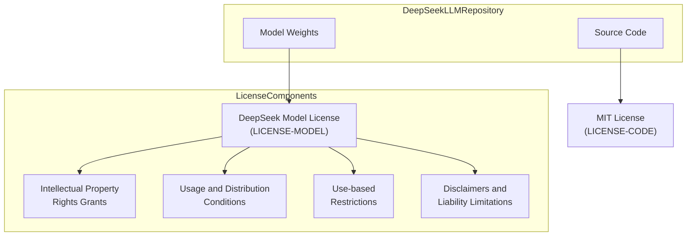
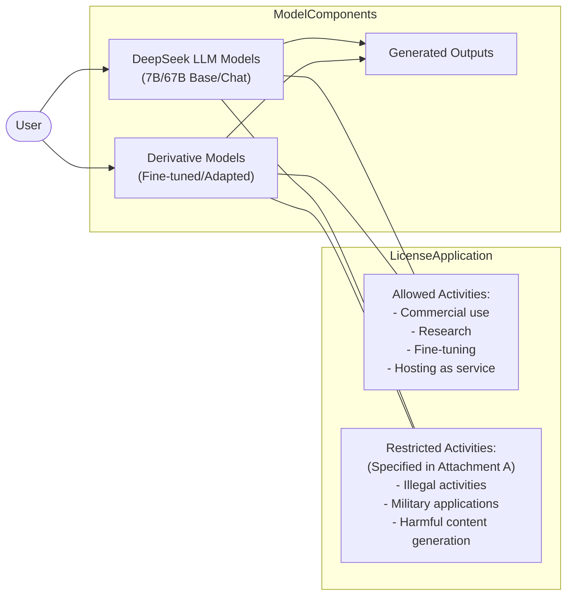
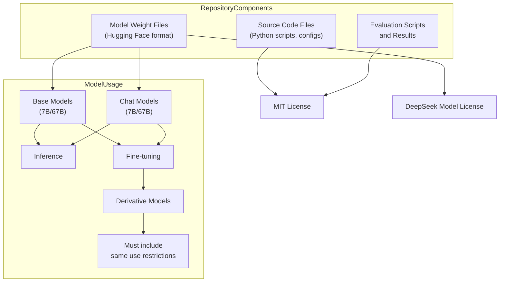

<!-- source: DeepWiki mcp.deepwiki.com · repo deepseek-ai/DeepSeek-LLM · page 6.2 Model License · fetched 2026-10-30 -->

# Model License

Relevant source files

The following files were used as context for generating this wiki page:

- [LICENSE-MODEL](LICENSE-MODEL)
- [README.md](README.md)

This document explains the DeepSeek Model License that governs the use of DeepSeek LLM model weights and their derivatives. For information about the repository's source code license (MIT License), see [Code License](#6.1).

## License Overview

DeepSeek LLM employs a dual licensing approach - the source code is licensed under the MIT License, while the model weights are subject to the DeepSeek Model License (version 1.0, dated October 23, 2023). This custom license aims to balance open access with responsible use restrictions.

### Dual Licensing Structure

Sources: [README.md:40-45](), [LICENSE-MODEL:1-14]()

## Core License Provisions

The DeepSeek Model License provides specific grants while imposing certain use-based restrictions:

### License Grants

The license provides:
- Perpetual, worldwide, non-exclusive, royalty-free copyright license
- Patent license for claims necessarily infringed by DeepSeek's contributions

These grants allow users to:
- Reproduce and modify the models
- Distribute the models and their derivatives
- Use the models commercially (subject to restrictions)

Sources: [LICENSE-MODEL:33-39]()

### Model Usage Flow

Sources: [LICENSE-MODEL:42-53](), [LICENSE-MODEL:76-91]()

## Distribution Requirements

When distributing the original model or derivatives, users must:

| Requirement | Description |
|-------------|-------------|
| Use restrictions | Include the use-based restrictions in any legal agreement |
| License copy | Provide recipients with a copy of the DeepSeek Model License |
| Modification notices | Mark modified files with notices of changes |
| Attribution | Retain all copyright, patent, and attribution notices |
| Personal additions | Can add personal copyright statements while respecting restrictions |

Sources: [LICENSE-MODEL:44-50]()

## Use-based Restrictions

The license explicitly prohibits using the models for the following purposes:

| Prohibited Use | Description |
|----------------|-------------|
| Illegal activities | Any use violating applicable laws or infringing third party rights |
| Military applications | Any military use |
| Exploitation of minors | Any use exploiting or harming minors |
| Misinformation | Generating false information to harm others |
| Inappropriate content | Content prohibited by applicable regulations |
| PII misuse | Unauthorized use of personal identifiable information |
| Harassment | Content that defames or harasses others |
| Automated legal decisions | Fully automated decision-making affecting legal rights |
| Discrimination | Uses discriminating against individuals or groups |
| Exploitation of vulnerabilities | Exploiting vulnerabilities of specific groups |

Sources: [LICENSE-MODEL:76-91]()

## Output Rights

The DeepSeek License addresses model outputs with these key points:

- DeepSeek claims no rights in outputs generated using the model
- Users are accountable for outputs they generate and subsequent uses
- No use of output can contravene any provision in the license

Sources: [LICENSE-MODEL:53-54]()

## Commercial Use

DeepSeek LLM models explicitly support commercial use, subject to the restrictions outlined in the license. The README states:

> DeepSeek LLM series (including Base and Chat) supports commercial use.

Commercial users may:
- Offer the model as a service (e.g., API access)
- Integrate it into commercial products
- Charge fees for support, warranty, or indemnity

Sources: [README.md:383](), [LICENSE-MODEL:67]()

## License Application to Repository Components

Sources: [README.md:80-88](), [LICENSE-MODEL:44-50]()

## Disclaimer and Liability

The model license includes standard disclaimers:
- Models provided "AS IS" without warranties
- DeepSeek is not liable for damages resulting from model use
- Users assume all risks associated with using the models

Sources: [LICENSE-MODEL:63-65]()

## Legal Jurisdiction

The license is governed by PRC (People's Republic of China) laws. Courts in the domicile of Hangzhou DeepSeek Artificial Intelligence Fundamental Technology Research Co., Ltd. have exclusive jurisdiction over any disputes arising from the license.

Sources: [LICENSE-MODEL:71]()