# Page: Overview

# Overview

<details>
<summary>Relevant source files</summary>

The following files were used as context for generating this wiki page:

- [README.md](README.md)

</details>


This page provides an introduction to the DeepSeek-LLM repository, a collection of large language models developed by DeepSeek-AI. It covers the model family structure, architectural design, capabilities, and integration options. For detailed usage instructions, see [Usage Guide](#3), and for comprehensive evaluation results, refer to [Evaluation and Benchmarks](#4).

## What is DeepSeek-LLM?

DeepSeek-LLM is an advanced language model family trained on a diverse dataset of 2 trillion tokens in both English and Chinese. The repository contains multiple model variants with different parameter sizes and optimization targets, making them suitable for various applications ranging from text completion to specialized tasks like coding and mathematics.

### Key Features

- **Parameter Scales**: Models available in 7B and 67B parameter sizes
- **Variants**: Base models for general purpose use and chat models optimized for dialogue
- **Context Length**: All models support a sequence length of 4096 tokens
- **Capabilities**: Strong performance in reasoning, coding, math, and Chinese language understanding
- **Open License**: Supports commercial use under the DeepSeek Model License

Sources: [README.md:63-76]()

## Model Family Structure

DeepSeek-LLM consists of four main models organized in a hierarchical structure, with chat models being fine-tuned versions of their base counterparts.

### Model Family Diagram

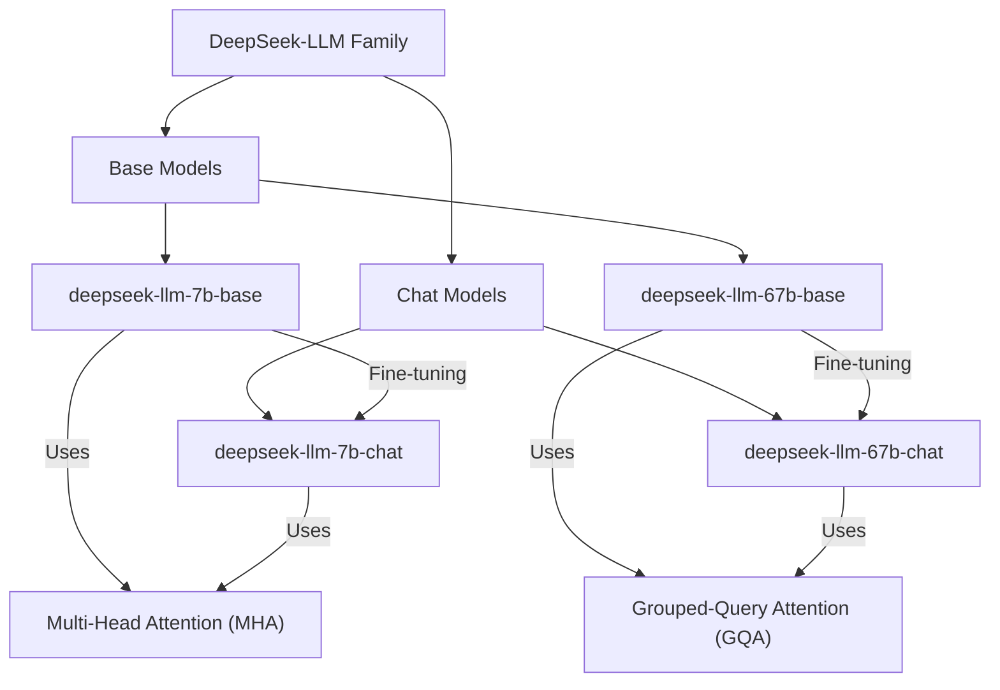

Sources: [README.md:77-89](), [README.md:195-197]()

## Model Architecture

DeepSeek-LLM uses an auto-regressive transformer decoder architecture similar to LLaMA. The models employ different attention mechanisms based on their size:

- **7B Models**: Use Multi-Head Attention (MHA)
- **67B Models**: Use Grouped-Query Attention (GQA) for improved efficiency

The models were pre-trained with AdamW optimizer using the following configurations:

| Model Size | Batch Size | Learning Rate | Sequence Length |
|------------|------------|---------------|-----------------|
| 7B         | 2304       | 4.2e-4        | 4096            |
| 67B        | 4608       | 3.2e-4        | 4096            |

Sources: [README.md:195-198]()

## Data Pipeline and Training

DeepSeek-LLM was trained on approximately 2 trillion tokens using a sophisticated data processing pipeline.

### Data Pipeline Diagram

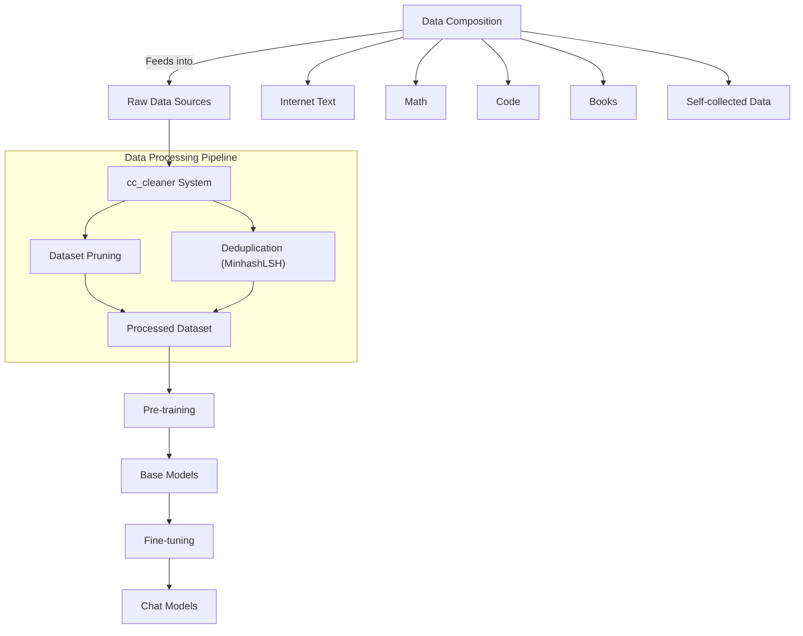

Key aspects of the data pipeline:

- **Data Composition**: Diverse mix of Internet text, math, code, books, and self-collected data
- **Dataset Pruning**: Heuristic rules and models to filter low-quality content
- **Deduplication**: MinhashLSH technique used to remove duplicates at document and string levels

Sources: [README.md:182-194]()

## Model Integration and Usage

DeepSeek-LLM models can be integrated through multiple interfaces, providing flexibility for different deployment scenarios.

### Integration Options Diagram

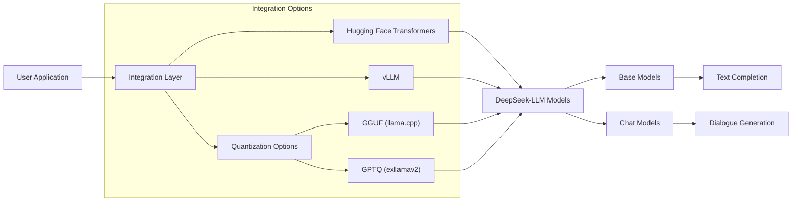

The models support two primary usage patterns:

1. **Text Completion**: Generating text continuations from a given prompt
2. **Chat Completion**: Generating conversational responses in a dialogue format

Sources: [README.md:210-328]()

## Model Capabilities and Performance

DeepSeek-LLM demonstrates strong performance across various benchmarks, with particular strengths in specific domains.

### Capability Comparison

```mermaid
radar
    title "DeepSeek-LLM-67B Capability Profile"
    axisLabel "Performance Level"
        
    axis "General Reasoning"
    axis "Code Generation" 
    axis "Mathematical Problem Solving"
    axis "Chinese Language"
    axis "Instruction Following"
        
    series "DeepSeek-LLM-67B-Chat"
    "General Reasoning" 85
    "Code Generation" 90
    "Mathematical Problem Solving" 87
    "Chinese Language" 88
    "Instruction Following" 82
```

Performance highlights include:

- **Coding Proficiency**: 73.78% pass@1 on HumanEval for the 67B chat model
- **Mathematical Reasoning**: 84.1% accuracy on GSM8K and 65/100 score on the Hungarian National High School Exam
- **Chinese Language Understanding**: Strong performance on CEval and CMMLU benchmarks

Sources: [README.md:104-166]()

## Limitations

Despite their capabilities, DeepSeek LLMs have several limitations to be aware of:

1. **Potential Data Bias**: May reflect biases present in training data
2. **Hallucination**: Can generate plausible-sounding but factually incorrect information
3. **Repetition**: May exhibit repetitive patterns in generated responses

Sources: [README.md:371-380]()

## Licensing

DeepSeek-LLM employs a dual licensing structure:

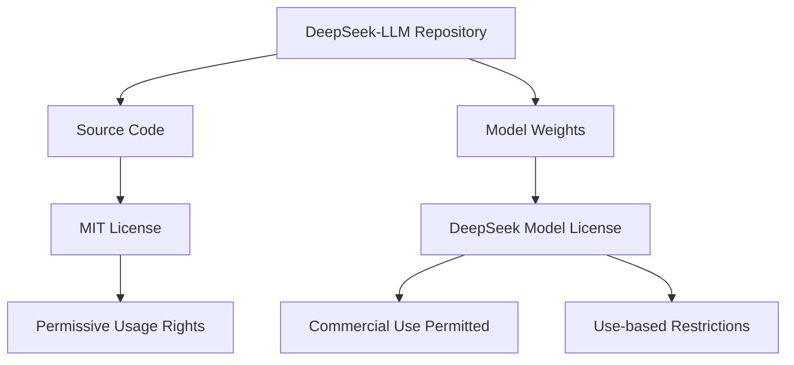

- **Code License**: MIT License (found in LICENSE-CODE)
- **Model License**: DeepSeek Model License (found in LICENSE-MODEL) which permits commercial use with certain restrictions

Sources: [README.md:382-383]()

---

# Page: Project Goals and Features

# Project Goals and Features

<details>
<summary>Relevant source files</summary>

The following files were used as context for generating this wiki page:

- [README.md](README.md)

</details>


## Purpose and Scope

This document outlines the primary goals and key features of the DeepSeek-LLM project. It covers the project's overall objectives, the distinctive capabilities of the models, and the technical innovations that differentiate this project in the large language model landscape. For detailed information about specific model variants, see [Model Family](#1.2). For technical architecture details, see [Model Architecture](#2).

## Project Overview

DeepSeek-LLM is an advanced large language model project aimed at creating powerful, open-source models for both research and commercial applications. The primary goal is to develop models that excel in general capabilities while demonstrating particular strength in specialized domains such as mathematics, coding, and multilingual comprehension.

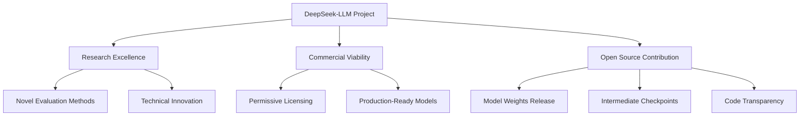

Sources: [README.md:63-65]()

## Core Goals

The DeepSeek-LLM project pursues several foundational goals:

1. **Create Powerful Base Models**: Develop high-performing foundation models trained on diverse, high-quality data at scale (2 trillion tokens)

2. **Specialized Excellence**: Achieve superior performance in targeted domains, particularly mathematics, coding, and Chinese language comprehension

3. **Research Enablement**: Provide open access to models and intermediate checkpoints to foster innovation in the AI research community

4. **Commercial Applicability**: Support commercial use through permissive licensing while maintaining ethical safeguards

5. **Multilingual Capability**: Ensure strong performance across multiple languages with particular emphasis on English and Chinese

Sources: [README.md:63-76]()

## Key Features

### Advanced Architecture and Training

The DeepSeek-LLM models utilize a transformer-based architecture with specific optimizations:

- 7B models employ Multi-Head Attention (MHA)
- 67B models use Grouped-Query Attention (GQA)
- Training on 2 trillion tokens with 4096 sequence length
- Sophisticated learning rate scheduling with multiple step-downs

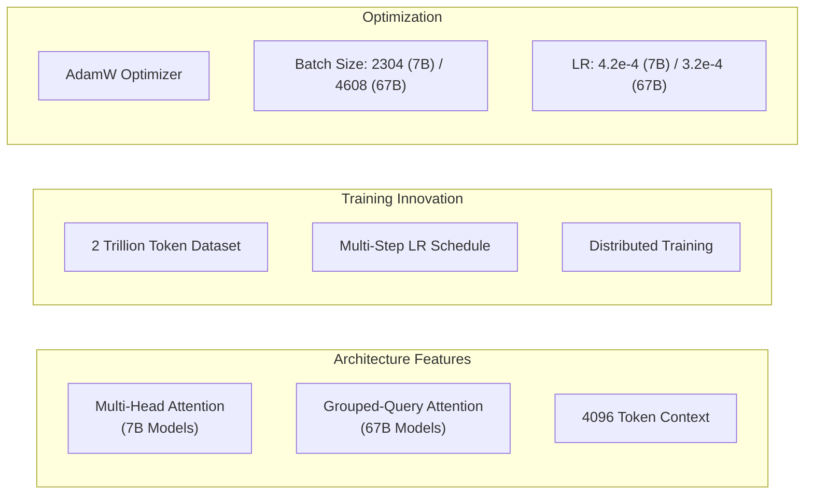

Sources: [README.md:195-199]()

### Data Processing Pipeline

A distinguishing feature of the project is its sophisticated data processing system:

- **cc_cleaner**: A distributed batch processing system for data refinement
- **Dataset Pruning**: Heuristic rules and models to filter low-quality content
- **Deduplication**: MinhashLSH-based removal of duplicates at document and string levels

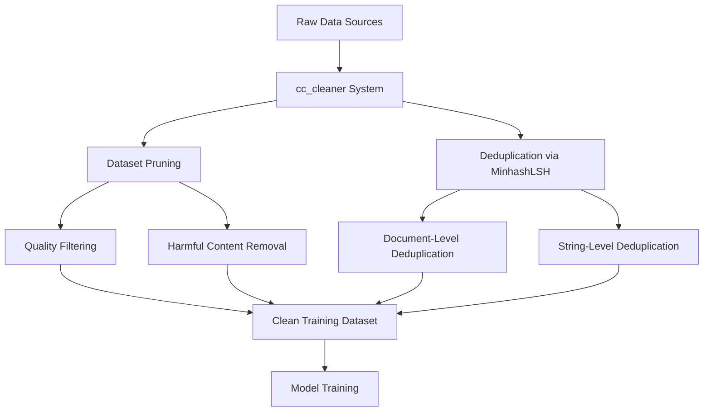

Sources: [README.md:182-194]()

### Domain-Specific Excellence

The DeepSeek-LLM models demonstrate exceptional performance in several key domains:

#### Mathematics and Reasoning

- GSM8K: 84.1% (67B Chat model, 0-shot)
- MATH: 32.6% (67B Chat model, 0-shot)
- Hungarian National High School Exam: 65/100 points

#### Coding Proficiency

- HumanEval Pass@1: 73.78% (67B Chat model)
- Performance on LeetCode Weekly Contest problems
- Strong performance on MBPP benchmark

#### Multilingual Capabilities

- Strong performance on Chinese benchmarks (C-Eval, CMMLU)
- Specialized Chinese question-answering performance
- Balanced training across English and Chinese data

Sources: [README.md:70-76](), [README.md:123-177]()

## Model Family Design

DeepSeek-LLM consists of a range of models designed for different use cases:

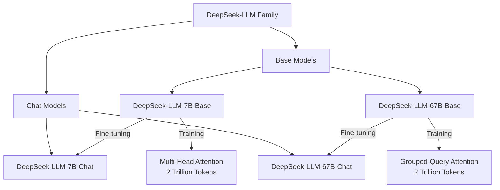

Sources: [README.md:77-89](), [README.md:195-199]()

## Evaluation Framework

A comprehensive evaluation system is a core feature of the project, including:

1. **Standard Benchmarks**: MMLU, GSM8K, HumanEval, BBH, etc.
2. **Novel Evaluation Methods**: Hungarian National High School Exam, LeetCode Weekly Contest
3. **Instruction Following Evaluation**: Using Google's instruction following benchmark

This evaluation framework goes beyond typical LLM benchmarks to test capabilities in never-before-seen problems, addressing concerns about data contamination in standard benchmarks.

| Model | TriviaQA | MMLU | GSM8K | HumanEval | BBH | C-Eval | CMMLU |
|-------|----------|------|-------|-----------|-----|--------|-------|
| DeepSeek-LLM 7B Chat | 57.9 | 49.4 | 62.6 | 48.2 | 42.3 | 47.0 | 49.7 |
| DeepSeek-LLM 67B Chat | 81.5 | 71.1 | 84.1 | 73.8 | 71.7 | 65.2 | 67.8 |

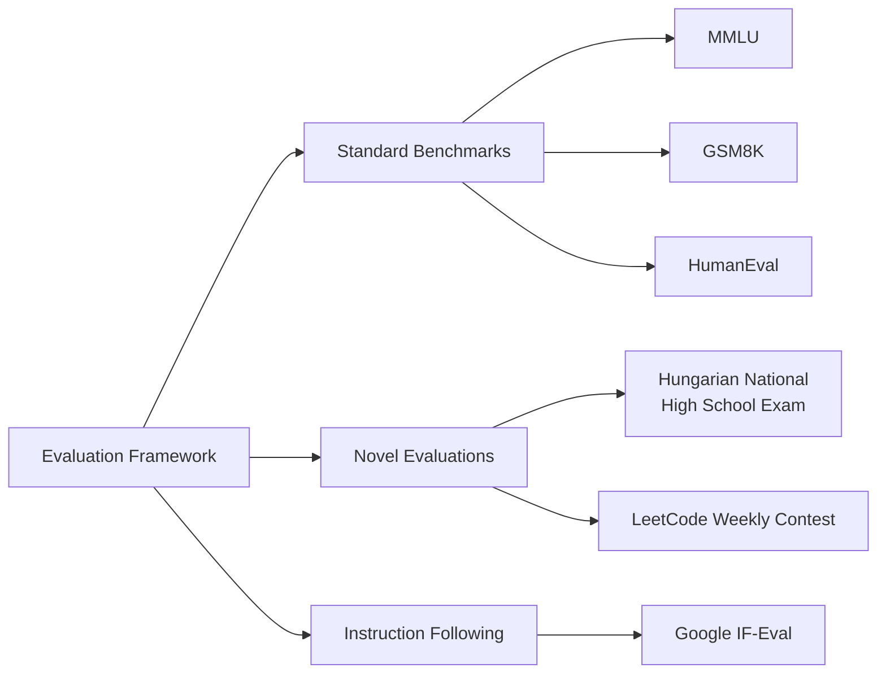

Sources: [README.md:104-177]()

## Licensing Strategy

A distinctive feature of the DeepSeek-LLM project is its dual licensing approach:

- **Code**: Released under the MIT License, enabling broad code reuse
- **Model Weights**: Released under a custom DeepSeek Model License that permits commercial use while maintaining ethical safeguards

This approach balances open-source principles with responsible AI deployment.

Sources: [README.md:381-383]()

## Infrastructure Features

The project includes several notable infrastructure components:

- Support for inference through Hugging Face Transformers
- High-throughput inference via vLLM integration
- Compatibility with quantization methods (GGUF/GPTQ)
- Intermediate checkpoint access for research

These features enhance the accessibility and utility of the models for various deployment scenarios.

Sources: [README.md:210-327]()

---

# Page: Model Family

# Model Family

<details>
<summary>Relevant source files</summary>

The following files were used as context for generating this wiki page:

- [README.md](README.md)

</details>


This document provides a comprehensive overview of the DeepSeek-LLM model family, explaining the different variants, their architectures, capabilities, and relationships. It covers both base and chat models across different parameter sizes, along with their technical specifications and performance characteristics.

For information about the training methodology used for these models, see [Training Methodology](#2.1).

## Model Variants Overview

DeepSeek-LLM consists of four primary model variants organized in a hierarchical structure:

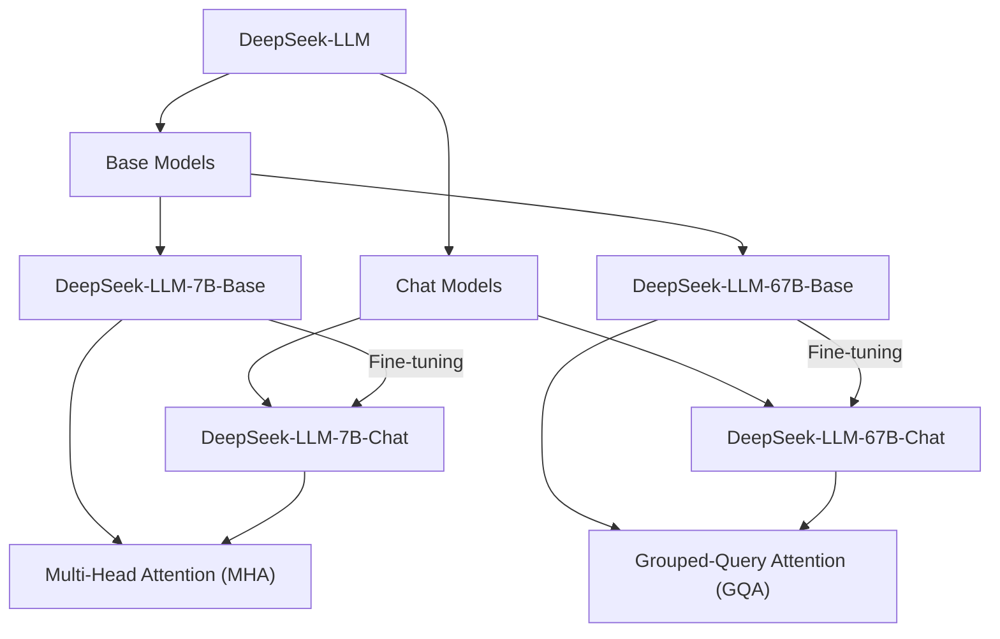

Sources: [README.md:82-88]()

The model family is structured into two main categories:

1. **Base Models**: Pre-trained from scratch on a diverse dataset of 2 trillion tokens.
   - **DeepSeek-LLM-7B-Base**: Smaller model with 7 billion parameters
   - **DeepSeek-LLM-67B-Base**: Larger model with 67 billion parameters

2. **Chat Models**: Fine-tuned versions of the base models optimized for conversational interactions.
   - **DeepSeek-LLM-7B-Chat**: Fine-tuned from the 7B base model
   - **DeepSeek-LLM-67B-Chat**: Fine-tuned from the 67B base model

## Model Architecture

All DeepSeek-LLM models follow an auto-regressive transformer decoder architecture similar to LLaMA, with key differences between the 7B and 67B variants:

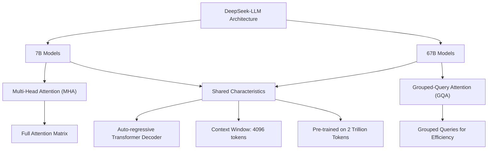

Sources: [README.md:196-198]()

### Architectural Differences

- **7B Models**: Utilize standard Multi-Head Attention (MHA) mechanism
- **67B Models**: Employ Grouped-Query Attention (GQA) for improved efficiency at larger scale

### Shared Characteristics

All models in the family share:
- Auto-regressive transformer decoder design
- Context window of 4096 tokens
- Pre-training on a dataset of 2 trillion tokens with diverse content

## Technical Specifications

### Model Parameters and Architecture

| Model | Parameters | Attention Mechanism | Context Length | Training Tokens |
|-------|------------|---------------------|----------------|-----------------|
| DeepSeek-LLM-7B-Base | 7 billion | MHA | 4096 | 2 trillion |
| DeepSeek-LLM-7B-Chat | 7 billion | MHA | 4096 | 2 trillion |
| DeepSeek-LLM-67B-Base | 67 billion | GQA | 4096 | 2 trillion |
| DeepSeek-LLM-67B-Chat | 67 billion | GQA | 4096 | 2 trillion |

Sources: [README.md:82-88](), [README.md:196-198]()

### Performance Benchmarks

The models show different performance profiles across various benchmarks:

| Model | MMLU | GSM8K | HumanEval | C-Eval | CMMLU |
|-------|------|-------|-----------|--------|-------|
| DeepSeek-LLM-7B-Base | 48.2 | 17.4 | 26.2 | 45.0 | 47.2 |
| DeepSeek-LLM-67B-Base | 71.3 | 63.4 | 42.7 | 66.1 | 70.8 |
| DeepSeek-LLM-7B-Chat | 49.4 | 62.6 | 48.2 | 47.0 | 49.7 |
| DeepSeek-LLM-67B-Chat | 71.1 | 84.1 | 73.8 | 65.2 | 67.8 |

Sources: [README.md:158-166]()

## Base and Chat Model Relationship

The relationship between base and chat models is a fundamental aspect of the DeepSeek-LLM family:

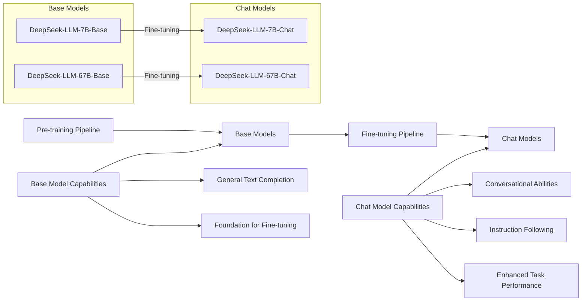

Sources: [README.md:63-76](), [README.md:158-166]()

### Development Flow

1. **Base Model Creation**: Pre-trained from scratch on 2 trillion tokens
2. **Chat Model Derivation**: Fine-tuned from base models on conversational data

### Capability Differences

- **Base Models**: Excel at general text completion and serve as foundations for further fine-tuning
- **Chat Models**: Optimized for conversation, instruction following, and show enhanced performance on applied tasks

### Performance Differences

Fine-tuning significantly improves performance on practical tasks. For example:
- GSM8K performance jumps from 17.4 to 62.6 for the 7B model after fine-tuning
- HumanEval performance increases from 26.2 to 48.2 for the 7B model

## Hardware Requirements

The models have different GPU memory requirements based on batch size and sequence length:

### DeepSeek-LLM-7B (1 NVIDIA A100-40GB)

| Batch Size | 256 tokens | 512 tokens | 1024 tokens | 2048 tokens | 4096 tokens |
|------------|------------|------------|-------------|-------------|-------------|
| 1 | 13.29 GB | 13.63 GB | 14.47 GB | 16.37 GB | 21.25 GB |
| 2 | 13.63 GB | 14.39 GB | 15.98 GB | 19.82 GB | 29.59 GB |
| 4 | 14.47 GB | 15.82 GB | 19.04 GB | 26.65 GB | OOM |
| 8 | 15.99 GB | 18.71 GB | 25.14 GB | 35.19 GB | OOM |
| 16 | 19.06 GB | 24.52 GB | 37.28 GB | OOM | OOM |

### DeepSeek-LLM-67B (8 NVIDIA A100-40GB)

| Batch Size | 256 tokens | 512 tokens | 1024 tokens | 2048 tokens | 4096 tokens |
|------------|------------|------------|-------------|-------------|-------------|
| 1 | 16.92 GB | 17.11 GB | 17.66 GB | 20.01 GB | 33.23 GB |
| 2 | 17.04 GB | 17.28 GB | 18.55 GB | 25.27 GB | OOM |
| 4 | 17.20 GB | 17.80 GB | 21.28 GB | 33.71 GB | OOM |
| 8 | 17.59 GB | 19.25 GB | 25.69 GB | OOM | OOM |
| 16 | 18.17 GB | 21.69 GB | 34.54 GB | OOM | OOM |

Sources: [README.md:364-369]()

## Usage Examples

Both base and chat models have different usage patterns. Here are examples of how to use them with Hugging Face's Transformers:

### Base Model (Text Completion)

```python
import torch
from transformers import AutoTokenizer, AutoModelForCausalLM, GenerationConfig

model_name = "deepseek-ai/deepseek-llm-7b-base"  # or "deepseek-ai/deepseek-llm-67b-base"
tokenizer = AutoTokenizer.from_pretrained(model_name)
model = AutoModelForCausalLM.from_pretrained(model_name, torch_dtype=torch.bfloat16, device_map="auto")
model.generation_config = GenerationConfig.from_pretrained(model_name)
model.generation_config.pad_token_id = model.generation_config.eos_token_id

text = "An attention function can be described as mapping a query and a set of key-value pairs to an output, where the query, keys, values, and output are all vectors. The output is"
inputs = tokenizer(text, return_tensors="pt")
outputs = model.generate(**inputs.to(model.device), max_new_tokens=100)

result = tokenizer.decode(outputs[0], skip_special_tokens=True)
print(result)
```

### Chat Model (Conversation)

```python
import torch
from transformers import AutoTokenizer, AutoModelForCausalLM, GenerationConfig

model_name = "deepseek-ai/deepseek-llm-7b-chat"  # or "deepseek-ai/deepseek-llm-67b-chat"
tokenizer = AutoTokenizer.from_pretrained(model_name)
model = AutoModelForCausalLM.from_pretrained(model_name, torch_dtype=torch.bfloat16, device_map="auto")
model.generation_config = GenerationConfig.from_pretrained(model_name)
model.generation_config.pad_token_id = model.generation_config.eos_token_id

messages = [
    {"role": "user", "content": "Who are you?"}
]
input_tensor = tokenizer.apply_chat_template(messages, add_generation_prompt=True, return_tensors="pt")
outputs = model.generate(input_tensor.to(model.device), max_new_tokens=100)

result = tokenizer.decode(outputs[0][input_tensor.shape[1]:], skip_special_tokens=True)
print(result)
```

Sources: [README.md:224-274]()

## Model Strengths and Specializations

Each model in the family has particular strengths:

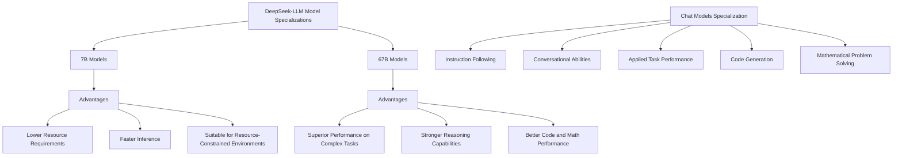

Sources: [README.md:71-76](), [README.md:158-166]()

### 7B Models

- Suitable for environments with limited GPU resources
- Faster inference speed
- Good balance between performance and efficiency

### 67B Models

- Superior general capabilities
- Exceptional performance in reasoning
- Strong abilities in coding and mathematics
- Excellent Chinese language comprehension

### Chat Models (Highlighted Capabilities)

- **DeepSeek LLM 67B Chat**: 
  - Outstanding coding performance (HumanEval Pass@1: 73.78)
  - Strong mathematical reasoning (GSM8K 0-shot: 84.1, MATH 0-shot: 32.6)
  - Exceptional generalization abilities (Hungarian National High School Exam score: 65)

Sources: [README.md:71-76]()

---

# Page: Model Architecture

# Model Architecture

<details>
<summary>Relevant source files</summary>

The following files were used as context for generating this wiki page:

- [README.md](README.md)

</details>


This document describes the technical architecture of DeepSeek-LLM models, including their internal structure, parameter configurations, and implementation details. For information about training methodology and data composition, see [Training Methodology](#2.1), and for details about the data processing pipeline, see [Data Pipeline](#2.2).

## Overview

DeepSeek-LLM follows the auto-regressive transformer decoder architecture similar to LLaMA. The models are available in two main parameter sizes (7B and 67B), each with base and chat variants. Both sizes support a context length of 4096 tokens, enabling them to process and generate long-form content.

### High-Level Architecture

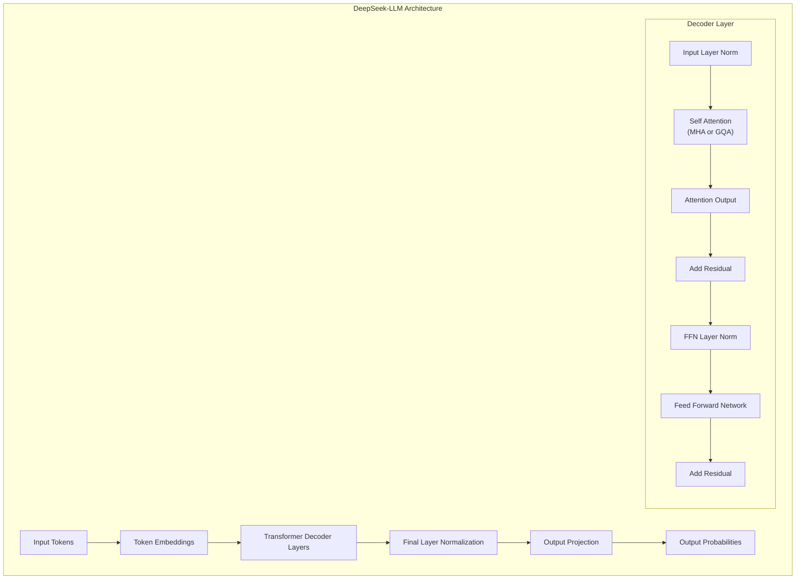

Sources: [README.md:196-197]()

## Model Variants and Specifications

DeepSeek-LLM is available in two main parameter sizes, each with specific architectural choices optimized for performance and efficiency.

| Parameter | DeepSeek-LLM 7B | DeepSeek-LLM 67B |
|-----------|----------------|------------------|
| Total Parameters | 7 billion | 67 billion |
| Attention Mechanism | Multi-Head Attention (MHA) | Grouped-Query Attention (GQA) |
| Context Length | 4096 tokens | 4096 tokens |
| Training Batch Size | 2304 | 4608 |
| Learning Rate | 4.2e-4 | 3.2e-4 |
| Tokenizer | Byte-level BPE | Byte-level BPE |

Sources: [README.md:196-197](), [README.md:198-199]()

## Attention Mechanisms

The DeepSeek-LLM models implement different attention mechanisms depending on model size to balance computational efficiency and model capability.

### Multi-Head Attention (7B Model)

The 7B model uses traditional Multi-Head Attention where queries, keys, and values are projected into multiple heads, each operating independently before being concatenated.

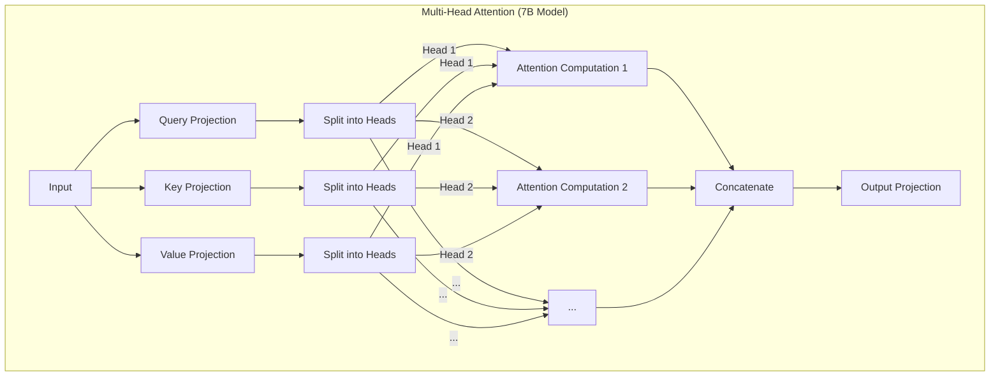

### Grouped-Query Attention (67B Model)

The 67B model uses Grouped-Query Attention (GQA), which reduces computational requirements by sharing keys and values across multiple query heads, making large models more efficient.

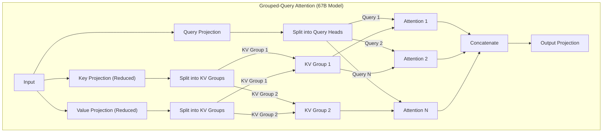

GQA allows the 67B model to maintain strong performance while reducing memory footprint and computational requirements compared to standard Multi-Head Attention at that scale.

Sources: [README.md:196-197]()

## Tokenization

DeepSeek-LLM uses a custom implementation of the Byte-level BPE (Byte Pair Encoding) algorithm through the Hugging Face Tokenizer library, with specially designed pre-tokenizers for optimal performance.


Unlike some other models, DeepSeek-LLM does not use SentencePiece tokenization, which has implications for compatibility with certain quantization methods.

Sources: [README.md:333-334]()

## Training Configuration

DeepSeek-LLM models were trained using the AdamW optimizer on a dataset of 2 trillion tokens. The training employed a multi-step learning rate schedule:

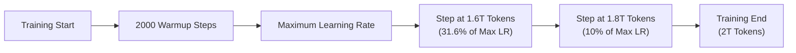

Sources: [README.md:198-199]()

## Memory Requirements for Inference

The memory requirements for inference vary based on model size, batch size, and sequence length:

### 7B Model (1 NVIDIA A100-40GB GPU)

| Batch Size | 256 tokens | 512 tokens | 1024 tokens | 2048 tokens | 4096 tokens |
|------------|------------|------------|-------------|-------------|-------------|
| 1          | 13.29 GB   | 13.63 GB   | 14.47 GB    | 16.37 GB    | 21.25 GB    |
| 2          | 13.63 GB   | 14.39 GB   | 15.98 GB    | 19.82 GB    | 29.59 GB    |
| 4          | 14.47 GB   | 15.82 GB   | 19.04 GB    | 26.65 GB    | OOM         |
| 8          | 15.99 GB   | 18.71 GB   | 25.14 GB    | 35.19 GB    | OOM         |
| 16         | 19.06 GB   | 24.52 GB   | 37.28 GB    | OOM         | OOM         |

### 67B Model (8 NVIDIA A100-40GB GPUs)

| Batch Size | 256 tokens | 512 tokens | 1024 tokens | 2048 tokens | 4096 tokens |
|------------|------------|------------|-------------|-------------|-------------|
| 1          | 16.92 GB   | 17.11 GB   | 17.66 GB    | 20.01 GB    | 33.23 GB    |
| 2          | 17.04 GB   | 17.28 GB   | 18.55 GB    | 25.27 GB    | OOM         |
| 4          | 17.20 GB   | 17.80 GB   | 21.28 GB    | 33.71 GB    | OOM         |
| 8          | 17.59 GB   | 19.25 GB   | 25.69 GB    | OOM         | OOM         |
| 16         | 18.17 GB   | 21.69 GB   | 34.54 GB    | OOM         | OOM         |

Sources: [README.md:365-369]()

## Model Integration Architecture

The following diagram shows how DeepSeek-LLM's architecture integrates with inference systems and user applications:

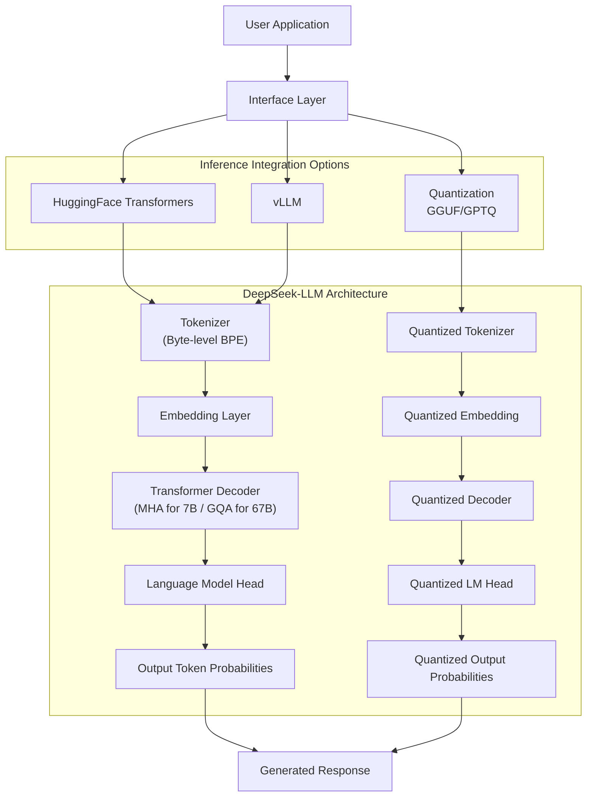

Sources: [README.md:196-197](), [README.md:337-358]()

## Base and Chat Model Variants

For each parameter size (7B and 67B), DeepSeek-LLM offers two variants:

1. **Base Models**: Foundation models trained on the full 2 trillion token dataset
2. **Chat Models**: Fine-tuned versions of the base models optimized for conversational interactions

The underlying architecture remains consistent between base and chat variants of the same parameter size, with differences only in the training objectives used during fine-tuning.

Sources: [README.md:77-78]()

---

# Page: Training Methodology

# Training Methodology

<details>
<summary>Relevant source files</summary>

The following files were used as context for generating this wiki page:

- [README.md](README.md)

</details>


This document details the training methodology used for DeepSeek-LLM models, covering the pre-training process, data composition, and optimization methods. For more detailed information about the model architecture itself, see [Model Architecture](#2), and for a deeper explanation of the data pipeline, see [Data Pipeline](#2.2).

## Overview

DeepSeek-LLM models were trained from scratch on 2 trillion tokens in both English and Chinese. The training methodology was designed to produce models with strong general capabilities, particularly in coding, mathematics, and Chinese language understanding.

## Pre-training Architecture and Configuration

DeepSeek-LLM follows the LLaMA architecture pattern, using an auto-regressive transformer decoder model with different attention mechanisms based on parameter size:

```mermaid
graph TD
    A["DeepSeek-LLM Pre-training"] --> B["7B Model"]
    A --> C["67B Model"]
    
    B --> D["Multi-Head Attention (MHA)"]
    C --> E["Grouped-Query Attention (GQA)"]
    
    D & E --> F["Auto-regressive Transformer Decoder"]
    
    F --> G["Context Length: 4096 tokens"]
```

The training process used the following configurations:

| Parameter | 7B Model | 67B Model |
|-----------|----------|-----------|
| Batch Size | 2304 | 4608 |
| Learning Rate | 4.2e-4 | 3.2e-4 |
| Optimizer | AdamW | AdamW |
| Sequence Length | 4096 | 4096 |

Sources: [README.md:196-197]()

## Data Processing

DeepSeek-LLM training utilized a sophisticated data pipeline called "cc_cleaner", a distributed batch processing system with frequent checkpointing to ensure data quality and diversity.

### Data Composition

The training corpus was deliberately diverse, including:
- Internet text
- Mathematical content
- Programming code
- Books
- Self-collected data (respecting robots.txt)

All personal information and copyright-restricted content was systematically removed from the dataset.

### Dataset Pruning

The pipeline employed both heuristic rules and model-based filtering to:
- Remove low-quality web content
- Preserve valuable low-resource knowledge
- Eliminate harmful or toxic content
- Improve overall corpus quality

### Deduplication Process

An advanced deduplication system using MinhashLSH was implemented to ensure data uniqueness:
- Document-level deduplication to remove duplicate documents
- String-level deduplication to remove repeated content across different documents
- Rigorous integrity checks for large-scale dataset processing

```mermaid
graph TD
    A["Raw Data (2T Tokens)"] --> B["cc_cleaner System"]
    
    B --> C["Data Composition Stage"]
    B --> D["Dataset Pruning Stage"]
    B --> E["Deduplication Stage"]
    
    C --> F["Internet Text, Math, Code, Books, etc."]
    D --> G["Heuristic Rules & Model-based Filtering"]
    E --> H["MinhashLSH Document & String-level Deduplication"]
    
    F --> I["Content Validated"]
    G --> I
    H --> I
    I --> J["Final Training Dataset"]
```

Sources: [README.md:182-194]()

## Training Process

The training process employed a multi-stage approach with careful optimization to ensure model quality throughout the 2 trillion token training run.

### Learning Rate Schedule

A multi-step learning rate schedule was employed:
1. Initial warmup with 2000 steps
2. Learning rate stepped down to 31.6% of maximum at 1.6 trillion tokens
3. Further reduced to 10% of maximum at 1.8 trillion tokens

```mermaid
graph TD
    A["Training Process"] --> B["Optimizer: AdamW"]
    
    B --> C["7B_Model"]
    B --> D["67B_Model"]
    
    C --> E["Batch_Size: 2304"]
    C --> F["Learning_Rate: 4.2e-4"]
    
    D --> G["Batch_Size: 4608"]
    D --> H["Learning_Rate: 3.2e-4"]
    
    E & F & G & H --> I["Learning_Rate_Schedule"]
    
    I --> J["Initial_Warmup (2000 steps)"]
    J --> K["Step_Down to 31.6% at 1.6T tokens"]
    K --> L["Step_Down to 10% at 1.8T tokens"]
    
    L --> M["Checkpoints"]
    M --> N["Base_Models"]
    N --> O["Chat_Models (via Fine-tuning)"]
```

Sources: [README.md:195-199]()

## Training Progress Monitoring

The training progress was continuously monitored using:
1. Training loss curve
2. Performance on multiple benchmark metrics

### Benchmark Metrics

Various benchmarks were tracked throughout training to evaluate model performance across different capability dimensions:

| Category | Benchmarks |
|----------|------------|
| General Understanding | TriviaQA, MMLU, BBH |
| Code | HumanEval |
| Mathematics | GSM8K |
| Chinese | C-Eval, CMMLU |

```mermaid
graph TD
    A["Training_Progress_Monitoring"] --> B["Training_Loss"]
    A --> C["Benchmark_Metrics"]
    
    C --> D["General_Understanding"]
    C --> E["Code_Performance"]
    C --> F["Math_Capability"]
    C --> G["Chinese_Proficiency"]
    
    D --> H["TriviaQA_MMLU_BBH"]
    E --> I["HumanEval"]
    F --> J["GSM8K"]
    G --> K["C-Eval_CMMLU"]
    
    B & H & I & J & K --> L["Model_Performance_Assessment"]
    L --> M["Continue_Training or Final_Checkpoint"]
```

The loss curve shows continuous improvement throughout training, with the model progressively improving on all benchmark metrics:

| Training Progress | Loss | TriviaQA | MMLU | GSM8K | HumanEval |
|-------------------|------|----------|------|-------|-----------|
| 500B tokens | Higher | Lower | Lower | Lower | Lower |
| 1T tokens | Medium | Medium | Medium | Medium | Medium |
| 2T tokens | Lowest | Highest | Highest | Highest | Highest |

Sources: [README.md:200-208]()

## Intermediate Checkpoints

As part of the training methodology, intermediate model checkpoints were preserved to enable research on model development over time. These checkpoints are available for both the 7B and 67B parameter models, allowing researchers to analyze the progression of model capabilities throughout the training process.

Sources: [README.md:90-102]()

---

# Page: Data Pipeline

# Data Pipeline

<details>
<summary>Relevant source files</summary>

The following files were used as context for generating this wiki page:

- [README.md](README.md)

</details>


## Purpose and Scope

This document describes the data processing pipeline used to prepare and clean the massive dataset for training DeepSeek-LLM models. The pipeline handles approximately 2 trillion tokens of diverse content, ensuring data quality, uniqueness, and ethical compliance throughout the training process.

For information about how this processed data is used in model training, see [Training Methodology](#2.1).

## System Overview

The DeepSeek-LLM data pipeline is built around "cc_cleaner," a distributed batch processing system with frequent checkpointing capabilities. This system transforms raw data from various sources into a clean, deduplicated, and high-quality dataset suitable for large language model training.

```mermaid
flowchart TD
    A["Raw Data Sources<br>2 Trillion Tokens"] --> B["cc_cleaner System"]
    
    subgraph "Data Pipeline"
        B --> C["Dataset Pruning"]
        B --> D["Deduplication"]
        C --> E["Filtered Dataset"]
        D --> E
        E --> F["Deterministic Randomization"]
        F --> G["Final Training Dataset"]
    end
    
    G --> H["Model Pre-Training"]
```

Sources: [README.md:182-194]()

## Data Composition

The training data comprises a diverse mixture of content types to provide the models with broad knowledge and capabilities:

| Content Type | Description | Purpose |
|--------------|-------------|---------|
| Internet text | Web pages, articles, forums | General knowledge and language patterns |
| Mathematics | Math problems, solutions, explanations | Mathematical reasoning capabilities |
| Code | Programming code from various languages | Coding and technical abilities |
| Books | Literary works, textbooks, research papers | Deep knowledge and complex reasoning |
| Self-collected data | Custom datasets respecting robots.txt | Specialized knowledge and capabilities |

A critical aspect of the data composition process is strict adherence to privacy and copyright considerations. The pipeline systematically removes:
- Content containing personal information
- Material subject to copyright restrictions
- Harmful or toxic content

```mermaid
graph TD
    subgraph "Data Composition Flow"
        A["Raw Data Sources"] --> B["Internet Text"]
        A --> C["Mathematics"]
        A --> D["Code"]
        A --> E["Books"]
        A --> F["Self-Collected Data"]
        
        B & C & D & E & F --> G["Privacy Filter"]
        G --> H["Copyright Filter"]
        H --> I["Toxic Content Filter"]
        
        I --> J["Clean Data Corpus"]
    end
    
    J --> K["cc_cleaner"]
```

Sources: [README.md:189-194]()

## Data Processing Components

### cc_cleaner System

The "cc_cleaner" system is the backbone of the data pipeline, providing a distributed framework for batch processing with frequent checkpointing. This system coordinates all data processing components and ensures efficient and reliable operation at web scale.

```mermaid
graph TD
    subgraph "cc_cleaner Architecture"
        A["Distributed Processing"] --- B["Batch Processing"]
        B --- C["Frequent Checkpointing"]
        C --- A
    end
    
    D["Raw Data"] --> A
    C --> E["Processed Data"]
```

Sources: [README.md:183-184]()

### Dataset Pruning

The pruning component applies both heuristic rules and model-based approaches to filter content:

```mermaid
flowchart LR
    A["Input Data"] --> B["Dataset Pruning"]
    
    subgraph "Pruning System"
        B --> C["Heuristic Rules"]
        B --> D["Model-Based Filters"]
        
        C --> E["Low-Quality Removal"]
        C --> F["Low-Resource Knowledge Preservation"]
        D --> G["Content Classification"]
        
        E & F & G --> H["Pruned Dataset"]
    end
    
    H --> I["Next Stage"]
```

The pruning system serves several key functions:
1. Removing low-quality web data using various quality metrics
2. Preserving valuable low-resource knowledge even if it comes from otherwise lower-quality sources
3. Improving overall corpus quality
4. Eliminating harmful or toxic content

Sources: [README.md:191-193]()

### Deduplication System

The deduplication system uses MinhashLSH (Locality-Sensitive Hashing) to detect and remove duplicate content at two levels:

```mermaid
flowchart TD
    A["Input Data"] --> B["Deduplication System"]
    
    subgraph "MinhashLSH Process"
        B --> C["Document-Level Deduplication"]
        B --> D["String-Level Deduplication"]
        
        C --> E["Document Hashing"]
        D --> F["String Hashing"]
        
        E --> G["Duplicate Document Removal"]
        F --> H["Duplicate String Removal"]
        
        G & H --> I["Deduplicated Dataset"]
    end
    
    I --> J["Next Stage"]
```

This rigorous deduplication approach ensures:
1. Document-level deduplication - Removes entire documents that are duplicates or near-duplicates
2. String-level deduplication - Identifies and removes duplicate text passages within and across documents
3. Exceptional data uniqueness and integrity to prevent the model from overlearning specific patterns

Sources: [README.md:193-194]()

### Deterministic Randomization

The pipeline incorporates deterministic randomization techniques to continuously enhance the data throughout the training process:

```mermaid
flowchart LR
    A["Filtered Data"] --> B["Deterministic Randomization"]
    
    subgraph "Randomization System"
        B --> C["Seed Generation"]
        C --> D["Consistent Shuffling"]
        D --> E["Adaptive Selection"]
        E --> F["Randomized Training Data"]
    end
    
    F --> G["Model Training"]
```

This approach allows for:
1. Adaptive data selection - Dynamically adjusting which data is presented to the model
2. Consistent reproducibility - Maintaining reproducible results despite randomization
3. Training stability - Providing varied but consistent data throughout the lengthy training process

Sources: [README.md:186-187]()

## Integration with Training Process

The data pipeline directly feeds into the pre-training process for DeepSeek-LLM models, providing a continuous stream of high-quality, diverse data:

```mermaid
flowchart TD
    A["Raw Data<br>2 Trillion Tokens"] --> B["Data Pipeline"]
    
    subgraph "Data Processing"
        B --> C["cc_cleaner"]
        C --> D["Dataset Pruning"]
        C --> E["Deduplication"]
        D & E --> F["Deterministic Randomization"]
    end
    
    F --> G["Pre-Processing"]
    G --> H["Pre-Training"]
    H --> I["Base Models<br>(7B/67B)"]
    I --> J["Fine-Tuning"]
    J --> K["Chat Models<br>(7B/67B)"]
```

This workflow shows how the data pipeline connects to the broader training process, ultimately resulting in both base and chat models. The processed dataset significantly impacts model performance, with DeepSeek-LLM demonstrating strong capabilities in areas like reasoning, coding, math, and Chinese comprehension.

Sources: [README.md:182-194](), [README.md:63-76]()

## Implementation Considerations

The implementation of the data pipeline prioritizes several key factors:

| Factor | Implementation Approach |
|--------|-------------------------|
| Scalability | Distributed architecture capable of handling trillions of tokens |
| Reliability | Frequent checkpointing to preserve progress and recover from failures |
| Efficiency | Batch processing to maximize throughput and resource utilization |
| Quality | Multi-layered filtering and verification for data integrity |
| Ethical compliance | Systematic removal of personal information and copyrighted content |

The pipeline represents a significant departure from simpler approaches like RefinedWeb + CCNet, offering more sophisticated processing capabilities tailored to the specific needs of training large language models like DeepSeek-LLM.

Sources: [README.md:183-194]()

---

# Page: Usage Guide

# Usage Guide

<details>
<summary>Relevant source files</summary>

The following files were used as context for generating this wiki page:

- [README.md](README.md)

</details>


This guide provides comprehensive instructions for utilizing DeepSeek-LLM models in various inference scenarios. It covers model loading, inference methods, hardware requirements, and optimization techniques for both base and chat model variants.

For information about model architecture and training methodology, see [Model Architecture](#2).

## Model Selection and Setup

DeepSeek-LLM comes in various sizes and types, each optimized for different use cases.

### Available Model Variants

```mermaid
graph TD
    A["DeepSeek-LLM Models"] --> B["Base Models"]
    A --> C["Chat Models"]
    B --> D["deepseek-llm-7b-base"]
    B --> E["deepseek-llm-67b-base"]
    C --> F["deepseek-llm-7b-chat"]
    C --> G["deepseek-llm-67b-chat"]

    style D stroke-width:2px
    style E stroke-width:2px
    style F stroke-width:2px
    style G stroke-width:2px
    
    H["Use Cases"] --- I["Base Models: Raw Text Completion"]
    H --- J["Chat Models: Conversational Responses"]
    K["Parameter Size"] --- L["7B: Lower Resource Requirements"]
    K --- M["67B: Higher Performance"]
```

Sources: [README.md:63-76]()

### Installation Requirements

Before using DeepSeek-LLM, ensure you have Python 3.8 or higher and install the necessary dependencies:

```bash
pip install -r requirements.txt
```

Sources: [README.md:214-218]()

## Inference with Transformers Library

The primary method for utilizing DeepSeek-LLM is through the Hugging Face Transformers library, which provides a standardized interface for model loading and text generation.

### Model Loading and Inference Flow

```mermaid
sequenceDiagram
    participant User as "Python Script"
    participant Tokenizer as "AutoTokenizer"
    participant Model as "AutoModelForCausalLM"
    participant GenConfig as "GenerationConfig"
    participant Device as "GPU/CPU"
    
    User->>Tokenizer: from_pretrained(model_name)
    User->>Model: from_pretrained(model_name, torch_dtype, device_map)
    User->>GenConfig: from_pretrained(model_name)
    User->>Model: set generation_config
    User->>Tokenizer: tokenize input text
    Tokenizer->>User: return input_tensor
    User->>Device: move input_tensor to device
    User->>Model: generate(input_tensor)
    Model->>User: return output_tensor
    User->>Tokenizer: decode(output_tensor)
    Tokenizer->>User: return decoded text
```

Sources: [README.md:220-242](), [README.md:246-265]()

### Text Completion with Base Models

For general text completion tasks, use the base models as follows:

```python
import torch
from transformers import AutoTokenizer, AutoModelForCausalLM, GenerationConfig

model_name = "deepseek-ai/deepseek-llm-67b-base"
tokenizer = AutoTokenizer.from_pretrained(model_name)
model = AutoModelForCausalLM.from_pretrained(model_name, torch_dtype=torch.bfloat16, device_map="auto")
model.generation_config = GenerationConfig.from_pretrained(model_name)
model.generation_config.pad_token_id = model.generation_config.eos_token_id

text = "An attention function can be described as mapping a query and a set of key-value pairs to an output, where the query, keys, values, and output are all vectors. The output is"
inputs = tokenizer(text, return_tensors="pt")
outputs = model.generate(**inputs.to(model.device), max_new_tokens=100)

result = tokenizer.decode(outputs[0], skip_special_tokens=True)
print(result)
```

Sources: [README.md:222-242]()

### Chat Completion with Chat Models

For conversational interactions, use the chat models with properly formatted inputs:

```python
import torch
from transformers import AutoTokenizer, AutoModelForCausalLM, GenerationConfig

model_name = "deepseek-ai/deepseek-llm-67b-chat"
tokenizer = AutoTokenizer.from_pretrained(model_name)
model = AutoModelForCausalLM.from_pretrained(model_name, torch_dtype=torch.bfloat16, device_map="auto")
model.generation_config = GenerationConfig.from_pretrained(model_name)
model.generation_config.pad_token_id = model.generation_config.eos_token_id

messages = [
    {"role": "user", "content": "Who are you?"}
]
input_tensor = tokenizer.apply_chat_template(messages, add_generation_prompt=True, return_tensors="pt")
outputs = model.generate(input_tensor.to(model.device), max_new_tokens=100)

result = tokenizer.decode(outputs[0][input_tensor.shape[1]:], skip_special_tokens=True)
print(result)
```

Sources: [README.md:246-265]()

### Chat Template Structure

DeepSeek-LLM chat models use a specific format for conversations. While `apply_chat_template()` handles this automatically, understanding the format is useful for troubleshooting or manual formatting:

```mermaid
graph TD
    A["Chat Messages Array"] --> B["tokenizer.apply_chat_template()"]
    B --> C["Tokenized Input"]
    C --> D["model.generate()"]
    
    subgraph "Template Format"
        E["User: {user_message}"]
        F["Assistant: {assistant_response}<｜end▁of▁sentence｜>"]
        G["User: {next_user_message}"]
        H["Assistant: {model_generates_here}"]
        E --> F
        F --> G
        G --> H
    end
```

If not using `apply_chat_template()`, you can format conversations manually:

```
User: {messages[0]['content']}

---

# Page: Using with Hugging Face Transformers

# Using with Hugging Face Transformers

<details>
<summary>Relevant source files</summary>

The following files were used as context for generating this wiki page:

- [README.md](README.md)

</details>


This document provides a comprehensive guide on how to use DeepSeek-LLM models with the Hugging Face Transformers library. For using DeepSeek-LLM with vLLM for high-throughput inference, see [Using with vLLM](#3.2). For quantization options to run DeepSeek-LLM on lower-end hardware, see [Quantization Options](#3.3).

## Installation Requirements

Before using DeepSeek-LLM with Hugging Face Transformers, you need to set up the required dependencies:

```bash
# Requires Python >= 3.8
pip install -r requirements.txt
```

Sources: [README.md:212-218]()

## Model Variants and Selection

DeepSeek-LLM offers multiple model variants with different parameter sizes and capabilities. When using with Hugging Face Transformers, you must select the appropriate model variant for your use case.

```mermaid
graph TD
    User["User Code"] --> |"import"| HF["Hugging Face Transformers"]
    HF --> |"AutoModelForCausalLM.from_pretrained()"| Models["DeepSeek-LLM Models"]
    
    subgraph "Model Selection"
        Models --> BaseModels["Base Models"]
        Models --> ChatModels["Chat Models"]
        
        BaseModels --> Base7B["deepseek-ai/deepseek-llm-7b-base"]
        BaseModels --> Base67B["deepseek-ai/deepseek-llm-67b-base"]
        
        ChatModels --> Chat7B["deepseek-ai/deepseek-llm-7b-chat"]
        ChatModels --> Chat67B["deepseek-ai/deepseek-llm-67b-chat"]
    end
    
    BaseModels --> |"Used for"| TextCompletion["Text Completion"]
    ChatModels --> |"Used for"| ChatCompletion["Chat Completion"]
```

Sources: [README.md:82-88]()

## Using Base Models for Text Completion

Base models are designed for general text completion tasks. They continue text based on the provided prompt without specific conversational capabilities.

### Basic Text Completion Example

```python
import torch
from transformers import AutoTokenizer, AutoModelForCausalLM, GenerationConfig

model_name = "deepseek-ai/deepseek-llm-67b-base"
tokenizer = AutoTokenizer.from_pretrained(model_name)
model = AutoModelForCausalLM.from_pretrained(model_name, torch_dtype=torch.bfloat16, device_map="auto")
model.generation_config = GenerationConfig.from_pretrained(model_name)
model.generation_config.pad_token_id = model.generation_config.eos_token_id

text = "An attention function can be described as mapping a query and a set of key-value pairs to an output, where the query, keys, values, and output are all vectors. The output is"
inputs = tokenizer(text, return_tensors="pt")
outputs = model.generate(**inputs.to(model.device), max_new_tokens=100)

result = tokenizer.decode(outputs[0], skip_special_tokens=True)
print(result)
```

Sources: [README.md:226-241]()

## Using Chat Models for Conversation

Chat models are optimized for conversational interactions and follow a specific dialog format. They're fine-tuned versions of the base models that understand turn-taking in conversations.

### Chat Completion Workflow

```mermaid
flowchart TD
    subgraph "Chat Completion Process"
        CreateMessages["Create Messages Array"] --> ApplyTemplate["Apply Chat Template"]
        ApplyTemplate --> Generate["Generate Response"]
        Generate --> DecodeOutput["Decode Output"]
    end
    
    subgraph "Code Entities"
        Messages["messages = [{role, content}, ...]"] --> |"Input to"| Template["tokenizer.apply_chat_template()"]
        Template --> |"Creates"| InputTensor["input_tensor"]
        InputTensor --> |"Input to"| ModelGenerate["model.generate()"]
        ModelGenerate --> |"Creates"| Outputs["outputs"]
        Outputs --> |"Processed by"| TokenizerDecode["tokenizer.decode()"]
        TokenizerDecode --> |"Produces"| Result["result"]
    end
```

### Basic Chat Completion Example

```python
import torch
from transformers import AutoTokenizer, AutoModelForCausalLM, GenerationConfig

model_name = "deepseek-ai/deepseek-llm-67b-chat"
tokenizer = AutoTokenizer.from_pretrained(model_name)
model = AutoModelForCausalLM.from_pretrained(model_name, torch_dtype=torch.bfloat16, device_map="auto")
model.generation_config = GenerationConfig.from_pretrained(model_name)
model.generation_config.pad_token_id = model.generation_config.eos_token_id

messages = [
    {"role": "user", "content": "Who are you?"}
]
input_tensor = tokenizer.apply_chat_template(messages, add_generation_prompt=True, return_tensors="pt")
outputs = model.generate(input_tensor.to(model.device), max_new_tokens=100)

result = tokenizer.decode(outputs[0][input_tensor.shape[1]:], skip_special_tokens=True)
print(result)
```

Sources: [README.md:246-264]()

### Chat Template Format

If you prefer not to use the `apply_chat_template` method, you can manually format your input using the following template:

```
User: {messages[0]['content']}

---

# Page: Using with vLLM

# Using with vLLM

<details>
<summary>Relevant source files</summary>

The following files were used as context for generating this wiki page:

- [README.md](README.md)

</details>


This page provides a technical guide for integrating DeepSeek-LLM models with vLLM for high-throughput inference. vLLM is a fast and memory-efficient inference engine that optimizes LLM serving through techniques such as PagedAttention for efficient memory management. For standard integration with Hugging Face Transformers, see [Using with Hugging Face Transformers](#3.1).

## What is vLLM?

vLLM is a high-performance inference framework designed to maximize throughput and minimize latency when serving large language models. It offers several advantages when used with DeepSeek-LLM:

- Significantly higher throughput for batch processing
- More efficient memory management
- Support for tensor parallelism across multiple GPUs
- Continuous batching capabilities for production scenarios

## vLLM Integration Architecture

```mermaid
flowchart TD
    User(["User Application"]) --> vLLM["vLLM Inference Engine"]
    vLLM --> DSModels["DeepSeek-LLM Models"]
    
    subgraph "vLLM Components"
        vLLM --> TokenAttention["PagedAttention"]
        vLLM --> ParallelExec["Tensor Parallelism"]
        vLLM --> BatchManager["Continuous Batching"]
    end
    
    subgraph "DeepSeek-LLM Models"
        DSModels --> Base7B["deepseek-llm-7b-base"]
        DSModels --> Base67B["deepseek-llm-67b-base"]
        DSModels --> Chat7B["deepseek-llm-7b-chat"]
        DSModels --> Chat67B["deepseek-llm-67b-chat"]
    end
```

Sources: [README.md:280-329]()

## Setup and Configuration

Before using vLLM with DeepSeek-LLM, you need to install the vLLM library:

```bash
pip install vllm
```

Key configuration parameters when initializing a model with vLLM include:

| Parameter | Description | Recommended Value |
|-----------|-------------|------------------|
| `model` | HuggingFace model identifier or local path | `"deepseek-ai/deepseek-llm-7b-base"` |
| `trust_remote_code` | Required for custom model code | `True` |
| `gpu_memory_utilization` | Fraction of GPU memory to use | `0.9` (90%) |
| `tensor_parallel_size` | Number of GPUs for tensor parallelism | `1` for 7B, `4+` for 67B |

## Text Completion with Base Models

The inference workflow with vLLM for DeepSeek-LLM base models follows this pattern:

```mermaid
sequenceDiagram
    participant App as "Application"
    participant vLLM as "vLLM Engine"
    participant Model as "DeepSeek-LLM Base Model"
    
    App->>vLLM: "Initialize LLM(model, tp_size)"
    vLLM->>Model: "Load model weights"
    App->>vLLM: "Define SamplingParams"
    App->>vLLM: "Prepare prompt batch"
    App->>vLLM: "llm.generate(prompts, sampling_params)"
    vLLM->>Model: "Process tokens through model"
    Model->>vLLM: "Return logits"
    vLLM->>vLLM: "Apply sampling strategy"
    vLLM->>App: "Return generated text"
```

Sources: [README.md:284-301]()

### Example Usage for Base Models

For text completion with base models like `deepseek-llm-7b-base` or `deepseek-llm-67b-base`:

1. Initialize the LLM with vLLM
2. Define sampling parameters
3. Prepare batch of prompts
4. Generate completions
5. Extract generated text from outputs

## Chat Completion with Chat Models

For chat models (`deepseek-llm-7b-chat` or `deepseek-llm-67b-chat`), the process requires tokenizer integration to properly format chat templates:

```mermaid
flowchart TD
    A["Initialize vLLM and Tokenizer"] --> B["Format Messages as Chat Templates"]
    B --> C["Convert to Token IDs"]
    C --> D["Set EOS Token as Stop Token"]
    D --> E["Generate Completions"]
    E --> F["Extract Response Text"]
    
    subgraph "Format Example"
        Format["User: Who are you?\n\nAssistant:"]
    end
    
    B --- Format
```

Sources: [README.md:305-328]()

### Example Usage for Chat Models

The workflow for chat completion requires both the vLLM engine and HuggingFace tokenizer:

1. Initialize both the tokenizer and vLLM engine
2. Format chat messages using the tokenizer's `apply_chat_template`
3. Generate completions with token IDs instead of raw text
4. Set the model's EOS token as the stop token
5. Extract the generated text from outputs

## Memory Requirements and Performance

Memory usage varies significantly based on batch size and sequence length. The following tables show peak memory usage for different configurations:

### DeepSeek-LLM 7B (on 1×A100-40GB)

| Batch Size | 256 tokens | 512 tokens | 1024 tokens | 2048 tokens | 4096 tokens |
|------------|------------|------------|-------------|-------------|-------------|
| 1          | 13.29 GB   | 13.63 GB   | 14.47 GB    | 16.37 GB    | 21.25 GB    |
| 2          | 13.63 GB   | 14.39 GB   | 15.98 GB    | 19.82 GB    | 29.59 GB    |
| 4          | 14.47 GB   | 15.82 GB   | 19.04 GB    | 26.65 GB    | OOM         |
| 8          | 15.99 GB   | 18.71 GB   | 25.14 GB    | 35.19 GB    | OOM         |
| 16         | 19.06 GB   | 24.52 GB   | 37.28 GB    | OOM         | OOM         |

### DeepSeek-LLM 67B (on 8×A100-40GB)

| Batch Size | 256 tokens | 512 tokens | 1024 tokens | 2048 tokens | 4096 tokens |
|------------|------------|------------|-------------|-------------|-------------|
| 1          | 16.92 GB   | 17.11 GB   | 17.66 GB    | 20.01 GB    | 33.23 GB    |
| 2          | 17.04 GB   | 17.28 GB   | 18.55 GB    | 25.27 GB    | OOM         |
| 4          | 17.20 GB   | 17.80 GB   | 21.28 GB    | 33.71 GB    | OOM         |
| 8          | 17.59 GB   | 19.25 GB   | 25.69 GB    | OOM         | OOM         |
| 16         | 18.17 GB   | 21.69 GB   | 34.54 GB    | OOM         | OOM         |

Sources: [README.md:362-369]()

## Tensor Parallelism for Large Models

For the 67B model variant, tensor parallelism is essential for efficient inference. This technique distributes the model across multiple GPUs:

```mermaid
flowchart LR
    subgraph "Tensor Parallelism (tp_size=4)"
        Input["Input Tokens"] --> Split["Split Computation"]
        Split --> GPU1["GPU 1: Portion of Model Weights"]
        Split --> GPU2["GPU 2: Portion of Model Weights"]
        Split --> GPU3["GPU 3: Portion of Model Weights"]
        Split --> GPU4["GPU 4: Portion of Model Weights"]
        GPU1 --> AllReduce["AllReduce Operation"]
        GPU2 --> AllReduce
        GPU3 --> AllReduce
        GPU4 --> AllReduce
        AllReduce --> Output["Output Logits"]
    end
```

Sources: [README.md:288](), [README.md:310](), [README.md:362-369]()

## Optimization Tips

For optimal performance with vLLM:

1. Set appropriate `gpu_memory_utilization` value (typically 0.9)
2. Choose tensor parallelism based on model size and available GPUs
3. Adjust batch size and sequence length to avoid OOM errors
4. Configure sampling parameters to balance quality and speed
5. Use token IDs directly for chat models to avoid tokenization overhead

For quantized versions of DeepSeek-LLM with reduced memory requirements, see [Quantization Options](#3.3).

---

# Page: Quantization Options

# Quantization Options

<details>
<summary>Relevant source files</summary>

The following files were used as context for generating this wiki page:

- [README.md](README.md)

</details>


This page explains the quantization options available for DeepSeek-LLM models. Quantization reduces memory requirements and improves inference speed by decreasing the precision of model weights, enabling deployment on hardware with limited resources. For information about using DeepSeek-LLM with Hugging Face Transformers, see [Using with Hugging Face Transformers](#3.1). For high-throughput inference information, see [Using with vLLM](#3.2).

## Quantization Overview

DeepSeek-LLM supports two primary quantization approaches for reduced resource usage: GGUF (llama.cpp) and GPTQ (exllamav2). These methods allow running models on consumer hardware by trading off a small amount of model quality for significantly reduced memory requirements.

### Deployment Workflow with Quantization

```mermaid
flowchart TD
    A["DeepSeek-LLM Models"] --> B["Full Precision Models"]
    A --> C["Quantized Models"]
    
    B --> D["HuggingFace Transformers"]
    B --> E["vLLM"]
    
    C --> F["GGUF Quantization<br>(llama.cpp)"]
    C --> G["GPTQ Quantization<br>(exllamav2)"]
    
    D --> H["High-Resource Deployment<br>40GB+ VRAM"]
    E --> H
    
    F --> I["Low-Resource Deployment<br>CPU or consumer GPUs"]
    G --> I
```

Sources: [README.md:332-357]()

## GGUF Quantization (llama.cpp)

GGUF (GPT-Generated Unified Format) is designed for efficiently storing and running large language models on consumer hardware. DeepSeek-LLM uses a Byte-level BPE algorithm with specially designed pre-tokenizers that requires specific handling during quantization.

### GGUF Implementation Status

A pull request has been submitted to the llama.cpp repository to fully support all HuggingFace pre-tokenizers, including those used by DeepSeek-LLM. While waiting for this PR to be merged, a specialized fork can be used.

### GGUF Quantization Steps

```mermaid
flowchart LR
    A["Clone Specialized Fork"] --> B["Setup Environment"]
    B --> C["Convert to GGUF"]
    C --> D["Apply Quantization"]
    D --> E["Run Inference"]
    
    subgraph "Commands"
        C --- C1["convert-hf-to-gguf.py"]
        D --- D1["./quantize"]
        E --- E1["./main"]
    end
```

To convert DeepSeek-LLM models to GGUF format:

1. Clone the specialized fork supporting DeepSeek's tokenizer:
   ```bash
   git clone https://github.com/DOGEwbx/llama.cpp.git
   cd llama.cpp
   git checkout regex_gpt2_preprocess
   ```

2. Set up the environment:
   ```bash
   make
   python3 -m pip install -r requirements.txt
   ```

3. Generate and quantize the GGUF model:
   ```bash
   python convert-hf-to-gguf.py <MODEL_PATH> --outfile <GGUF_PATH> --model-name deepseekllm
   ./quantize <GGUF_PATH> <OUTPUT_PATH> q4_0
   ./main -m <OUTPUT_PATH> -n 128 -p <PROMPT>
   ```

Sources: [README.md:338-345]()

### GGUF Quantization Levels

The quantization level determines the trade-off between model size, inference speed, and quality:

| Quantization Level | Description | Memory Reduction | Quality Impact |
|-------------------|-------------|-----------------|---------------|
| q4_0 | 4-bit quantization | ~4x | Moderate |
| q4_1 | 4-bit with lookup tables | ~4x | Moderate-Low |
| q5_0 | 5-bit quantization | ~3.2x | Low |
| q5_1 | 5-bit with lookup tables | ~3.2x | Very Low |
| q8_0 | 8-bit quantization | ~2x | Minimal |

Sources: [README.md:346-354]()

## GPTQ Quantization (exllamav2)

GPTQ is a one-shot weight quantization method designed specifically for large language models. It optimizes for GPU inference with minimal quality loss.

### GPTQ Implementation Status

The exllamav2 library now supports HuggingFace Tokenizer, making it compatible with DeepSeek-LLM models. This means no special fork is required for using GPTQ quantization with DeepSeek-LLM models.

Sources: [README.md:356-357]()

### Memory Efficiency Comparison

The following diagram illustrates approximate memory usage reduction achieved through quantization compared to full-precision models:

```mermaid
flowchart LR
    subgraph "DeepSeek-LLM 7B"
        A1["BF16 Full Precision<br>~14GB VRAM"] --> B1["GGUF q4_0<br>~3.5GB VRAM"]
        A1 --> C1["GPTQ 4-bit<br>~4GB VRAM"]
    end
    
    subgraph "DeepSeek-LLM 67B"
        A2["BF16 Full Precision<br>~134GB VRAM"] --> B2["GGUF q4_0<br>~34GB VRAM"]
        A2 --> C2["GPTQ 4-bit<br>~38GB VRAM"]
    end
```

## Memory Requirements

Memory requirements for full-precision DeepSeek-LLM models are documented in the project's README. These requirements can be significantly reduced through quantization.

### Full-Precision Memory Usage (7B Model)

For DeepSeek-LLM 7B on 1 NVIDIA A100-PCIE-40GB GPU:

| Batch Size | 256 tokens | 512 tokens | 1024 tokens | 2048 tokens | 4096 tokens |
|------------|------------|------------|-------------|-------------|-------------|
| 1          | 13.29 GB   | 13.63 GB   | 14.47 GB    | 16.37 GB    | 21.25 GB    |
| 2          | 13.63 GB   | 14.39 GB   | 15.98 GB    | 19.82 GB    | 29.59 GB    |
| 4          | 14.47 GB   | 15.82 GB   | 19.04 GB    | 26.65 GB    | OOM         |
| 8          | 15.99 GB   | 18.71 GB   | 25.14 GB    | 35.19 GB    | OOM         |
| 16         | 19.06 GB   | 24.52 GB   | 37.28 GB    | OOM         | OOM         |

### Full-Precision Memory Usage (67B Model)

For DeepSeek-LLM 67B on 8 NVIDIA A100-PCIE-40GB GPUs:

| Batch Size | 256 tokens | 512 tokens | 1024 tokens | 2048 tokens | 4096 tokens |
|------------|------------|------------|-------------|-------------|-------------|
| 1          | 16.92 GB   | 17.11 GB   | 17.66 GB    | 20.01 GB    | 33.23 GB    |
| 2          | 17.04 GB   | 17.28 GB   | 18.55 GB    | 25.27 GB    | OOM         |
| 4          | 17.20 GB   | 17.80 GB   | 21.28 GB    | 33.71 GB    | OOM         |
| 8          | 17.59 GB   | 19.25 GB   | 25.69 GB    | OOM         | OOM         |
| 16         | 18.17 GB   | 21.69 GB   | 34.54 GB    | OOM         | OOM         |

Sources: [README.md:360-369]()

## Choosing the Right Quantization Method

When selecting a quantization method, consider:

1. **Hardware**: 
   - For CPU deployment or older GPUs, GGUF with llama.cpp is generally the better choice
   - For modern NVIDIA GPUs, GPTQ with exllamav2 may provide better performance

2. **Use Case**:
   - For applications requiring high accuracy, higher precision quantization (8-bit) or full precision may be necessary
   - For general-purpose applications, 4-bit or 5-bit quantization often provides a good balance

3. **Model Size**:
   - Larger models (67B) see more dramatic memory savings from quantization
   - Smaller models (7B) can often run in full precision on high-end consumer GPUs

| Feature | GGUF (llama.cpp) | GPTQ (exllamav2) |
|---------|------------------|------------------|
| Primary Use | CPU & GPU | NVIDIA GPU |
| Integration Complexity | Standalone C++ application | Python library |
| Memory Efficiency | Very high | High |
| Inference Speed | Good | Excellent (on supported GPUs) |
| Quality Preservation | Good | Very good |
| Supported Platforms | Windows, Linux, macOS | Windows, Linux |

Sources: [README.md:332-357]()

---

# Page: Evaluation and Benchmarks

# Evaluation and Benchmarks

<details>
<summary>Relevant source files</summary>

The following files were used as context for generating this wiki page:

- [README.md](README.md)
- [evaluation/more_results.md](evaluation/more_results.md)
- [images/mathexam.png](images/mathexam.png)

</details>


## Purpose and Scope

This page documents the comprehensive evaluation framework and benchmarking system used to assess DeepSeek-LLM models across various capabilities including language understanding, knowledge, reasoning, mathematics, coding, and multilingual proficiency. For detailed examination of specific benchmark scores, see [Benchmark Results](#4.1), and for in-depth analysis of mathematical performance, see [Mathematical Problem Solving](#4.2).

## Evaluation Framework Architecture

The DeepSeek-LLM evaluation framework is organized as a modular system that measures model performance across multiple capability domains:

```mermaid
graph TD
    A["DeepSeekEvalSystem"] --> B["LanguageUnderstandingEvals"]
    A --> C["KnowledgeReasoningEvals"]
    A --> D["MathProblemSolvingEvals"]
    A --> E["CodeGenerationEvals"]
    A --> F["MultilingualEvals"]
    
    B --> B1["HellaSwagEvaluator"]
    B --> B2["PIQAEvaluator"]
    B --> B3["WinoGrandeEvaluator"]
    
    C --> C1["MMLUEvaluator"]
    C --> C2["ARCEvaluator"]
    C --> C3["TriviaQAEvaluator"]
    
    D --> D1["GSM8KEvaluator"]
    D --> D2["MATHEvaluator"]
    D --> D3["HungarianExamEvaluator"]
    
    E --> E1["HumanEvalEvaluator"]
    E --> E2["MBPPEvaluator"]
    E --> E3["LeetCodeEvaluator"]
    
    F --> F1["CMMULEvaluator"]
    F --> F2["CEvalEvaluator"]
    
    G["SpecializedEvaluators"] --> G1["IFEvalEvaluator"]
    G --> G2["CoTEvaluator"]
    G --> G3["ToolReasoningEvaluator"]
```

Sources: [README.md:104-119]()

## Evaluation Methodologies

The evaluation system implements multiple methodologies to assess model capabilities under different conditions:

```mermaid
flowchart TB
    A["EvaluationMethodology"] --> B["ZeroShotEvaluation"]
    A --> C["FewShotEvaluation"]
    A --> D["ChainOfThoughtEvaluation"]
    A --> E["ToolIntegratedEvaluation"]
    
    B --> B1["DirectPrompting"]
    
    C --> C1["ExampleBasedPrompting"]
    C --> C2["PatternBasedPrompting"]
    
    D --> D1["StepByStepReasoning"]
    D --> D2["SelfConsistencyChecking"]
    
    E --> E1["PythonInterpreterIntegration"]
    E --> E2["CalculatorIntegration"]
```

Sources: [README.md:118-119](), [evaluation/more_results.md:16-19]()

## Standard Benchmark Suite

The evaluation framework includes a comprehensive suite of benchmarks that assess different aspects of model capabilities:

### Language Understanding Benchmarks

- **HellaSwag**: Tests common sense reasoning through sentence completion tasks
- **PIQA**: Physical Interaction Question Answering for physical commonsense reasoning
- **WinoGrande**: Assesses pronoun resolution and common sense reasoning

### Knowledge and Reasoning Benchmarks

- **MMLU** (Massive Multitask Language Understanding): Covers 57 subjects across STEM, humanities, social sciences, etc.
- **ARC-Easy/Challenge**: Elementary/middle school science questions requiring reasoning
- **TriviaQA**: Fact-based question answering dataset requiring world knowledge
- **BBH** (Big Bench Hard): Collection of challenging language tasks

### Mathematical Problem-Solving Benchmarks

- **GSM8K**: Grade school math word problems
- **MATH**: Competition-level mathematics problems
- **Hungarian National High-School Exam**: Real high school exam problems

### Code Generation Benchmarks

- **HumanEval**: Hand-written programming problems for function synthesis
- **MBPP**: Programming problems for Python code generation
- **LeetCode Weekly Contest**: Recent competitive programming problems

### Multilingual Benchmarks

- **CMMLU**: Chinese version of MMLU covering 67 topics
- **CEval**: Comprehensive Chinese evaluation suite
- **ChineseQA**: In-house Chinese question answering benchmark

Sources: [README.md:110-166](), [evaluation/more_results.md:1-14]()

## Novel Evaluation Approaches

DeepSeek-LLM introduces several novel evaluation approaches to address data contamination concerns and provide more robust assessment of model capabilities.

### Hungarian National High-School Exam Evaluation

```mermaid
flowchart LR
    A["HungarianExamEvaluator"] --> B["ExamQuestionProcessor"]
    B --> C["ModelResponseCollector"]
    C --> D["HumanAnnotationSystem"]
    D --> E["ScoringMetricsCalculator"]
    
    subgraph "Evaluation Process"
    B
    C
    D
    E
    end
    
    E --> F["FinalScoreReport"]
```

This evaluation uses the Hungarian National High School Exam containing 33 mathematics problems. The process involves:

1. Extracting exam questions from the dataset repository
2. Prompting the model in a zero-shot setting
3. Collecting complete solution attempts
4. Human evaluation following the official scoring metric in the solution.pdf
5. Calculating total score across all problems

This approach provides assessment of mathematical reasoning capabilities on content models haven't encountered during training.

Sources: [README.md:128-135]()

### Instruction Following Evaluation (IFEval)

```mermaid
flowchart LR
    A["IFEvalEvaluator"] --> B["InstructionPromptProcessor"]
    B --> C["ModelResponseAnalyzer"]
    C --> D["InstructionComplianceChecker"]
    D --> E["PromptLevelScorer"]
    
    subgraph "Verification Process"
    B
    C
    D
    E
    end
    
    E --> F["ComplianceReport"]
```

This evaluation uses Google's instruction following dataset released on November 15th, 2023. The system:

1. Uses 25 types of verifiable instructions across approximately 500 prompts
2. Evaluates model responses using the prompt-level loose metric
3. Measures the model's ability to correctly follow explicit instructions
4. Produces a compliance score reflecting instruction following capability

Sources: [README.md:139-143]()

### LeetCode Weekly Contest Evaluation

```mermaid
flowchart LR
    A["LeetCodeEvaluator"] --> B["ProblemExtractor"]
    B --> C["TestCaseProcessor"]
    C --> D["CodeExecutionEnvironment"]
    D --> E["ResultVerifier"]
    
    subgraph "Evaluation Process"
    B
    C
    D
    E
    end
    
    E --> F["PassRateCalculator"]
```

This evaluation assesses coding proficiency using problems from recent LeetCode contests:

1. Sources 126 problems from LeetCode Weekly Contests (351-372) and Bi-Weekly Contests (108-117)
2. Processes over 20 test cases for each problem
3. Executes model-generated solutions against all test cases
4. Considers a problem solved only if all test cases pass
5. Calculates a pass@1 score similar to HumanEval methodology

Sources: [README.md:147-153]()

## Benchmark Results

### Base Model Performance

The following table summarizes DeepSeek-LLM base models compared to other base models across standard benchmarks:

| Model | HellaSwag | TriviaQA | MMLU | GSM8K | HumanEval | BBH | CEval | CMMLU | ChineseQA |
|-------|-----------|----------|------|-------|-----------|-----|-------|-------|-----------|
| LLaMA-2 7B | 75.6 | 63.8 | 45.8 | 15.5 | 14.6 | 38.5 | 33.9 | 32.6 | 21.5 |
| LLaMA-2 70B | 84.0 | 79.5 | 69.0 | 58.4 | 28.7 | 62.9 | 51.4 | 53.1 | 50.2 |
| DeepSeek LLM 7B Base | 75.4 | 59.7 | 48.2 | 17.4 | 26.2 | 39.5 | 45.0 | 47.2 | 78.0 |
| DeepSeek LLM 67B Base | 84.0 | 78.9 | 71.3 | 63.4 | 42.7 | 68.7 | 66.1 | 70.8 | 87.6 |

Sources: [README.md:110-116]()

### Chat Model Performance

Performance of DeepSeek-LLM chat models on standard benchmarks:

| Model | TriviaQA | MMLU | GSM8K | HumanEval | BBH | CEval | CMMLU | ChineseQA |
|-------|----------|------|-------|-----------|-----|-------|-------|-----------|
| DeepSeek LLM 7B Chat | 57.9 | 49.4 | 62.6 | 48.2 | 42.3 | 47.0 | 49.7 | 75.0 |
| DeepSeek LLM 67B Chat | 81.5 | 71.1 | 84.1 | 73.8 | 71.7 | 65.2 | 67.8 | 85.1 |

Sources: [README.md:160-166]()

### Novel Evaluation Results

#### Hungarian National High-School Exam

| Model | Score (out of 100) |
|-------|-----------|
| DeepSeek LLM 67B Chat | 58 |
| Qwen-14B-Chat | 36.5 |
| ChatGLM3-6B | 32 |
| Baichuan2-Chat-13B | 19.5 |
| Yi-Chat-34B | 39 |
| GPT-3.5-Turbo | 41 |
| Grok-1 | 59 |
| Claude 2 | 55 |
| GPT-4 | 68 |

Sources: [README.md:132-135](), [evaluation/more_results.md:23-26]()

#### Instruction Following Evaluation

| Model | Prompt-level Instruction Following |
|-------|-----------------------------------|
| Qwen-14B-Chat | 48.9 |
| ChatGLM3-6B | 35.0 |
| Baichuan2-Chat-13B | 51.0 |
| Yi-Chat-34B | 51.2 |
| PaLM2 Small | 46.9 |
| DeepSeek LLM 67B Chat | 59.1 |
| GPT-4 | 79.3 |

Sources: [README.md:140-143](), [evaluation/more_results.md:28-31]()

#### LeetCode Weekly Contest

| Model | LeetCode Weekly Contest |
|-------|------------------------|
| Qwen-14B-Chat | 11.1 |
| ChatGLM3-6B | 2.38 |
| Baichuan2-Chat-13B | 1.58 |
| Yi-Chat-34B | 7.9 |
| GPT-3.5-Turbo | 20.6 |
| Phind-CodeLlama-34B-v2 | 12.6 |
| DeepSeek LLM 67B Chat | 17.5 |
| DeepSeek Coder 33B | 31.7 |
| GPT-4 | 48.4 |

Sources: [README.md:148-153](), [evaluation/more_results.md:32-35]()

## Mathematical Problem-Solving with Advanced Methods

The evaluation system assessed mathematical problem-solving capabilities using different reasoning approaches:

| Inference Method | GSM8k | MATH | MGSM-zh | CMATH | Gaokao-MathCloze | Gaokao-MathQA |
|-----------------|-------|------|---------|-------|------------------|---------------|
| Chain-of-Thought | 84.1% | 32.6% | 74.0% | 80.3% | 16.9% | 20.2% |
| Tool-Integrated Reasoning | 86.7% | 51.1% | 76.4% | 85.4% | 21.2% | 28.2% |

Sources: [evaluation/more_results.md:16-19]()

## Multiple-Choice Question Benchmark Analysis

The DeepSeek evaluation team found that performance on multiple-choice question benchmarks can be artificially enhanced. Adding Chinese multiple-choice questions to training data resulted in significant score improvements:

| Model | MMLU | C-Eval | CMMLU |
|-------|------|--------|-------|
| DeepSeek LLM 7B Chat | 49.4 | 47.0 | 49.7 |
| DeepSeek LLM 7B Chat + MC | 60.9 | 71.3 | 73.8 |

However, this approach led to benchmark overfitting without improving actual model knowledge on other tasks. Consequently, the team chose not to incorporate multiple-choice data in the pre-training or fine-tuning process, prioritizing genuine capability development over benchmark optimization.

Sources: [README.md:170-178]()

## Comprehensive Evaluation Results

The evaluation framework provides more extensive results for both base and chat models across dozens of standard benchmarks, including:

- HellaSwag, PIQA, WinoGrande (common sense reasoning)
- RACE-Middle, RACE-High (reading comprehension)
- TriviaQA, NaturalQuestions (question answering)
- MMLU, ARC-Easy, ARC-Challenge (knowledge and reasoning)
- GSM8K, MATH (mathematical reasoning)
- HumanEval, MBPP (code generation)
- DROP (reading comprehension with numerical reasoning)
- OpenBookQA, Pile-test (general knowledge)
- BBH, AGIEval (advanced reasoning)
- CLUEWSC, CHID, CEval, CMMLU (Chinese language understanding)

For complete benchmark details, refer to the `evaluation/more_results.md` file.

Sources: [evaluation/more_results.md:1-14]()

---

# Page: Benchmark Results

# Benchmark Results

<details>
<summary>Relevant source files</summary>

The following files were used as context for generating this wiki page:

- [README.md](README.md)
- [evaluation/more_results.md](evaluation/more_results.md)

</details>


This page provides a comprehensive analysis of DeepSeek-LLM's performance across a wide range of standardized benchmarks. The evaluation framework covers language understanding, reasoning, mathematical problem-solving, coding abilities, and multilingual capabilities. For information about the mathematical problem-solving specifically, see [Mathematical Problem Solving](#4.2), and for instruction following evaluation details, see [Instruction Following Evaluation](#4.3).

## Evaluation Framework Overview

DeepSeek-LLM has been evaluated using a comprehensive benchmark framework that spans multiple capability domains. The framework is designed to assess both the base and chat models across different parameter scales (7B and 67B).

```mermaid
graph TD
    A["DeepSeek-LLM Evaluation Framework"] --> B["Common Sense & Understanding"]
    A --> C["Knowledge & Reasoning"]
    A --> D["Math Problem-Solving"]
    A --> E["Code Generation"]
    A --> F["Multilingual Capability"]
    A --> G["Novel Evaluations"]
    
    B --> B1["HellaSwag"]
    B --> B2["PIQA"]
    B --> B3["WinoGrande"]
    
    C --> C1["MMLU"]
    C --> C2["ARC-Easy/Challenge"]
    C --> C3["TriviaQA"]
    
    D --> D1["GSM8K"]
    D --> D2["MATH"]
    D --> D3["Hungarian Math Exam"]
    
    E --> E1["HumanEval"]
    E --> E2["MBPP"]
    E --> E3["LeetCode Weekly Contest"]
    
    F --> F1["CMMLU"]
    F --> F2["CEval"]
    F --> F3["ChineseQA"]
    
    G --> G1["Instruction Following<br>IFEval"]
    G --> G2["Tool-Integrated Reasoning"]
```

Sources: [README.md:105-167]()

## Base Model Benchmark Results

The base models (7B and 67B) have been evaluated against popular baseline models across various benchmarks. The results demonstrate DeepSeek-LLM's strong performance, particularly for the 67B variant which outperforms comparable models in many tasks.

### Core Benchmark Results

The following table presents the performance of DeepSeek-LLM base models compared to other baseline models on key benchmarks:

| Model | HellaSwag | TriviaQA | MMLU | GSM8K | HumanEval | BBH | CEval | CMMLU | ChineseQA |
|:---------------:|:-------------:|:------------:|:------:|:------:|:-------------:|:------:|:------:|:------:|:-------------:|
| LLaMA-2-7B | 75.6 | 63.8 | 45.8 | 15.5 | 14.6 | 38.5 | 33.9 | 32.6 | 21.5 |
| LLaMA-2-70B | 84.0 | 79.5 | 69.0 | 58.4 | 28.7 | 62.9 | 51.4 | 53.1 | 50.2 |
| DeepSeek-LLM-7B-Base | 75.4 | 59.7 | 48.2 | 17.4 | 26.2 | 39.5 | 45.0 | 47.2 | 78.0 |
| DeepSeek-LLM-67B-Base | 84.0 | 78.9 | 71.3 | 63.4 | 42.7 | 68.7 | 66.1 | 70.8 | 87.6 |

Sources: [README.md:103-118](), [evaluation/more_results.md:1-14]()

### Extended Benchmark Results

The following table provides a more comprehensive view of DeepSeek-LLM performance across additional benchmarks:

| Model | PIQA | WinoGrande | RACE-Middle | RACE-High | NaturalQuestions | ARC-Easy | ARC-Challenge | MBPP | DROP (EM) | DROP (F1) | OpenBookQA |
|:---------------:|:----:|:----------:|:-----------:|:---------:|:----------------:|:--------:|:-------------:|:----:|:---------:|:---------:|:----------:|
| DeepSeek-LLM-7B-Base | 79.2 | 70.5 | 63.2 | 46.5 | 22.2 | 67.9 | 48.1 | 39.0 | 34.9 | 41.0 | 55.8 |
| DeepSeek-LLM-67B-Base | 83.6 | 79.8 | 69.9 | 50.7 | 36.6 | 76.9 | 59.0 | 57.4 | 61.0 | 67.9 | 60.2 |

Sources: [evaluation/more_results.md:1-14]()

## Chat Model Benchmark Results

The chat models show significant improvements over their base counterparts, especially on reasoning tasks like GSM8K and coding tasks like HumanEval, demonstrating the effectiveness of the instruction fine-tuning process.

### Core Benchmark Results

| Model | TriviaQA | MMLU | GSM8K | HumanEval | BBH | CEval | CMMLU | ChineseQA |
|:---------------:|:------------:|:------:|:------:|:-------------:|:------:|:------:|:------:|:-------------:|
| DeepSeek-LLM-7B-Chat | 57.9 | 49.4 | 62.6 | 48.2 | 42.3 | 47.0 | 49.7 | 75.0 |
| DeepSeek-LLM-67B-Chat | 81.5 | 71.1 | 84.1 | 73.8 | 71.7 | 65.2 | 67.8 | 85.1 |

Sources: [README.md:158-166](), [evaluation/more_results.md:1-14]()

### Extended Benchmark Results

| Model | HellaSwag | PIQA | WinoGrande | RACE-Middle | RACE-High | NaturalQuestions | ARC-Easy | ARC-Challenge | MBPP | DROP (EM) | DROP (F1) | OpenBookQA |
|:---------------:|:---------:|:----:|:----------:|:-----------:|:---------:|:----------------:|:--------:|:-------------:|:----:|:---------:|:---------:|:----------:|
| DeepSeek-LLM-7B-Chat | 68.5 | 77.6 | 66.9 | 65.2 | 50.8 | 32.5 | 71.0 | 49.4 | 35.2 | 37.5 | 49.1 | 54.8 |
| DeepSeek-LLM-67B-Chat | 75.7 | 82.6 | 76.0 | 70.9 | 56.0 | 47.0 | 81.6 | 64.1 | 61.4 | 59.4 | 71.9 | 63.2 |

Sources: [evaluation/more_results.md:1-14]()

## Mathematical Problem Solving

DeepSeek-LLM demonstrates exceptional mathematical problem-solving capabilities, particularly in the 67B Chat variant. Performance is measured across a variety of math-focused benchmarks, including standard datasets and specialized exams.

### Standard Math Benchmarks

DeepSeek-LLM-67B-Chat achieves state-of-the-art performance on GSM8K (84.1%) and strong results on MATH (32.6%) using Chain-of-Thought (CoT) prompting. When enhanced with Tool-Integrated Reasoning, performance increases to 86.7% on GSM8K and 51.1% on MATH.

| Inference | GSM8K | MATH | MGSM-zh | CMATH | Gaokao-MathCloze | Gaokao-MathQA |
|-----------|-------|------|---------|-------|-------------------|---------------|
| CoT       | 84.1% | 32.6%| 74.0%   | 80.3% | 16.9%             | 20.2%         |
| Tool-Integrated Reasoning | 86.7% | 51.1% | 76.4% | 85.4% | 21.2% | 28.2% |

Sources: [evaluation/more_results.md:15-19](), [README.md:163-166]()

### Hungarian National High-School Exam

DeepSeek-LLM-67B-Chat was evaluated on the Hungarian National High School Exam, which comprises 33 complex mathematical problems. This represents a "never-seen-before" evaluation to test the model's ability to generalize to novel mathematical challenges.

| Model | Score (out of 100) |
|-------|------------------|
| DeepSeek-LLM-67B-Chat | 58 |
| GPT-3.5-Turbo | 41 |
| Grok-1 | 59 |
| Claude 2 | 55 |
| GPT-4 | 68 |
| Yi-Chat-34B | 39 |
| Qwen-14B-Chat | 36.5 |
| ChatGLM3-6B | 32 |
| Baichuan2-Chat-13B | 19.5 |

Sources: [README.md:126-135](), [evaluation/more_results.md:21-26]()

```mermaid
graph LR
    A["Mathematical Evaluation Pipeline"] --> B["Standard Benchmarks"]
    A --> C["Specialized Exams"]
    A --> D["Reasoning Enhancement"]
    
    B --> B1["GSM8K<br>84.1% accuracy"]
    B --> B2["MATH<br>32.6% accuracy"]
    B --> B3["MGSM-zh / CMATH<br>Chinese math problems"]
    B --> B4["Gaokao Math Problems<br>Chinese college entrance exam"]
    
    C --> C1["Hungarian National<br>High School Exam<br>58/100 score"]
    
    D --> D1["Chain-of-Thought<br>Prompting"]
    D --> D2["Tool-Integrated<br>Reasoning<br>+18.5% on MATH"]
    
    D1 --> B
    D2 --> B
```

Sources: [README.md:124-135](), [evaluation/more_results.md:15-26]()

## Coding Performance

DeepSeek-LLM demonstrates strong performance in code generation tasks, with the 67B Chat variant achieving particularly impressive results on standard coding benchmarks.

### Standard Coding Benchmarks

| Model | HumanEval | MBPP |
|:---------------:|:---------:|:----:|
| DeepSeek-LLM-7B-Base | 26.2 | 39.0 |
| DeepSeek-LLM-67B-Base | 42.7 | 57.4 |
| DeepSeek-LLM-7B-Chat | 48.2 | 35.2 |
| DeepSeek-LLM-67B-Chat | 73.8 | 61.4 |

Sources: [README.md:163-166](), [evaluation/more_results.md:1-14]()

### LeetCode Weekly Contest

To evaluate coding capabilities on more complex, unseen problems, DeepSeek-LLM was tested on problems from LeetCode Weekly Contests (Weekly Contest 351-372, Bi-Weekly Contest 108-117). This evaluation consists of 126 problems with over 20 test cases each.

| Model | Pass@1 Score (%) |
|:---------------------:|:----------------:|
| DeepSeek-LLM-67B-Chat | 17.5 |
| DeepSeek-Coder-33B | 31.7 |
| GPT-3.5-Turbo | 20.6 |
| GPT-4 | 48.4 |
| Phind-CodeLlama-34B-v2 | 12.6 |
| Yi-Chat-34B | 7.9 |
| Qwen-14B-Chat | 11.1 |
| ChatGLM3-6B | 2.38 |
| Baichuan2-Chat-13B | 1.58 |

Sources: [README.md:147-156](), [evaluation/more_results.md:32-35]()

```mermaid
graph TD
    A["Code Generation Evaluation"] --> B["Standard Benchmarks"]
    A --> C["Complex Problem Solving"]
    
    B --> B1["HumanEval<br>73.8% on DeepSeek-67B-Chat"]
    B --> B2["MBPP<br>61.4% on DeepSeek-67B-Chat"]
    
    C --> C1["LeetCode Weekly Contest<br>17.5% on DeepSeek-67B-Chat"]
    C --> C2["Test Case Validation<br>20+ test cases per problem"]
    
    C1 --> D["In-domain vs. Out-domain<br>Performance Analysis"]
    B1 --> D
```

Sources: [README.md:147-156](), [evaluation/more_results.md:32-35]()

## Multilingual Capability

DeepSeek-LLM was designed with strong multilingual capabilities, particularly in Chinese. This is evaluated through specialized Chinese benchmarks.

| Model | CEval | CMMLU | ChineseQA |
|:---------------:|:------:|:------:|:-------------:|
| LLaMA-2-70B | 51.4 | 53.1 | 50.2 |
| DeepSeek-LLM-67B-Base | 66.1 | 70.8 | 87.6 |
| DeepSeek-LLM-67B-Chat | 65.2 | 67.8 | 85.1 |

Sources: [README.md:116-118](), [README.md:163-166]()

## Instruction Following Evaluation

DeepSeek-LLM was evaluated using Google's instruction following evaluation dataset, which contains approximately 500 prompts with verifiable instructions across 25 instruction types.

| Model | Prompt-level Instruction Following Score (%) |
|:---------------------:|:--------------------------------:|
| DeepSeek-LLM-67B-Chat | 59.1 |
| GPT-4 | 79.3 |
| Yi-Chat-34B | 51.2 |
| Qwen-14B-Chat | 48.9 |
| PaLM2 Small | 46.9 |
| Baichuan2-Chat-13B | 51.0 |
| ChatGLM3-6B | 35.0 |

Sources: [README.md:139-144](), [evaluation/more_results.md:28-31]()

```mermaid
graph TD
    A["Instruction Following Evaluation"] --> B["25 Types of<br>Verifiable Instructions"]
    A --> C["~500 Prompts"]
    A --> D["Prompt-level<br>Loose Metric"]
    
    B --> E["DeepSeek-LLM-67B-Chat<br>59.1% accuracy"]
    
    F["Google's IF Evaluation<br>Framework"] --> A
    
    E --> G["Model Comparison"]
    G --> G1["GPT-4: 79.3%"]
    G --> G2["Yi-Chat-34B: 51.2%"]
    G --> G3["Baichuan2-Chat-13B: 51.0%"]
```

Sources: [README.md:139-144](), [evaluation/more_results.md:28-31]()

## Benchmark Evolution During Training

The DeepSeek-LLM models were trained on 2 trillion tokens, with benchmark performance tracked throughout the training process. The training loss curve and benchmark metrics show continuous improvement over time.

```mermaid
graph TD
    A["Training Progress"] --> B["Loss Curve"]
    A --> C["Benchmark Metrics"]
    
    B --> B1["Initial Phase<br>Rapid Loss Decrease"]
    B --> B2["Middle Phase<br>Gradual Improvement"]
    B --> B3["Final Phase<br>Convergence"]
    
    C --> C1["MMLU"]
    C --> C2["GSM8K"]
    C --> C3["HumanEval"]
    C --> C4["TriviaQA"]
    
    D["Learning Rate Schedule"] --> D1["Warmup<br>2000 steps"]
    D --> D2["First Decay<br>31.6% of max at 1.6T tokens"]
    D --> D3["Second Decay<br>10% of max at 1.8T tokens"]
    
    D1 --> A
    D2 --> A
    D3 --> A
```

Sources: [README.md:195-208]()

## Multiple-Choice Benchmark Considerations

While multiple-choice benchmarks like MMLU, CMMLU, and C-Eval are commonly used to evaluate language models, the DeepSeek team found that these benchmarks can be easily gamed through specific fine-tuning. Their experiments showed dramatic improvements when adding Chinese multiple-choice questions to the training data.

| Model | MMLU | C-Eval | CMMLU |
|:---------------------------:|:-----:|:------:|:-----:|
| DeepSeek-LLM-7B-Chat | 49.4 | 47.0 | 49.7 |
| DeepSeek-LLM-7B-Chat + MC | 60.9 | 71.3 | 73.8 |

The results highlight the importance of considering a broad range of evaluation metrics beyond multiple-choice benchmarks.

Sources: [README.md:169-178]()

---

# Page: Mathematical Problem Solving

# Mathematical Problem Solving

<details>
<summary>Relevant source files</summary>

The following files were used as context for generating this wiki page:

- [README.md](README.md)
- [evaluation/more_results.md](evaluation/more_results.md)
- [images/mathexam.png](images/mathexam.png)

</details>


This document details DeepSeek-LLM's mathematical problem-solving capabilities, including benchmark performance, reasoning approaches, and evaluation on specialized mathematical tests. For information about the overall evaluation framework, see [Evaluation and Benchmarks](#4) and [Benchmark Results](#4.1).

## Overview

DeepSeek-LLM demonstrates strong performance in mathematical reasoning tasks, particularly with the 67B Chat model. The model has been evaluated on:

- Standard benchmarks (GSM8K, MATH)
- Multilingual math problems (MGSM-zh, CMATH)
- Educational exams (Gaokao Math, Hungarian National High School Exam)

The mathematical problem-solving capabilities have been tested through two main reasoning approaches:
1. **Chain-of-Thought (CoT)**: Step-by-step reasoning for problem-solving
2. **Tool-Integrated Reasoning (TIR)**: Enhanced reasoning with external computational tools

### Mathematical Reasoning Flow

```mermaid
flowchart TD
    input["Natural Language Math Problem"] --> understanding["Problem Understanding"]
    understanding --> reasoning["Reasoning Process"]
    reasoning --> solution["Step-by-Step Solution"]
    solution --> answer["Final Answer"]
    
    subgraph reasoning_approaches["Reasoning Approaches"]
        cot["Chain-of-Thought (CoT)"]
        tir["Tool-Integrated Reasoning (TIR)"]
    end
    
    reasoning --- cot
    reasoning --- tir
```

Sources: README.md:73-74, evaluation/more_results.md:15-19

## Benchmark Performance

DeepSeek-LLM 67B Chat demonstrates impressive mathematical problem-solving capabilities across various benchmarks, with particularly strong results on GSM8K.

### Mathematical Evaluation Framework

```mermaid
graph TD
    deepseek_eval["DeepSeek-LLM Math Evaluation"] --> standard_benchmarks["Standard Benchmarks"]
    deepseek_eval --> multilingual_math["Multilingual Math"]
    deepseek_eval --> educational_exams["Educational Exams"]
    
    standard_benchmarks --> gsm8k["GSM8K"]
    standard_benchmarks --> math["MATH"]
    
    multilingual_math --> mgsm_zh["MGSM-zh"]
    multilingual_math --> cmath["CMATH"]
    
    educational_exams --> gaokao_cloze["Gaokao-MathCloze"]
    educational_exams --> gaokao_qa["Gaokao-MathQA"]
    educational_exams --> hungarian["Hungarian National High School Exam"]
```

Sources: README.md:128-135, evaluation/more_results.md:15-19

### Performance Metrics

The table below summarizes DeepSeek-LLM 67B Chat's performance on mathematical benchmarks using different reasoning approaches:

| Benchmark | Chain-of-Thought | Tool-Integrated Reasoning |
|:----------|:----------------:|:-------------------------:|
| GSM8K | 84.1% | 86.7% |
| MATH | 32.6% | 51.1% |
| MGSM-zh | 74.0% | 76.4% |
| CMATH | 80.3% | 85.4% |
| Gaokao-MathCloze | 16.9% | 21.2% |
| Gaokao-MathQA | 20.2% | 28.2% |

Key observations:
- Tool-Integrated Reasoning consistently outperforms Chain-of-Thought across all benchmarks
- The most significant improvement is seen on the MATH dataset (18.5 percentage point increase)
- Strong performance on GSM8K demonstrates the model's capability with grade school math problems

Sources: evaluation/more_results.md:15-19, README.md:73-74

## Reasoning Approaches

DeepSeek-LLM employs two primary mathematical reasoning approaches, each with distinct characteristics:

### Reasoning Methods Comparison

```mermaid
flowchart TD
    input["Math Problem Input"] --> approach_selection["Reasoning Approach Selection"]
    approach_selection --> cot["Chain-of-Thought (CoT)"]
    approach_selection --> tir["Tool-Integrated Reasoning (TIR)"]
    
    cot --> cot_step1["Step-by-Step Verbal Reasoning"]
    cot --> cot_step2["Intermediate Calculations"]
    cot --> cot_step3["Final Answer Derivation"]
    
    tir --> tir_step1["Problem Decomposition"]
    tir --> tir_step2["Tool Selection & Execution"]
    tir --> tir_step3["Result Integration"]
    tir --> tir_step4["Final Answer Synthesis"]
    
    cot_step3 --> output["Solution Output"]
    tir_step4 --> output
```

Sources: evaluation/more_results.md:15-19

### Chain-of-Thought (CoT)

Chain-of-Thought reasoning is a prompting technique where the model generates step-by-step explanations of its problem-solving process. This approach helps the model break down complex problems into simpler steps, similar to human mathematical reasoning.

For example, when solving a word problem, the model would:
1. Identify key variables and relationships
2. Perform intermediate calculations
3. Track progress toward the final answer
4. Present the solution with justification

### Tool-Integrated Reasoning (TIR)

Tool-Integrated Reasoning extends Chain-of-Thought by allowing the model to use external computational tools for specific mathematical operations. This approach enhances the model's ability to:

1. Perform precise calculations
2. Execute complex mathematical functions
3. Reduce computational errors
4. Handle multi-step problems more effectively

The significant performance improvements with TIR (particularly the 51.1% vs. 32.6% on MATH) demonstrate the value of augmenting language models with specialized mathematical tools.

Sources: evaluation/more_results.md:15-19

## Novel Mathematical Evaluations

Beyond standard benchmarks, DeepSeek-LLM 67B Chat has been evaluated on unique test sets to demonstrate its generalization capabilities.

### Hungarian National High School Exam

The Hungarian National High School Exam consists of 33 mathematical problems. Similar to the approach taken by Grok-1, DeepSeek-LLM was evaluated on this exam to test its mathematical reasoning capabilities on previously unseen problems.

```mermaid
flowchart LR
    subgraph exam_comparison["Hungarian National High School Exam Scores"]
        deepseek["DeepSeek LLM 67B Chat: 58"]
        grok["Grok-1: 59"]
        claude["Claude 2: 55"]
        gpt35["GPT-3.5-Turbo: 41"]
        gpt4["GPT-4: 68"]
    end
```

DeepSeek-LLM 67B Chat achieved a score of 58 out of 100 possible points, which is:
- Nearly identical to Grok-1 (59)
- Higher than Claude 2 (55)
- Significantly outperforming GPT-3.5-Turbo (41)
- Approaching but not matching GPT-4 (68)

This performance on a previously unseen exam format demonstrates the model's strong generalization capabilities for mathematical reasoning.

Sources: README.md:128-135, evaluation/more_results.md:21-25

## Comparative Performance

The table below shows DeepSeek-LLM 67B Chat's mathematical problem-solving capabilities compared to other leading models:

| Model | GSM8K | MATH | Hungarian National High-School Exam |
|:------|:-----:|:----:|:----------------------------------:|
| DeepSeek LLM 67B Chat | 84.1% | 32.6% | 58 |
| GPT-3.5-Turbo | - | - | 41 |
| Grok-1 | - | - | 59 |
| Claude 2 | - | - | 55 |
| GPT-4 | - | - | 68 |

For a broader context of how mathematical performance fits into the overall evaluation framework:

```mermaid
graph TD
    eval["DeepSeek-LLM Evaluation"] --> benchmarks["Standard Benchmarks"]
    eval --> specialized["Specialized Evaluations"]
    
    benchmarks --> math_bench["Mathematical Benchmarks"]
    benchmarks --> lang_bench["Language Understanding"]
    benchmarks --> code_bench["Code Generation"]
    
    math_bench --> gsm8k["GSM8K: 84.1%"]
    math_bench --> math_dataset["MATH: 32.6%"]
    
    specialized --> cot_eval["Chain-of-Thought Evaluation"]
    specialized --> tir_eval["Tool-Integrated Reasoning Evaluation"]
    specialized --> hungarian["Hungarian Math Exam: 58/100"]
    
    cot_eval --> math_results_cot["Math Results (CoT)"]
    tir_eval --> math_results_tir["Math Results (TIR)"]
```

Sources: README.md:160-166, evaluation/more_results.md:21-25

## Conclusion

DeepSeek-LLM 67B Chat demonstrates strong mathematical problem-solving capabilities, particularly excelling on the GSM8K benchmark (84.1% with CoT, 86.7% with TIR). The model performs competitively on novel evaluations like the Hungarian National High School Exam, where it achieves results comparable to specialized models like Grok-1.

The significant improvement in performance when using Tool-Integrated Reasoning compared to Chain-of-Thought reasoning highlights the value of augmenting language models with specialized tools for complex mathematical tasks. This is especially evident in the MATH dataset results, where TIR improves performance by 18.5 percentage points (32.6% to 51.1%).

Sources: README.md:73-74, README.md:128-135, evaluation/more_results.md:15-35

---

# Page: Instruction Following Evaluation

# Instruction Following Evaluation

<details>
<summary>Relevant source files</summary>

The following files were used as context for generating this wiki page:

- [evaluation/IFEval/baichuan13B.jsonl](evaluation/IFEval/baichuan13B.jsonl)
- [evaluation/more_results.md](evaluation/more_results.md)

</details>


## Purpose and Scope

Instruction Following Evaluation (IFEval) is a benchmarking framework for assessing how well language models adhere to specific instructions embedded in prompts. This evaluation is crucial for determining a model's practical usability in assistant-like roles, where following user instructions accurately is a fundamental capability for real-world applications.

The DeepSeek-LLM project implements and utilizes IFEval to measure its models' ability to follow a wide range of instruction types, from formatting requirements to structural specifications, providing a quantitative assessment of the model's instruction-following capabilities.

Sources: evaluation/more_results.md

## Methodology

IFEval works by providing language models with prompts that contain explicit instructions and evaluating how well their responses adhere to those instructions. The evaluation covers various instruction categories and complexity levels.

### IFEval Process Diagram

```mermaid
graph LR
    InputPrompt["Input Prompt with Instructions"] --> LanguageModel["Language Model (DeepSeek-LLM)"]
    LanguageModel --> ModelResponse["Model Response"]
    ModelResponse --> Evaluation["Evaluation System"]
    Evaluation --> IFEvalScore["IFEval Score"]
```

Sources: evaluation/more_results.md

The evaluation process typically involves:
1. Preparing a diverse set of prompts with explicit instructions
2. Running these prompts through the model being evaluated
3. Analyzing responses to determine adherence to the given instructions
4. Calculating an overall score based on instruction following accuracy

## Instruction Categories

IFEval evaluates a language model's ability to follow various types of instructions, as evidenced by the test prompts in the evaluation dataset:

### Instruction Categories Diagram

```mermaid
graph TD
    InstructionTypes["Instruction Types"] --> FormattingInstructions["Formatting Instructions"]
    InstructionTypes --> StylisticInstructions["Stylistic Instructions"]
    InstructionTypes --> ContentInstructions["Content Instructions"]
    InstructionTypes --> StructuralInstructions["Structural Instructions"]
    
    FormattingInstructions --> Lowercase["Lowercase/Uppercase"]
    FormattingInstructions --> PunctuationRestrictions["Punctuation Restrictions"]
    FormattingInstructions --> CharacterLimits["Character Limits"]
    
    StylisticInstructions --> WritingStyle["Writing Style"]
    StylisticInstructions --> Tone["Tone"]
    
    ContentInstructions --> KeywordInclusion["Keyword Inclusion/Exclusion"]
    ContentInstructions --> RequiredPhrases["Required Phrases"]
    ContentInstructions --> TopicGuidelines["Topic Guidelines"]
    
    StructuralInstructions --> Formatting["Markdown/Bullets"]
    StructuralInstructions --> JSONFormat["JSON/HTML Format"]
    StructuralInstructions --> SectionSeparators["Section Separators"]
```

Sources: evaluation/IFEval/baichuan13B.jsonl

Example instruction types from the evaluation dataset include:
- Writing text without using commas
- Using all lowercase or all uppercase letters
- Including specific keywords in the response
- Excluding certain keywords from the response
- Following a particular writing style (poetry, rap, formal, etc.)
- Formatting output in JSON or other structured formats
- Highlighting sections using markdown
- Adding specific elements like postscripts
- Separating responses in a specified manner
- Limiting the number of words or characters

## Implementation Structure

The following diagram shows the conceptual relationship between the natural language instructions and the evaluation system's code entities:

### IFEval Structure Diagram

```mermaid
graph TD
    subgraph NaturalLanguageSpace["Natural Language Space"]
    InstructionPrompts["Instruction Prompts"] --> InstructionCategories["Instruction Categories"]
    InstructionCategories --> FormatRequirements["Format Requirements"]
    InstructionCategories --> ContentRequirements["Content Requirements"]
    InstructionCategories --> StructuralRequirements["Structural Requirements"]
    end
    
    subgraph CodeEntitySpace["Code Entity Space"]
    EvaluationDir["evaluation/IFEval/"] --> JSONLFiles["JSONL Test Files"]
    JSONLFiles --> PromptResponsePairs["Prompt-Response Pairs"]
    PromptResponsePairs --> EvaluationLogic["Evaluation Logic"]
    EvaluationLogic --> ScoringSystem["Scoring System"]
    end
    
    InstructionPrompts -.-> JSONLFiles
    InstructionCategories -.-> PromptResponsePairs
    ScoringSystem -.-> ResultsStorage["evaluation/more_results.md"]
```

Sources: evaluation/IFEval/baichuan13B.jsonl, evaluation/more_results.md

## Performance of DeepSeek-LLM

The DeepSeek-LLM 67B Chat model achieved a score of 59.1 on prompt-level instruction following, positioning it competitively among other open-source language models but still below GPT-4's performance.

### IFEval Benchmark Results

```mermaid
graph LR
    subgraph IFEvalScores["IFEval Scores"]
    GPT4["GPT-4"] --> |"79.3"| Score["Score"]
    DeepSeekLLM["DeepSeek-LLM-67B-Chat"] --> |"59.1"| Score
    YiChat["Yi-Chat-34B"] --> |"51.2"| Score
    Baichuan["Baichuan2-Chat-13B"] --> |"51.0"| Score
    QwenChat["Qwen-14B-Chat"] --> |"48.9"| Score
    PaLM2["PaLM2-Small"] --> |"46.9"| Score
    ChatGLM["ChatGLM3-6B"] --> |"35.0"| Score
    end
```

Sources: evaluation/more_results.md:30

This evaluation demonstrates that DeepSeek-LLM has strong instruction-following capabilities compared to other models of similar size, making it suitable for various assistant-like applications.

## Evaluation Dataset Examples

The IFEval benchmark uses a diverse set of prompts to test different aspects of instruction following. Here are examples from the evaluation dataset:

| Instruction Type | Example Prompt |
|------------------|----------------|
| Format Instructions | "Write a poem about how I am missing my classes. The poem must have 4 sections marked with SECTION X. Finish the poem with Any other questions?." |
| Content Requirements | "Write a poem that has the word "robyn" and "forest". It should be about nature and love. It should also contain the word "elgin" and be written in English, with all letters lowercased." |
| Structural Requirements | "Write an ad copy for a new product, a digital photo frame that connects to your social media accounts and displays your photos. It should be less than 344 words." |
| Combined Instructions | "Write a 4 section resume for professional clown Phil Larkin. Each section should be noted as Section X." |

Sources: evaluation/IFEval/baichuan13B.jsonl

## Types of Instructions Tested

The IFEval framework tests a wide range of instruction types to comprehensively assess a model's instruction-following capabilities:

1. **Text Formatting**
   - Case requirements (lowercase, uppercase)
   - Punctuation restrictions (no commas, specific separators)
   - Character or word count limitations

2. **Content Requirements**
   - Keyword inclusion (must include specific words)
   - Keyword exclusion (must not include certain words)
   - Specific phrases at beginning or end of response

3. **Structural Formatting**
   - Markdown formatting (bullet points, highlighting)
   - Output in specific formats (JSON, HTML)
   - Section organization (numbered sections, headings)

4. **Stylistic Requirements**
   - Writing in specific styles (formal, casual, Shakespearean)
   - Using specific tones (angry, professional, weird)
   - Writing in specific formats (poem, story, song)

5. **Language Requirements**
   - Writing in specified languages
   - Translating content between languages
   - Avoiding specific language elements

Sources: evaluation/IFEval/baichuan13B.jsonl

## Conclusion

Instruction Following Evaluation provides a crucial metric for assessing the practical usability of language models as assistants. The DeepSeek-LLM's strong performance on this benchmark indicates its effectiveness at understanding and following user instructions, which is essential for real-world applications.

The IFEval framework helps quantify a model's ability to adhere to various instruction types, from simple formatting requirements to complex content and structural specifications. As shown in the benchmarks, DeepSeek-LLM demonstrates competitive instruction-following capabilities compared to other models of similar size, though there remains room for improvement to reach the performance levels of the most advanced models like GPT-4.

The continued enhancement of instruction-following capabilities remains an important focus in the development of more capable and useful language models.

---

# Page: Development and Contribution

# Development and Contribution

<details>
<summary>Relevant source files</summary>

The following files were used as context for generating this wiki page:

- [.editorconfig](.editorconfig)
- [.flake8](.flake8)
- [.gitattributes](.gitattributes)
- [.gitignore](.gitignore)
- [.pre-commit-config.yaml](.pre-commit-config.yaml)
- [.pylintrc](.pylintrc)
- [Makefile](Makefile)

</details>


This page provides comprehensive guidance for developers who want to contribute to the DeepSeek-LLM project. It covers development environment setup, coding standards, and the contribution workflow. For information about using the models, see [Usage Guide](#3), and for licensing details, see [Licensing](#6).

## Overview of Development Environment

DeepSeek-LLM uses a structured development environment with enforced code quality standards through various tools and configurations. This ensures consistency and maintainability across the codebase.

```mermaid
flowchart TD
    subgraph "Development Tools"
        direction LR
        A["Code Formatting"] --> A1["black"]
        A --> A2["isort"]
        B["Linting"] --> B1["flake8"]
        B --> B2["pylint"] 
        B --> B3["ruff"]
        C["Type Checking"] --> C1["mypy"]
        D["Pre-commit"] --> D1["pre-commit hooks"]
    end
    
    subgraph "Workflow"
        direction TB
        E["Setup Environment"] --> F["Make Code Changes"]
        F --> G["Run Pre-commit Checks"] 
        G --> H["Create Pull Request"]
    end
    
    D1 -.-> G
```

Sources: [.pre-commit-config.yaml](), [Makefile]()

## Setting Up the Development Environment

To contribute to DeepSeek-LLM, you need to set up a proper development environment with all the required tools and configurations.

### Prerequisites

- Python 3.8 or higher
- Git
- Make (for Unix-based systems)

### Installation Steps

1. **Clone the repository**:
   ```bash
   git clone https://github.com/deepseek-ai/DeepSeek-LLM.git
   cd DeepSeek-LLM
   ```

2. **Set up development tools**:

   The project includes a Makefile with commands to install all necessary development tools:

   ```bash
   make pre-commit-install  # Install pre-commit hooks
   ```

   This will install all the required linting and formatting tools configured for the project.

3. **Install additional dependencies as needed**:

   The Makefile provides commands for installing specific tools:

   ```bash
   make py-format-install   # Install code formatters
   make flake8-install      # Install flake8 and plugins
   make pylint-install      # Install pylint
   make ruff-install        # Install ruff
   make mypy-install        # Install mypy
   ```

Sources: [Makefile:14-52]()

## Development Workflow

The typical development workflow for contributing to DeepSeek-LLM follows these steps:

```mermaid
sequenceDiagram
    participant D as "Developer"
    participant L as "Local Environment"
    participant R as "Remote Repository"
    
    D->>L: Clone repository
    D->>L: Install pre-commit hooks
    D->>L: Make code changes
    L->>L: Run pre-commit checks
    Note over L: Code formatting<br>Linting<br>Type checking
    D->>L: Create commit
    D->>R: Push changes
    D->>R: Create pull request
```

### Key Development Commands

The Makefile provides various utility commands to help with development:

| Command | Description |
|---------|-------------|
| `make lint` | Run all linting checks |
| `make format` | Format all Python files |
| `make clean` | Clean Python cache files |
| `make pylint` | Run pylint checks |
| `make flake8` | Run flake8 checks |
| `make mypy` | Run mypy type checking |
| `make ruff` | Run ruff linter |
| `make pre-commit` | Run all pre-commit hooks |

Sources: [Makefile:83-96]()

## Coding Standards

DeepSeek-LLM maintains strict coding standards enforced by automated tools. These standards are defined in configuration files within the repository.

### Code Formatting

Code formatting is handled by:
- **Black** - For consistent Python code formatting
- **isort** - For organizing and sorting imports

#### Editor Configuration

The project includes an `.editorconfig` file that defines basic formatting rules for different file types:

| File Type | Indentation | Line Endings | Other Rules |
|-----------|-------------|--------------|-------------|
| Python (.py) | 4 spaces | LF | UTF-8 encoding |
| YAML/JSON | 2 spaces | LF | UTF-8 encoding |
| Markdown (.md) | 2 spaces | LF | Soft wrap text |
| RST (.rst) | 4 spaces | LF | Soft wrap text |
| C/C++ (.cpp, .h, .cu, .cuh) | 2 spaces | LF | UTF-8 encoding |

Sources: [.editorconfig]()

### Linting Configuration

Multiple linters are used to ensure code quality:

1. **Flake8** with plugins:
   - flake8-bugbear
   - flake8-comprehensions
   - flake8-docstrings
   - flake8-pyi
   - flake8-simplify

   Configured in [.flake8]() with settings like:
   - Maximum line length: 120 characters
   - Ignoring specific rules: E203, W503, W504, E501, W505

2. **Pylint** with comprehensive configuration:
   - Naming conventions (snake_case for functions/variables, PascalCase for classes)
   - Code complexity limits
   - Docstring requirements

   Configured in [.pylintrc]() with settings for code structure, formatting, and error checking.

3. **Ruff** for fast Python linting

```mermaid
graph TD
    subgraph "Code Quality Enforcement"
        A["Pre-commit Hooks"] --> B["Code Checking"]
        A --> C["Code Formatting"]
        
        B --> B1["flake8"]
        B --> B2["pylint"]
        B --> B3["ruff"]
        B --> B4["mypy"]
        
        C --> C1["black"]
        C --> C2["isort"]
        
        D["File Checks"] --> D1["check-yaml"]
        D --> D2["check-toml"]
        D --> D3["check-merge-conflict"]
        D --> D4["end-of-file-fixer"]
    end
```

Sources: [.flake8](), [.pylintrc](), [.pre-commit-config.yaml]()

## Pre-commit Hooks

The project uses pre-commit hooks to automate code quality checks before each commit. These hooks are defined in [.pre-commit-config.yaml]() and include:

1. **Basic checks**:
   - Trailing whitespace
   - End-of-file fixes
   - YAML/TOML validation
   - Merge conflict detection
   - Large file checks

2. **Code formatters**:
   - ruff (with auto-fix)
   - isort
   - black for Python and Jupyter notebooks

3. **Linters**:
   - flake8 with multiple plugins
   - pylint

To use pre-commit hooks:

1. Install pre-commit: `make pre-commit-install`
2. Pre-commit will automatically run on `git commit`
3. Run manually on all files: `make pre-commit`

Sources: [.pre-commit-config.yaml:1-76]()

## Contribution Guidelines

When contributing to DeepSeek-LLM, please follow these guidelines:

### Pull Request Process

1. Ensure all pre-commit hooks pass locally
2. Make focused commits with clear commit messages
3. Include documentation updates when adding features
4. Reference any related issues in your pull request

### Code Review Expectations

- Address review comments promptly
- Be open to feedback and suggestions
- Maintain a respectful and collaborative attitude

### Testing Requirements

Before submitting a pull request, ensure:
- All existing tests pass
- New features include appropriate tests
- Code coverage is maintained or improved

## Useful Development Commands

The project's Makefile provides several useful commands for development:

```bash
# Format code
make format

# Run all linters
make lint

# Run specific linters
make flake8
make pylint
make ruff

# Type checking
make mypy

# Clean Python cache files
make clean-py
```

Sources: [Makefile:83-96]()

## Repository Organization

The DeepSeek-LLM repository is organized with a focus on clear separation of concerns:

```mermaid
graph TD
    A["DeepSeek-LLM Repository"] --> B["evaluation/"]
    A --> C["model configuration files"]
    A --> D["documentation"]
    A --> E["example scripts"]
    
    B --> B1["Evaluation Scripts"]
    B --> B2["Benchmark Tools"]
    
    F["Development Configuration"] --> F1[".editorconfig"]
    F --> F2[".flake8"]
    F --> F3[".pre-commit-config.yaml"]
    F --> F4[".pylintrc"]
    F --> F5["Makefile"]
    
    A --> F
```

## Conclusion

Contributing to DeepSeek-LLM involves adhering to established coding standards and using the provided development tools. By following the workflow and guidelines outlined in this document, you can ensure that your contributions maintain the quality and consistency of the project.

For further information about the project, refer to:
- [Project Overview](#1) for general information
- [Model Architecture](#2) for technical details
- [Usage Guide](#3) for using the models
- [Evaluation and Benchmarks](#4) for performance metrics

Sources: [.editorconfig](), [.flake8](), [.pre-commit-config.yaml](), [.pylintrc](), [Makefile]()

---

# Page: Development Environment Setup

# Development Environment Setup

<details>
<summary>Relevant source files</summary>

The following files were used as context for generating this wiki page:

- [.editorconfig](.editorconfig)
- [.flake8](.flake8)
- [.pre-commit-config.yaml](.pre-commit-config.yaml)
- [.pylintrc](.pylintrc)
- [Makefile](Makefile)

</details>


This page describes how to set up a development environment for working with the DeepSeek-LLM codebase. It covers the required tools, configuration settings, and recommended workflows for effective contribution to the project.

For information about coding standards, see [Coding Standards](#5.2).

## Overview of Development Tools

DeepSeek-LLM uses a comprehensive set of development tools to ensure code quality and consistency. These tools include code formatters, linters, type checkers, and pre-commit hooks.

```mermaid
flowchart TD
    subgraph "Development Environment"
        direction TB
        A["Developer Workflow"] --> B["Code Editing"]
        A --> C["Code Validation"]
        A --> D["Submission Process"]
        
        B --> B1["Editor Config<br>.editorconfig"]
        B --> B2["Code Formatting<br>black/isort"]
        
        C --> C1["Linting<br>flake8/pylint/ruff"]
        C --> C2["Type Checking<br>mypy"]
        C --> C3["Pre-commit Checks"]
        
        D --> D1["Pre-commit Hooks<br>.pre-commit-config.yaml"]
        D --> D2["Lint Verification<br>Makefile targets"]
    end
```

Sources: [.editorconfig](), [.flake8](), [.pre-commit-config.yaml](), [.pylintrc](), [Makefile]()

## Setting Up Your Environment

### Prerequisites

Before contributing to DeepSeek-LLM, ensure you have the following prerequisites:

1. Python 3.8 or higher (as indicated in [.pylintrc:87]())
2. Git for version control
3. Make (for running Makefile commands)

### Installation Steps

1. Clone the repository:
   ```bash
   git clone https://github.com/deepseek-ai/DeepSeek-LLM.git
   cd DeepSeek-LLM
   ```

2. Install development tools:
   ```bash
   make pre-commit-install
   ```

This installs all necessary development tools including pre-commit hooks, linters, and formatters.

Sources: [Makefile:43-46]()

### Editor Configuration

The project uses `.editorconfig` to maintain consistent coding styles across different editors and IDEs. Ensure your editor supports EditorConfig or install the appropriate plugin.

Key settings include:

| File Type | Indent Style | Indent Size | Line Endings | Other |
|-----------|--------------|-------------|--------------|-------|
| Python | Spaces | 4 | LF | UTF-8, trim trailing whitespace |
| YAML/JSON | Spaces | 2 | LF | UTF-8, trim trailing whitespace |
| Markdown | Spaces | 2 | LF | UTF-8, soft wrap text |
| C++/CUDA | Spaces | 2 | LF | UTF-8, trim trailing whitespace |

Sources: [.editorconfig:5-42]()

## Development Workflow

```mermaid
sequenceDiagram
    participant D as "Developer"
    participant L as "Local Environment"
    participant G as "Git Repository"
    
    D->>L: Make code changes
    L->>L: Run formatters (black, isort)
    L->>L: Run linters (flake8, pylint, ruff)
    L->>L: Run type checking (mypy)
    Note over L: Pre-commit hooks verify<br>before allowing commit
    D->>L: Commit changes
    L->>G: Push changes
```

Sources: [.pre-commit-config.yaml:9-75](), [Makefile:58-89]()

### Code Formatting and Linting

The project enforces code style using several tools:

1. **Black** - Code formatter that enforces a consistent style
2. **isort** - Sorts imports alphabetically and separates them into sections
3. **ruff** - Fast Python linter
4. **flake8** - Code style enforcer with plugins
5. **pylint** - Static code analyzer for detecting errors and enforcing conventions

To format your code:
```bash
make format
```

To check code quality without modifying files:
```bash
make lint
```

Sources: [Makefile:58-89](), [.flake8:1-41](), [.pylintrc]()

## Code Quality Tools Configuration

### Pre-commit Hooks

Pre-commit hooks automatically run before each commit to ensure code quality. The configuration is defined in `.pre-commit-config.yaml`.

```mermaid
flowchart TD
    subgraph "Pre-commit Pipeline"
        A["Developer Commits Code"] --> B["pre-commit Hooks Run"]
        
        B --> C1["Basic Checks<br>trailing-whitespace<br>end-of-file-fixer<br>check-yaml/toml<br>etc."]
        B --> C2["Code Formatting<br>ruff<br>isort<br>black-jupyter"]
        B --> C3["Code Quality<br>pyupgrade<br>flake8<br>pylint"]
        
        C1 --> D["All Checks Pass"]
        C2 --> D
        C3 --> D
        
        D -->|"Yes"| E["Commit Accepted"]
        D -->|"No"| F["Commit Rejected<br>Errors Displayed"]
        
        F --> G["Fix Issues"]
        G --> A
    end
```

Sources: [.pre-commit-config.yaml:10-75]()

### Makefile Targets

The project provides a Makefile with various targets to streamline development tasks:

| Target | Description |
|--------|-------------|
| `make pylint` | Run pylint linter |
| `make flake8` | Run flake8 linter |
| `make py-format` | Check code formatting with isort and black |
| `make ruff` | Run ruff linter |
| `make mypy` | Run mypy type checker |
| `make lint` | Run all linters and formatters in check mode |
| `make format` | Format code using isort, black, and ruff |
| `make clean` | Clean Python cache files |
| `make pre-commit` | Run all pre-commit hooks |

Sources: [Makefile:13-97]()

## Tool-specific Configurations

### Flake8 Configuration

Flake8 is configured with a maximum line length of 120 characters and several ignored rules to align with black's formatting style.

```python
# Key flake8 settings
max-line-length = 120
ignore = E203,W503,W504,E501,W505  # Compatible with black formatting
```

Sources: [.flake8:1-40]()

### Pylint Configuration

Pylint is extensively configured to enforce code quality standards:

```python
# Key pylint settings
max-line-length = 120
py-version = 3.8  # Minimum supported Python version
good-names = i,j,k,ex,Run,_,op,fn,f,g,p,u,t,lr,mu,nu,x,y  # Allowed short variable names
```

Pylint has specialized configurations for:
- Naming conventions (PascalCase for classes, snake_case for functions)
- Code complexity limits (max branches, statements, etc.)
- Documentation standards
- Import organization

Sources: [.pylintrc:86-87](), [.pylintrc:178-195](), [.pylintrc:288-316]()

### Editor Support

The `.editorconfig` file ensures consistent settings across different editors:

```
[*.py]
indent_size = 4

[*.{yaml,yml,json}]
indent_size = 2

[*.md]
indent_size = 2
x-soft-wrap-text = true
```

Most modern editors support EditorConfig natively or through plugins.

Sources: [.editorconfig:5-42]()

## Recommended Workflow

Here's the recommended workflow for contributing to DeepSeek-LLM:

1. Set up your development environment as described above
2. Create a new branch for your feature or fix
3. Write your code following the project's style guidelines
4. Run `make format` to automatically format your code
5. Run `make lint` to check for any remaining issues
6. Commit your changes (pre-commit hooks will verify compliance)
7. Push your changes and create a pull request

This workflow ensures your contributions meet the project's quality standards and can be easily integrated.

Sources: [Makefile:83-89](), [.pre-commit-config.yaml:10-75]()

## Troubleshooting Common Issues

### Pre-commit Hook Failures

If pre-commit hooks fail, review the error messages carefully. Common issues include:

- Formatting inconsistencies (fixable with `make format`)
- Linting errors (review and fix according to the specific error)
- Import ordering issues (fixable with `isort`)

To bypass pre-commit hooks in exceptional cases (not recommended for regular use):
```bash
git commit --no-verify
```

### Clean Environment

If you encounter strange behavior, try cleaning your environment:

```bash
make clean
```

This removes Python cache files that might cause unexpected behavior.

Sources: [Makefile:91-97]()

## Development Environment Components

```mermaid
graph TD
    subgraph "DeepSeek-LLM Development Tools"
        A["Development Environment"]
        
        B["Code Style Tools"]
        C["Code Quality Tools"]
        D["Workflow Tools"]
        
        A --> B
        A --> C
        A --> D
        
        B --> B1["Editor Config<br>.editorconfig"]
        B --> B2["Black<br>Code Formatter"]
        B --> B3["isort<br>Import Sorter"]
        
        C --> C1["flake8<br>Style Enforcer"]
        C --> C2["pylint<br>Static Analyzer"]
        C --> C3["ruff<br>Fast Linter"]
        C --> C4["mypy<br>Type Checker"]
        
        D --> D1["pre-commit<br>Git Hook Manager"]
        D --> D2["Makefile<br>Task Runner"]
    end
```

Sources: [.editorconfig](), [.flake8](), [.pre-commit-config.yaml](), [.pylintrc](), [Makefile]()

By following these guidelines and using the provided development tools, you can ensure that your contributions to DeepSeek-LLM maintain the project's high quality standards.

---

# Page: Coding Standards

# Coding Standards

<details>
<summary>Relevant source files</summary>

The following files were used as context for generating this wiki page:

- [.editorconfig](.editorconfig)
- [.flake8](.flake8)
- [.pre-commit-config.yaml](.pre-commit-config.yaml)
- [.pylintrc](.pylintrc)

</details>


## Introduction and Purpose

This document details the coding standards and style guidelines enforced in the DeepSeek-LLM repository. These standards ensure code quality, maintainability, and consistency throughout the codebase. The guidelines apply to all Python code, configuration files, and documentation in the repository.

For information about setting up a development environment, see [Development Environment Setup](#5.1).

## Code Quality Tools Overview

DeepSeek-LLM employs multiple automated tools to enforce coding standards through a comprehensive pre-commit framework:

```mermaid
flowchart TD
    A["DeepSeek-LLM Source Code"] --> B["pre-commit Framework"]
    
    B --> C["Code Formatters"]
    C --> C1["black (rev: 23.11.0)"]
    C --> C2["isort (rev: 5.12.0)"]
    
    B --> D["Linters"]
    D --> D1["flake8 (rev: 6.1.0)"]
    D --> D2["pylint (from .pylintrc)"]
    D --> D3["ruff (rev: 0.1.5)"]
    
    B --> E["Safety & Verification"]
    E --> E1["check-yaml/check-toml"]
    E --> E2["check-ast"]
    E --> E3["check-added-large-files"]
    E --> E4["detect-private-key"]
    
    C1 & C2 & D1 & D2 & D3 & E1 & E2 & E3 & E4 --> F["Quality-assured Code"]
```

Sources: [.pre-commit-config.yaml]()

## File Format Standards

The EditorConfig system defines consistent formatting rules for different file types in the codebase:

| File Type | Indentation | Line Ending | Final Newline | Trailing Whitespace |
|-----------|-------------|-------------|---------------|---------------------|
| Python (.py) | 4 spaces | LF | Yes | No |
| YAML/JSON (.yaml, .yml, .json) | 2 spaces | LF | Yes | No |
| Markdown (.md) | 2 spaces | LF | Yes | No |
| RST (.rst) | 4 spaces | LF | Yes | No |
| C++/CUDA (.cpp, .h, .cu, .cuh) | 2 spaces | LF | Yes | No |
| Makefiles, Shell scripts | Tabs | LF | Yes | No |
| Batch files (.bat) | Tabs | CRLF | Yes | No |

Sources: [.editorconfig:5-42]()

## Python Code Style Guidelines

### Naming Conventions

DeepSeek-LLM follows consistent naming conventions defined in the Pylint configuration:

| Element | Style | Examples |
|---------|-------|----------|
| Variables | snake_case | `user_count`, `total_items` |
| Functions | snake_case | `calculate_total()`, `get_user()` |
| Classes | PascalCase | `UserAccount`, `DataProcessor` |
| Constants | UPPER_CASE | `MAX_SIZE`, `API_KEY` |
| Methods | snake_case | `get_items()`, `calculate_total()` |
| Modules | snake_case | `data_processor.py`, `model_utils.py` |

Additionally, the project maintains an allowlist of common short variable names that are exempt from the naming conventions, including `i`, `j`, `k`, `x`, `y`, `f`, `g`, `p`, `lr`, and several others commonly used in machine learning code.

Sources: [.pylintrc:106-195]()

### Code Structure Limitations

To maintain code quality and readability, the DeepSeek-LLM codebase enforces structural limitations:

```mermaid
graph TD
    A["Python Code Structure Limits"] --> B["Function/Method Constraints"]
    A --> C["Class Design Constraints"]
    A --> D["Module Organization"]
    
    B --> B1["Max 5 arguments"]
    B --> B2["Max 12 branches"]
    B --> B3["Max 15 local variables"]
    B --> B4["Max 6 returns"]
    B --> B5["Max 50 statements"]
    
    C --> C1["Max 7 attributes"]
    C --> C2["Max 7 parent classes"]
    C --> C3["Min 2 public methods"]
    C --> C4["Max 20 public methods"]
    
    D --> D1["Max 1000 lines per module"]
    D --> D2["Organized imports"]
    D --> D3["No wildcard imports"]
    
    B1 & B2 & B3 & B4 & B5 & C1 & C2 & C3 & C4 & D1 & D2 & D3 --> E["Maintainable Code"]
```

Sources: [.pylintrc:289-316](), [.pylintrc:345](), [.pylintrc:362-367]()

### Formatting Rules

- Maximum line length: 120 characters ([.flake8:2]())
- Maximum docstring length: 100 characters ([.flake8:3]())
- 4-space indentation for Python files ([.editorconfig:14]())
- Black for consistent code formatting ([.pre-commit-config.yaml:37-40]())
- isort for consistent import organization ([.pre-commit-config.yaml:33-36]())

## Linter Configurations

### Flake8

Flake8 is configured with:
- Maximum line length: 120
- Selected checks: B,C,E,F,W,Y,SIM (including bugbear, simplify)
- Ignored errors: E203, W503, W504 (conflicts with Black)
- Ignored errors: E501, W505 (line length/docstring length exceptions)
- File exclusions: `.git`, `.vscode`, `venv`, `third-party`, etc.

Sources: [.flake8:1-40]()

### Pylint

Pylint provides comprehensive static analysis with:
- Python 3.8+ compatibility ([.pylintrc:87]())
- Complexity metrics (described in Code Structure section)
- Disabled checks: duplicate-code, consider-using-from-import ([.pylintrc:423-424]())
- Generated member allowances for numpy and torch libraries ([.pylintrc:551-552]())

Sources: [.pylintrc]()

### Ruff

Ruff provides fast Python linting with automatic fixes where possible:
- Configured to fix issues automatically when possible ([.pre-commit-config.yaml:32]())
- Runs before other linters in the pre-commit sequence

Sources: [.pre-commit-config.yaml:28-32]()

## Pre-commit Workflow

The pre-commit framework automates code quality checks before each commit:

```mermaid
sequenceDiagram
    participant Dev as "Developer"
    participant Git as "Git"
    participant Hooks as "pre-commit Hooks"
    participant Repo as "Repository"
    
    Dev->>Git: git commit
    Git->>Hooks: Trigger pre-commit
    
    Hooks->>Hooks: Basic checks (symlinks, whitespace, EOF)
    Hooks->>Hooks: ruff --fix
    Hooks->>Hooks: isort
    Hooks->>Hooks: black-jupyter
    Hooks->>Hooks: pyupgrade
    Hooks->>Hooks: flake8
    Hooks->>Hooks: pylint
    
    alt All checks pass
        Hooks->>Git: Success
        Git->>Repo: Commit proceeds
    else Checks fail
        Hooks->>Dev: Error report
        Dev->>Dev: Fix issues
        Dev->>Git: Try again
    end
```

Sources: [.pre-commit-config.yaml:9-75]()

### Key Pre-commit Hooks

| Hook | Purpose | Auto-fix? |
|------|---------|-----------|
| check-symlinks | Validate symlinks | No |
| trailing-whitespace | Remove trailing whitespace | Yes |
| end-of-file-fixer | Ensure files end with newline | Yes |
| check-yaml/toml | Validate YAML/TOML files | No |
| check-ast | Ensure valid Python syntax | No |
| double-quote-string-fixer | Use single quotes consistently | Yes |
| ruff | Fast Python linter | Yes |
| isort | Sort imports | Yes |
| black-jupyter | Format Python/Jupyter code | Yes |
| pyupgrade | Upgrade Python syntax | Yes |
| flake8 | Comprehensive Python linter | No |
| pylint | Static code analyzer | No |

Sources: [.pre-commit-config.yaml:11-75]()

## Development Workflow Integration

To integrate these coding standards into your development workflow:

1. Install pre-commit hooks:
   ```bash
   pip install pre-commit
   pre-commit install
   ```

2. Run pre-commit manually for all files:
   ```bash
   pre-commit run --all-files
   ```

3. When commits fail due to pre-commit checks:
   - Review the reported issues
   - Fix problems manually or let auto-fixes apply
   - Stage the changes (`git add`)
   - Try committing again

The pre-commit framework is also configured for CI environments:
- Automatic PR fixes for fixable issues ([.pre-commit-config.yaml:6]())
- Monthly autoupdates of pre-commit hooks ([.pre-commit-config.yaml:8]())
- CI skips slower checks like pylint ([.pre-commit-config.yaml:4]())

Sources: [.pre-commit-config.yaml:3-8]()

## Editor Integration Recommendations

For the best development experience, configure your editor to use the project's coding standards:

1. **VSCode**:
   - Install EditorConfig, Black, Flake8, and Pylint extensions
   - Configure them to use project-specific configuration files

2. **PyCharm**:
   - Enable EditorConfig support
   - Install and configure the Black, Flake8, and Pylint plugins

3. **Vim/Emacs**:
   - Install appropriate plugins for EditorConfig, Black, Flake8, and Pylint
   - Configure them to respect project configuration files

This ensures real-time feedback on coding standard violations while you work, reducing the need for corrections during the commit process.

---

# Page: Licensing

# Licensing

<details>
<summary>Relevant source files</summary>

The following files were used as context for generating this wiki page:

- [LICENSE-CODE](LICENSE-CODE)
- [LICENSE-MODEL](LICENSE-MODEL)
- [README.md](README.md)

</details>


This document outlines the licensing structure of the DeepSeek-LLM repository, explaining the dual licensing approach that governs the use of both source code and model weights. Understanding these licenses is crucial for anyone looking to use, modify, distribute, or build upon the DeepSeek-LLM models or codebase.

## Licensing Overview

DeepSeek-LLM uses a dual licensing structure that distinguishes between the source code and the model weights:

1. **Source Code**: Licensed under the MIT License
2. **Model Weights**: Licensed under the custom DeepSeek Model License

This approach allows for open-source collaboration on the codebase while imposing certain use restrictions on the model weights to ensure responsible AI deployment.

```mermaid
flowchart TB
    subgraph "DeepSeek-LLM Repository"
        Code["Source Code"]
        Models["Model Weights"]
    end
    
    Code --> CodeLicense["MIT License<br>LICENSE-CODE"]
    Models --> ModelLicense["DeepSeek Model License<br>LICENSE-MODEL"]
    
    subgraph "Permitted Actions"
        direction TB
        CodeActions["Code Actions:<br>- Use<br>- Modify<br>- Distribute<br>- Sublicense<br>- Sell"]
        ModelActions["Model Actions:<br>- Use commercially<br>- Distribute<br>- Create derivatives<br>- Fine-tune<br>Subject to use restrictions"]
    end
    
    CodeLicense --> CodeActions
    ModelLicense --> ModelActions
```

Sources: [README.md:382-383](), [LICENSE-CODE](), [LICENSE-MODEL]()

## MIT License (Code)

The source code of the DeepSeek-LLM repository is licensed under the MIT License, one of the most permissive open-source licenses.

### Key Provisions

| Provision | Description |
|-----------|-------------|
| Rights Granted | Permission to use, copy, modify, merge, publish, distribute, sublicense, and sell copies of the software |
| Conditions | Include the copyright notice and permission notice in all copies or substantial portions of the software |
| Warranty | No warranty of any kind, express or implied |
| Liability | Authors or copyright holders not liable for any claims, damages or liability |

### Scope of Application

The MIT License applies specifically to:
- Source code for model implementation
- Inference scripts
- Evaluation tools
- Example code
- Documentation

```mermaid
flowchart LR
    subgraph "MIT License Scope"
        direction TB
        SourceCode["Source Code"]
        Scripts["Scripts"]
        Tools["Tools"]
        Examples["Examples"]
        Docs["Documentation"]
    end
    
    Repository["DeepSeek-LLM Repository"] --> SourceCode & Scripts & Tools & Examples & Docs
    
    SourceCode --> Implementation["Model Implementation"]
    Scripts --> Inference["Inference Scripts"]
    Scripts --> Training["Training Scripts"]
    Tools --> Evaluation["Evaluation Tools"]
    Tools --> DataProcessing["Data Processing"]
```

Sources: [LICENSE-CODE](), [README.md:40-42]()

## DeepSeek Model License (Model Weights)

The model weights are governed by the DeepSeek Model License, a custom license designed to balance open innovation with responsible use.

### Structure and Key Components

The DeepSeek Model License consists of four main sections:

1. **Preamble**: Explains the license philosophy
2. **Intellectual Property Rights**: Grants copyright and patent licenses
3. **Conditions of Usage, Distribution and Redistribution**: Outlines terms for using and sharing models
4. **Other Provisions**: Contains disclaimers, limitations, and governing law

```mermaid
flowchart TD
    DeepSeekLicense["DeepSeek Model License"]
    
    DeepSeekLicense --> Preamble["Section I: Preamble"]
    DeepSeekLicense --> IPRights["Section II: Intellectual Property Rights"]
    DeepSeekLicense --> Conditions["Section III: Conditions of Usage"]
    DeepSeekLicense --> OtherProvisions["Section IV: Other Provisions"]
    DeepSeekLicense --> Attachment["Attachment A: Use Restrictions"]
    
    IPRights --> Copyright["Copyright Grant"]
    IPRights --> Patent["Patent Grant"]
    
    Conditions --> Distribution["Distribution Requirements"]
    Conditions --> UseRestrictions["Use-based Restrictions"]
    Conditions --> Output["Rights to Output"]
    
    OtherProvisions --> Updates["Updates and Runtime Restrictions"]
    OtherProvisions --> Trademarks["Trademarks"]
    OtherProvisions --> Disclaimer["Disclaimer of Warranty"]
    OtherProvisions --> Liability["Limitation of Liability"]
```

Sources: [LICENSE-MODEL:7-72]()

### Licensed Model Variants

The DeepSeek Model License applies to all model weights in the DeepSeek-LLM family:

| Model | Size | Type | License |
|-------|------|------|---------|
| DeepSeek-LLM-7B-Base | 7B parameters | Base model | DeepSeek Model License |
| DeepSeek-LLM-7B-Chat | 7B parameters | Chat model | DeepSeek Model License |
| DeepSeek-LLM-67B-Base | 67B parameters | Base model | DeepSeek Model License |
| DeepSeek-LLM-67B-Chat | 67B parameters | Chat model | DeepSeek Model License |

Sources: [README.md:82-88]()

### Use-Based Restrictions

Attachment A of the DeepSeek Model License specifies prohibited uses of the models. These restrictions apply to both the original models and any derivatives.

Key prohibited uses include:

- Violating applicable laws or regulations
- Military use
- Exploiting or harming minors
- Generating false information to harm others
- Generating inappropriate content
- Unauthorized use of personal identifiable information
- Defamation or harassment
- Fully automated decision-making affecting legal rights
- Discriminatory applications
- Exploiting vulnerabilities of specific groups

Sources: [LICENSE-MODEL:75-91]()

## Derivatives and Redistribution

The licenses have specific provisions for derivatives and redistribution of both code and models.

### Code Derivatives

Under the MIT License, derivative works based on the code:
- Can be distributed under different licenses
- Must include the original MIT license notice
- Have no obligation to release source code

### Model Derivatives

Under the DeepSeek Model License, derivatives of the models:
- Must include the same use-based restrictions as the original license
- Can be distributed under different licensing terms otherwise
- May be used commercially, subject to the use restrictions

```mermaid
flowchart LR
    Original["Original DeepSeek-LLM"]
    
    Original --> CodeDerivatives["Code Derivatives"]
    Original --> ModelDerivatives["Model Derivatives"]
    
    CodeDerivatives --> CodeOptions["License Options:<br>- Any license<br>- Must include MIT notice"]
    
    ModelDerivatives --> ModelOptions["License Options:<br>- Must include use restrictions<br>- Otherwise flexible<br>- Commercial use allowed"]
    
    subgraph "Derivative Examples"
        FineTuned["Fine-tuned Models"]
        Distilled["Distilled Models"]
        Merged["Merged Models"]
        Quantized["Quantized Versions"]
    end
    
    ModelDerivatives --> FineTuned & Distilled & Merged & Quantized
```

Sources: [LICENSE-MODEL:44-49](), [LICENSE-CODE:5-10]()

## Commercial Use

### Commercial Use of Code

Under the MIT License, the source code may be used for commercial purposes without restriction, including:
- Integration into commercial products
- Offering commercial services based on the code
- Selling derivative works

### Commercial Use of Models

The DeepSeek Model License explicitly permits commercial use of the model weights, subject to:
- Compliance with the use-based restrictions
- No misrepresentation of endorsement by DeepSeek
- All disclaimers and limitations of liability

The README.md explicitly states: "DeepSeek LLM series (including Base and Chat) supports commercial use."

Sources: [README.md:383](), [LICENSE-MODEL:44-45]()

## License Enforcement and Governing Law

### Code License

The MIT License is enforced according to applicable copyright law in the jurisdiction of use.

### Model License

The DeepSeek Model License specifies:
- PRC (People's Republic of China) laws govern the agreement
- Courts in the domicile of Hangzhou DeepSeek AI have exclusive jurisdiction
- DeepSeek reserves the right to restrict usage in violation of the license

Sources: [LICENSE-MODEL:71-72](), [LICENSE-MODEL:57-58]()

## Using DeepSeek-LLM in Projects

When incorporating DeepSeek-LLM into your projects, ensure compliance with both licenses:

| Action | Requirement |
|--------|-------------|
| Using code | Include MIT License notice |
| Modifying code | Include MIT License notice in modified files |
| Using model | Comply with use restrictions |
| Distributing model | Include DeepSeek Model License |
| Creating model derivatives | Include same use restrictions |
| Commercial use | Allowed, subject to use restrictions |

Sources: [LICENSE-CODE:12-13](), [LICENSE-MODEL:44-49]()

## Relationship to Other Open LLM Licenses

The DeepSeek Model License follows a pattern similar to other recent AI model licenses that balance openness with responsible use:

```mermaid
flowchart LR
    subgraph "License Spectrum"
        direction LR
        Permissive["Fully Permissive<br>(e.g., Apache 2.0)"]
        HybridOpen["Hybrid Open<br>(e.g., DeepSeek, Llama)"]
        Restrictive["Restrictive<br>(e.g., Proprietary)"]
    end
    
    DeepSeek["DeepSeek Model License"] --> HybridOpen
    
    subgraph "License Components"
        direction TB
        IPGrants["IP Grants"]
        UseRestrictions["Use Restrictions"]
        Redistribution["Redistribution Rights"]
        CommercialTerms["Commercial Terms"]
    end
    
    DeepSeek --> IPGrants & UseRestrictions & Redistribution & CommercialTerms
```

Sources: [LICENSE-MODEL:9-15]()

## Summary

The DeepSeek-LLM repository employs a dual licensing approach:
- MIT License for source code, offering permissive terms for code use and modification
- DeepSeek Model License for model weights, balancing open access with responsible use restrictions

This structure allows for extensive use, including commercial applications, while maintaining ethical safeguards through use-based restrictions. Users should carefully review both licenses before incorporating DeepSeek-LLM into their projects.

---

# Page: Code License

# Code License

<details>
<summary>Relevant source files</summary>

The following files were used as context for generating this wiki page:

- [LICENSE-CODE](LICENSE-CODE)
- [README.md](README.md)

</details>


This document details the licensing terms applicable to the source code of the DeepSeek-LLM repository. For information about the license governing the model weights and their usage, see [Model License](#6.2).

## 1. Overview

The DeepSeek-LLM repository employs a dual licensing structure: the source code is licensed under the MIT License, while the model weights are governed by a separate DeepSeek Model License. This page specifically addresses the MIT License that applies to all code in the repository.

```mermaid
graph TD
    A["DeepSeek-LLM Repository"] --> B["Source Code"]
    A --> C["Model Weights"]
    B --> D["MIT License<br>(LICENSE-CODE)"]
    C --> E["DeepSeek Model License<br>(LICENSE-MODEL)"]
    
    D --> F["Permits: Use, Modify, Distribute, Sublicense, Sell"]
    D --> G["Requires: License and Copyright Notice"]
    D --> H["Disclaims: Warranty and Liability"]
```

Sources: [README.md:40-45](), [LICENSE-CODE:1-21]()

## 2. MIT License Structure and Terms

The MIT License is one of the most permissive open-source licenses, designed to give users extensive freedom with minimal restrictions.

### 2.1 Key Provisions

The MIT License contains three main components:

1. **Grant of Rights**: Permission to use, copy, modify, merge, publish, distribute, sublicense, and/or sell copies of the software
2. **Condition**: The copyright notice and permission notice must be included in all copies or substantial portions of the software
3. **Disclaimer**: The software is provided "as is" without warranty of any kind, and the authors are not liable for damages

```mermaid
flowchart LR
    A["MIT License<br>Components"] --> B["Rights Granted"]
    A --> C["Conditions"]
    A --> D["Disclaimers"]
    
    B --> B1["Use"]
    B --> B2["Modify"]
    B --> B3["Distribute"]
    B --> B4["Sublicense"]
    B --> B5["Sell"]
    
    C --> C1["Include License<br>and Copyright Notice"]
    
    D --> D1["No Warranty"]
    D --> D2["No Liability"]
```

Sources: [LICENSE-CODE:5-21]()

### 2.2 Copyright Holder

The MIT License for DeepSeek-LLM specifies:

```
Copyright (c) 2023 DeepSeek
```

This identifies DeepSeek as the copyright holder of the original code.

Sources: [LICENSE-CODE:3]()

## 3. Coverage of the License

The MIT License applies to all source code within the DeepSeek-LLM repository, including:

| Component | Description | Coverage Details |
|-----------|-------------|------------------|
| Model Implementation | Code that implements the DeepSeek-LLM architecture | Model structure, parameter initialization |
| Inference Code | Scripts for running the model | HF Transformers and vLLM integration examples |
| Evaluation Framework | Code for benchmarking | Metrics implementation, test harnesses |
| Data Processing Tools | Utilities mentioned in the documentation | "cc_cleaner" system, dataset pruning, MinhashLSH deduplication |
| Documentation | Explanatory files | README, usage examples |

Sources: [README.md:182-194](), [README.md:210-328]()

## 4. License Implications for Different Use Cases

```mermaid
graph TD
    A["MIT Licensed<br>DeepSeek-LLM Code"] --> B["Research Use"]
    A --> C["Commercial Use"]
    A --> D["Derivative Works"]
    
    B --> B1["Studying Implementation"]
    B --> B2["Modifying Architecture"]
    B --> B3["Extending Capabilities"]
    
    C --> C1["Integration in Products"]
    C --> C2["Custom Deployment"]
    C --> C3["Service Offerings"]
    
    D --> D1["New Models Based on Code"]
    D --> D2["Specialized Versions"]
    D --> D3["Combined with Other Software"]
    
    E["License Requirements"] --> E1["Include Copyright Notice"]
    E --> E2["Include Permission Notice"]
    
    F["No Requirements For"] --> F1["Releasing Source Code"]
    F --> F2["Contributing Back Changes"]
    F --> F3["Paying Royalties"]
```

Sources: [LICENSE-CODE:5-13](), [README.md:382-383]()

### 4.1 Permitted Activities

Under the MIT License, users of the DeepSeek-LLM code can:

- Use the code for any purpose, including commercial applications
- Modify the code to suit specific needs
- Integrate the code into proprietary systems
- Redistribute the original or modified code
- Create and distribute derivative works
- Sublicense the code under different terms

### 4.2 Requirements

The only substantive requirement is to include the original copyright notice and the MIT License text in any copy or substantial portion of the software.

Sources: [LICENSE-CODE:12-13]()

## 5. Distinction Between Code and Model Licenses

The README clearly states the dual licensing approach:

> This code repository is licensed under [the MIT License](https://github.com/deepseek-ai/DeepSeek-LLM/blob/HEAD/LICENSE-CODE). The use of DeepSeek LLM Base/Chat models is subject to [the Model License](https://github.com/deepseek-ai/DeepSeek-LLM/blob/HEAD/LICENSE-MODEL). DeepSeek LLM series (including Base and Chat) supports commercial use.

Understanding this distinction is crucial for proper usage:

```mermaid
graph TD
    A["DeepSeek-LLM<br>Usage Scenarios"] --> B["Using/Modifying Source Code"]
    A --> C["Using Model Weights"]
    
    B --> D["Governed by<br>MIT License"]
    C --> E["Governed by<br>DeepSeek Model License"]
    
    B1["Example: Custom Training Loop"] --> B
    B2["Example: Modified Architecture"] --> B
    B3["Example: Integration into<br>Proprietary System"] --> B
    
    C1["Example: Inference with<br>Pre-trained Weights"] --> C
    C2["Example: Fine-tuning Models"] --> C
    C3["Example: Serving Model API"] --> C
```

Sources: [README.md:382-383]()

## 6. License Compatibility

The MIT License is compatible with many other open-source licenses:

- Can be integrated with GPL-licensed code (resulting work will be under GPL)
- Combines well with other permissive licenses (Apache, BSD)
- Can be included in proprietary, closed-source systems

This compatibility makes the DeepSeek-LLM code highly versatile for inclusion in various software projects.

Sources: [LICENSE-CODE:1-21]()

## 7. Full License Text

For reference, here is the complete MIT License text as it appears in the LICENSE-CODE file:

```
MIT License

Copyright (c) 2023 DeepSeek

Permission is hereby granted, free of charge, to any person obtaining a copy
of this software and associated documentation files (the "Software"), to deal
in the Software without restriction, including without limitation the rights
to use, copy, modify, merge, publish, distribute, sublicense, and/or sell
copies of the Software, and to permit persons to whom the Software is
furnished to do so, subject to the following conditions:

The above copyright notice and this permission notice shall be included in all
copies or substantial portions of the Software.

THE SOFTWARE IS PROVIDED "AS IS", WITHOUT WARRANTY OF ANY KIND, EXPRESS OR
IMPLIED, INCLUDING BUT NOT LIMITED TO THE WARRANTIES OF MERCHANTABILITY,
FITNESS FOR A PARTICULAR PURPOSE AND NONINFRINGEMENT. IN NO EVENT SHALL THE
AUTHORS OR COPYRIGHT HOLDERS BE LIABLE FOR ANY CLAIM, DAMAGES OR OTHER
LIABILITY, WHETHER IN AN ACTION OF CONTRACT, TORT OR OTHERWISE, ARISING FROM,
OUT OF OR IN CONNECTION WITH THE SOFTWARE OR THE USE OR OTHER DEALINGS IN THE
SOFTWARE.
```

Sources: [LICENSE-CODE:1-21]()

---

# Page: Model License

# Model License

<details>
<summary>Relevant source files</summary>

The following files were used as context for generating this wiki page:

- [LICENSE-MODEL](LICENSE-MODEL)
- [README.md](README.md)

</details>


This document explains the DeepSeek Model License that governs the use of DeepSeek LLM model weights and their derivatives. For information about the repository's source code license (MIT License), see [Code License](#6.1).

## License Overview

DeepSeek LLM employs a dual licensing approach - the source code is licensed under the MIT License, while the model weights are subject to the DeepSeek Model License (version 1.0, dated October 23, 2023). This custom license aims to balance open access with responsible use restrictions.

### Dual Licensing Structure

```mermaid
flowchart TB
    subgraph "DeepSeekLLMRepository"
        SourceCode["Source Code"]
        ModelWeights["Model Weights"]
    end
    
    SourceCode --> MITLicense["MIT License<br>(LICENSE-CODE)"]
    ModelWeights --> DeepSeekModelLicense["DeepSeek Model License<br>(LICENSE-MODEL)"]
    
    subgraph "LicenseComponents"
        DeepSeekModelLicense --> IPRights["Intellectual Property<br>Rights Grants"]
        DeepSeekModelLicense --> UsageConditions["Usage and Distribution<br>Conditions"]
        DeepSeekModelLicense --> UseRestrictions["Use-based<br>Restrictions"]
        DeepSeekModelLicense --> Disclaimers["Disclaimers and<br>Liability Limitations"]
    end
```

Sources: [README.md:40-45](), [LICENSE-MODEL:1-14]()

## Core License Provisions

The DeepSeek Model License provides specific grants while imposing certain use-based restrictions:

### License Grants

The license provides:
- Perpetual, worldwide, non-exclusive, royalty-free copyright license
- Patent license for claims necessarily infringed by DeepSeek's contributions

These grants allow users to:
- Reproduce and modify the models
- Distribute the models and their derivatives
- Use the models commercially (subject to restrictions)

Sources: [LICENSE-MODEL:33-39]()

### Model Usage Flow

```mermaid
flowchart LR
    User(["User"])
    
    subgraph "ModelComponents"
        DeepSeekModels["DeepSeek LLM Models<br>(7B/67B Base/Chat)"]
        DerivativeModels["Derivative Models<br>(Fine-tuned/Adapted)"]
        ModelOutputs["Generated Outputs"]
    end
    
    User --> DeepSeekModels
    User --> DerivativeModels
    
    DeepSeekModels --> ModelOutputs
    DerivativeModels --> ModelOutputs
    
    subgraph "LicenseApplication"
        AllowedActivities["Allowed Activities:<br>- Commercial use<br>- Research<br>- Fine-tuning<br>- Hosting as service"]
        
        RestrictedActivities["Restricted Activities:<br>(Specified in Attachment A)<br>- Illegal activities<br>- Military applications<br>- Harmful content generation"]
    end
    
    DeepSeekModels --- AllowedActivities
    DeepSeekModels --- RestrictedActivities
    DerivativeModels --- AllowedActivities
    DerivativeModels --- RestrictedActivities
```

Sources: [LICENSE-MODEL:42-53](), [LICENSE-MODEL:76-91]()

## Distribution Requirements

When distributing the original model or derivatives, users must:

| Requirement | Description |
|-------------|-------------|
| Use restrictions | Include the use-based restrictions in any legal agreement |
| License copy | Provide recipients with a copy of the DeepSeek Model License |
| Modification notices | Mark modified files with notices of changes |
| Attribution | Retain all copyright, patent, and attribution notices |
| Personal additions | Can add personal copyright statements while respecting restrictions |

Sources: [LICENSE-MODEL:44-50]()

## Use-based Restrictions

The license explicitly prohibits using the models for the following purposes:

| Prohibited Use | Description |
|----------------|-------------|
| Illegal activities | Any use violating applicable laws or infringing third party rights |
| Military applications | Any military use |
| Exploitation of minors | Any use exploiting or harming minors |
| Misinformation | Generating false information to harm others |
| Inappropriate content | Content prohibited by applicable regulations |
| PII misuse | Unauthorized use of personal identifiable information |
| Harassment | Content that defames or harasses others |
| Automated legal decisions | Fully automated decision-making affecting legal rights |
| Discrimination | Uses discriminating against individuals or groups |
| Exploitation of vulnerabilities | Exploiting vulnerabilities of specific groups |

Sources: [LICENSE-MODEL:76-91]()

## Output Rights

The DeepSeek License addresses model outputs with these key points:

- DeepSeek claims no rights in outputs generated using the model
- Users are accountable for outputs they generate and subsequent uses
- No use of output can contravene any provision in the license

Sources: [LICENSE-MODEL:53-54]()

## Commercial Use

DeepSeek LLM models explicitly support commercial use, subject to the restrictions outlined in the license. The README states:

> DeepSeek LLM series (including Base and Chat) supports commercial use.

Commercial users may:
- Offer the model as a service (e.g., API access)
- Integrate it into commercial products
- Charge fees for support, warranty, or indemnity

Sources: [README.md:383](), [LICENSE-MODEL:67]()

## License Application to Repository Components

```mermaid
flowchart TB
    subgraph "RepositoryComponents" 
        CodeFiles["Source Code Files<br>(Python scripts, configs)"]
        ModelFiles["Model Weight Files<br>(Hugging Face format)"]
        EvaluationFiles["Evaluation Scripts<br>and Results"]
    end
    
    CodeFiles --> MITLicense["MIT License"]
    ModelFiles --> ModelLicense["DeepSeek Model License"]
    EvaluationFiles --> MITLicense
    
    ModelFiles --> BaseModels["Base Models<br>(7B/67B)"]
    ModelFiles --> ChatModels["Chat Models<br>(7B/67B)"]
    
    subgraph "ModelUsage"
        BaseModels --> Inference["Inference"]
        ChatModels --> Inference
        BaseModels --> FineTuning["Fine-tuning"]
        ChatModels --> FineTuning
        FineTuning --> DerivativeModels["Derivative Models"]
        DerivativeModels --> DistributionRequirements["Must include<br>same use restrictions"]
    end
```

Sources: [README.md:80-88](), [LICENSE-MODEL:44-50]()

## Disclaimer and Liability

The model license includes standard disclaimers:
- Models provided "AS IS" without warranties
- DeepSeek is not liable for damages resulting from model use
- Users assume all risks associated with using the models

Sources: [LICENSE-MODEL:63-65]()

## Legal Jurisdiction

The license is governed by PRC (People's Republic of China) laws. Courts in the domicile of Hangzhou DeepSeek Artificial Intelligence Fundamental Technology Research Co., Ltd. have exclusive jurisdiction over any disputes arising from the license.

Sources: [LICENSE-MODEL:71]()