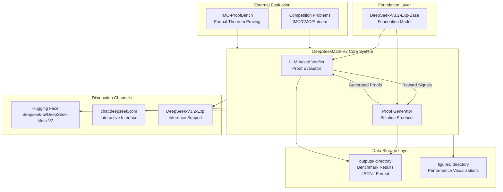
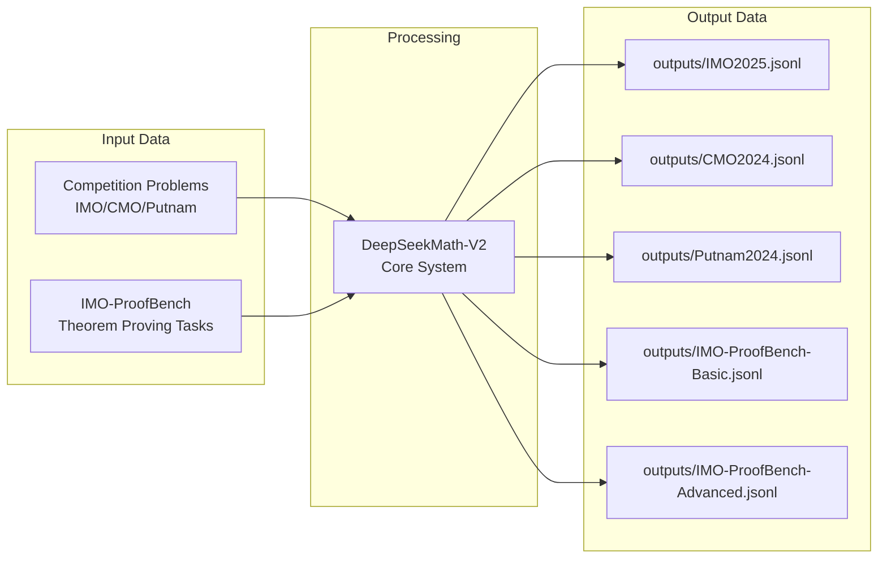
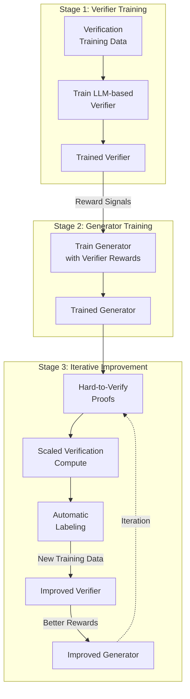
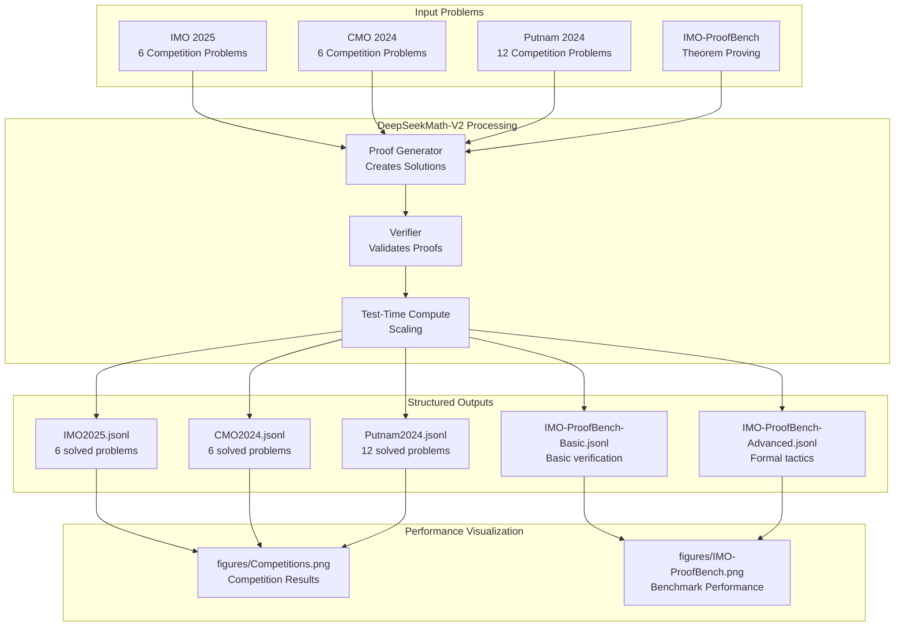
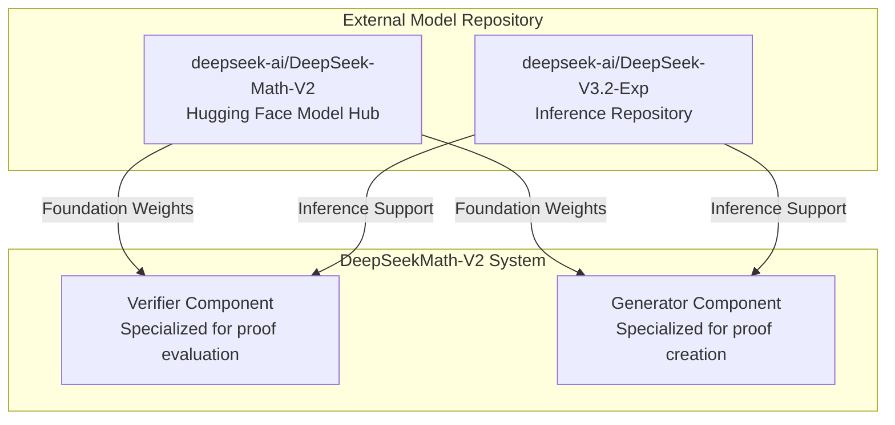

<!-- source: DeepWiki mcp.deepwiki.com · repo deepseek-ai/DeepSeek-Math-V2 · page 2 System Architecture · fetched 2026-10-30 -->

# System Architecture

<details>
<summary>Relevant source files</summary>

The following files were used as context for generating this wiki page:

- [DeepSeekMath_V2.pdf](DeepSeekMath_V2.pdf)
- [README.md](README.md)

</details>


## Purpose and Scope

This document provides a high-level architectural overview of DeepSeekMath-V2, explaining how the system's major components interact to achieve self-verifiable mathematical reasoning. This page focuses on the structural organization and communication patterns between subsystems.

For detailed information about specific components, see:
- Core system components (verifier and generator): [Core Components](#2.1)
- Training methodology and stages: [Training Pipeline](#2.2)
- Self-verification mechanisms: [Self-Verification Mechanism](#2.3)
- Foundation model details: [Foundation Model](#6.3)

---

## Architectural Overview

DeepSeekMath-V2 is a self-verifiable mathematical reasoning system built on the DeepSeek-V3.2-Exp-Base foundation model. The architecture implements a closed-loop feedback system where a proof generator and an LLM-based verifier continuously improve each other through iterative training cycles.

**Key Architectural Principles:**

| Principle | Description | Impact |
|-----------|-------------|--------|
| **Self-Verification** | Generator and verifier are trained together to maintain tight coupling | Ensures rigorous step-by-step proof validation |
| **Feedback-Driven Learning** | Verifier provides reward signals to guide generator improvement | Moves beyond final-answer accuracy to comprehensive reasoning |
| **Gap Management** | System actively addresses generation-verification capability gaps | Maintains verification fidelity as generator becomes stronger |
| **Compute Scaling** | Test-time compute can be scaled for harder problems | Enables gold-level performance on competition mathematics |

The system is designed to solve mathematical problems that require rigorous proof rather than just numerical answers, making it particularly effective for theorem proving and competition-level mathematics ([README.md:34-45]()).

### System Deployment Architecture



**Sources:** [README.md:1-88]()

---

## System Layers

DeepSeekMath-V2 follows a layered architecture with clear separation of concerns:

### 1. Foundation Layer

The foundation layer consists of the DeepSeek-V3.2-Exp-Base model, which provides the underlying language understanding and generation capabilities. This model is accessible via Hugging Face and serves as the base for both the verifier and generator components ([README.md:69-70]()).

**Characteristics:**
- Pre-trained large language model
- Shared weights between verifier and generator (initially)
- Provides mathematical reasoning capabilities
- Supports inference through dedicated repository

### 2. Reasoning Layer

The reasoning layer implements the dual-component architecture:

**Verifier Component:**
- Evaluates proof correctness and rigor
- Provides step-by-step validation
- Generates reward signals for generator training
- Trained on verification datasets

**Generator Component:**
- Produces step-by-step mathematical proofs
- Optimized using verifier rewards
- Incentivized to self-resolve issues before finalization
- Creates challenging proofs for verifier improvement

### 3. Data Layer

The data layer manages input problems, training data, and output results:



All output files follow a consistent JSONL schema with structured problem data, proofs, and ratings. The `outputs/` directory contains evaluation results from various benchmarks ([README.md:50]()).

### 4. Distribution Layer

The distribution layer provides multiple access points for different user types:

| Channel | Purpose | Target Users |
|---------|---------|--------------|
| **Hugging Face** | Model download and hosting | Researchers, developers |
| **chat.deepseek.com** | Interactive web interface | End users, experimenters |
| **GitHub (DeepSeek-V3.2-Exp)** | Inference code and documentation | Technical integrators |

**Sources:** [README.md:1-88]()

---

## Component Interactions

The core innovation of DeepSeekMath-V2 lies in how the verifier and generator components interact through a feedback loop:

### Feedback Loop Architecture



**Interaction Patterns:**

1. **Reward Signal Flow:** The verifier evaluates generator outputs and provides reward signals that guide training ([README.md:42]())

2. **Challenge Generation:** As the generator improves, it creates harder proofs that challenge the verifier's capabilities ([README.md:43]())

3. **Scaled Verification:** The system applies additional compute to verify challenging proofs, creating labeled training data ([README.md:43]())

4. **Iterative Refinement:** Improved verifier provides better rewards, enabling further generator improvements ([README.md:43]())

**Sources:** [README.md:41-45]()

---

## Data Flow Architecture

The system processes mathematical problems through several stages, maintaining structured data at each step:

### End-to-End Data Flow



### Data Transformation Pipeline

The system transforms raw mathematical problems into structured proof outputs:

| Stage | Input | Process | Output |
|-------|-------|---------|--------|
| **Problem Ingestion** | Competition questions (text) | Parse and structure | Structured problem representation |
| **Proof Generation** | Problem + context | Generator produces step-by-step proof | Draft proof with LaTeX formatting |
| **Verification** | Draft proof | Verifier evaluates each step | Automatic rating (float) |
| **Scaling** | Challenging cases | Apply additional compute | Refined proof + human rating |
| **Storage** | Verified proofs | Serialize to JSONL | Files in `outputs/` directory |

All output files follow a consistent schema with `question`, `problem_idx`, and `model_prediction` fields containing the proof text and ratings.

**Sources:** [README.md:47-65]()

---

## Repository Structure

The physical organization of the system reflects its logical architecture:

```
DeepSeek-Math-V2/
├── outputs/                    # Evaluation results (JSONL format)
│   ├── IMO2025.jsonl          # IMO 2025 solutions
│   ├── CMO2024.jsonl          # CMO 2024 solutions  
│   ├── Putnam2024.jsonl       # Putnam 2024 solutions
│   ├── IMO-ProofBench-Basic.jsonl      # Basic theorem proving
│   └── IMO-ProofBench-Advanced.jsonl   # Advanced formal proofs
├── figures/                    # Performance visualizations
│   ├── Competitions.png       # Competition results chart
│   ├── IMO-ProofBench.png    # ProofBench performance
│   ├── logo.svg              # DeepSeek logo
│   └── ...                   # Additional graphics
├── LICENSE                    # Apache License 2.0
└── README.md                 # Main documentation
```

**Key Directories:**

- **`outputs/`**: Contains all evaluation results in structured JSONL format. Each file represents results from a specific benchmark or competition ([README.md:50]())
  
- **`figures/`**: Stores performance visualizations referenced in documentation and presentations ([README.md:55-65]())

**Sources:** [README.md:1-88]()

---

## Model Foundation

DeepSeekMath-V2 is built on the DeepSeek-V3.2-Exp-Base foundation model, which provides the core language understanding and generation capabilities:

### Foundation Model Integration



**Integration Points:**

1. **Model Weights:** Both verifier and generator initialize from DeepSeek-V3.2-Exp-Base weights
2. **Inference Infrastructure:** Uses the DeepSeek-V3.2-Exp repository for model serving and inference
3. **Specialization:** Components are fine-tuned from the base model for their specific roles

For inference setup and model access, refer to the [DeepSeek-V3.2-Exp GitHub repository](https://github.com/deepseek-ai/DeepSeek-V3.2-Exp) as documented in [README.md:70]().

**Sources:** [README.md:69-70]()

---

## Performance Characteristics

The architectural design enables strong performance across multiple evaluation domains:

### Evaluation Results Summary

| Benchmark | Result | Metric |
|-----------|--------|--------|
| **IMO 2025** | Gold Medal | 6/6 problems solved |
| **CMO 2024** | Gold Medal | 6/6 problems solved |
| **Putnam 2024** | 118/120 | Near-perfect score |
| **IMO-ProofBench** | State-of-the-art | Basic and advanced problems |

These results are achieved through the combination of:
- Self-verifiable reasoning architecture
- Scaled test-time compute
- Iterative verifier-generator improvement
- Rigorous step-by-step proof validation

Performance data is available in the `outputs/` directory, with visualizations in `figures/Competitions.png` and `figures/IMO-ProofBench.png` ([README.md:47-65]()).

**Sources:** [README.md:44-65]()

---

## Architectural Trade-offs

The design makes several intentional trade-offs:

| Aspect | Design Choice | Trade-off |
|--------|--------------|-----------|
| **Verification Overhead** | Verifier evaluates every proof step | Higher compute cost, but ensures rigor |
| **Training Complexity** | Multi-stage iterative training | Longer training time, but better quality |
| **Gap Management** | Active scaling of verification compute | Additional resources needed for hard cases |
| **Generalization** | Focus on theorem proving domain | Specialized for mathematics vs. general reasoning |

The architecture prioritizes proof correctness and rigor over raw speed, reflecting the system's focus on self-verifiable mathematical reasoning rather than just final answer accuracy ([README.md:36-40]()).

**Sources:** [README.md:34-45]()

---

## Integration with External Systems

DeepSeekMath-V2 integrates with several external systems and benchmarks:

### External Dependencies

1. **IMO-ProofBench:** The system is evaluated against Google DeepMind's IMO-ProofBench benchmark for formal theorem proving ([README.md:49]())

2. **Competition Problems:** Processes problems from IMO, CMO, and Putnam competitions

3. **Inference Infrastructure:** Relies on the DeepSeek-V3.2-Exp repository for model serving ([README.md:70]())

### Distribution Interfaces

The system provides multiple interfaces for different use cases:

- **Research Access:** Direct model download from Hugging Face for academic research
- **Production Inference:** Integration through the DeepSeek-V3.2-Exp inference repository  
- **Interactive Use:** Web-based chat interface for exploratory problem-solving

**Sources:** [README.md:69-70](), [README.md:49]()

---

