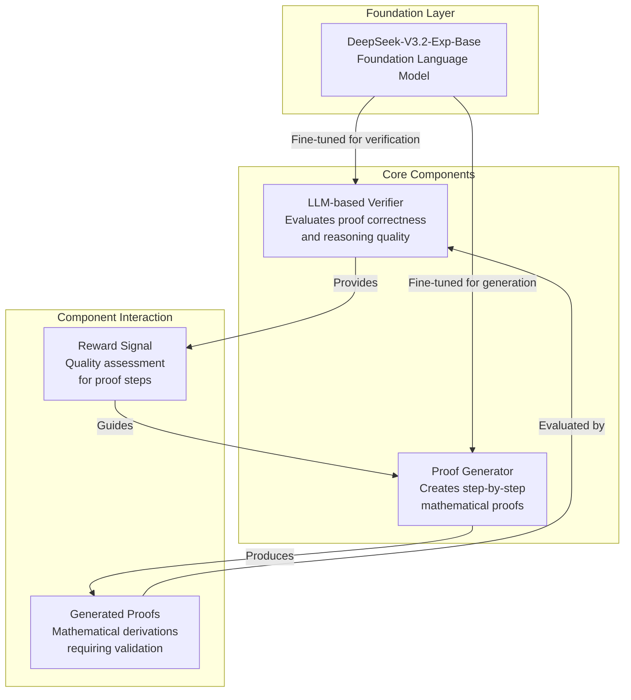
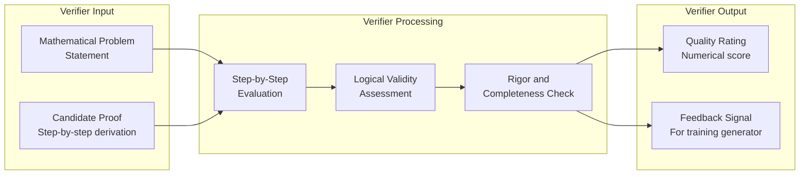
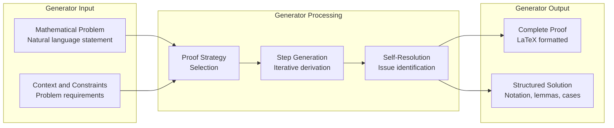
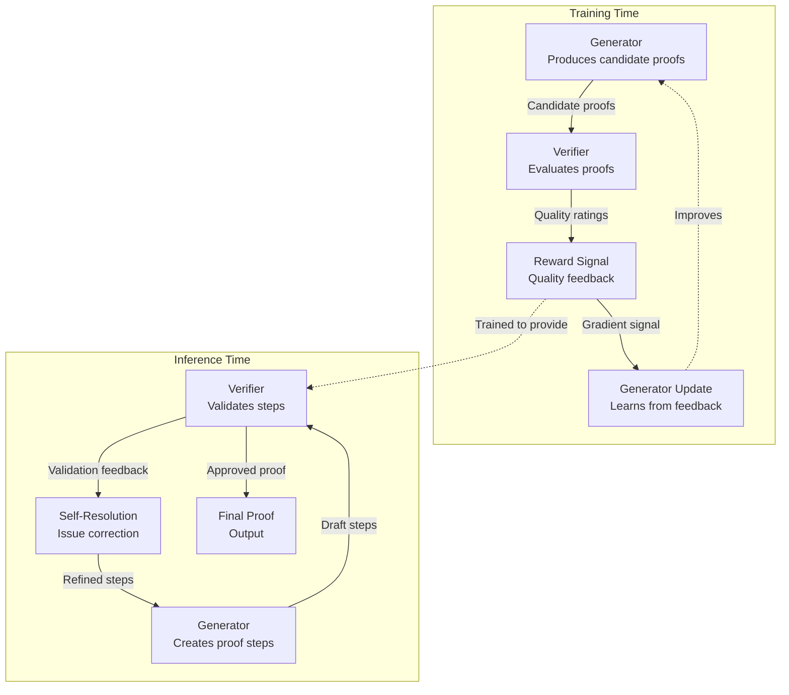
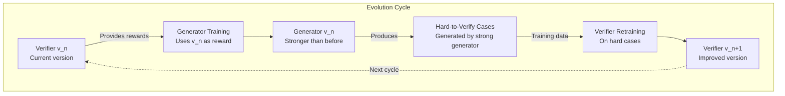
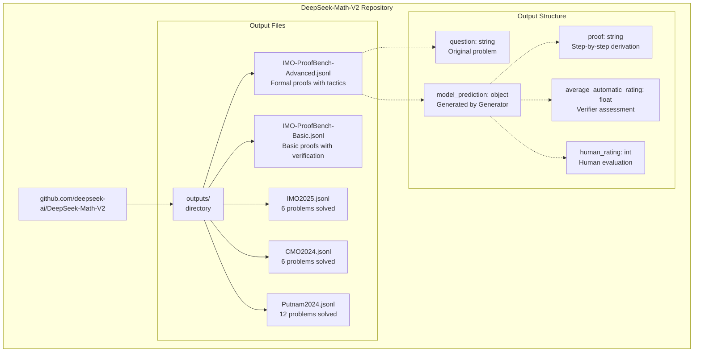

<!-- source: DeepWiki mcp.deepwiki.com · repo deepseek-ai/DeepSeek-Math-V2 · page 2.1 Core Components · fetched 2026-10-30 -->

# Core Components

Relevant source files

The following files were used as context for generating this wiki page:

- [DeepSeekMath_V2.pdf](DeepSeekMath_V2.pdf)
- [README.md](README.md)

## Purpose and Scope

This page details the two fundamental components that comprise DeepSeekMath-V2's architecture: the **LLM-based Verifier** and the **Proof Generator**. These components work in tandem to enable self-verifiable mathematical reasoning. This page explains their individual roles, capabilities, and how they interact within the system.

For information about the training process that creates and improves these components, see [Training Pipeline](#2.2). For details on how the self-verification mechanism operates during inference, see [Self-Verification Mechanism](#2.3).

---

## System Overview

DeepSeekMath-V2 consists of two specialized components built on top of a shared foundation model. Both components are instances of the same base language model, fine-tuned for different but complementary tasks within the mathematical reasoning pipeline.

**Figure 1: Core Component Architecture**

Sources: [README.md:30-45]()

---

## Foundation Model: DeepSeek-V3.2-Exp-Base

Both core components are derived from `DeepSeek-V3.2-Exp-Base`, a large-scale foundation language model. This base model provides the underlying capabilities for mathematical reasoning, which are then specialized through component-specific fine-tuning.

| Attribute | Details |
|-----------|---------|
| **Model Name** | `DeepSeek-V3.2-Exp-Base` |
| **Distribution** | Hugging Face: `deepseek-ai/DeepSeek-Math-V2` |
| **Access** | https://huggingface.co/deepseek-ai/DeepSeek-Math-V2 |
| **Inference Support** | https://github.com/deepseek-ai/DeepSeek-V3.2-Exp |
| **Purpose** | Foundation for both Verifier and Generator components |

The foundation model is not directly used for inference in DeepSeekMath-V2. Instead, it serves as the starting point for training the two specialized components. Each component is fine-tuned independently while maintaining the ability to work together in the self-verification loop.

Sources: [README.md:69-70]()

---

## LLM-based Verifier

### Role and Purpose

The **Verifier** is an LLM fine-tuned to evaluate mathematical proofs for correctness, rigor, and logical validity. Unlike traditional automated proof checkers that rely on formal verification systems, this verifier uses natural language understanding to assess informal mathematical reasoning.

**Figure 2: Verifier Component Processing Flow**

### Capabilities

The Verifier component is trained to:

1. **Evaluate Step Correctness**: Assess whether each step in a mathematical derivation follows logically from previous steps
2. **Identify Logical Gaps**: Detect missing steps or unjustified leaps in reasoning
3. **Assess Mathematical Rigor**: Verify that proofs meet standards of mathematical completeness
4. **Provide Quality Ratings**: Generate numerical scores for proof quality (reflected in the `average_automatic_rating` field in output files)

### Training Objective

The Verifier is trained to be **accurate** and **faithful**—it must correctly identify both valid and invalid reasoning. The training process emphasizes:

- Distinguishing correct proofs from superficially plausible but flawed reasoning
- Recognizing correct answers that arrive through incorrect reasoning
- Evaluating rigor beyond final answer accuracy

### Output Structure

The Verifier's assessments appear in the output JSONL files as the `average_automatic_rating` field within the `model_prediction` object. This rating represents the Verifier's confidence in the proof's correctness and rigor.

Sources: [README.md:38-43]()

---

## Proof Generator

### Role and Purpose

The **Generator** is an LLM fine-tuned to produce rigorous, step-by-step mathematical proofs. Unlike models optimized solely for final answer accuracy, this component is trained to generate comprehensive derivations that can be verified.

**Figure 3: Generator Component Processing Flow**

### Capabilities

The Generator component is trained to:

1. **Produce Step-by-Step Derivations**: Generate detailed mathematical reasoning rather than just final answers
2. **Format Mathematical Notation**: Use LaTeX and proper mathematical conventions
3. **Structure Complex Proofs**: Organize proofs with notation sections, lemmas, case analysis, and conclusions
4. **Self-Resolve Issues**: Identify and address potential problems in its own reasoning before finalizing the proof

### Training Objective

The Generator is trained using the Verifier as a reward model. This approach incentivizes the Generator to:

- Produce proofs that the Verifier rates highly
- Minimize logical gaps and unjustified steps
- Resolve potential issues before submitting the final proof
- Maintain rigor throughout the derivation process

### Output Structure

The Generator's proofs appear in the output JSONL files as the `proof` field (a string) within the `model_prediction` object. These proofs typically include:

- **Notation sections**: Defining variables and mathematical objects
- **Lemmas**: Intermediate results supporting the main proof
- **Case analysis**: Systematic treatment of different scenarios
- **Conclusions**: Final results and Q.E.D. statements

Sources: [README.md:42-44]()

---

## Component Interaction: The Verification Loop

The Verifier and Generator work together in a continuous feedback loop, both during training and inference. This interaction enables self-verifiable mathematical reasoning.

**Figure 4: Component Interaction During Training and Inference**

### Training Interaction

During training, the interaction follows this pattern:

1. **Generator Produces**: The Generator creates candidate proofs for mathematical problems
2. **Verifier Evaluates**: The Verifier assesses each proof's quality and correctness
3. **Reward Signal**: The Verifier's evaluation becomes a reward signal for the Generator
4. **Generator Updates**: The Generator learns to produce proofs that receive higher Verifier ratings

This creates an incentive structure where the Generator learns to produce increasingly rigorous and verifiable proofs.

### Inference Interaction

During inference (test-time compute), the interaction enables self-verification:

1. **Iterative Generation**: The Generator produces proof steps incrementally
2. **Continuous Validation**: The Verifier evaluates each step as it's generated
3. **Self-Resolution**: The Generator can revise steps that receive low Verifier ratings
4. **Final Approval**: Only proofs that pass Verifier scrutiny are finalized

This process is reflected in the system's ability to "identify and resolve as many issues as possible in their own proofs before finalizing them" [README.md:42]().

Sources: [README.md:41-43]()

---

## Component Versioning and Evolution

Both components evolve through iterative training cycles. This evolution is critical for maintaining the generation-verification gap as both components improve.

| Training Stage | Verifier Version | Generator Version | Key Change |
|----------------|------------------|-------------------|------------|
| **Stage 1** | v1.0 | - | Initial verifier trained on verification data |
| **Stage 2** | v1.0 (fixed) | v1.0 | Generator trained with verifier as reward model |
| **Stage 3+** | v2.0+ | v2.0+ | Iterative improvement using scaled verification compute |

### Component Evolution Process

**Figure 5: Component Evolution Through Iterative Training**

This iterative process ensures that:

- The Verifier remains capable of evaluating increasingly sophisticated proofs
- The Generator continues to push the boundaries of proof complexity
- The system maintains the generation-verification gap necessary for self-improvement

For detailed information about this training cycle, see [Training Pipeline](#2.2).

Sources: [README.md:43-44]()

---

## Component Outputs in Repository

While this repository does not contain the component implementations (which are distributed through Hugging Face and the inference repository), it does contain the outputs produced by both components:

### Output Directory Structure

**Figure 6: Repository Output Structure Showing Component Results**

Each JSONL file in the `outputs/` directory contains records that demonstrate both component outputs:

- **Generator Output**: The `proof` field within `model_prediction` objects
- **Verifier Output**: The `average_automatic_rating` field showing the Verifier's assessment

For detailed information about the output format, see [Data Formats & Outputs](#4).

Sources: [README.md:50]()

---

## Component Access and Usage

### Model Distribution

Both components are packaged together as **DeepSeekMath-V2** and distributed through:

| Channel | Purpose | URL/Location |
|---------|---------|--------------|
| **Hugging Face** | Model weights download | `deepseek-ai/DeepSeek-Math-V2` |
| **Inference Repository** | Implementation and API | `github.com/deepseek-ai/DeepSeek-V3.2-Exp` |
| **Online Chat** | Interactive demo | `chat.deepseek.com` |

### Inference Setup

To use the components for mathematical reasoning:

1. Download the model from Hugging Face [README.md:69]()
2. Set up inference using the DeepSeek-V3.2-Exp repository [README.md:70]()
3. Both components are invoked automatically during the reasoning process

For detailed setup instructions, see [Inference Setup](#5.2).

### Component Roles During Inference

During a typical inference session:

1. **User provides**: A mathematical problem in natural language
2. **Generator produces**: Step-by-step proof with mathematical reasoning
3. **Verifier validates**: Each proof step for correctness and rigor
4. **System outputs**: A complete, verified proof with quality rating

This dual-component architecture enables the self-verification capability that distinguishes DeepSeekMath-V2 from answer-only mathematical reasoning systems.

Sources: [README.md:69-70]()

---

## Summary

The core components of DeepSeekMath-V2 are:

1. **LLM-based Verifier**: Evaluates proof quality and provides reward signals, producing the `average_automatic_rating` values in output files
2. **Proof Generator**: Creates rigorous mathematical proofs, producing the `proof` content in output files

Both are built on the `DeepSeek-V3.2-Exp-Base` foundation model and work together in a feedback loop that enables self-verifiable mathematical reasoning. Their interaction during training creates a virtuous cycle of improvement, while their interaction during inference enables self-verification and issue resolution.

For information on how these components are trained and improved, see [Training Pipeline](#2.2). For details on the self-verification mechanism they enable, see [Self-Verification Mechanism](#2.3).

Sources: [README.md:30-45](), [README.md:69-70]()

---

