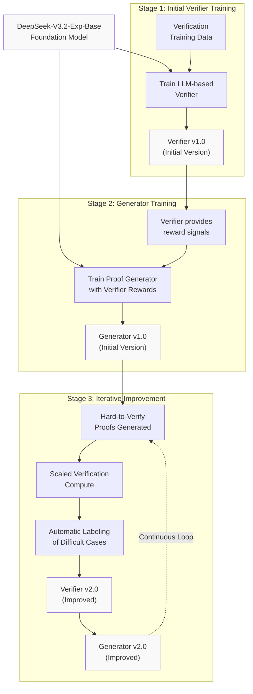
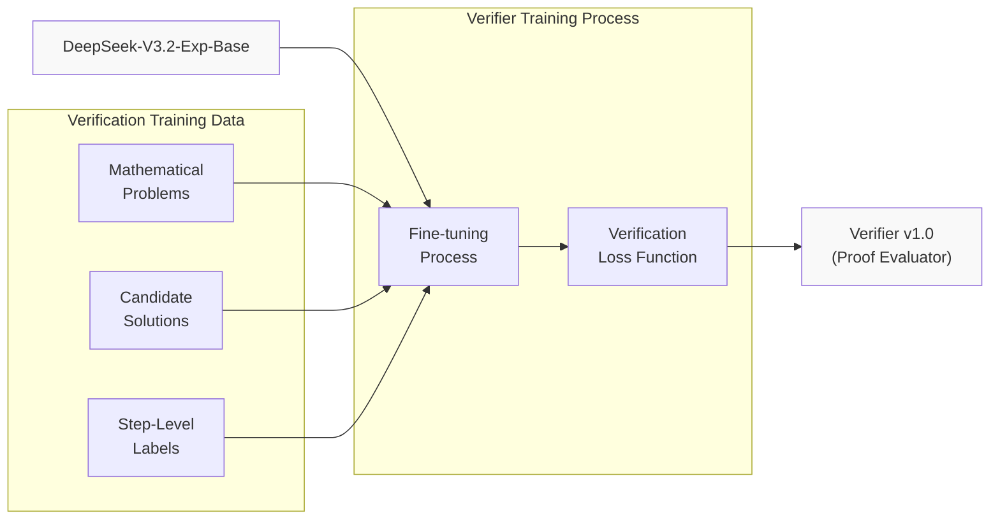
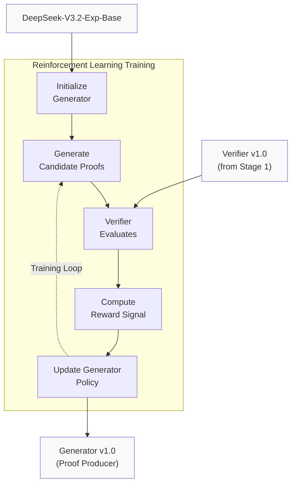
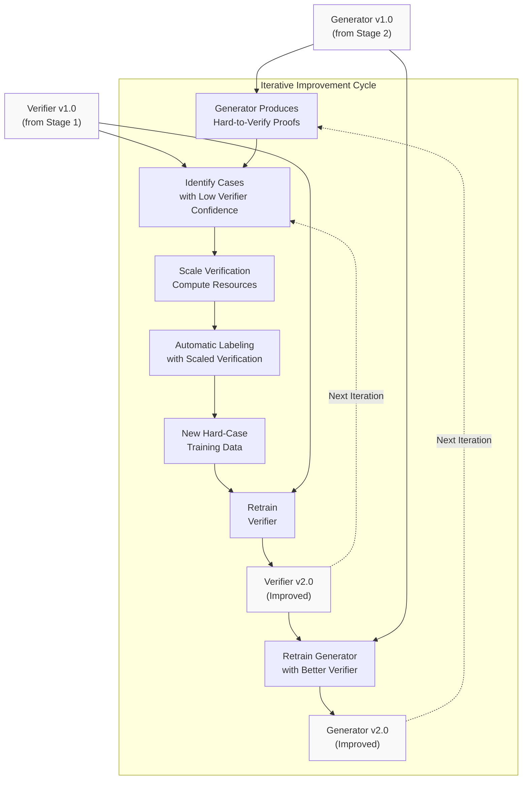
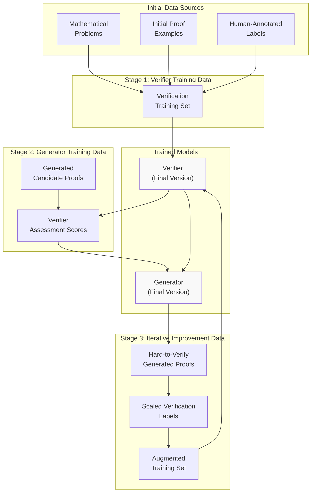
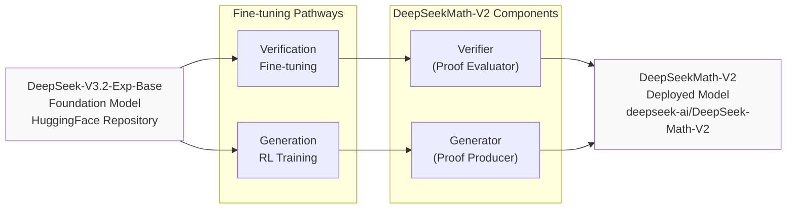

<!-- source: DeepWiki mcp.deepwiki.com · repo deepseek-ai/DeepSeek-Math-V2 · page 2.2 Training Pipeline · fetched 2026-10-30 -->

# Training Pipeline

Relevant source files

The following files were used as context for generating this wiki page:

- [DeepSeekMath_V2.pdf](DeepSeekMath_V2.pdf)
- [README.md](README.md)

## Purpose and Scope

This document describes the three-stage training process used to develop DeepSeekMath-V2's self-verifiable mathematical reasoning capabilities. The training pipeline transforms the base foundation model into a system with both proof generation and rigorous verification abilities through an iterative improvement loop.

For information about the resulting components (verifier and generator), see [Core Components](#2.1). For details on how the trained components achieve self-verification at inference time, see [Self-Verification Mechanism](#2.3). For the foundation model architecture, see [Foundation Model](#6.3).

**Note**: This repository contains evaluation results and model outputs, not training code. The training methodology is documented based on the research approach described in the project materials.

Sources: [README.md:30-45]()

## Overview

DeepSeekMath-V2's training pipeline consists of three sequential stages that build upon each other:

1. **Stage 1: Initial Verifier Training** - Train an accurate LLM-based verifier to evaluate proof quality
2. **Stage 2: Generator Training with Verifier Rewards** - Use the trained verifier as a reward model to train a proof generator
3. **Stage 3: Iterative Improvement Loop** - Scale verification compute to label challenging proofs, creating new training data to improve both components

Each stage addresses specific challenges in developing self-verifiable mathematical reasoning capabilities.

Sources: [README.md:41-44]()

### Three-Stage Training Flow

Sources: [README.md:41-44]()

## Stage 1: Initial Verifier Training

The first stage establishes the foundation for self-verifiable reasoning by training an accurate and faithful LLM-based verifier. This verifier must be capable of evaluating the correctness and rigor of mathematical proofs at the step level.

### Training Objective

The verifier is trained to assess whether mathematical proofs are:
- **Correct**: Each logical step follows from previous steps and established mathematical principles
- **Complete**: No gaps exist in the reasoning chain
- **Rigorous**: Each claim is properly justified with appropriate mathematical formalism

### Training Data Requirements

The initial verifier training requires labeled verification data consisting of:
- Mathematical problems with candidate solutions
- Step-by-step annotations indicating which steps are valid or invalid
- Proof quality assessments at various levels of granularity

### Verifier Architecture

The verifier is built on top of the `DeepSeek-V3.2-Exp-Base` foundation model and fine-tuned to output assessments of proof validity. The model learns to identify logical errors, missing steps, and insufficient justifications in mathematical reasoning.

Sources: [README.md:41](), [README.md:69-70]()

### Stage 1 Data Flow

Sources: [README.md:41](), [README.md:69-70]()

## Stage 2: Generator Training with Verifier Rewards

The second stage trains a proof generator that produces rigorous mathematical proofs using the trained verifier as a reward model. This approach enables the generator to learn not just to produce correct final answers, but to construct comprehensive step-by-step derivations.

### Reinforcement Learning Framework

The generator training uses reinforcement learning where:
- **Policy**: The generator model produces proof steps
- **Reward Model**: The trained verifier evaluates proof quality
- **Objective**: Maximize verifier assessment scores while maintaining proof validity

### Key Training Principles

The generator is incentivized to:
1. **Self-resolve issues**: Identify and fix potential problems in proofs before finalization
2. **Rigorous derivation**: Provide detailed step-by-step justifications rather than jumping to conclusions
3. **Verifier alignment**: Produce proofs that the verifier can confidently assess as correct

This training approach ensures that the generator learns to produce proofs that are verifiable by the trained verifier, establishing the foundation for self-verification.

Sources: [README.md:42-43]()

### Stage 2 Training Flow

Sources: [README.md:42-43]()

### Generator Training Objectives

| Objective | Description | Impact |
|-----------|-------------|--------|
| **Self-Resolution** | Generator learns to identify and fix issues before finalization | Reduces reliance on external verification during deployment |
| **Step-by-Step Rigor** | Emphasis on comprehensive derivations vs. direct answers | Ensures proofs are interpretable and verifiable |
| **Verifier Alignment** | Proofs must satisfy the verifier's quality standards | Maintains generation-verification consistency |

Sources: [README.md:42-43]()

## Stage 3: Iterative Improvement Loop

The third stage addresses a critical challenge: as the generator improves through verifier-guided training, it may begin producing proofs that are more sophisticated than the verifier can reliably assess. This creates a **generation-verification gap** that could undermine self-verification capabilities.

### Generation-Verification Gap Problem

After Stage 2, the generator becomes stronger at producing complex proofs, but the verifier (trained on simpler examples) may struggle to accurately evaluate these advanced proofs. This gap limits further improvement and could compromise the reliability of self-verification.

### Scaled Verification Compute Solution

To maintain the generation-verification gap, Stage 3 implements a continuous improvement cycle:

1. **Identify Hard Cases**: The improved generator produces proofs that challenge the verifier
2. **Scale Verification Compute**: Apply additional computational resources to carefully evaluate these challenging proofs
3. **Automatic Labeling**: Use the scaled verification to create high-quality labels for difficult cases
4. **Retrain Verifier**: Update the verifier with the new hard-case training data
5. **Improve Generator**: Use the improved verifier to further train the generator

This creates a virtuous cycle where each component pushes the other to higher performance levels.

Sources: [README.md:43-44]()

### Iterative Improvement Cycle

Sources: [README.md:43-44]()

### Scaled Verification Compute Strategy

The scaled verification compute approach involves:

**Resource Allocation**: When the verifier encounters difficult-to-assess proofs, additional computational resources are allocated to thoroughly analyze these cases through:
- Multiple verification passes with different analysis strategies
- Ensemble verification using multiple model instances
- Extended reasoning chains to carefully evaluate complex logical steps

**Automatic Labeling**: The scaled verification process produces high-confidence labels for challenging proofs, which serve as training data for the next verifier iteration.

**Continuous Learning**: As the generator becomes more sophisticated, it naturally produces new challenging cases, ensuring the verifier continues to improve alongside it.

Sources: [README.md:43-44]()

## Training Data Flow

The complete training pipeline processes data through multiple transformation stages, with each stage contributing to both immediate training objectives and future iterations.

### End-to-End Data Transformation

Sources: [README.md:41-44]()

### Data Characteristics by Stage

| Stage | Data Type | Source | Purpose |
|-------|-----------|--------|---------|
| **Stage 1** | Labeled proof verification examples | Human annotation + existing datasets | Train initial verifier to assess proof validity |
| **Stage 2** | Generated proofs + verifier scores | Generator samples + verifier evaluations | Provide reward signal for generator training |
| **Stage 3** | Hard-case proofs + scaled labels | Generator + scaled verification | Improve verifier on challenging cases |

Sources: [README.md:41-44]()

## Foundation Model Integration

The training pipeline builds upon the `DeepSeek-V3.2-Exp-Base` foundation model, which provides the pre-trained knowledge and reasoning capabilities required for mathematical problem-solving.

### Base Model Role

The foundation model (`DeepSeek-V3.2-Exp-Base`) serves as the starting point for both the verifier and generator:

**For Verifier Training**: The base model is fine-tuned to specialize in evaluating mathematical proofs, learning to identify logical errors, incomplete reasoning, and insufficient justifications.

**For Generator Training**: The base model is trained with reinforcement learning using the verifier as a reward model, learning to produce rigorous step-by-step mathematical derivations.

Sources: [README.md:69-70]()

### Model Access and Distribution

The final trained model, `DeepSeekMath-V2`, is available through multiple channels:

- **Hugging Face**: Direct model download from `deepseek-ai/DeepSeek-Math-V2`
- **Inference Support**: The [DeepSeek-V3.2-Exp repository](https://github.com/deepseek-ai/DeepSeek-V3.2-Exp) provides inference code and examples
- **Chat Interface**: Interactive access at `chat.deepseek.com`

For detailed information on model access and usage, see [Model Access](#5.1) and [Inference Setup](#5.2).

Sources: [README.md:69-70]()

### Foundation Model to Specialized Components

Sources: [README.md:69-70]()

## Training Pipeline Outcomes

The three-stage training pipeline produces a model with demonstrated capabilities across multiple challenging mathematical benchmarks:

### Achieved Results

- **IMO 2025**: Gold medal level performance
- **CMO 2024**: Gold medal level performance  
- **Putnam 2024**: 118 out of 120 points (near-perfect)
- **IMO-ProofBench**: Strong performance on formal theorem proving

These results validate the effectiveness of the training approach in developing self-verifiable mathematical reasoning capabilities. For detailed performance analysis, see [Competition Results](#3.1) and [IMO-ProofBench](#3.2).

Sources: [README.md:44-45](), [README.md:47-65]()

### Key Training Innovations

The training pipeline's success stems from several key innovations:

1. **Verifier-as-Reward**: Using an LLM-based verifier as a reward model enables training on proof rigor rather than just final answer correctness
2. **Self-Resolution Incentive**: The generator learns to identify and fix issues proactively, improving inference-time reliability
3. **Gap Management**: Active maintenance of the generation-verification gap through scaled compute prevents the verifier from becoming a bottleneck
4. **Iterative Co-improvement**: Both components improve together through continuous cycling of hard cases back into training

Sources: [README.md:41-44]()

---

