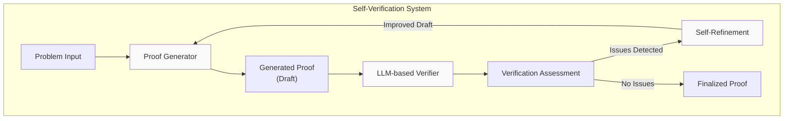
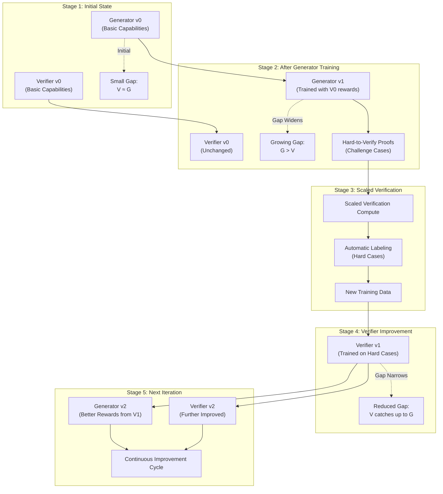
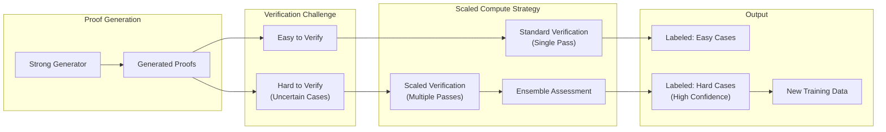
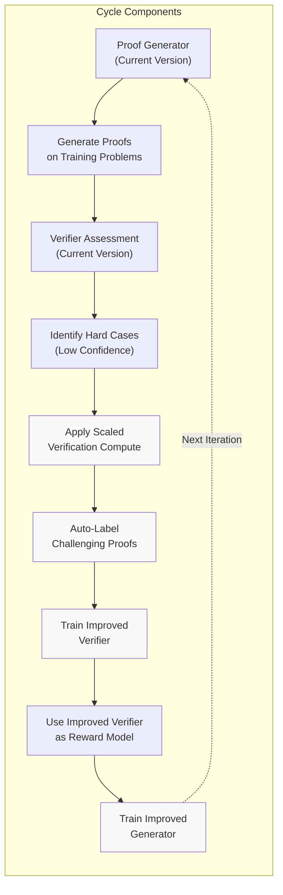
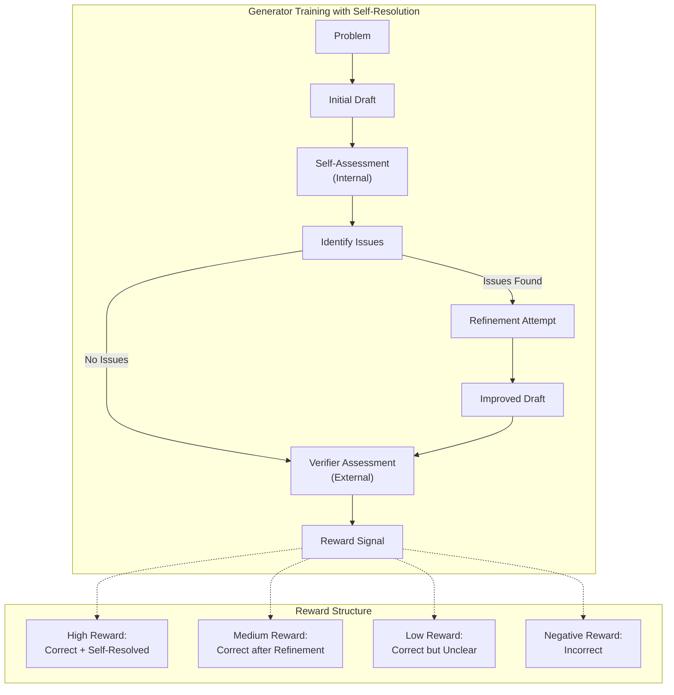
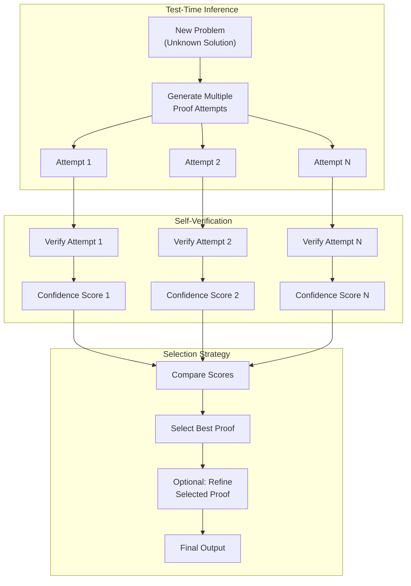

<!-- source: DeepWiki mcp.deepwiki.com · repo deepseek-ai/DeepSeek-Math-V2 · page 2.3 Self-Verification Mechanism · fetched 2026-10-30 -->

# Self-Verification Mechanism

Relevant source files

The following files were used as context for generating this wiki page:

- [README.md](README.md)

## Purpose and Scope

This page describes the self-verification mechanism that enables DeepSeekMath-V2 to produce rigorous, verifiable mathematical proofs. The mechanism addresses a fundamental challenge in mathematical reasoning: ensuring that not only answers are correct, but that the step-by-step derivations are comprehensive and rigorous. This page covers the generation-verification gap concept, scaled verification compute strategy, and the continuous improvement cycle that maintains verification quality as proof generation capabilities advance.

For details about the core verifier and generator components themselves, see [Core Components](#2.1). For the overall training pipeline, see [Training Pipeline](#2.2).

Sources: [README.md:30-46]()

---

## Overview

The self-verification mechanism is designed to solve a critical problem in mathematical AI: correct final answers do not guarantee correct reasoning. Many mathematical tasks, particularly theorem proving, require rigorous step-by-step derivation rather than just numerical results. DeepSeekMath-V2's approach centers on training an LLM-based verifier that can assess proof quality, then using this verifier to train a generator that not only produces proofs but also identifies and resolves issues in its own reasoning before finalizing solutions.

**Figure 1: Basic Self-Verification Flow**

The generator is incentivized to identify and resolve as many issues as possible in its own proofs before finalization, creating a self-improving feedback loop during both training and inference.

Sources: [README.md:38-45]()

---

## The Generation-Verification Gap

A critical design consideration in DeepSeekMath-V2 is the **generation-verification gap**: the difference in capability between what the generator can produce and what the verifier can reliably assess. This gap evolves during training and requires active management.

### Gap Evolution Stages

| Stage | Generator State | Verifier State | Gap Status | Implication |
|-------|----------------|----------------|------------|-------------|
| **Initial** | Basic proof generation | Basic verification | Small gap | Verifier can assess most proofs |
| **Post-Generator Training** | Improved with verifier rewards | Unchanged | Growing gap | Generator produces proofs verifier struggles to assess |
| **Post-Verifier Improvement** | Unchanged | Trained on hard cases | Reduced gap | Verifier catches up to generator |
| **Continuous Cycle** | Further improved | Further improved | Maintained gap | Both components push each other higher |

**Figure 2: Generation-Verification Gap Evolution**

The system deliberately maintains this gap rather than eliminating it. As the generator produces increasingly sophisticated proofs, it creates challenging verification cases that become training data for the verifier. This creates a virtuous cycle where each component drives improvements in the other.

Sources: [README.md:43-44]()

---

## Scaled Verification Compute

When the generator becomes strong enough to produce proofs that challenge the verifier's assessment capabilities, the system employs **scaled verification compute** to handle these difficult cases. This strategy is central to maintaining the self-verification mechanism's effectiveness.

### Mechanism

**Figure 3: Scaled Verification Compute Pipeline**

### Automatic Labeling Process

The scaled verification compute enables automatic labeling of hard-to-verify proofs:

1. **Identification**: Generator produces proofs that the verifier finds challenging to assess confidently
2. **Scaled Assessment**: Apply additional computational resources (e.g., multiple verification passes, ensemble methods) to these challenging cases
3. **High-Confidence Labeling**: Use the scaled compute results to automatically label proofs with high confidence
4. **Data Creation**: These labeled challenging cases become training data for verifier improvement

This approach addresses a key limitation: as mathematical reasoning becomes more sophisticated, the space of possible proofs grows, but the availability of labeled training data does not scale proportionally. Scaled verification compute allows the system to create its own high-quality training data from the generator's most challenging outputs.

Sources: [README.md:43-44]()

---

## Iterative Improvement Cycle

The self-verification mechanism operates through a continuous improvement cycle that progressively enhances both verification and generation capabilities.

**Figure 4: Continuous Improvement Cycle**

### Cycle Phases

| Phase | Action | Input | Output | Purpose |
|-------|--------|-------|--------|---------|
| **Generation** | Generator produces proofs | Training problems | Candidate proofs | Create verification challenges |
| **Initial Verification** | Verifier assesses proofs | Candidate proofs | Confidence scores | Identify easy vs hard cases |
| **Hard Case Processing** | Scale verification compute | Low-confidence proofs | High-confidence labels | Create training data |
| **Verifier Training** | Update verifier weights | Labeled hard cases | Improved verifier | Enhance verification capability |
| **Reward Modeling** | Use verifier for rewards | Generator outputs | Reward signals | Guide generator improvement |
| **Generator Training** | Update generator weights | Reward signals | Improved generator | Produce better proofs |

This cycle ensures that the system continuously pushes the boundaries of what it can verify and generate, with each iteration addressing the limitations exposed by the previous iteration.

Sources: [README.md:41-45]()

---

## Self-Resolution Incentives

A key innovation in DeepSeekMath-V2 is incentivizing the generator to **identify and resolve issues in its own proofs before finalizing them**. This creates a self-correcting mechanism during both training and inference.

### Training Objective

The generator is trained not just to produce correct proofs, but to:

1. **Generate draft proofs** with explicit reasoning steps
2. **Self-assess** potential weaknesses or gaps in reasoning
3. **Refine and improve** the proof based on self-assessment
4. **Finalize** only when issues are resolved

**Figure 5: Self-Resolution Training Structure**

### Benefits

| Benefit | Description | Impact |
|---------|-------------|--------|
| **Reduced Verification Load** | Generator catches many issues internally | Fewer iterations needed between generator and verifier |
| **Improved Proof Quality** | Self-correction during generation | More rigorous, comprehensive proofs |
| **Better Generalization** | Generator learns to reason about reasoning | Stronger performance on novel problems |
| **Test-Time Efficiency** | Fewer external verification passes needed | Faster inference with maintained quality |

The verifier provides the reward signal that encourages this self-resolution behavior. Proofs that demonstrate self-correction and issue resolution receive higher rewards than proofs that are correct but lack explicit self-verification steps.

Sources: [README.md:42-43]()

---

## Test-Time Compute Integration

Self-verification is particularly important for scaling test-time compute, especially for open problems without known solutions. The mechanism enables the system to allocate computational resources intelligently during inference.

**Figure 6: Test-Time Compute with Self-Verification**

### Compute Allocation Strategy

At test time, the self-verification mechanism enables:

1. **Multiple Proof Generation**: Generate several candidate proofs for the same problem
2. **Parallel Verification**: Assess each candidate independently using the verifier
3. **Confidence-Based Selection**: Choose the proof with the highest verification confidence
4. **Optional Refinement**: For high-value problems, apply additional compute to refine the selected proof
5. **Quality Assurance**: Ensure output quality even without ground truth solutions

This approach is particularly valuable for competition mathematics (IMO, CMO, Putnam) and open research problems where correct solutions are not available for validation during inference.

Sources: [README.md:40-44]()

---

## System-Wide Impact

The self-verification mechanism has implications across the entire DeepSeekMath-V2 system:

### Training Impact

- **Data Efficiency**: Automatically generates high-quality training data for the verifier from the generator's challenging outputs
- **Curriculum Learning**: Naturally creates increasingly difficult training examples as the system improves
- **Reduced Annotation Cost**: Minimizes need for human-labeled verification data

### Inference Impact

- **Reliability**: Provides confidence estimates for generated proofs without ground truth
- **Scalability**: Enables principled allocation of test-time compute based on verification confidence
- **Transparency**: Verification scores help users assess proof quality

### Architecture Impact

- **Modularity**: Verifier and generator can be improved independently
- **Extensibility**: Scaled verification compute can be adapted to different problem domains
- **Maintainability**: Clear separation between generation and verification concerns

Sources: [README.md:38-45]()

---

## Connection to Competition Results

The self-verification mechanism directly enabled DeepSeekMath-V2's strong performance on mathematical competitions:

| Competition | Score | Role of Self-Verification |
|-------------|-------|---------------------------|
| **IMO 2025** | Gold Medal | Ensured rigorous step-by-step proofs for challenging olympiad problems |
| **CMO 2024** | Gold Medal | Enabled high-confidence proof selection from multiple attempts |
| **Putnam 2024** | 118/120 | Maintained proof quality across diverse problem types |

For detailed competition results, see [Competition Results](#3.1). For benchmark performance on formal theorem proving, see [IMO-ProofBench](#3.2).

Sources: [README.md:44-49]()

---

## Key Takeaways

The self-verification mechanism represents a fundamental shift from answer-focused to reasoning-focused mathematical AI:

1. **Gap Management**: Actively maintains and exploits the generation-verification gap to drive continuous improvement
2. **Scaled Compute**: Uses additional computational resources strategically to handle challenging verification cases
3. **Self-Resolution**: Incentivizes generators to fix their own issues before finalization
4. **Test-Time Scaling**: Enables principled allocation of inference compute without ground truth
5. **Iterative Improvement**: Creates a virtuous cycle where each component drives the other to higher performance

This mechanism is essential for moving beyond saturated benchmarks with known answers toward open mathematical research where rigorous reasoning verification is paramount.

Sources: [README.md:30-46]()

---

