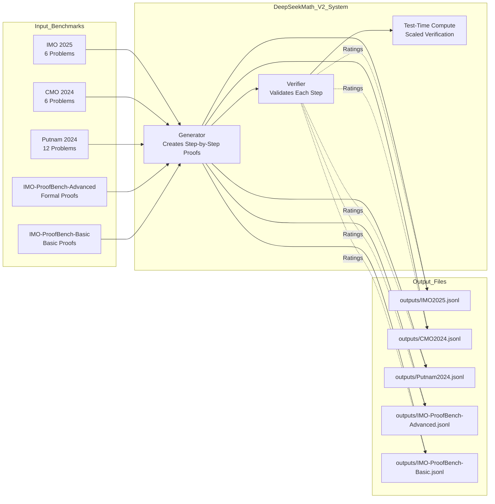
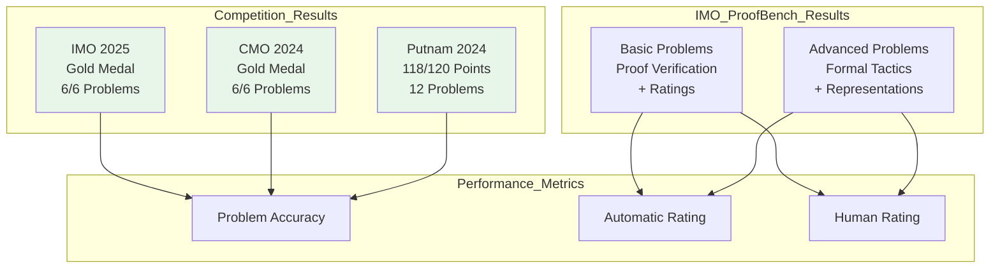
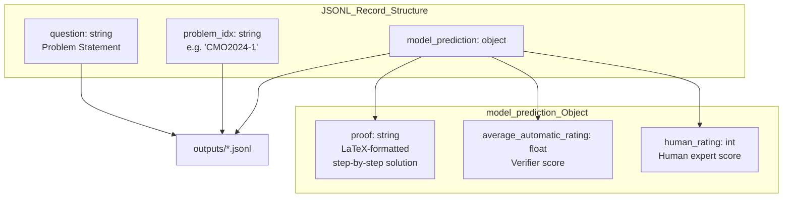

<!-- source: DeepWiki mcp.deepwiki.com · repo deepseek-ai/DeepSeek-Math-V2 · page 3 Evaluation & Results · fetched 2026-10-30 -->

# Evaluation & Results

Relevant source files

The following files were used as context for generating this wiki page:

- [README.md](README.md)
- [outputs/CMO2024.jsonl](outputs/CMO2024.jsonl)
- [outputs/IMO2025.jsonl](outputs/IMO2025.jsonl)
- [outputs/Putnam2024.jsonl](outputs/Putnam2024.jsonl)

This page provides an overview of the benchmarks used to evaluate DeepSeek-Math-V2 and a summary of the results achieved. DeepSeek-Math-V2 was tested across four major evaluation domains: three mathematics competitions (IMO 2025, CMO 2024, Putnam 2024) and one formal theorem-proving benchmark (IMO-ProofBench). All evaluation outputs, including detailed proofs and ratings, are stored in structured JSONL files in the `outputs/` directory.

For detailed breakdowns of individual competitions, see [Competition Results](#3.1). For formal theorem-proving evaluation details, see [IMO-ProofBench](#3.2). For information about the data format and schema used in outputs, see [Data Formats & Outputs](#4).

---

## Evaluation Pipeline

The diagram below shows how DeepSeek-Math-V2 processes problems from various benchmarks and produces structured evaluation outputs.

**Sources:** [README.md:47-65](), [outputs/CMO2024.jsonl:1](), [outputs/IMO2025.jsonl:1]()

---

## Benchmark Overview

DeepSeek-Math-V2 was evaluated on four distinct benchmarks, each testing different aspects of mathematical reasoning capability.

| Benchmark | Type | Problem Count | Output File | Evaluation Focus |
|-----------|------|---------------|-------------|------------------|
| IMO 2025 | Competition | 6 | `outputs/IMO2025.jsonl` | Olympiad-level problem solving |
| CMO 2024 | Competition | 6 | `outputs/CMO2024.jsonl` | Chinese Mathematical Olympiad |
| Putnam 2024 | Competition | 12 | `outputs/Putnam2024.jsonl` | University-level mathematics |
| IMO-ProofBench (Basic) | Formal Proof | Variable | `outputs/IMO-ProofBench-Basic.jsonl` | Basic proof verification |
| IMO-ProofBench (Advanced) | Formal Proof | Variable | `outputs/IMO-ProofBench-Advanced.jsonl` | Formal representations + tactics |

**Sources:** [README.md:47-65]()

---

## High-Level Results Summary

DeepSeek-Math-V2 achieved gold-level performance on two major competitions and near-perfect scores on another, demonstrating strong mathematical reasoning capabilities across diverse problem types.

### Competition Achievements

- **IMO 2025:** Gold medal performance, solving all 6 problems
- **CMO 2024:** Gold medal performance, solving all 6 problems  
- **Putnam 2024:** 118 out of 120 points, demonstrating near-perfect accuracy

### IMO-ProofBench Performance

The model was evaluated on the IMO-ProofBench benchmark developed by Google DeepMind, which tests formal theorem-proving capabilities. Results are divided into:

- **Basic Problems:** Standard proof verification with automatic and human quality ratings
- **Advanced Problems:** Formal proof representations including tactics and formal mathematical constructs

Full performance metrics and detailed proof analysis are visualized in [figures/IMO-ProofBench.png]() and [figures/Competitions.png]().

**Sources:** [README.md:32-65]()

---

## Output Data Structure

All evaluation results follow a consistent JSONL schema where each line represents one problem's complete solution and evaluation.

### Example Record Structure

Each JSONL file contains records with the following fields:

- `question`: The original problem statement in LaTeX format
- `problem_idx`: Unique identifier (e.g., `"CMO2024-1"`, `"IMO2025-2"`)
- `model_prediction`: Object containing:
  - `proof`: Complete step-by-step solution with mathematical notation
  - `average_automatic_rating`: Numerical score from the LLM-based verifier
  - `human_rating`: Integer rating from human expert evaluation

**Sources:** [outputs/CMO2024.jsonl:1](), [outputs/IMO2025.jsonl:1]()

---

## Evaluation Metrics

DeepSeek-Math-V2 employs a dual evaluation system combining automated verification with human expert assessment.

| Metric Type | Description | Range | Purpose |
|-------------|-------------|-------|---------|
| **Automatic Rating** | LLM-based verifier score evaluating proof correctness and rigor | Float (typically 0.0-1.0) | Real-time quality assessment during generation |
| **Human Rating** | Expert mathematician evaluation | Integer (problem-specific) | Gold standard validation of solution quality |
| **Problem Accuracy** | Binary success measure | Solved/Unsolved | Overall benchmark performance tracking |

### Rating Interpretation

- **Automatic ratings** reflect the verifier's confidence in each proof step's correctness
- **Human ratings** are typically scored on competition-specific scales (e.g., 0-7 for IMO, 0-10 for Putnam)
- Both metrics are stored for each problem to enable comprehensive performance analysis

For detailed information about the rating systems and proof structure, see [Evaluation Metrics](#4.3).

**Sources:** [README.md:47-65](), [outputs/CMO2024.jsonl:1]()

---

## Benchmark-Specific Details

For detailed problem-by-problem analysis and solutions:

- **Competition Results:** See [Competition Results](#3.1) for full breakdowns of IMO 2025, CMO 2024, and Putnam 2024
  - [IMO 2025](#3.1.1): 6 problems, gold medal achievement
  - [CMO 2024](#3.1.2): 6 problems, gold medal achievement  
  - [Putnam 2024](#3.1.3): 12 problems, 118/120 points

- **Formal Theorem Proving:** See [IMO-ProofBench](#3.2) for formal proof evaluation
  - [Basic Problems](#3.2.1): Standard proof verification results
  - [Advanced Problems](#3.2.2): Formal tactics and representations

**Sources:** [README.md:47-65]()

---

