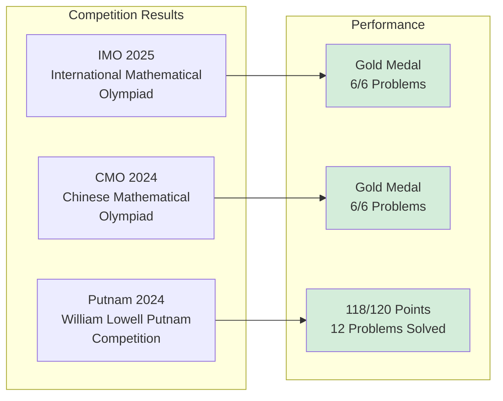
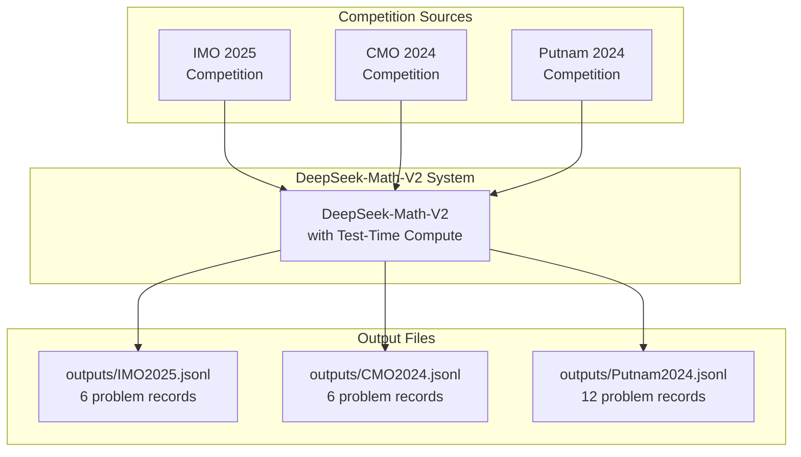
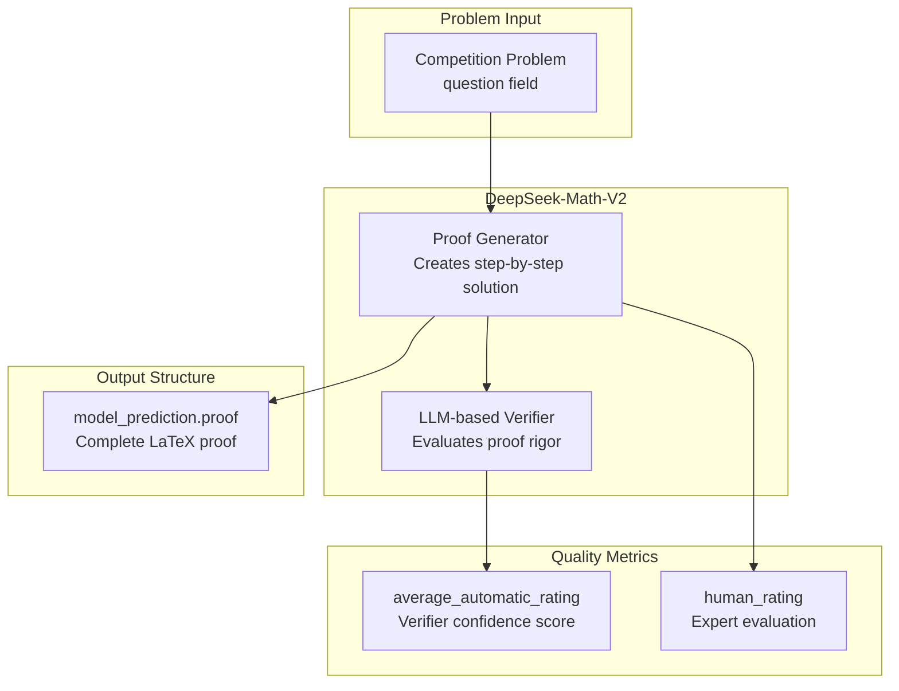

<!-- source: DeepWiki mcp.deepwiki.com · repo deepseek-ai/DeepSeek-Math-V2 · page 3.1 Competition Results · fetched 2026-10-30 -->

# Competition Results

<details>
<summary>Relevant source files</summary>

The following files were used as context for generating this wiki page:

- [README.md](README.md)
- [figures/Competitions.png](figures/Competitions.png)
- [outputs/CMO2024.jsonl](outputs/CMO2024.jsonl)
- [outputs/IMO2025.jsonl](outputs/IMO2025.jsonl)
- [outputs/Putnam2024.jsonl](outputs/Putnam2024.jsonl)

</details>


## Purpose and Scope

This page provides an overview of DeepSeek-Math-V2's performance on three major mathematical competitions: the International Mathematical Olympiad (IMO) 2025, the Chinese Mathematical Olympiad (CMO) 2024, and the Putnam Competition 2024. These competitions test the model's ability to solve challenging olympiad-level problems requiring rigorous mathematical reasoning and proof construction.

For detailed analysis of individual problems and solutions within each competition, see:
- IMO 2025 detailed breakdown: [IMO 2025](#3.1.1)
- CMO 2024 detailed breakdown: [CMO 2024](#3.1.2)
- Putnam 2024 detailed breakdown: [Putnam 2024](#3.1.3)

For information about the IMO-ProofBench formal theorem proving benchmark, see [IMO-ProofBench](#3.2).

Sources: [README.md:47-66]()

---

## Competition Overview

DeepSeek-Math-V2 was evaluated on three distinct mathematical competitions, each representing different problem-solving traditions and difficulty levels. All evaluations used scaled test-time compute to allow the model to generate comprehensive, rigorous proofs.

### Achievement Summary



**Competition Performance Table**

| Competition | Year | Problems Attempted | Score/Achievement | Medal/Ranking |
|------------|------|-------------------|-------------------|---------------|
| IMO        | 2025 | 6                 | 6/6 solved        | **Gold Medal** |
| CMO        | 2024 | 6                 | 6/6 solved        | **Gold Medal** |
| Putnam     | 2024 | 12                | 118/120 points    | Near-perfect score |

Sources: [README.md:32-45](), [README.md:61-66]()

---

## Output Data Structure

All competition results are stored as structured JSONL (JSON Lines) files in the `outputs/` directory. Each file contains one JSON record per problem, following a consistent schema.



### JSONL Record Schema

Each line in the output files is a JSON object with the following structure:

| Field | Type | Description |
|-------|------|-------------|
| `question` | string | The complete problem statement in LaTeX format |
| `problem_idx` | string | Unique identifier (e.g., "IMO2025-1", "CMO2024-2") |
| `model_prediction` | object | Container for model output and ratings |
| `model_prediction.proof` | string | Complete step-by-step mathematical proof/solution |
| `model_prediction.average_automatic_rating` | float | Automated quality score from the verifier |
| `model_prediction.human_rating` | int | Human expert evaluation score |

**Example Record Structure:**

```json
{
  "question": "Let $n \\geq 3$ be a given integer...",
  "problem_idx": "CMO2024-1",
  "model_prediction": {
    "proof": "**Notation and basic facts**...",
    "average_automatic_rating": 1.0,
    "human_rating": 21
  }
}
```

Sources: [outputs/CMO2024.jsonl:1-2](), [outputs/IMO2025.jsonl:1-2](), [README.md:50]()

---

## Competition Details

### IMO 2025 (International Mathematical Olympiad)

**Format:** 6 problems over two days (3 problems per day, 4.5 hours each day)  
**Difficulty:** Among the most challenging mathematics competitions for high school students  
**Result:** Gold medal performance (all 6 problems solved)

**Problem Distribution by Topic:**
- Combinatorics and graph theory
- Number theory
- Geometry
- Algebra and inequalities

The model demonstrated strong performance across all mathematical domains tested at the IMO level, successfully constructing rigorous proofs for problems that typically require deep mathematical insight and creative problem-solving strategies.

Output file: [outputs/IMO2025.jsonl]()

### CMO 2024 (Chinese Mathematical Olympiad)

**Format:** 6 problems across multiple sessions  
**Difficulty:** National-level olympiad competition in China  
**Result:** Gold medal performance (all 6 problems solved)

**Sample Problems:**
- Sequence analysis with irrational parameters (CMO2024-1)
- Synthetic geometry with multiple concurrent elements (CMO2024-2)
- Combinatorial number theory with LCM constraints (CMO2024-3)

The CMO tests advanced problem-solving skills with emphasis on rigorous proof construction, particularly in combinatorics, number theory, and geometry.

Output file: [outputs/CMO2024.jsonl]()

### Putnam 2024 (William Lowell Putnam Mathematical Competition)

**Format:** 12 problems over two sessions (6 problems per session, 3 hours each)  
**Difficulty:** Undergraduate-level mathematics competition (widely considered extremely difficult)  
**Result:** 118 out of 120 points (near-perfect score)

**Scoring System:** Each problem worth 0-10 points based on correctness and rigor  
**Context:** The Putnam is known for its extremely low median score (often 0-1 points)

The near-perfect 118/120 score demonstrates the model's ability to handle undergraduate-level pure mathematics across diverse topics including analysis, algebra, combinatorics, and probability theory.

Output file: [outputs/Putnam2024.jsonl]() (referenced but not provided in files list)

Sources: [README.md:32-45]()

---

## Proof Quality and Verification



The competition outputs include two forms of quality assessment:

1. **Automatic Rating** (`average_automatic_rating`): Generated by the model's internal verifier component, representing the system's confidence in proof correctness and completeness. Values typically range from 0.0 to 1.0.

2. **Human Rating** (`human_rating`): Expert evaluation scores assigned by human mathematicians to validate the correctness and rigor of the generated proofs. The specific scale varies by competition.

**Example from CMO 2024:**
- Problem CMO2024-1: `average_automatic_rating: 1.0`, `human_rating: 21`
- Problem CMO2024-2: `average_automatic_rating: 1.0`, `human_rating: 21`

These consistently high ratings across both automatic and human evaluation demonstrate the reliability of the self-verification mechanism.

Sources: [outputs/CMO2024.jsonl:1-3](), [outputs/IMO2025.jsonl:1-2]()

---

## Proof Structure and Format

All proofs in the competition output files follow a consistent structure designed for mathematical rigor and clarity:

**Typical Proof Components:**

1. **Notation Section**: Defines variables, constants, and mathematical objects
2. **Preliminary Results**: Establishes lemmas and basic facts
3. **Main Construction**: Builds the core argument or solution
4. **Case Analysis**: Handles different scenarios systematically
5. **Conclusion**: Completes the proof with clear logical closure

**LaTeX Formatting**: All mathematical expressions use proper LaTeX markup, including:
- Display equations: `\[ ... \]`
- Inline math: `\( ... \)`
- Aligned equation blocks: `\begin{aligned} ... \end{aligned}`
- Mathematical symbols and operators

**Example Structure** (from CMO2024-1):

```
**Notation and basic facts**
Define f(x) = ... with conditions ...

### 1. Preliminary estimates
From L > α²/(α-1) we obtain ...

### 2. Part (i) – eventual periodicity
[Proof of first claim]

### 3. Part (ii) – fundamental period properties
[Proof of second claim]
```

This structured approach ensures that proofs are:
- Easy to follow and verify
- Logically organized
- Complete in mathematical detail
- Suitable for expert review

Sources: [outputs/CMO2024.jsonl:1](), [outputs/IMO2025.jsonl:1]()

---

## Accessing Competition Results

All model predictions and proofs are publicly available in the repository:

**File Locations:**
- IMO 2025 solutions: [outputs/IMO2025.jsonl]()
- CMO 2024 solutions: [outputs/CMO2024.jsonl]()
- Putnam 2024 solutions: [outputs/Putnam2024.jsonl]()

**Visualization:**
- Competition performance summary figure: [figures/Competitions.png]()

Each JSONL file can be processed line-by-line, with each line representing a complete, valid JSON object containing one problem's full solution and metadata.

**Usage Example:**

To examine a specific problem's solution, load the corresponding JSONL file and access the `model_prediction.proof` field for the complete mathematical proof in LaTeX format.

Sources: [README.md:50](), [README.md:64]()

---

