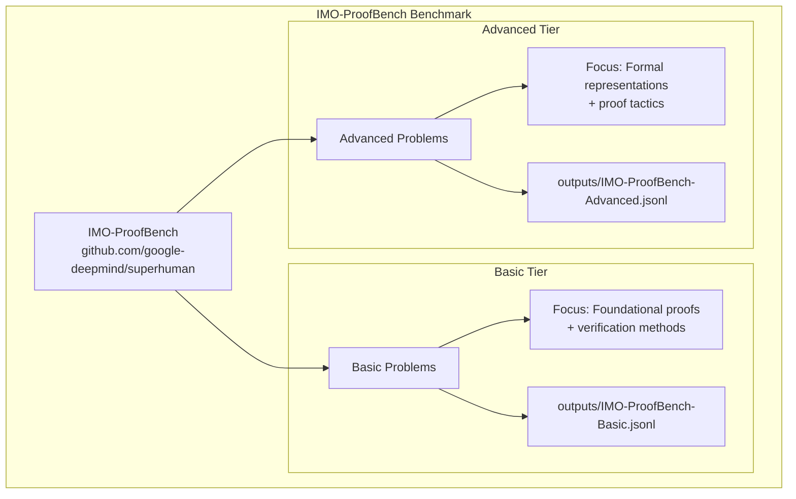
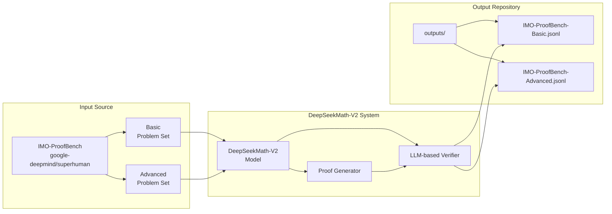
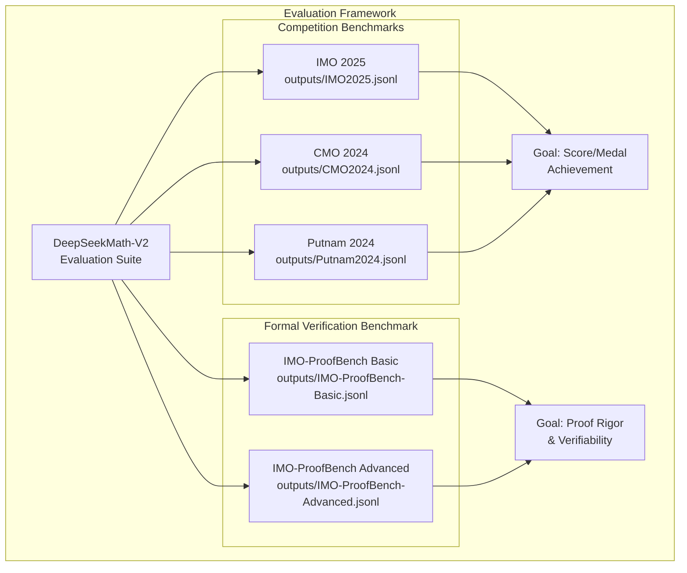

<!-- source: DeepWiki mcp.deepwiki.com · repo deepseek-ai/DeepSeek-Math-V2 · page 3.2 IMO-ProofBench · fetched 2026-10-30 -->

# IMO-ProofBench

<details>
<summary>Relevant source files</summary>

The following files were used as context for generating this wiki page:

- [README.md](README.md)
- [figures/IMO-ProofBench.png](figures/IMO-ProofBench.png)
- [outputs/README.md](outputs/README.md)

</details>


## Purpose and Scope

This document describes the IMO-ProofBench benchmark system, which evaluates formal theorem proving capabilities in DeepSeekMath-V2. IMO-ProofBench is a formal verification benchmark developed by Google DeepMind that tests a model's ability to produce mathematically rigorous proofs that can be verified by proof assistants.

For results on mathematical competitions (IMO, CMO, Putnam), see [Competition Results](#3.1).  
For detailed analysis of basic theorem proving problems, see [Basic Problems](#3.2.1).  
For formal representations and tactics in advanced problems, see [Advanced Problems](#3.2.2).

---

## Overview

IMO-ProofBench is an external benchmark developed by the Google DeepMind team behind DeepThink IMO-Gold. It provides a standardized evaluation framework for assessing formal mathematical reasoning capabilities, specifically testing whether models can generate proofs that meet the rigorous standards of formal verification systems.

The benchmark is hosted at the external repository `github.com/google-deepmind/superhuman/tree/main/imobench` and is licensed under Apache License 2.0, making it freely available for research and evaluation purposes.

**Key Characteristics:**
- Focus on formal theorem proving rather than informal problem solving
- Two-tier difficulty structure: Basic and Advanced problem sets
- Evaluation includes both automated verification and human assessment
- Tests mathematical rigor beyond final answer accuracy

Sources: [README.md:49-56](), [outputs/README.md:1]()

---

## Benchmark Structure

IMO-ProofBench consists of two distinct problem sets with different difficulty levels and evaluation requirements:

### Problem Set Hierarchy



| Problem Set | Difficulty | Output File | Key Requirements |
|-------------|-----------|-------------|------------------|
| **Basic** | Foundational | `outputs/IMO-ProofBench-Basic.jsonl` | Basic proof structure, verification compatibility |
| **Advanced** | Competition-level | `outputs/IMO-ProofBench-Advanced.jsonl` | Formal representations, proof tactics, advanced techniques |

Sources: [README.md:49-56](), Diagram 1 and Diagram 3 from context

---

## Evaluation Pipeline

The evaluation process for IMO-ProofBench follows a structured pipeline that produces standardized output files for analysis.

### Data Flow Architecture



**Evaluation Steps:**

1. **Problem Ingestion**: Problems from IMO-ProofBench are fed to DeepSeekMath-V2
2. **Proof Generation**: The proof generator produces step-by-step formal proofs
3. **Self-Verification**: The LLM-based verifier validates each proof step
4. **Output Recording**: Results are written to JSONL files in the `outputs/` directory
5. **Human Review**: Final human ratings complement automatic verification scores

Sources: [README.md:49-51](), Diagram 3 from context

---

## Output Data Structure

All IMO-ProofBench evaluation results are stored in the `outputs/` directory as JSONL (JSON Lines) files. Each file contains one JSON object per line, representing a single problem evaluation.

### File Locations

```
outputs/
├── IMO-ProofBench-Basic.jsonl      # Basic tier results
├── IMO-ProofBench-Advanced.jsonl   # Advanced tier results
└── README.md                        # Attribution and licensing
```

### Schema Structure

Both output files follow the standard evaluation schema used across all DeepSeekMath-V2 benchmarks:

```json
{
  "question": "string",              // Problem statement
  "problem_idx": "string",           // Unique identifier
  "model_prediction": {
    "proof": "string",               // Step-by-step formal proof
    "average_automatic_rating": float,  // Automated verification score
    "human_rating": int              // Human expert assessment
  }
}
```

**Field Descriptions:**

| Field | Type | Description |
|-------|------|-------------|
| `question` | string | The formal problem statement from IMO-ProofBench |
| `problem_idx` | string | Unique identifier for tracking and reference |
| `model_prediction.proof` | string | Generated formal proof with LaTeX formatting |
| `model_prediction.average_automatic_rating` | float | Automated verification score from the verifier |
| `model_prediction.human_rating` | int | Expert human assessment of proof quality |

For detailed schema documentation, see [JSONL Schema](#4.1).  
For proof structure conventions, see [Proof Structure](#4.2).  
For metric definitions, see [Evaluation Metrics](#4.3).

Sources: [README.md:50](), Diagram 3 from context

---

## Performance Visualization

DeepSeekMath-V2's performance on IMO-ProofBench is visualized in the repository's figures directory:

```
figures/
└── IMO-ProofBench.png    # Performance comparison chart
```

This visualization shows comparative performance metrics across different problem categories within the benchmark. The figure is referenced in the main README to demonstrate the system's formal theorem proving capabilities.

Sources: [README.md:54-56]()

---

## Benchmark Attribution

IMO-ProofBench is an external dependency with specific licensing requirements that must be acknowledged:

**Source Information:**
- **Developer**: Google DeepMind (team behind DeepThink IMO-Gold)
- **Repository**: `github.com/google-deepmind/superhuman/tree/main/imobench`
- **License**: Apache License, Version 2.0
- **Attribution File**: [outputs/README.md:1]()

The repository includes proper attribution in `outputs/README.md`, acknowledging the use of IMO-ProofBench and its Apache 2.0 licensing terms. This ensures compliance with the benchmark's distribution requirements.

For more information on external dependencies, see [External Dependencies](#7.2).

Sources: [outputs/README.md:1](), [README.md:49]()

---

## Relationship to Other Benchmarks

IMO-ProofBench serves a distinct role within DeepSeekMath-V2's evaluation suite:

### Benchmark Comparison

| Benchmark | Type | Focus | Output Format |
|-----------|------|-------|---------------|
| **IMO-ProofBench** | Formal verification | Theorem proving rigor | JSONL with formal proofs |
| **IMO 2025** | Competition | Real-world problem solving | JSONL with competition solutions |
| **CMO 2024** | Competition | Chinese olympiad problems | JSONL with detailed proofs |
| **Putnam 2024** | Competition | University-level calculus | JSONL with mathematical derivations |

**Key Distinction**: While competition benchmarks (IMO, CMO, Putnam) evaluate the model's ability to solve specific mathematical problems and achieve high scores, IMO-ProofBench specifically tests the formal rigor and verifiability of the proofs themselves. This aligns with DeepSeekMath-V2's core innovation of self-verifiable mathematical reasoning.



Sources: [README.md:47-66](), Diagram 1 and Diagram 4 from context

---

## Integration with Training Pipeline

IMO-ProofBench results contribute to the continuous improvement cycle of DeepSeekMath-V2:

1. **Benchmark Evaluation**: The model is tested on IMO-ProofBench problems
2. **Gap Identification**: Challenging proofs where the verifier struggles are identified
3. **Scaled Verification**: Additional compute is applied to these hard cases
4. **Auto-labeling**: Difficult cases are automatically labeled as new training data
5. **Verifier Improvement**: The verifier is retrained on this augmented dataset
6. **Generator Enhancement**: The improved verifier provides better reward signals

This creates a feedback loop where IMO-ProofBench serves not just as an evaluation benchmark but as a source of challenging cases that drive system improvement.

For details on the training pipeline, see [Training Pipeline](#2.2).  
For self-verification mechanism details, see [Self-Verification Mechanism](#2.3).

Sources: [README.md:32-45](), Diagram 2 and Diagram 6 from context

---

## Access and Usage

### Accessing IMO-ProofBench

The benchmark itself is maintained externally by Google DeepMind:
- **Repository**: `https://github.com/google-deepmind/superhuman/tree/main/imobench`
- **License**: Apache License 2.0

### Accessing DeepSeekMath-V2 Results

Model predictions on IMO-ProofBench are available in this repository:
- **Location**: `outputs/` directory
- **Files**: `IMO-ProofBench-Basic.jsonl` and `IMO-ProofBench-Advanced.jsonl`
- **Format**: One JSON object per line (JSONL)

### Running Inference

To generate your own predictions on IMO-ProofBench:
1. Download the model from Hugging Face: `deepseek-ai/DeepSeek-Math-V2`
2. Follow inference setup instructions in [Inference Setup](#5.2)
3. Process IMO-ProofBench problems through the model
4. Apply the verification pipeline to validate results

For complete usage examples, see [Example Usage](#5.3).

Sources: [README.md:67-71](), [outputs/README.md:1]()

---

