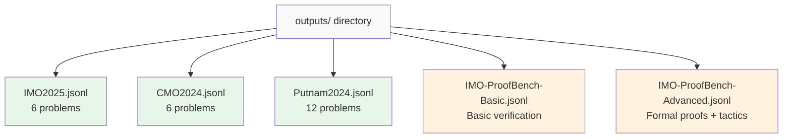
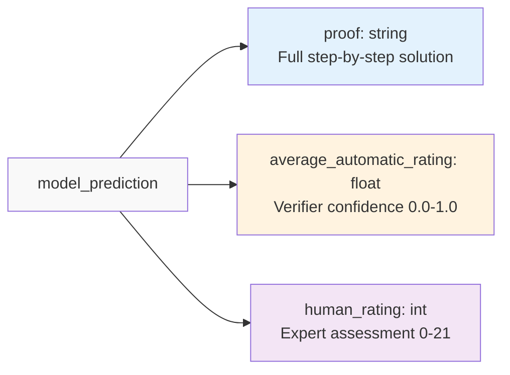
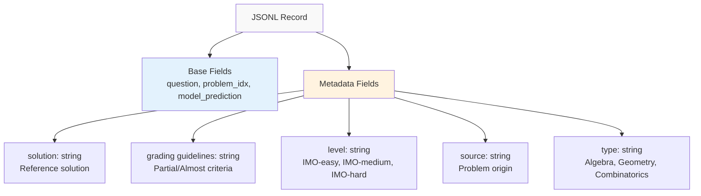
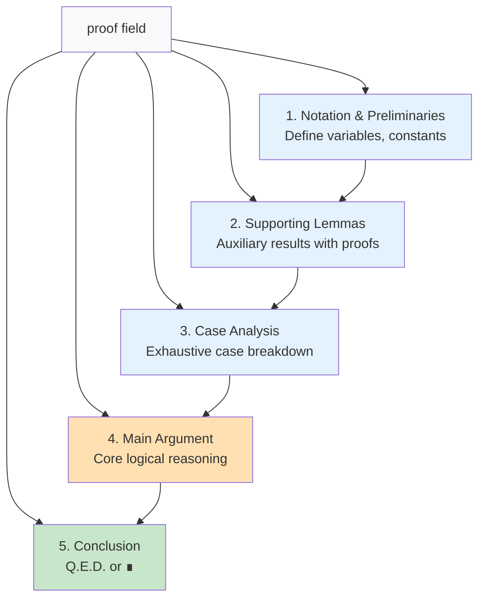
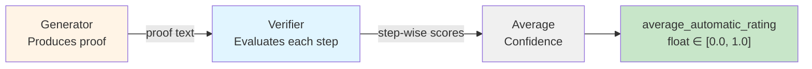
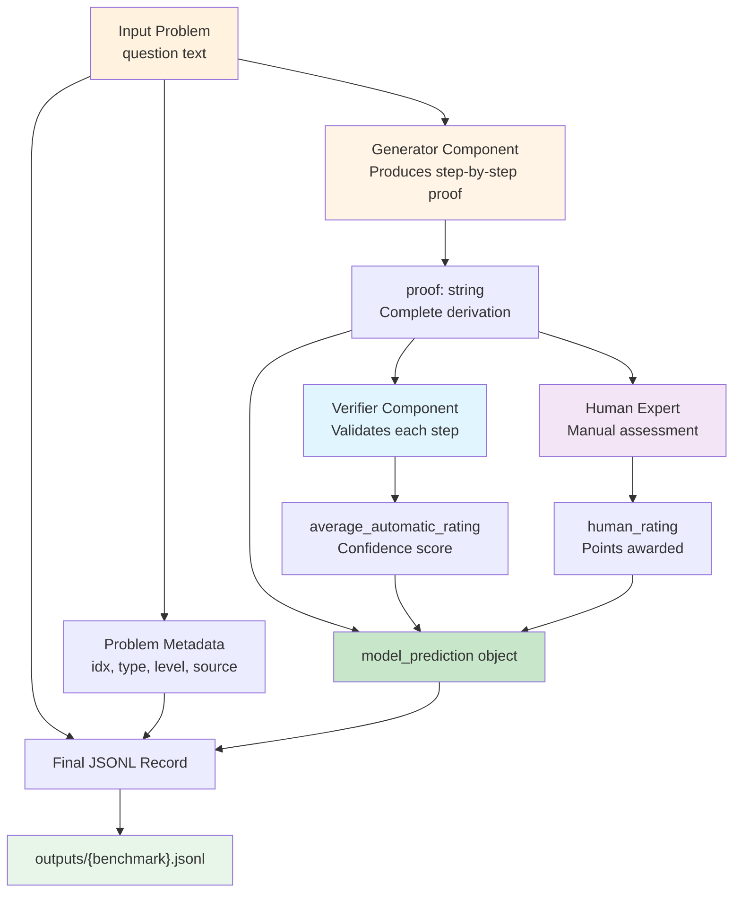

<!-- source: DeepWiki mcp.deepwiki.com · repo deepseek-ai/DeepSeek-Math-V2 · page 4 Data Formats & Outputs · fetched 2026-10-30 -->

# Data Formats & Outputs

<details>
<summary>Relevant source files</summary>

The following files were used as context for generating this wiki page:

- [outputs/CMO2024.jsonl](outputs/CMO2024.jsonl)
- [outputs/IMO-ProofBench-Advanced.jsonl](outputs/IMO-ProofBench-Advanced.jsonl)
- [outputs/IMO-ProofBench-Basic.jsonl](outputs/IMO-ProofBench-Basic.jsonl)
- [outputs/IMO2025.jsonl](outputs/IMO2025.jsonl)
- [outputs/Putnam2024.jsonl](outputs/Putnam2024.jsonl)

</details>


This page documents the structure of output data files produced by DeepSeek-Math-V2 during evaluation on various mathematical benchmarks. It covers the JSONL file format, common schema elements, proof representations, and rating systems.

**Scope:** This page focuses exclusively on the data formats and structure of evaluation outputs. For information about the evaluation pipeline itself, see [Evaluation & Results](#3). For details on specific benchmarks, see [Competition Results](#3.1) and [IMO-ProofBench](#3.2). For the model's inference setup, see [Inference Setup](#5.2).

---

## Output File Overview

DeepSeek-Math-V2 produces structured evaluation outputs in **JSONL** (JSON Lines) format. Each benchmark evaluation generates a separate file in the `outputs/` directory. All files follow a consistent base schema with benchmark-specific extensions.

### File Inventory



**Sources:** [outputs/IMO2025.jsonl:1](), [outputs/CMO2024.jsonl:1](), [outputs/IMO-ProofBench-Basic.jsonl:1](), [outputs/IMO-ProofBench-Advanced.jsonl:1]()

---

## JSONL Format Specification

Each output file uses the **JSONL** (JSON Lines) format:
- One complete JSON object per line
- Each line is independently parsable
- No comma separation between records
- UTF-8 encoding for mathematical symbols

### Basic Structure Example

```json
{
  "question": "Problem statement with LaTeX math",
  "problem_idx": "unique-identifier",
  "model_prediction": {
    "proof": "Step-by-step solution...",
    "average_automatic_rating": 0.9296875,
    "human_rating": 0
  }
}
```

**Sources:** [outputs/CMO2024.jsonl:1-2](), [outputs/IMO2025.jsonl:1]()

---

## Common Schema Elements

All output files share these core fields regardless of benchmark type:

### Record-Level Fields

| Field | Type | Description | Example |
|-------|------|-------------|---------|
| `question` | string | Problem statement in LaTeX/Unicode | `"Let $\alpha > 1$ be an irrational..."` |
| `problem_idx` | string | Unique problem identifier | `"CMO2024-1"`, `"IMO2025-2"` |
| `model_prediction` | object | Container for solution and ratings | See Prediction Object below |

### Prediction Object Structure



**Field Definitions:**

- **`proof`**: Complete mathematical derivation including notation, lemmas, cases, and conclusions. Formatted in LaTeX for mathematical expressions.
- **`average_automatic_rating`**: Floating-point value representing the LLM-based verifier's confidence in proof correctness. Range: [0.0, 1.0].
- **`human_rating`**: Integer score from human expert evaluation. Typically uses a 0-21 scale for IMO-style problems (matching actual IMO scoring).

**Sources:** [outputs/CMO2024.jsonl:1](), [outputs/IMO2025.jsonl:1]()

---

## Competition Output Format

Competition benchmarks (IMO, CMO, Putnam) use the base schema exclusively.

### Example: IMO 2025 Problem

```json
{
  "question": "A line in the plane is called \\emph{sunny} if...",
  "problem_idx": "IMO2025-1",
  "model_prediction": {
    "proof": "**Notation.**  \nFor an integer \\(n\\ge 3\\) set...",
    "average_automatic_rating": 1.0,
    "human_rating": 7
  }
}
```

### Problem Identifier Convention

Competition problem identifiers follow the pattern: `{Competition}{Year}-{ProblemNumber}`

Examples:
- `IMO2025-1`, `IMO2025-2` (6 problems total)
- `CMO2024-1` through `CMO2024-6`
- `Putnam2024-1` through `Putnam2024-12`

**Sources:** [outputs/IMO2025.jsonl:1](), [outputs/CMO2024.jsonl:1-3]()

---

## IMO-ProofBench Format

IMO-ProofBench outputs include additional metadata fields for formal verification context.

### Extended Schema



### IMO-ProofBench Specific Fields

| Field | Type | Purpose | Example Values |
|-------|------|---------|----------------|
| `solution` | string | Official or reference solution | Full proof text |
| `grading guidelines` | string | Partial credit criteria | "(Partial) 1. Proved...<br>(Almost) 1. Solved correctly..." |
| `level` | string | Difficulty classification | `"IMO-easy"`, `"IMO-medium"`, `"IMO-hard"`, `"pre-IMO"` |
| `source` | string | Problem provenance | `"(Modified) IMO 2019, P1"`, `"Novel Problem"` |
| `type` | string | Mathematical domain | `"Algebra"`, `"Geometry"`, `"Combinatorics"` |

### Basic vs. Advanced Variants

**IMO-ProofBench-Basic.jsonl:**
- Simpler problems (pre-IMO to IMO-easy)
- Focus on basic proof verification
- Example: [outputs/IMO-ProofBench-Basic.jsonl:1]()

**IMO-ProofBench-Advanced.jsonl:**
- Complex problems (IMO-medium to IMO-hard)
- Includes formal representations and proof tactics
- Example: [outputs/IMO-ProofBench-Advanced.jsonl:1]()

**Sources:** [outputs/IMO-ProofBench-Basic.jsonl:1](), [outputs/IMO-ProofBench-Advanced.jsonl:1-3]()

---

## Proof Structure and Formatting

The `proof` field contains complete mathematical derivations with consistent structural conventions.

### Common Proof Elements



### LaTeX Mathematical Notation

Proofs extensively use LaTeX math mode delimiters:

**Inline math:** `\( expression \)` or `$ expression $`
```
Example: "Let \(n\ge 3\) be an integer and \(f:\mathbb{R}\to\mathbb{R}\) be a function..."
```

**Display math:** `\[ expression \]` or `$$ expression $$`
```
\[
x^{2}+y^{2}+z^{2}+t^{2} \ge xyzt
\]
```

**Aligned equations:** Using `\begin{aligned}...\end{aligned}` or custom tags
```
\[
\begin{aligned}
f(2x)+2f(y)&=f\bigl(f(x+y)\bigr)\\
&=\text{some expression}
\end{aligned}
\]
```

### Proof Organization Markers

Common section markers in proofs:

- `**1. Section Title**` - Major proof sections
- `*Lemma N.* Statement` - Supporting lemmas
- `*Proof.* ...` - Proof of lemma
- `*Case A:*` - Case analysis
- `### Subsection` - Markdown-style headers
- `\tag{N}` or `\tag{label}` - Equation numbering
- `\qed` or `∎` - Proof completion marker

**Example from actual output:**
```
**1. First consequences of the equation**  

*Put \(y=0\) in \(P(x,y)\):*  

\[
f(2x)+2f(0)=f\bigl(f(x)\bigr)\tag{1}
\]
```

**Sources:** [outputs/CMO2024.jsonl:1](), [outputs/IMO2025.jsonl:1](), [outputs/IMO-ProofBench-Basic.jsonl:1]()

---

## Rating Systems

DeepSeek-Math-V2 outputs include two independent evaluation metrics: automatic verification ratings and human expert assessments.

### Automatic Rating (`average_automatic_rating`)

**Type:** `float`  
**Range:** [0.0, 1.0]  
**Source:** LLM-based verifier component

This rating represents the verifier's confidence that the proof is correct. Computed as:



**Interpretation:**

| Range | Interpretation | Example Problems |
|-------|----------------|------------------|
| 0.90 - 1.0 | High confidence, likely correct | IMO2025-1 (1.0), CMO2024-1 (1.0) |
| 0.70 - 0.89 | Moderate confidence | - |
| 0.50 - 0.69 | Low confidence | IMO-ProofBench-Advanced-002 (0.578125) |
| < 0.50 | Very low confidence, likely incorrect | - |

**Note:** A rating of 1.0 indicates the verifier found no issues with any proof step.

### Human Rating (`human_rating`)

**Type:** `int`  
**Range:** [0, 21] for IMO-style problems  
**Source:** Expert human evaluation

Follows standard IMO scoring conventions:
- **7 points per problem** for standard IMO problems
- **21 points maximum** across a 3-problem set
- **Partial credit** awarded based on grading guidelines

**IMO-ProofBench Grading Criteria:**

The `grading guidelines` field defines partial credit thresholds:

```
(Partial)
 1. Proved that either f(0)=0 or f(x)=-x+k for some constant k
 
(Almost)
 1. Solved correctly by handling the case f(0)=0, but did not check 
    that the candidates are indeed the solutions to given equation.
```

**Example Ratings:**

- **7 points:** Complete and correct solution (e.g., IMO2025-1)
- **1 point:** Novel progress or significant lemma (e.g., IMO-ProofBench-Advanced-002)
- **0 points:** Incorrect or incomplete (e.g., CMO2024-3)

**Sources:** [outputs/CMO2024.jsonl:1-3](), [outputs/IMO-ProofBench-Basic.jsonl:1-3](), [outputs/IMO-ProofBench-Advanced.jsonl:1-2]()

---

## Reading and Parsing Outputs

### Python Example: Loading JSONL

```python
import json

def load_jsonl(filepath):
    """Load a JSONL file into a list of records."""
    records = []
    with open(filepath, 'r', encoding='utf-8') as f:
        for line in f:
            records.append(json.loads(line))
    return records

# Load competition results
imo_results = load_jsonl('outputs/IMO2025.jsonl')
for record in imo_results:
    print(f"Problem: {record['problem_idx']}")
    print(f"Auto rating: {record['model_prediction']['average_automatic_rating']}")
    print(f"Human score: {record['model_prediction']['human_rating']}/7")
    print()

# Load IMO-ProofBench with metadata
pb_results = load_jsonl('outputs/IMO-ProofBench-Basic.jsonl')
for record in pb_results:
    print(f"Problem: {record['problem_idx']}")
    print(f"Type: {record['type']}, Level: {record['level']}")
    print(f"Source: {record['source']}")
    print()
```

### Extracting Proof Text

```python
def extract_proof(record):
    """Extract and optionally process proof text."""
    proof = record['model_prediction']['proof']
    
    # Proof is already formatted with LaTeX
    # Can be rendered directly or processed further
    return proof

def get_high_confidence_proofs(records, threshold=0.9):
    """Filter records by automatic rating threshold."""
    return [
        r for r in records 
        if r['model_prediction']['average_automatic_rating'] >= threshold
    ]
```

**Sources:** [outputs/CMO2024.jsonl:1](), [outputs/IMO2025.jsonl:1]()

---

## Data Flow: Problem to Output



**Process Summary:**

1. **Input:** Problem statement with unique identifier
2. **Generation:** DeepSeek-Math-V2 generator produces detailed proof
3. **Automatic Verification:** LLM-based verifier evaluates proof rigor
4. **Human Evaluation:** Expert assigns score based on grading criteria
5. **Serialization:** All components packaged into JSONL record
6. **Output:** Single-line JSON appended to benchmark file

**Sources:** Based on system architecture from high-level diagrams and [outputs/ directory structure]()

---

## Benchmark-Specific Variations

### Competition Outputs (IMO/CMO/Putnam)

**Characteristics:**
- Minimal schema (base fields only)
- Focus on final solution quality
- Problems solved under time constraints
- Human ratings reflect actual competition scoring

**Files:** [outputs/IMO2025.jsonl](), [outputs/CMO2024.jsonl](), [outputs/Putnam2024.jsonl]()

### IMO-ProofBench Outputs

**Characteristics:**
- Extended schema with metadata
- Reference solutions included (`solution` field)
- Detailed grading guidelines for partial credit
- Categorized by difficulty level and mathematical domain

**Files:** [outputs/IMO-ProofBench-Basic.jsonl](), [outputs/IMO-ProofBench-Advanced.jsonl]()

**Key Differences:**

| Aspect | Competition | IMO-ProofBench |
|--------|-------------|----------------|
| **Fields** | 3 (question, problem_idx, model_prediction) | 8 (adds solution, grading guidelines, level, source, type) |
| **Purpose** | Real competition performance | Systematic capability assessment |
| **Evaluation** | Final answer correctness | Proof rigor and methodology |
| **Metadata** | Minimal | Rich (difficulty, domain, source) |

**Sources:** [outputs/CMO2024.jsonl:1](), [outputs/IMO-ProofBench-Basic.jsonl:1]()

---

## Summary: Output File Specification

**Format:** JSONL (JSON Lines), one record per line  
**Encoding:** UTF-8  
**Location:** `outputs/` directory  

**Mandatory Fields (all files):**
- `question` (string): Problem statement
- `problem_idx` (string): Unique identifier  
- `model_prediction` (object):
  - `proof` (string): Complete solution
  - `average_automatic_rating` (float): Verifier confidence [0.0, 1.0]
  - `human_rating` (int): Expert score

**Optional Fields (IMO-ProofBench only):**
- `solution` (string): Reference solution
- `grading guidelines` (string): Partial credit criteria
- `level` (string): Difficulty tier
- `source` (string): Problem origin
- `type` (string): Mathematical category

**Sources:** All files in [outputs/ directory]()

---

