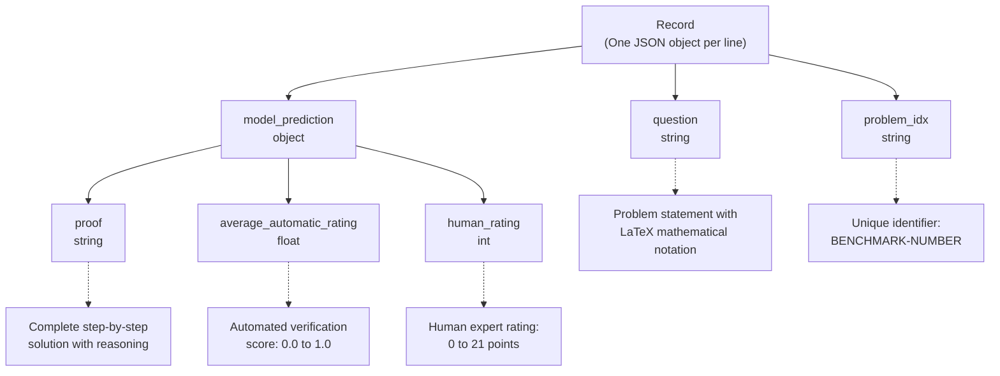
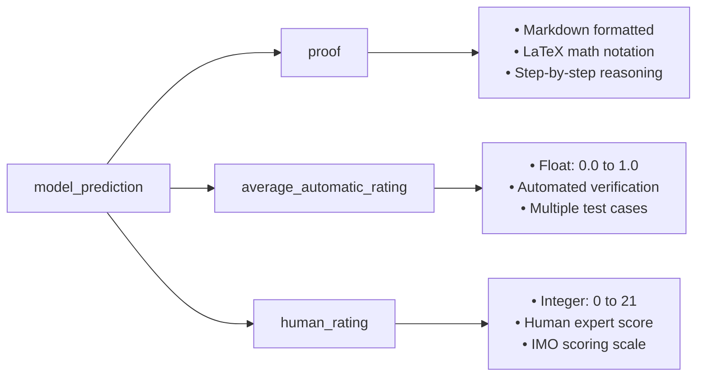
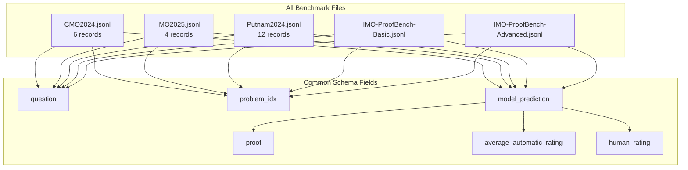
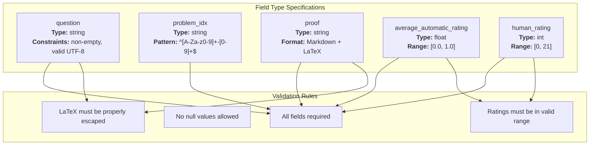

<!-- source: DeepWiki mcp.deepwiki.com · repo deepseek-ai/DeepSeek-Math-V2 · page 4.1 JSONL Schema · fetched 2026-10-30 -->

# JSONL Schema

<details>
<summary>Relevant source files</summary>

The following files were used as context for generating this wiki page:

- [outputs/CMO2024.jsonl](outputs/CMO2024.jsonl)
- [outputs/IMO2025.jsonl](outputs/IMO2025.jsonl)
- [outputs/Putnam2024.jsonl](outputs/Putnam2024.jsonl)

</details>


This document specifies the common data schema used across all benchmark output files in the DeepSeek-Math-V2 repository. The schema defines how problem statements, model predictions, and evaluation metrics are structured and stored.

For details about the content and structure of the generated proofs themselves, see [Proof Structure](#4.2). For information about the rating systems used to evaluate predictions, see [Evaluation Metrics](#4.3).

---

## Overview

All benchmark results in the [`outputs/`](outputs/) directory follow a standardized JSONL (JSON Lines) format. Each file contains one JSON object per line, where each object represents a single problem, the model's solution, and associated metadata. This format enables efficient streaming, parallel processing, and easy integration with analysis tools.

The schema is consistent across all five output files:
- `CMO2024.jsonl` (6 problems)
- `IMO2025.jsonl` (4 problems)
- `Putnam2024.jsonl` (12 problems)
- `IMO-ProofBench-Basic.jsonl`
- `IMO-ProofBench-Advanced.jsonl`

---

## File Format

### JSONL Structure

Each output file uses the **JSON Lines** format:
- One complete JSON object per line
- No commas between objects
- Each line can be parsed independently
- UTF-8 encoding with LaTeX mathematical notation

```
{"question": "...", "problem_idx": "...", "model_prediction": {...}}
{"question": "...", "problem_idx": "...", "model_prediction": {...}}
{"question": "...", "problem_idx": "...", "model_prediction": {...}}
```

This format allows for:
- **Streaming processing**: Read and process one problem at a time
- **Parallel analysis**: Multiple processes can read different lines simultaneously
- **Easy concatenation**: Files can be merged with simple text concatenation
- **Version control friendly**: Line-by-line diffs show changes clearly

Sources: [outputs/CMO2024.jsonl:1-6](), [outputs/IMO2025.jsonl:1-4]()

---

## Schema Definition

### Top-Level Record Structure



Sources: [outputs/CMO2024.jsonl:1](), [outputs/IMO2025.jsonl:1]()

---

## Field Specifications

### `question` (string)

**Purpose**: Contains the complete problem statement as presented in the original competition or benchmark.

**Format**:
- Plain text with embedded LaTeX mathematical notation
- LaTeX delimited by `\(` ... `\)` for inline math
- LaTeX delimited by `\[` ... `\]` for display math
- May include multiple paragraphs, enumerated items, or bullet points
- Preserves original formatting and mathematical symbols

**Example**:

```json
"question": "Let $\\alpha > 1$ be an irrational number and $L$ be a integer such that $L > \\frac{\\alpha^2}{\\alpha - 1}$. A sequence $x_1, x_2, \\cdots$ satisfies that $x_1 > L$ and for all positive integers $n$,\\[ x_{n+1} = \\begin{cases} \\left \\lfloor \\alpha x_n \\right \\rfloor & \\textup{if} \\; x_n  \\leqslant L \\\\left \\lfloor \\frac{x_n}{\\alpha} \\right \\rfloor & \\textup{if}  \\; x_n  > L \\end{cases}. \\]Prove that..."
```

**Constraints**:
- Non-empty string
- Must be valid UTF-8 with properly escaped characters in JSON
- Length varies from ~100 to ~2000 characters depending on problem complexity

Sources: [outputs/CMO2024.jsonl:1](), [outputs/IMO2025.jsonl:1]()

---

### `problem_idx` (string)

**Purpose**: Provides a unique, human-readable identifier for each problem within its benchmark.

**Format Pattern**: `BENCHMARK-NUMBER`

Where:
- `BENCHMARK` is one of: `CMO2024`, `IMO2025`, `Putnam2024`, `IMO-ProofBench-Basic`, `IMO-ProofBench-Advanced`
- `NUMBER` is a sequential integer starting from 1

**Examples**:

| Benchmark | Sample Identifiers |
|-----------|-------------------|
| CMO 2024 | `CMO2024-1`, `CMO2024-2`, ..., `CMO2024-6` |
| IMO 2025 | `IMO2025-1`, `IMO2025-2`, ..., `IMO2025-4` |
| Putnam 2024 | `Putnam2024-1`, `Putnam2024-2`, ..., `Putnam2024-12` |

**Properties**:
- **Uniqueness**: Each identifier appears exactly once across all files
- **Ordering**: Numbers correspond to problem sequence in the competition
- **Stability**: Identifiers do not change across repository versions
- **Human-readable**: Easy to reference in discussions and citations

**Usage**: This field serves as the primary key for referencing problems in analysis, discussion, and cross-referencing with official competition materials.

Sources: [outputs/CMO2024.jsonl:1](), [outputs/IMO2025.jsonl:1]()

---

### `model_prediction` (object)

**Purpose**: Encapsulates all output and evaluation data generated by DeepSeek-Math-V2 for a given problem.

**Structure**: A nested JSON object containing three required fields:



This nested structure separates the machine-generated content (proof) from evaluation metrics (ratings), enabling independent updates to scoring without modifying the proof content.

Sources: [outputs/CMO2024.jsonl:1]()

---

#### `model_prediction.proof` (string)

**Purpose**: Contains the complete mathematical proof or solution generated by DeepSeek-Math-V2.

**Format**:
- Markdown-formatted text
- LaTeX mathematical notation (inline: `\(...\)`, display: `\[...\]`)
- Structured with headings, subheadings, and numbered steps
- Includes intermediate lemmas, case analysis, and formal reasoning
- Concludes with QED symbol (□, ■, or ∎)

**Typical Structure** (see [Proof Structure](#4.2) for details):
1. Notation section defining variables and conventions
2. Preliminary lemmas and basic facts
3. Main proof divided into numbered sections
4. Case-by-case analysis when applicable
5. Final conclusion with QED marker

**Example Fragment**:

```markdown
**Notation and basic facts**  

Define  

\[
f(x)=\begin{cases}
\displaystyle \bigl\lfloor \alpha x\bigr\rfloor & (x\le L),\\[4mm]
\displaystyle \Bigl\lfloor \frac{x}{\alpha}\Bigr\rfloor & (x>L).
\end{cases}
\]

The recurrence is \(x_{n+1}=f(x_n)\;(n\ge1)\) with \(x_1>L\).  
...

### 1.  Preliminary estimates  

From \(L>\dfrac{\alpha^{2}}{\alpha-1}\) and \(\alpha>1\),

\[
L(\alpha-1)>\alpha^{2}\;...
\]
```

**Length**: Varies from ~2,000 to ~50,000 characters depending on problem complexity and proof detail.

Sources: [outputs/CMO2024.jsonl:1](), [outputs/IMO2025.jsonl:1]()

---

#### `model_prediction.average_automatic_rating` (float)

**Purpose**: Represents the automated verification score computed by the system's verifier component.

**Data Type**: Floating-point number in the range [0.0, 1.0]

**Semantics**:
- `1.0`: Perfect score - all verification checks passed
- `0.9296875`: High confidence - most checks passed with minor issues
- `0.0`: Failed verification - significant logical errors detected

**Computation** (see [Evaluation Metrics](#4.3)):
- Generated by the LLM-based verifier component
- Averages multiple automatic verification tests
- Checks logical consistency, mathematical correctness, and completeness
- May involve formal proof checking for IMO-ProofBench problems

**Examples from Data**:

| Problem | Automatic Rating | Interpretation |
|---------|-----------------|----------------|
| CMO2024-1 | 1.0 | Perfect verification |
| CMO2024-2 | 1.0 | Perfect verification |
| CMO2024-3 | 0.9296875 | High confidence, minor issues |
| IMO2025-1 | 1.0 | Perfect verification |
| IMO2025-2 | 1.0 | Perfect verification |

**Note**: This is a continuous metric that may not correspond exactly to the binary "correct/incorrect" judgment used in competitions. See [Evaluation Metrics](#4.3) for the relationship between automatic and human ratings.

Sources: [outputs/CMO2024.jsonl:1-6](), [outputs/IMO2025.jsonl:1-4]()

---

#### `model_prediction.human_rating` (int)

**Purpose**: Represents the score assigned by human expert evaluators following competition scoring rubrics.

**Data Type**: Integer in the range [0, 21]

**Scoring Scale** (IMO standard):
- **21 points**: Complete, rigorous proof with no errors
- **14-20 points**: Substantial progress with minor gaps or errors
- **7-13 points**: Significant partial progress
- **1-6 points**: Minimal progress or key insight only
- **0 points**: No meaningful progress or incorrect approach

**Evaluation Criteria**:
- Mathematical correctness and rigor
- Completeness of argument
- Proper justification of all steps
- Handling of edge cases
- Clarity of exposition

**Examples from Data**:

| Problem | Human Rating | Description |
|---------|-------------|-------------|
| CMO2024-1 | 21 | Full marks - complete proof |
| CMO2024-2 | 21 | Full marks - complete proof |
| CMO2024-3 | 0 | No credit |
| IMO2025-1 | 7 | Partial credit |
| IMO2025-2 | 7 | Partial credit |

**Relationship to Automatic Rating**: High automatic ratings (e.g., 1.0) often correlate with high human ratings (e.g., 21), but the converse is not always true. A proof may pass automatic checks but have subtle errors detected by human experts, or vice versa. See [Evaluation Metrics](#4.3) for detailed discussion.

Sources: [outputs/CMO2024.jsonl:1-6](), [outputs/IMO2025.jsonl:1-4]()

---

## Schema Consistency Across Benchmarks

### Uniform Structure

All five output files follow the identical schema, enabling unified processing pipelines:



Sources: [outputs/CMO2024.jsonl](), [outputs/IMO2025.jsonl]()

---

### Benchmark-Specific Variations

While the schema is uniform, the content and characteristics vary by benchmark:

| Benchmark | Problems | Avg. Proof Length | Domain Coverage | Rating Scale |
|-----------|----------|-------------------|-----------------|--------------|
| CMO 2024 | 6 | ~15,000 chars | Number theory, geometry, combinatorics | 0-21 |
| IMO 2025 | 4 | ~20,000 chars | Competition geometry, functional equations | 0-21 |
| Putnam 2024 | 12 | ~10,000 chars | Analysis, algebra, probability | 0-21 |
| IMO-ProofBench-Basic | Varies | ~8,000 chars | Formal theorem proving basics | 0-21 |
| IMO-ProofBench-Advanced | Varies | ~25,000 chars | Advanced formal proofs + tactics | 0-21 |

**Key Observations**:
- **Problem complexity**: IMO-ProofBench-Advanced problems yield longest proofs
- **Notation density**: Geometry problems (IMO 2025) use more LaTeX diagrams
- **Proof style**: Formal benchmarks include explicit tactic references
- **Rating distribution**: Competition problems show wider rating variance

Sources: [outputs/CMO2024.jsonl](), [outputs/IMO2025.jsonl]()

---

## Data Types and Validation

### Type Constraints Summary



Sources: [outputs/CMO2024.jsonl:1](), [outputs/IMO2025.jsonl:1]()

---

### JSON Encoding

**String Escaping**:
- Backslashes in LaTeX: `\` → `\\` in JSON
- Newlines: literal `\n` characters for line breaks
- Quotes: `"` → `\"` within string values
- Unicode: directly encoded in UTF-8

**Example of JSON Encoding**:

Raw LaTeX in proof:
```latex
\frac{1}{2} + \frac{1}{3} = \frac{5}{6}
```

Encoded in JSON:
```json
"proof": "...\\frac{1}{2} + \\frac{1}{3} = \\frac{5}{6}..."
```

**Numeric Precision**:
- `average_automatic_rating`: Stored with full floating-point precision (typically 6-7 decimal places when not 1.0)
- `human_rating`: Integer only (no decimal component)

Sources: [outputs/CMO2024.jsonl:1]()

---

## Usage Patterns

### Reading JSONL Files

**Python Example**:

```python
import json

def read_results(filepath):
    """Read and parse a JSONL benchmark file."""
    problems = []
    with open(filepath, 'r', encoding='utf-8') as f:
        for line in f:
            if line.strip():  # Skip empty lines
                record = json.loads(line)
                problems.append(record)
    return problems

# Load CMO 2024 results
cmo_results = read_results('outputs/CMO2024.jsonl')

# Access fields
for problem in cmo_results:
    idx = problem['problem_idx']
    auto_score = problem['model_prediction']['average_automatic_rating']
    human_score = problem['model_prediction']['human_rating']
    print(f"{idx}: auto={auto_score:.3f}, human={human_score}")
```

**Command-Line Processing**:

```bash
# Count problems in each benchmark
wc -l outputs/*.jsonl

# Extract problem indices
jq -r '.problem_idx' outputs/IMO2025.jsonl

# Filter problems with perfect automatic rating
jq 'select(.model_prediction.average_automatic_rating == 1.0)' outputs/CMO2024.jsonl

# Compare automatic vs human ratings
jq -r '[.problem_idx, .model_prediction.average_automatic_rating, .model_prediction.human_rating] | @tsv' outputs/CMO2024.jsonl
```

Sources: [outputs/CMO2024.jsonl](), [outputs/IMO2025.jsonl]()

---

### Aggregating Results

**Cross-Benchmark Analysis**:

```python
import json
import glob

def aggregate_all_results():
    """Combine results from all benchmarks."""
    all_problems = []
    
    for filepath in glob.glob('outputs/*.jsonl'):
        with open(filepath, 'r', encoding='utf-8') as f:
            for line in f:
                if line.strip():
                    record = json.loads(line)
                    # Add benchmark name as metadata
                    record['benchmark'] = filepath.split('/')[-1].replace('.jsonl', '')
                    all_problems.append(record)
    
    return all_problems

# Compute aggregate statistics
results = aggregate_all_results()
total = len(results)
perfect_auto = sum(1 for r in results if r['model_prediction']['average_automatic_rating'] == 1.0)
perfect_human = sum(1 for r in results if r['model_prediction']['human_rating'] == 21)

print(f"Total problems: {total}")
print(f"Perfect automatic rating: {perfect_auto}/{total} ({100*perfect_auto/total:.1f}%)")
print(f"Perfect human rating: {perfect_human}/{total} ({100*perfect_human/total:.1f}%)")
```

Sources: [outputs/CMO2024.jsonl](), [outputs/IMO2025.jsonl]()

---

## Complete Example Record

Here is a full example record from CMO 2024 Problem 1, showing all fields with realistic content:

```json
{
  "question": "Let $\\alpha > 1$ be an irrational number and $L$ be a integer such that $L > \\frac{\\alpha^2}{\\alpha - 1}$. A sequence $x_1, x_2, \\cdots$ satisfies that $x_1 > L$ and for all positive integers $n$,\\[ x_{n+1} = \\begin{cases} \\left \\lfloor \\alpha x_n \\right \\rfloor & \\textup{if} \\; x_n  \\leqslant L \\\\left \\lfloor \\frac{x_n}{\\alpha} \\right \\rfloor & \\textup{if}  \\; x_n  > L \\end{cases}. \\]Prove that\n(i) $\\left\\{x_n\\right\\}$ is eventually periodic.\n(ii) The eventual fundamental period of $\\left\\{x_n\\right\\}$ is an odd integer which doesn't depend on the choice of $x_1$.",
  
  "problem_idx": "CMO2024-1",
  
  "model_prediction": {
    "proof": "**Notation and basic facts**  \n\nDefine  \n\n\\[\nf(x)=\\begin{cases}\n\\displaystyle \\bigl\\lfloor \\alpha x\\bigr\\rfloor & (x\\le L),\\\\[4mm]\n\\displaystyle \\Bigl\\lfloor \\frac{x}{\\alpha}\\Bigr\\rfloor & (x>L).\n\\end{cases}\n\\]\n\n...[proof continues for ~15,000 characters]...\n\n---",
    
    "average_automatic_rating": 1.0,
    
    "human_rating": 21
  }
}
```

**Field Interpretation**:
- `question`: A number theory problem about sequence periodicity
- `problem_idx`: First problem from CMO 2024
- `proof`: Complete proof with notation, lemmas, and conclusion
- `average_automatic_rating`: 1.0 indicates perfect automated verification
- `human_rating`: 21 indicates full credit from human evaluators (maximum score)

Sources: [outputs/CMO2024.jsonl:1]()

---

## Schema Evolution and Versioning

The current schema is **version 1.0** and has been stable since the repository's initial release. Any future changes will maintain backward compatibility by:

1. **Adding optional fields** rather than modifying existing required fields
2. **Preserving field names and types** for all current fields
3. **Documenting version numbers** in future releases if schema changes occur

**Potential Future Extensions** (not yet implemented):
- `execution_time_seconds`: Time taken to generate the proof
- `num_verification_attempts`: Number of self-correction iterations
- `formal_proof_checked`: Boolean indicating if proof was verified by proof assistant
- `confidence_score`: Model's self-assessed confidence in correctness

For now, all files conform to the schema described in this document.

Sources: [outputs/CMO2024.jsonl](), [outputs/IMO2025.jsonl]()

---

