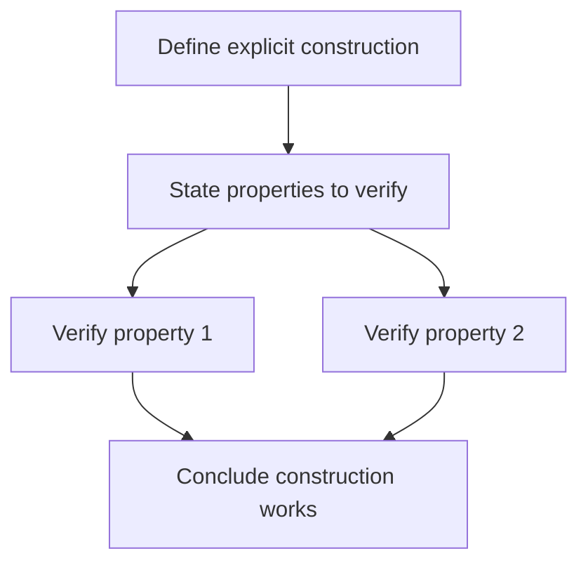
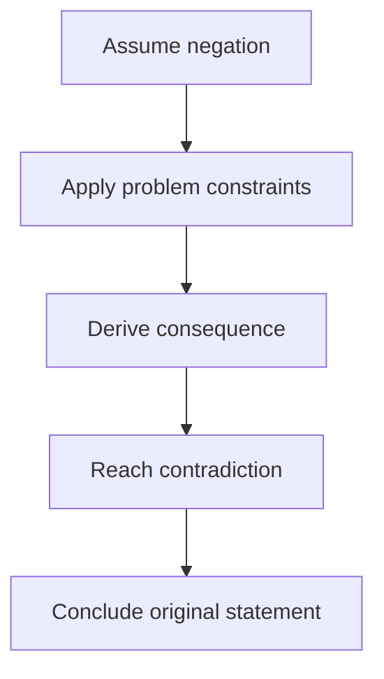
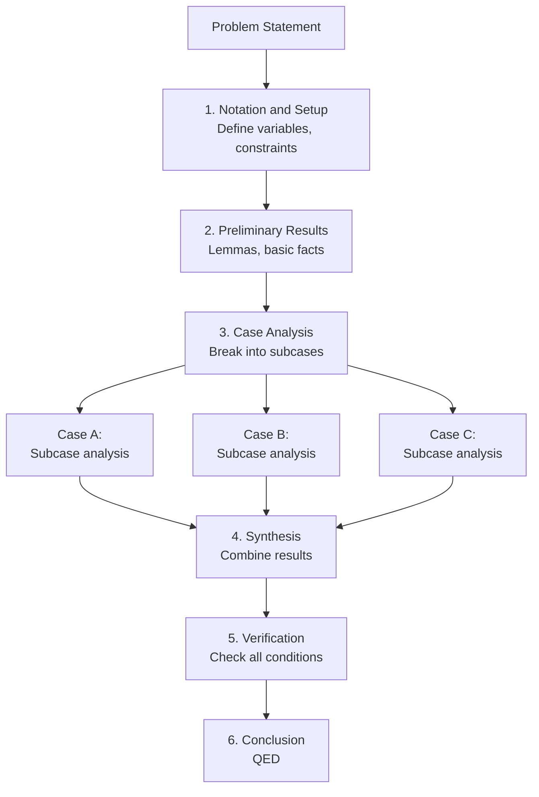
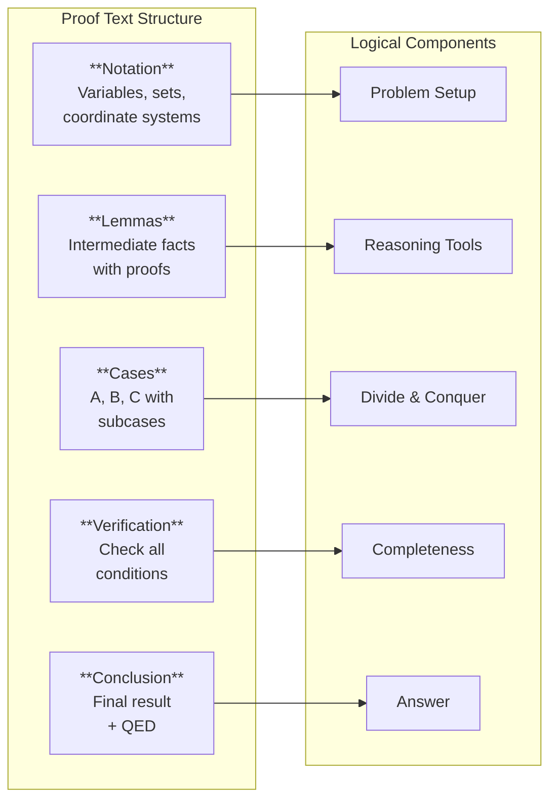

<!-- source: DeepWiki mcp.deepwiki.com · repo deepseek-ai/DeepSeek-Math-V2 · page 4.2 Proof Structure · fetched 2026-10-30 -->

# Proof Structure

<details>
<summary>Relevant source files</summary>

The following files were used as context for generating this wiki page:

- [outputs/CMO2024.jsonl](outputs/CMO2024.jsonl)
- [outputs/IMO2025.jsonl](outputs/IMO2025.jsonl)
- [outputs/Putnam2024.jsonl](outputs/Putnam2024.jsonl)

</details>


This page documents the typical structure and formatting conventions used in DeepSeek-Math-V2's generated mathematical proofs. Understanding this structure helps in parsing, analyzing, and evaluating the model's reasoning steps.

For the overall schema of proof output files, see [JSONL Schema](#4.1). For how proofs are evaluated, see [Evaluation Metrics](#4.3).

---

## Overview of Proof Organization

DeepSeek-Math-V2 generates proofs as structured markdown documents containing LaTeX-formatted mathematics. Each proof follows a hierarchical organization with numbered sections, explicitly labeled lemmas, case analyses, and clearly marked conclusions.

The typical proof contains these major components:

1. **Notation and setup** — Defining variables, coordinate systems, and basic objects
2. **Lemmas and preliminary results** — Intermediate facts needed for the main argument
3. **Case-by-case analysis** — Breaking the problem into manageable subcases
4. **Step-by-step derivation** — Detailed calculations and logical steps
5. **Conclusion** — Final result with explicit QED marker

**Sources:** [outputs/CMO2024.jsonl:1-1](), [outputs/IMO2025.jsonl:1-1]()

---

## Hierarchical Section Structure

### Section Numbering

Proofs use a clear hierarchical numbering scheme:

```
1. Major Section
   1.1 Subsection
   1.2 Subsection
       * Bullet point details
2. Next Major Section
   2.1 Subsection
       Case A: ...
       Case B: ...
   2.2 Subsection
```

Each section has:
- **Numeric identifier** (e.g., `### 3.2`)
- **Descriptive title** in bold (e.g., `### 3. Applying the lemma`)
- **Content** with detailed mathematical reasoning

### Multi-Part Problems

For problems with multiple parts (e.g., "Prove (i) ... and (ii) ..."), the proof explicitly labels each part:

```markdown
### Part (i) — eventual periodicity
[proof of part (i)]

### Part (ii) — the period is odd
[proof of part (ii)]
```

**Sources:** [outputs/CMO2024.jsonl:1-1](), [outputs/IMO2025.jsonl:1-1]()

---

## Notation Sections

Nearly every proof begins with a **Notation** section that:

1. Defines all variables and sets used throughout
2. Establishes coordinate systems or reference frames
3. States basic facts or constraints from the problem
4. Introduces shorthand for frequently used expressions

**Example from CMO2024-1:**

```markdown
**Notation and basic facts**

Define
\[
f(x)=\begin{cases}
\displaystyle \bigl\lfloor \alpha x\bigr\rfloor & (x\le L),\\
\displaystyle \Bigl\lfloor \frac{x}{\alpha}\Bigr\rfloor & (x>L).
\end{cases}
\]

The recurrence is \(x_{n+1}=f(x_n)\;(n\ge1)\) with \(x_1>L\).
```

### Coordinate Systems

For geometry problems, the notation section often establishes a coordinate system with explicit coordinates:

```markdown
**1. Coordinate set-up.**
Place the midpoint \(M\) of \(AC\) at the origin and let \(AC\) lie on the \(x\)-axis.
Write
\[
A=(-t,0),\qquad C=(t,0)\quad(t>0),\qquad B=(p,q)\quad(q>0).
\]
```

**Sources:** [outputs/CMO2024.jsonl:1-1](), [outputs/IMO2025.jsonl:2-2]()

---

## Lemmas and Intermediate Results

### Lemma Structure

Lemmas are explicitly labeled and formatted as:

```markdown
**Lemma 1.** For any two points \(P_i,P_j\) let \(\Delta x=\|x_i-x_j\|\) and \(\Delta y=\|y_i-y_j\|\).
Then \(\Delta x\ge\delta\) and \(\Delta y\ge\delta\).

*Proof.* Because \(\|t\|\le\frac12\) for every real \(t\), we have \(\Delta y\le\frac12\).
If \(\Delta x<\delta\) then ... contradiction.
Hence \(\Delta x\ge\delta\). □
```

Key elements:
- **Lemma label** in bold (e.g., `**Lemma 1.**`, `**Lemma 2.1.**`)
- **Statement** on same line or immediately following
- **Proof marker** using `*Proof.*` in italics
- **QED symbol** (`□` or `\220e`) marking the end

### Boxed Results

Important intermediate results are highlighted using `\boxed{}`:

```markdown
\[
\boxed{f(1)=1}. \tag{2}
\]
```

or

```markdown
\[
\boxed{\;D\ge\sqrt5\;}. \tag{7}
\]
```

The boxed equation is often followed by a tag (e.g., `\tag{2}`) for later reference.

**Sources:** [outputs/CMO2024.jsonl:3-3](), [outputs/IMO2025.jsonl:2-2]()

---

## Case Analysis Structure

### Nested Case Breakdown

Complex proofs often require extensive case analysis with multiple levels:

```markdown
**Case A: \(x_2\le L\) and \(x_2\ge a\).**
Then \(x_2\in Y\subseteq T\). ...

**Case B: \(x_2\le L\) and \(x_2<a\).**
Set \(t=\bigl\lfloor L/\alpha\bigr\rfloor\). ...

**Case C: \(x_2>L\).**
As in part (i), there exists ...
```

Subcases use hierarchical labels:

```markdown
* **Subcase 2a:** \(q<2p\). Then ...
* **Subcase 2b:** \(q\ge2p\) (including the case ...). Then ...
```

### Case Exhaustion

Proofs explicitly verify all cases have been covered:

```markdown
In every case we have proved ...
```

or

```markdown
All cases have been examined, therefore **\(g\) is a bonza function**.
```

**Sources:** [outputs/CMO2024.jsonl:1-1](), [outputs/IMO2025.jsonl:4-4]()

---

## Mathematical Formatting

### Display Equations

Multi-line aligned equations use `\begin{aligned}...\end{aligned}`:

```latex
\[
\begin{aligned}
S_1&=\sum_i\bigl(d_i^{2}+2v d_i+v^{2}\bigr)(u-d_i)\\
   &=u\sum d_i^{2}+2vu\sum d_i+u v^{2}n-\sum d_i^{3}-2v\sum d_i^{2}-v^{2}\sum d_i\\
   &=un+0+u v^{2}n-(-n)-2vn-0\\
   &=n\bigl(uv^{2}+u+1-2v\bigr),
\end{aligned}
\]
```

### Equation Tags and References

Important equations are tagged for later reference:

```latex
\[
f(X) = \alpha(r+R). \tag{6.1}
\]
```

Later referenced as:

```markdown
Using (6.1) we obtain ...
```

### Delimiters and Spacing

- Delimiter sizing: `\bigl(`, `\bigr)`, `\Bigl[`, `\Bigr]`
- Spacing: `\,` (thin), `\!` (negative), `\quad`, `\qquad`
- Text in math: `\text{if }x>0`, `\qquad(\text{since }k\ge1)`

**Sources:** [outputs/CMO2024.jsonl:1-6](), [outputs/IMO2025.jsonl:1-4]()

---

## Common Proof Patterns

### Pattern 1: Construction + Verification

Used to show a value is attainable:



Example structure:
```markdown
**k=1.**
Take the \(n-1\) vertical lines \(x=1,\;x=2,\;...\)
together with the line through \((n,1)\) and \((1,2)\).
[verification that this works]
Thus we obtain \(n\) distinct lines ... with exactly one sunny line.
```

### Pattern 2: Contradiction Argument



Example:
```markdown
Assume, for contradiction, that some term \(a_n\) is odd.
Then all its divisors are odd. Consequently \(p\ge3,\;q\ge5,\;r\ge7\).
Therefore \(\frac1p+\frac1q+\frac1r<1\), so \(f(a_n)<a_n\).
...
Such a sequence cannot exist. This contradiction shows ...
```

### Pattern 3: Induction

```markdown
*Proof by induction on \(n\).*

*Base case.* \(S_3\) has just been proved.

*Inductive step.* Assume \(S_{n-1}\) holds for some \(n-1\ge3\).
Consider any configuration of \(n\) distinct lines ...
By Lemma 2, it produces a configuration of \(n-1\) ...
The induction hypothesis \(S_{n-1}\) applied to this new configuration forces ...

By induction, \(S_n\) is true for every integer \(n\ge3\).
```

**Sources:** [outputs/CMO2024.jsonl:3-6](), [outputs/IMO2025.jsonl:1-4]()

---

## Proof Flow Diagram

The typical logical flow of a complete proof:



**Sources:** [outputs/CMO2024.jsonl:1-6](), [outputs/IMO2025.jsonl:1-4]()

---

## LaTeX Symbols and Commands

### Commonly Used Symbols

| Category | Symbols | LaTeX Command |
|----------|---------|---------------|
| Relations | ≤, ≥, ≡, ≠ | `\le`, `\ge`, `\equiv`, `\neq` |
| Operators | ∣, ∤, ⊥ | `\mid`, `\nmid`, `\perp` |
| Logic | ⇒, ⟺, ∀, ∃ | `\Rightarrow`, `\Longleftrightarrow`, `\forall`, `\exists` |
| Sets | ℕ, ℤ, ℚ, ℝ | `\mathbb{N}`, `\mathbb{Z}`, `\mathbb{Q}`, `\mathbb{R}` |
| Functions | ⌊x⌋, ⌈x⌉, {x} | `\lfloor x\rfloor`, `\lceil x\rceil`, `\{x\}` |
| Modular | mod, gcd, lcm | `\pmod{n}`, `\gcd`, `\operatorname{lcm}` |

### Function Definitions

Piecewise functions use `\begin{cases}...\end{cases}`:

```latex
f(x)=\begin{cases}
\displaystyle \bigl\lfloor \alpha x\bigr\rfloor & (x\le L),\\[4mm]
\displaystyle \Bigl\lfloor \frac{x}{\alpha}\Bigr\rfloor & (x>L).
\end{cases}
```

### Sets and Lists

```latex
\[
S=\{1,2,\dots ,M\}
\]

\[
A=(-t,0),\qquad C=(t,0)\quad(t>0)
\]
```

**Sources:** [outputs/CMO2024.jsonl:1-6](), [outputs/IMO2025.jsonl:1-4]()

---

## Conclusion Format

Every proof ends with an explicit conclusion section:

```markdown
### Conclusion

We have proved that under the given configuration the line through \(H\) 
parallel to \(AP\) is tangent to the circumcircle of triangle \(BEF\). □
```

Or more elaborate:

```markdown
### 3. Conclusion

We have shown
* **Sufficiency:** for every \(n\ge3\) there exist explicit constructions 
  with \(k=0,\;1,\;3\);
* **Necessity:** if a configuration exists for a given \(n\), then 
  necessarily \(k\in\{0,1,3\}\) ...

Therefore the set of all non-negative integers \(k\) for which such 
\(n\) distinct lines can be found is exactly
\[
\boxed{\{0,\;1,\;3\}}.
\]
```

The QED symbol appears as:
- `□` (simple Unicode square)
- `\220e` (LaTeX QED symbol)
- Sometimes implicit when the proof ends with a boxed result

**Sources:** [outputs/CMO2024.jsonl:1-6](), [outputs/IMO2025.jsonl:1-4]()

---

## Proof-to-Components Mapping

The following diagram maps typical proof sections to their structural roles:



**Sources:** [outputs/CMO2024.jsonl:1-6](), [outputs/IMO2025.jsonl:1-4]()

---

## Example Proof Skeleton

A representative proof structure from the competition problems:

```markdown
**Notation and basic facts**
Define f(x) = ...
The recurrence is x_{n+1} = f(x_n).

### 1. Preliminary estimates
From L > α²/(α-1) we obtain ... \tag{1}

### 2. Part (i) – eventual periodicity
**Lemma 2.1** f(S) ⊆ S.
*Proof.* Take k ∈ S. [cases] □

**Entering S.** Compute x_2 = ⌊x_1/α⌋ ...

**Conclusion of (i).** By Lemma 2.1, once in S we stay there ...

### 3. Part (ii) – the period is odd
Refine the invariant set: Y = {a, a+1, ..., L}, I = {L+1, ..., M}

#### 3.1 Behaviour of f on Y and I
**Lemma 3.1**
1. If y ∈ Y and y > a, then f(y) ∈ I and f²(y) = y-1.
2. If k ∈ I, then f(k) ∈ Y and f(k) ≥ a.
*Proof.* [detailed proof] □

#### 3.2 The sequence eventually stays in T
* **Case A:** x_2 ≤ L and x_2 ≥ a. Then ...
* **Case B:** x_2 ≤ L and x_2 < a. Then ...
* **Case C:** x_2 > L. Then ...

#### 3.3 All elements of T are attracted to a
**Lemma 3.3** For every t ∈ T there exists m ≥ 0 with f^m(t) = a.

### Conclusion
We have proved [summary of both parts]. □
```

**Sources:** [outputs/CMO2024.jsonl:1-1]()

---

## Special Formatting Considerations

### Tables

When needed, proofs include markdown tables:

```markdown
| Type of ℓ₀ | Points on ℓ₀ (from P₃) | m |
|-----------|------------------------|---|
| x=1       | (1,1),(1,2),(1,3)      | 3 |
| x=2       | (2,1),(2,2)            | 2 |
| x=3       | (3,1)                  | 1 |
```

### Long Expressions

When expressions are too long, they are broken across lines with alignment:

```latex
\[
\begin{aligned}
x &= \frac{d}{2} + \frac{L_x}{2} + \frac{U L_y}{2q}\\[4pt]
  &= \frac{2p-t}{2} + \frac{1}{2}\,\frac{t(p-a-t)}{s} 
     + \frac{t(p+t+c)}{2s}\\[4pt]
  &= \frac{2p-t}{2} + \frac{t}{2s}\bigl[(p-a-t)+(p+t+c)\bigr]
\end{aligned}
\]
```

### Emphasis and Formatting

- **Bold** for case labels, important statements
- *Italics* for proof markers, emphasis
- `\text{...}` for text within math mode
- Horizontal rules `---` to separate major sections

**Sources:** [outputs/CMO2024.jsonl:1-6](), [outputs/IMO2025.jsonl:1-4]()

---

## Summary

DeepSeek-Math-V2's proof structure is characterized by:

1. **Hierarchical organization** with numbered sections and subsections
2. **Explicit notation** sections establishing all variables and constraints
3. **Labeled lemmas** with self-contained proofs ending in QED symbols
4. **Systematic case analysis** exhaustively covering all possibilities
5. **Rich LaTeX formatting** for mathematical expressions
6. **Boxed intermediate results** highlighting key facts
7. **Clear conclusions** summarizing the proof

This consistent structure enables both human readers and automated systems to parse, verify, and evaluate the reasoning steps in generated proofs.

**Sources:** [outputs/CMO2024.jsonl:1-6](), [outputs/IMO2025.jsonl:1-4]()

---

