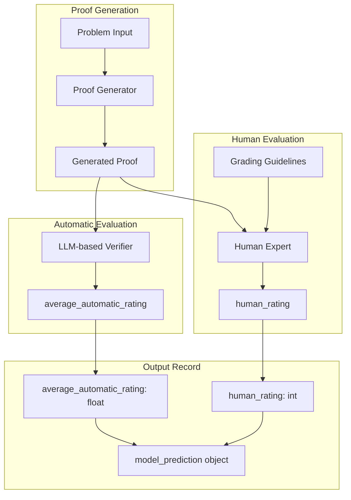
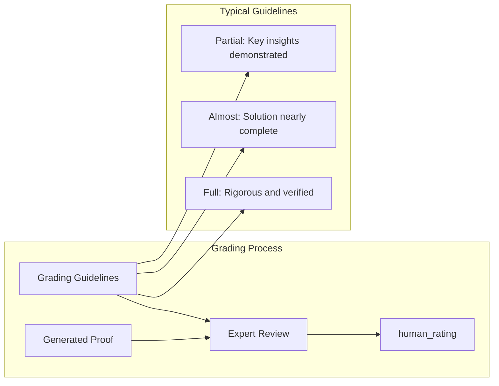
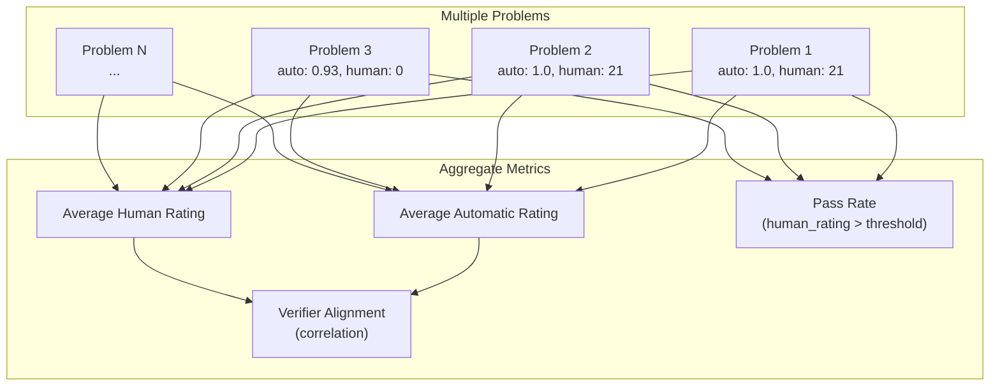

<!-- source: DeepWiki mcp.deepwiki.com · repo deepseek-ai/DeepSeek-Math-V2 · page 4.3 Evaluation Metrics · fetched 2026-10-30 -->

# Evaluation Metrics

<details>
<summary>Relevant source files</summary>

The following files were used as context for generating this wiki page:

- [outputs/CMO2024.jsonl](outputs/CMO2024.jsonl)
- [outputs/IMO-ProofBench-Basic.jsonl](outputs/IMO-ProofBench-Basic.jsonl)
- [outputs/IMO2025.jsonl](outputs/IMO2025.jsonl)
- [outputs/Putnam2024.jsonl](outputs/Putnam2024.jsonl)

</details>


This page documents the dual rating system used to evaluate mathematical proofs generated by DeepSeek-Math-V2. Each proof receives both an automatic rating from the LLM-based verifier and a human rating from expert evaluators. For information about the overall data structure containing these metrics, see [JSONL Schema](#4.1). For details about the proof content being evaluated, see [Proof Structure](#4.2).

---

## Overview of the Dual Rating System

DeepSeek-Math-V2 employs a two-tier evaluation approach where each generated proof is assessed both algorithmically and by human experts. This dual system ensures rigorous quality control and enables analysis of the generation-verification gap addressed by the model's training methodology.



**Sources:** [outputs/CMO2024.jsonl:1](), [outputs/IMO-ProofBench-Basic.jsonl:1](), [outputs/IMO2025.jsonl:1]()

---

## Automatic Rating

The `average_automatic_rating` field contains a floating-point value representing the verifier's assessment of proof quality. This rating is produced by the LLM-based Verifier component, which evaluates each step of the generated proof.

### Rating Computation

The automatic rating reflects the verifier's confidence that the proof is mathematically sound and complete. The verifier examines:

- **Logical validity** of each proof step
- **Completeness** of the argument chain
- **Rigor** of mathematical reasoning
- **Self-consistency** within the proof

### Typical Values

Based on the output data, automatic ratings typically fall in these ranges:

| Rating Range | Interpretation | Example Files |
|--------------|----------------|---------------|
| `1.0` | Perfect or near-perfect proof | Multiple entries with `1.0` |
| `0.9` - `0.99` | High-quality proof with minor issues | `0.9296875` in CMO2024 |
| `< 0.9` | Proof with significant gaps or errors | Rare in provided examples |

### Field Location

```
model_prediction {
  "proof": "...",
  "average_automatic_rating": 1.0,
  "human_rating": 21
}
```

**Sources:** [outputs/CMO2024.jsonl:1](), [outputs/IMO-ProofBench-Basic.jsonl:1](), [outputs/IMO2025.jsonl:1]()

---

## Human Rating

The `human_rating` field contains an integer score assigned by expert mathematicians after manual review of the generated proof. This provides ground truth for model performance and validates the automatic ratings.

### Rating Scale

Human ratings use an integer scale where higher values indicate better proof quality:

| Score | Meaning |
|-------|---------|
| `21` | Excellent solution (gold standard) |
| `7` | Correct and complete solution |
| `0` | Incorrect, incomplete, or failed solution |

The specific scale may vary by benchmark, but consistently uses integers to represent discrete quality levels.

### Grading Guidelines

Human evaluators follow structured grading guidelines that define assessment criteria. Examples from the data show categories such as:

**Partial Credit:**
- Correctly identified key insights
- Applied relevant techniques (e.g., AM-GM inequality)
- Made substantial progress toward solution

**Almost Complete:**
- Solution is almost correct
- Minor mistakes that are non-negligible
- Missing verification steps

**Full Credit:**
- Mathematically rigorous and complete
- All cases handled
- Solution verified



**Sources:** [outputs/IMO-ProofBench-Basic.jsonl:1]()

---

## Rating Correlation and Analysis

The dual rating system enables analysis of the generation-verification gap, a key focus of DeepSeek-Math-V2's training methodology.

### Interpreting Rating Pairs

| Automatic | Human | Interpretation |
|-----------|-------|----------------|
| High (≥0.9) | High (≥7) | Strong alignment; proof is genuinely correct |
| High | Low | Verification gap; verifier over-confident |
| Low | High | Verification gap; verifier under-confident |
| Low | Low | Agreement on poor quality |

### Examples from Data

**CMO2024 Problem 1:**
- `average_automatic_rating`: `1.0`
- `human_rating`: `21`
- **Analysis:** Perfect alignment; both systems rate proof as excellent

**CMO2024 Problem 3:**
- `average_automatic_rating`: `0.9296875`
- `human_rating`: `0`
- **Analysis:** Verification gap; automatic verifier over-estimated proof quality

**IMO-ProofBench Examples:**
- Multiple entries show `1.0` automatic and `7` human ratings
- **Analysis:** Consistent agreement on correct solutions

**Sources:** [outputs/CMO2024.jsonl:1-3](), [outputs/IMO-ProofBench-Basic.jsonl:1-6]()

---

## Metric Usage in Model Evaluation

These metrics serve multiple purposes in assessing DeepSeek-Math-V2's performance:

### Benchmark Performance

Each benchmark dataset uses these metrics to compute aggregate statistics:



### Competition-Level Results

For mathematical competitions (IMO 2025, CMO 2024, Putnam 2024):
- **Gold Medal Performance:** Requires high human ratings on multiple problems
- **Score Calculation:** Based on sum of human ratings across problems
- **Quality Assurance:** Automatic ratings help identify proofs needing review

### Verifier Training

The rating pairs provide training data for improving the verifier:
- **Hard-to-Verify Cases:** Where automatic and human ratings diverge
- **Scaled Verification Compute:** Applied to challenging proofs with low automatic confidence
- **Feedback Loop:** Human ratings refine verifier's assessment capabilities

**Sources:** [outputs/CMO2024.jsonl:1-5](), [outputs/IMO2025.jsonl:1-3]()

---

## Data Schema Integration

The ratings are stored within the `model_prediction` object in the JSONL output format:

```json
{
  "question": "...",
  "problem_idx": "CMO2024-1",
  "model_prediction": {
    "proof": "**Step-by-step solution...**",
    "average_automatic_rating": 1.0,
    "human_rating": 21
  }
}
```

### Field Specifications

| Field | Type | Range | Required |
|-------|------|-------|----------|
| `average_automatic_rating` | `float` | `[0.0, 1.0]` | Yes |
| `human_rating` | `int` | Benchmark-specific | Yes |

**Sources:** [outputs/CMO2024.jsonl:1](), [outputs/IMO-ProofBench-Basic.jsonl:1](), [outputs/Putnam2024.jsonl]()

---

## Summary

The dual rating system provides:

1. **Automatic Assessment:** Fast, scalable evaluation via LLM-based verifier (`average_automatic_rating`)
2. **Ground Truth:** Expert validation via human review (`human_rating`)
3. **Quality Control:** Cross-validation between automated and human evaluation
4. **Training Signal:** Data for improving verifier accuracy and closing the generation-verification gap

This evaluation framework ensures that DeepSeek-Math-V2 produces not just correct answers but rigorous, step-by-step mathematical proofs that meet expert standards.

**Sources:** [outputs/CMO2024.jsonl:1-5](), [outputs/IMO-ProofBench-Basic.jsonl:1-7](), [outputs/IMO2025.jsonl:1-3]()

---

