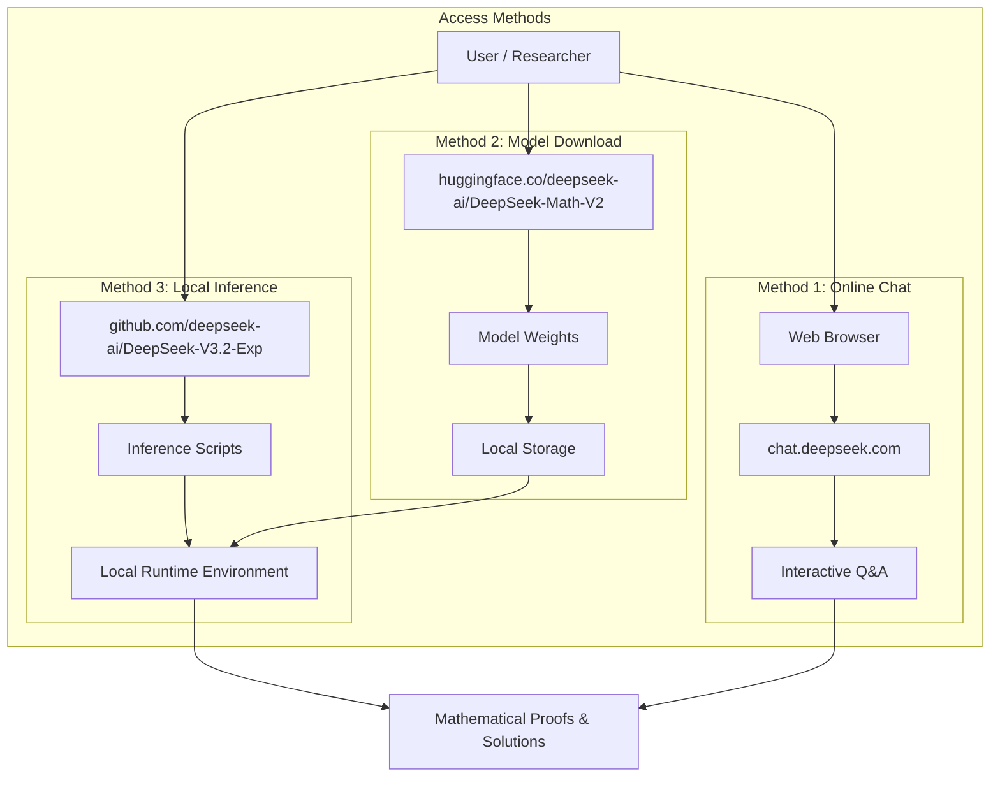
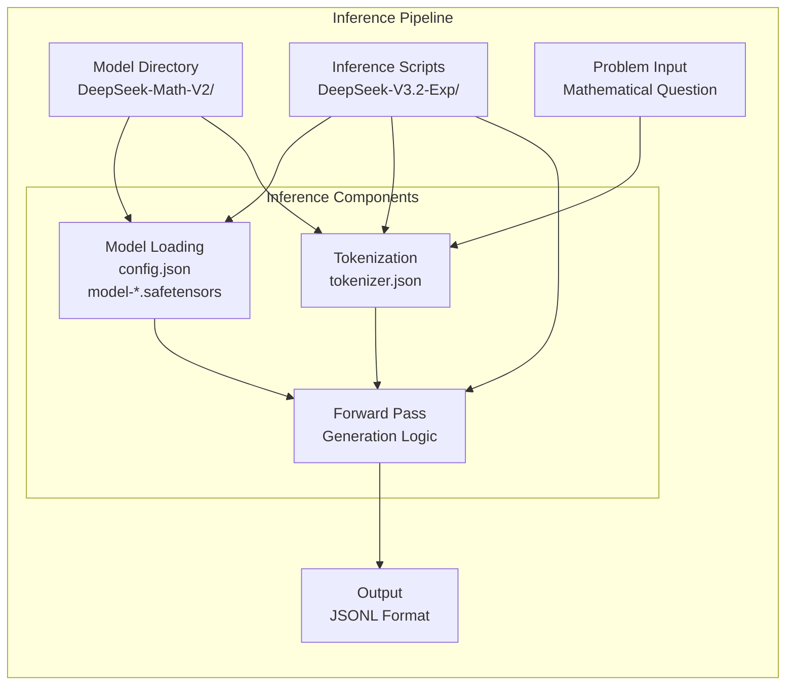

<!-- source: DeepWiki mcp.deepwiki.com · repo deepseek-ai/DeepSeek-Math-V2 · page 5 Getting Started · fetched 2026-10-30 -->

# Getting Started

<details>
<summary>Relevant source files</summary>

The following files were used as context for generating this wiki page:

- [README.md](README.md)

</details>


This page provides a practical guide for accessing and using DeepSeekMath-V2. It covers model download from Hugging Face, local inference setup using the DeepSeek-V3.2-Exp repository, and basic usage patterns for mathematical problem-solving. For technical details about the model architecture, see [Model Architecture Details](#6.2). For information about output formats and result interpretation, see [Data Formats & Outputs](#4).

**Scope**: This guide assumes basic familiarity with Python, PyTorch, and command-line tools. It focuses on getting the model running for inference, not training or fine-tuning.

---

## Access Methods Overview

DeepSeekMath-V2 can be accessed through three primary methods, each suited to different use cases.



**Access Methods Comparison**

| Method | Use Case | Requirements | Latency | Customization |
|--------|----------|--------------|---------|---------------|
| Online Chat (`chat.deepseek.com`) | Quick testing, demos | Browser only | Low | None |
| Direct Download (`deepseek-ai/DeepSeek-Math-V2`) | Research, archival | ~100GB storage | N/A | Full |
| Local Inference (`DeepSeek-V3.2-Exp`) | Production, batch processing | GPU, Python 3.8+ | Medium | Full |

**Sources**: [README.md:69-70](), [README.md:10-22]()

---

## Prerequisites

Before setting up local inference, ensure your system meets these requirements:

**Hardware Requirements**
- **GPU Memory**: Minimum 80GB VRAM (single A100/H100) or distributed setup
- **System RAM**: 128GB+ recommended
- **Storage**: 150GB+ free space for model weights and dependencies

**Software Requirements**
- Python 3.8 or higher
- PyTorch 2.0+ with CUDA support
- Git and Git LFS for repository cloning

**Python Dependencies** (installed via `DeepSeek-V3.2-Exp` repository)
- `transformers` (Hugging Face)
- `torch` (PyTorch)
- `accelerate` (for multi-GPU inference)
- Additional dependencies specified in the inference repository

**Sources**: [README.md:69-70]()

---

## Model Download from Hugging Face

The DeepSeekMath-V2 model weights are hosted on Hugging Face and must be downloaded before local inference.

### Hugging Face Model Repository

The model is located at: `https://huggingface.co/deepseek-ai/DeepSeek-Math-V2`

### Download Methods

**Method 1: Using Hugging Face CLI** (Recommended)

```bash
# Install huggingface-cli if not already installed
pip install -U "huggingface_hub[cli]"

# Download the model
huggingface-cli download deepseek-ai/DeepSeek-Math-V2 \
  --local-dir ./models/DeepSeek-Math-V2 \
  --local-dir-use-symlinks False
```

**Method 2: Using Git LFS**

```bash
# Install Git LFS
git lfs install

# Clone the repository
git clone https://huggingface.co/deepseek-ai/DeepSeek-Math-V2
```

**Method 3: Programmatic Download**

```python
from huggingface_hub import snapshot_download

model_path = snapshot_download(
    repo_id="deepseek-ai/DeepSeek-Math-V2",
    cache_dir="./models",
    local_files_only=False
)
```

### Model Files Structure

After download, the model directory contains:

```
DeepSeek-Math-V2/
├── config.json              # Model configuration
├── model-*.safetensors      # Model weight shards
├── tokenizer_config.json    # Tokenizer configuration
├── tokenizer.json           # Tokenizer vocabulary
├── special_tokens_map.json  # Special token mappings
└── README.md                # Model card documentation
```

**Sources**: [README.md:69]()

---

## Inference Setup

Local inference requires the `DeepSeek-V3.2-Exp` repository, which provides inference scripts optimized for the model architecture.



### Step 1: Clone Inference Repository

```bash
# Clone the DeepSeek-V3.2-Exp repository
git clone https://github.com/deepseek-ai/DeepSeek-V3.2-Exp.git
cd DeepSeek-V3.2-Exp
```

### Step 2: Install Dependencies

```bash
# Create virtual environment (recommended)
python -m venv venv
source venv/bin/activate  # On Windows: venv\Scripts\activate

# Install requirements
pip install -r requirements.txt
```

### Step 3: Configure Model Path

Update the inference script to point to your downloaded model:

```python
# In the inference script, set model_path:
model_path = "/path/to/models/DeepSeek-Math-V2"
```

### Step 4: Initialize Model

Basic inference initialization pattern:

```python
from transformers import AutoModelForCausalLM, AutoTokenizer

# Load model and tokenizer
model = AutoModelForCausalLM.from_pretrained(
    model_path,
    torch_dtype="auto",
    device_map="auto",
    trust_remote_code=True
)

tokenizer = AutoTokenizer.from_pretrained(
    model_path,
    trust_remote_code=True
)
```

### Single-GPU vs Multi-GPU Setup

**Single GPU (80GB+ VRAM)**
```python
device_map = "auto"  # Automatically places model on available GPU
```

**Multi-GPU (Distributed)**
```python
device_map = "balanced"  # Distributes model across GPUs
# or
device_map = {
    "layer_0": 0,
    "layer_1": 1,
    # ... manual layer distribution
}
```

**Sources**: [README.md:70]()

---

## Basic Usage Patterns

This section demonstrates typical usage patterns for mathematical problem-solving with DeepSeekMath-V2.

### Input Format

Mathematical problems should be provided as plain text strings. The model accepts natural language problem descriptions:

```python
problem = """
Find all positive integers n such that 2^n + 1 is divisible by 3.
"""
```

### Generation Parameters

Recommended parameters for mathematical reasoning:

| Parameter | Value | Purpose |
|-----------|-------|---------|
| `max_new_tokens` | 4096-8192 | Accommodate detailed proofs |
| `temperature` | 0.7-1.0 | Balance creativity and rigor |
| `top_p` | 0.95 | Nucleus sampling for quality |
| `do_sample` | True | Enable sampling for diverse solutions |
| `num_return_sequences` | 1-8 | Generate multiple solution attempts |

### Basic Inference Example

```python
def solve_math_problem(problem_text, model, tokenizer):
    """
    Generate mathematical proof for a given problem.
    
    Args:
        problem_text: String containing the mathematical problem
        model: Loaded DeepSeekMath-V2 model
        tokenizer: Corresponding tokenizer
    
    Returns:
        Generated proof as string
    """
    # Prepare input
    messages = [
        {"role": "user", "content": problem_text}
    ]
    
    # Tokenize
    inputs = tokenizer.apply_chat_template(
        messages,
        return_tensors="pt",
        add_generation_prompt=True
    ).to(model.device)
    
    # Generate
    outputs = model.generate(
        inputs,
        max_new_tokens=8192,
        temperature=0.8,
        top_p=0.95,
        do_sample=True,
        pad_token_id=tokenizer.eos_token_id
    )
    
    # Decode
    response = tokenizer.decode(
        outputs[0][inputs.shape[1]:],
        skip_special_tokens=True
    )
    
    return response
```

### Expected Output Structure

The model generates structured proofs with:

1. **Problem Restatement**: Clarifies the question
2. **Notation**: Defines variables and symbols
3. **Solution Strategy**: Outlines the approach
4. **Step-by-Step Derivation**: Detailed logical progression
5. **Verification**: Self-checks key steps
6. **Final Answer**: Explicit conclusion

Example output structure:

```
**Problem**: Find all positive integers n such that 2^n + 1 is divisible by 3.

**Solution**:

Let's analyze when 2^n + 1 ≡ 0 (mod 3).

Note that 2 ≡ -1 (mod 3), so:
2^n ≡ (-1)^n (mod 3)

Therefore:
2^n + 1 ≡ (-1)^n + 1 (mod 3)

Case 1: n is even
Then (-1)^n = 1, so 2^n + 1 ≡ 1 + 1 = 2 (mod 3) ≠ 0

Case 2: n is odd
Then (-1)^n = -1, so 2^n + 1 ≡ -1 + 1 = 0 (mod 3)

**Conclusion**: All odd positive integers n satisfy the condition.
```

**Sources**: [README.md:50]()

---

## Batch Processing

For processing multiple problems (e.g., from benchmark datasets):

```python
def batch_solve_problems(problems, model, tokenizer, output_path):
    """
    Process multiple problems and save results in JSONL format.
    
    Args:
        problems: List of problem dictionaries with 'question' and 'problem_idx'
        model: Loaded model
        tokenizer: Tokenizer
        output_path: Path to save JSONL output
    """
    import json
    
    results = []
    
    for problem in problems:
        # Generate solution
        proof = solve_math_problem(
            problem['question'],
            model,
            tokenizer
        )
        
        # Structure result
        result = {
            "problem_idx": problem['problem_idx'],
            "question": problem['question'],
            "model_prediction": {
                "proof": proof,
                "average_automatic_rating": None,  # To be computed
                "human_rating": None                # To be assigned
            }
        }
        
        results.append(result)
        
        # Save incrementally
        with open(output_path, 'a') as f:
            f.write(json.dumps(result) + '\n')
    
    return results
```

This pattern matches the output format used in `outputs/` directory for benchmark results. For details on the JSONL schema and rating systems, see [JSONL Schema](#4.1) and [Evaluation Metrics](#4.3).

**Sources**: [README.md:50]()

---

## Integration Flow

```mermaid
graph TB
    subgraph "Complete Usage Workflow"
        START["Start"]
        
        subgraph "Setup Phase"
            DL["Download Model<br/>deepseek-ai/DeepSeek-Math-V2"]
            CLONE["Clone Inference Repo<br/>DeepSeek-V3.2-Exp"]
            INSTALL["Install Dependencies<br/>pip install -r requirements.txt"]
        end
        
        subgraph "Initialization Phase"
            LOAD_MODEL["Load Model<br/>AutoModelForCausalLM.from_pretrained()"]
            LOAD_TOK["Load Tokenizer<br/>AutoTokenizer.from_pretrained()"]
            CONFIG["Configure Parameters<br/>max_tokens, temperature, etc."]
        end
        
        subgraph "Inference Phase"
            INPUT_PREP["Prepare Input<br/>Problem text + formatting"]
            TOKENIZE["Tokenize<br/>tokenizer.apply_chat_template()"]
            GENERATE["Generate<br/>model.generate()"]
            DECODE["Decode Output<br/>tokenizer.decode()"]
        end
        
        subgraph "Output Phase"
            STRUCT["Structure Result<br/>JSONL format"]
            SAVE["Save Output<br/>outputs/*.jsonl"]
            VERIFY["Optional: Verify<br/>Check proof validity"]
        end
        
        END["End"]
    end
    
    START --> DL
    DL --> CLONE
    CLONE --> INSTALL
    INSTALL --> LOAD_MODEL
    LOAD_MODEL --> LOAD_TOK
    LOAD_TOK --> CONFIG
    
    CONFIG --> INPUT_PREP
    INPUT_PREP --> TOKENIZE
    TOKENIZE --> GENERATE
    GENERATE --> DECODE
    
    DECODE --> STRUCT
    STRUCT --> SAVE
    SAVE --> VERIFY
    VERIFY --> END
```



**Sources**: [README.md:69-70]()

---

## Memory Optimization

For systems with limited GPU memory, use these strategies:

### Quantization

```python
from transformers import BitsAndBytesConfig

# 8-bit quantization (reduces memory by ~50%)
quantization_config = BitsAndBytesConfig(
    load_in_8bit=True,
    llm_int8_threshold=6.0
)

model = AutoModelForCausalLM.from_pretrained(
    model_path,
    quantization_config=quantization_config,
    device_map="auto"
)
```

### Gradient Checkpointing

```python
model.gradient_checkpointing_enable()  # Reduces memory during generation
```

### Batch Size Adjustment

```python
# Process one problem at a time for inference
batch_size = 1  

# For multiple solutions, generate sequentially
for _ in range(num_solutions):
    output = model.generate(inputs, ...)
```

**Sources**: [README.md:69-70]()

---

## Verification and Quality Checks

After generation, verify output quality:

### Automatic Checks

```python
def verify_proof_structure(proof_text):
    """
    Perform basic structural validation on generated proof.
    
    Returns:
        Dict with validation results
    """
    checks = {
        "has_conclusion": "conclusion" in proof_text.lower() or 
                          "therefore" in proof_text.lower(),
        "has_notation": "let" in proof_text.lower() or 
                        "define" in proof_text.lower(),
        "has_cases": "case" in proof_text.lower(),
        "length_adequate": len(proof_text.split()) > 50,
        "has_equations": any(char in proof_text for char in "=≡≤≥")
    }
    
    return checks
```

### Manual Verification Criteria

For human evaluation (see [Evaluation Metrics](#4.3)):

1. **Correctness**: Each step follows logically
2. **Completeness**: All cases covered
3. **Rigor**: No unjustified leaps
4. **Clarity**: Easy to follow reasoning

**Sources**: [README.md:50]()

---

## Troubleshooting

### Common Issues and Solutions

| Issue | Possible Cause | Solution |
|-------|----------------|----------|
| Out of memory (OOM) | Model too large for GPU | Use quantization or multi-GPU setup |
| Generation hangs | Infinite loop in generation | Set `max_new_tokens` explicitly |
| Poor quality output | Temperature too high/low | Adjust to 0.7-1.0 range |
| Tokenization error | Wrong tokenizer version | Use tokenizer from same repo as model |
| Model not found | Incorrect path | Verify path to `DeepSeek-Math-V2/` |

### Debugging Tips

```python
# Enable detailed logging
import logging
logging.basicConfig(level=logging.DEBUG)

# Check model device placement
print(model.hf_device_map)

# Verify tokenizer special tokens
print(tokenizer.special_tokens_map)

# Monitor generation progress
outputs = model.generate(
    inputs,
    output_scores=True,
    return_dict_in_generate=True
)
```

**Sources**: [README.md:70]()

---

## Next Steps

After successfully setting up inference:

1. **Explore Examples**: See [Example Usage](#5.3) for detailed problem-solving patterns
2. **Understand Output Format**: Review [Data Formats & Outputs](#4) to interpret results
3. **Evaluate Performance**: Learn about benchmarks in [Evaluation & Results](#3)
4. **Deep Dive**: For architectural details, see [Technical Deep Dive](#6)

For community support and discussions:
- **Discord**: Join at `https://discord.gg/Tc7c45Zzu5`
- **WeChat**: Scan QR code in [README.md:19]()
- **Email**: Contact `service@deepseek.com` for technical issues

**Sources**: [README.md:10-28](), [README.md:85-87]()

---

