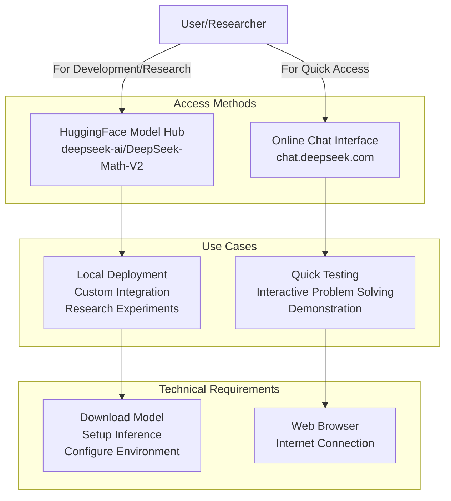
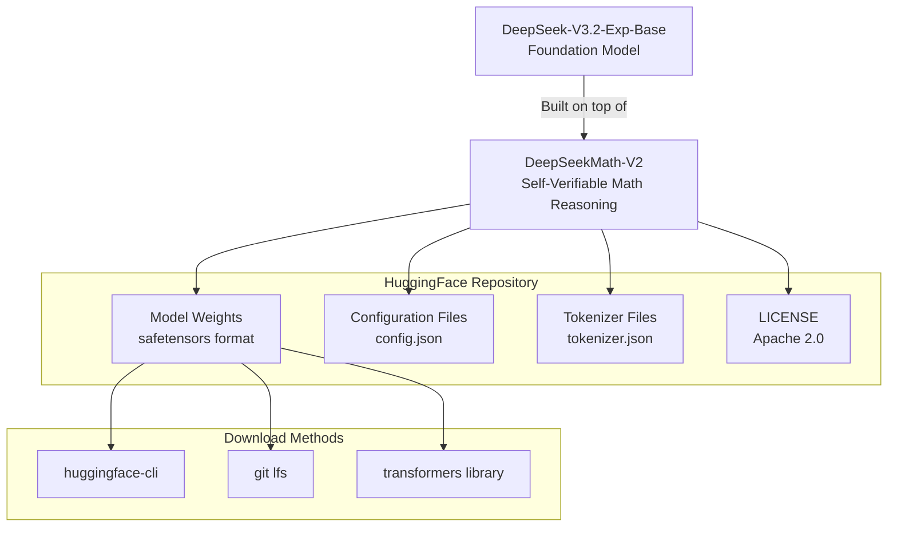
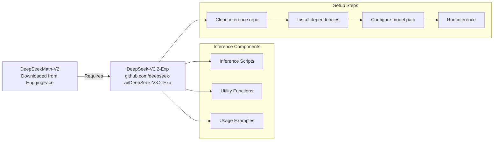
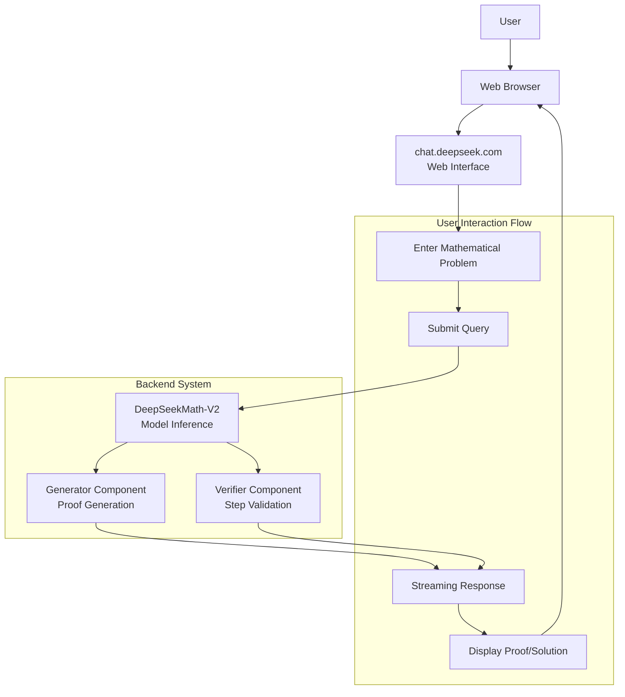
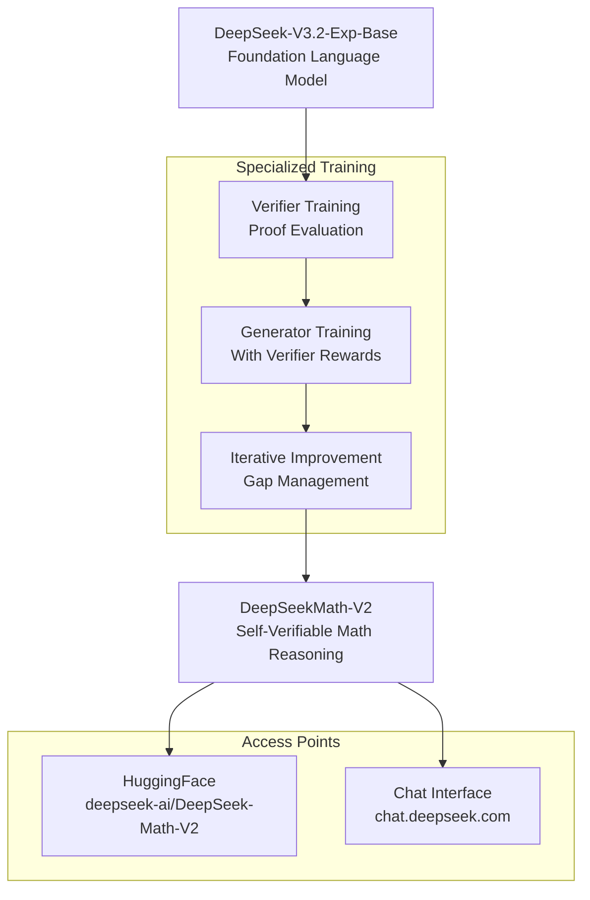
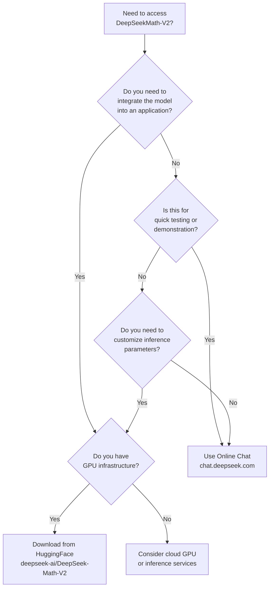

<!-- source: DeepWiki mcp.deepwiki.com · repo deepseek-ai/DeepSeek-Math-V2 · page 5.1 Model Access · fetched 2026-10-30 -->

# Model Access

<details>
<summary>Relevant source files</summary>

The following files were used as context for generating this wiki page:

- [README.md](README.md)

</details>


This page explains how to obtain and access DeepSeekMath-V2 for use. It covers the two primary access methods: downloading the model from Hugging Face for local or cloud deployment, and using the online chat interface for immediate interactive access. For instructions on setting up local inference after downloading the model, see [Inference Setup](#5.2). For usage examples, see [Example Usage](#5.3).

## Overview

DeepSeekMath-V2 provides two distinct access pathways depending on your use case and technical requirements:



**Sources:** [README.md:67-70]()

## Access Methods Comparison

The following table summarizes the key differences between the two access methods:

| Feature | HuggingFace Download | Online Chat Interface |
|---------|---------------------|----------------------|
| **URL** | `huggingface.co/deepseek-ai/DeepSeek-Math-V2` | `chat.deepseek.com` |
| **Setup Time** | Hours (download + environment setup) | Immediate |
| **Hardware Requirements** | High-end GPU infrastructure | None (browser only) |
| **Customization** | Full control over inference parameters | Limited to chat interface |
| **Best For** | Research, production deployment, custom integrations | Quick testing, demonstrations, learning |
| **Cost** | Infrastructure costs | Free at point of use |
| **Offline Use** | Yes, after download | No, requires internet |

**Sources:** [README.md:67-70]()

## HuggingFace Model Download

### Repository Location

DeepSeekMath-V2 is hosted on the Hugging Face Model Hub at the following location:

```
https://huggingface.co/deepseek-ai/DeepSeek-Math-V2
```

This repository contains the complete model weights, configuration files, and metadata required for deployment.

**Sources:** [README.md:69]()

### Model Architecture



**Sources:** [README.md:69]()

### Download Methods

Three primary methods are available for downloading the model from HuggingFace:

#### Method 1: Using Hugging Face CLI

```bash
# Install huggingface-cli if not already installed
pip install huggingface-hub

# Download the model
huggingface-cli download deepseek-ai/DeepSeek-Math-V2
```

#### Method 2: Using Git LFS

```bash
# Install git-lfs if not already installed
git lfs install

# Clone the repository
git clone https://huggingface.co/deepseek-ai/DeepSeek-Math-V2
```

#### Method 3: Using Python Transformers Library

```python
from transformers import AutoModelForCausalLM, AutoTokenizer

# This will automatically download and cache the model
model = AutoModelForCausalLM.from_pretrained(
    "deepseek-ai/DeepSeek-Math-V2",
    trust_remote_code=True
)
tokenizer = AutoTokenizer.from_pretrained(
    "deepseek-ai/DeepSeek-Math-V2",
    trust_remote_code=True
)
```

**Sources:** [README.md:69-70]()

### Model Size and Storage Requirements

Due to the model being built on top of DeepSeek-V3.2-Exp-Base, users should anticipate significant storage and memory requirements:

| Component | Estimated Size |
|-----------|----------------|
| Model Weights | Multiple GB (varies by precision) |
| Configuration Files | < 1 MB |
| Tokenizer Files | < 10 MB |
| **Total Storage** | Plan for adequate GB capacity |

> **Note:** The exact size depends on the precision format (FP16, FP32, quantized variants) available in the repository.

**Sources:** [README.md:69]()

### Inference Support

After downloading the model, inference capabilities are provided through the DeepSeek-V3.2-Exp inference repository:



**Sources:** [README.md:70]()

The DeepSeek-V3.2-Exp GitHub repository provides:
- Optimized inference implementations
- Distributed inference support for large-scale deployments
- Example scripts for common use cases
- Configuration templates

Reference URL: `https://github.com/deepseek-ai/DeepSeek-V3.2-Exp`

For detailed setup instructions, see [Inference Setup](#5.2).

**Sources:** [README.md:70]()

## Online Chat Interface

### Access Location

The online chat interface is available at:

```
https://chat.deepseek.com
```

This web-based interface provides immediate access to DeepSeekMath-V2 capabilities without requiring local setup or computational resources.

**Sources:** [README.md:12-13]()

### Interface Features

The chat interface provides:

1. **Interactive Problem Solving**: Submit mathematical problems and receive step-by-step proofs
2. **Real-time Response Generation**: Stream responses as they are generated
3. **Conversation History**: Maintain context across multiple problem-solving sessions
4. **No Authentication Required**: Access without account creation (subject to rate limits)



**Sources:** [README.md:12-13]()

### Usage Constraints

Users should be aware of the following constraints when using the online chat interface:

| Constraint Type | Description |
|----------------|-------------|
| **Rate Limiting** | Queries may be subject to rate limits during high-traffic periods |
| **Session Length** | Extended conversations may have token limits |
| **Availability** | Service availability depends on backend infrastructure |
| **Data Privacy** | Queries are processed on DeepSeek servers |
| **Customization** | Limited inference parameter control compared to local deployment |

**Sources:** [README.md:12-13]()

## Model Foundation and Dependencies

### Base Model Relationship

DeepSeekMath-V2 is not a standalone model but is built on top of the DeepSeek-V3.2-Exp-Base foundation model:



**Sources:** [README.md:69]()

This means:
- DeepSeekMath-V2 inherits the general language understanding capabilities of DeepSeek-V3.2-Exp-Base
- Additional training specializes the model for mathematical reasoning and self-verification
- The model retains the architectural properties of the base model

**Sources:** [README.md:69]()

## Licensing and Legal Requirements

### License Type

DeepSeekMath-V2 is licensed under the Apache License 2.0. The license file is located at:

```
LICENSE
```

in the repository root.

**Sources:** [README.md:73]()

### License Terms Summary

| Aspect | Terms |
|--------|-------|
| **Usage** | Commercial and non-commercial use permitted |
| **Modification** | Modifications allowed |
| **Distribution** | Redistribution allowed with proper attribution |
| **Patent Rights** | Grant of patent rights included |
| **Warranty** | Provided "AS IS" without warranty |

> **Important:** Users must review the complete license terms in the [LICENSE](LICENSE) file before deployment. Certain restrictions may apply to the model's use.

For complete legal details, see [License & Legal](#7.1).

**Sources:** [README.md:73]()

## Access Method Decision Tree

Use this decision tree to determine which access method is appropriate for your use case:



**Sources:** [README.md:67-70]()

## Additional Resources

The following resources are available through the DeepSeek ecosystem:

| Resource | URL/Location | Purpose |
|----------|--------------|---------|
| **Main Website** | `www.deepseek.com` | Documentation and announcements |
| **HuggingFace Organization** | `huggingface.co/deepseek-ai` | All DeepSeek models |
| **Inference Repository** | `github.com/deepseek-ai/DeepSeek-V3.2-Exp` | Inference implementation |
| **Discord Community** | Discord invite link in README | Community discussion |
| **WeChat Group** | QR code in repository | Chinese language community |
| **Twitter/X** | `@deepseek_ai` | Updates and announcements |
| **Email Support** | `service@deepseek.com` | Direct support contact |

**Sources:** [README.md:10-22](), [README.md:87]()

For community and support channels, see [Community & Support](#7.3).

---

**Next Steps:**
- After obtaining model access, proceed to [Inference Setup](#5.2) for local deployment instructions
- For immediate usage examples, see [Example Usage](#5.3)
- To understand the model's capabilities, review [System Architecture](#2)

---

