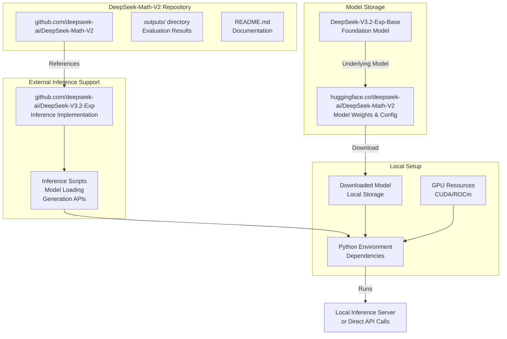
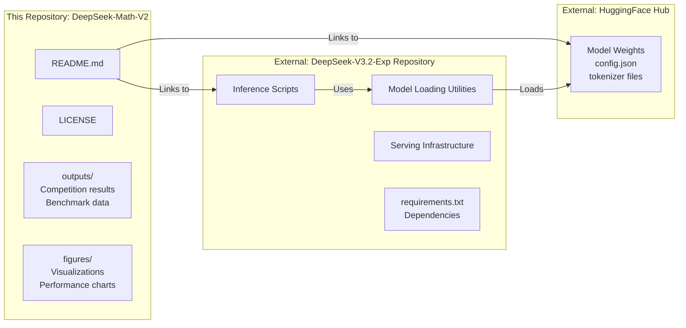
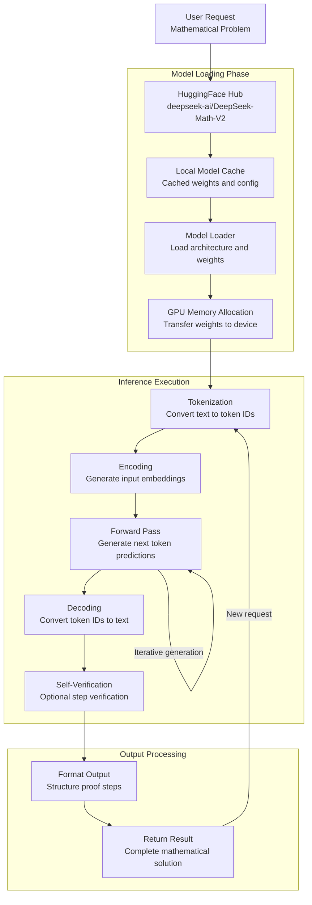
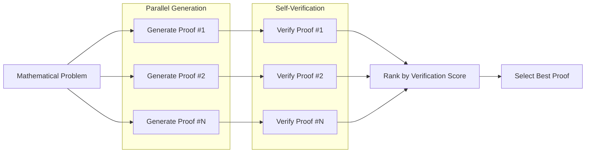
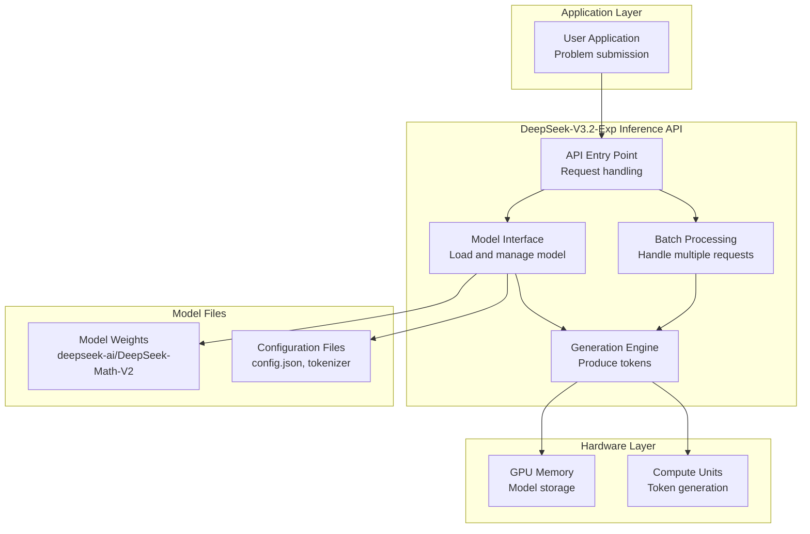

<!-- source: DeepWiki mcp.deepwiki.com · repo deepseek-ai/DeepSeek-Math-V2 · page 5.2 Inference Setup · fetched 2026-10-30 -->

# Inference Setup

<details>
<summary>Relevant source files</summary>

The following files were used as context for generating this wiki page:

- [README.md](README.md)

</details>


## Purpose and Scope

This document provides technical guidance for setting up local inference with DeepSeekMath-V2. It covers the dependencies, external repository requirements, and configuration needed to run the model locally for mathematical problem-solving tasks.

For information about downloading the model files and accessing the online interface, see [Model Access](#5.1). For practical examples of using the model, see [Example Usage](#5.3).

**Sources:** [README.md:69-70]()

---

## Overview

DeepSeekMath-V2 does not include inference code in its repository. Instead, inference support is provided through the external **DeepSeek-V3.2-Exp** repository, which contains the necessary runtime, optimization, and serving infrastructure for the underlying foundation model.



**Diagram:** Inference Setup Dependencies and Architecture

**Sources:** [README.md:69-70]()

---

## Key Components

### Foundation Model Architecture

DeepSeekMath-V2 is built on top of the **DeepSeek-V3.2-Exp-Base** foundation model. This architecture choice has several implications for inference setup:

| Component | Description | Inference Impact |
|-----------|-------------|------------------|
| **Base Model** | DeepSeek-V3.2-Exp-Base | Requires inference infrastructure compatible with this architecture |
| **Model Weights** | Available at `deepseek-ai/DeepSeek-Math-V2` on HuggingFace | Downloaded separately from inference code |
| **Inference Engine** | Provided by `DeepSeek-V3.2-Exp` repository | Must be cloned and configured independently |
| **Specialization** | Mathematical reasoning and self-verification | Uses same inference pipeline as base model |

**Sources:** [README.md:69-70]()

### Repository Structure



**Diagram:** Repository Component Relationships

**Sources:** [README.md:1-88]()

---

## Setup Steps

### Step 1: Prerequisites

Before setting up inference, ensure the following prerequisites are met:

**System Requirements:**
- **Python**: 3.8 or higher recommended
- **GPU**: NVIDIA GPU with CUDA support (or AMD GPU with ROCm) for efficient inference
- **Memory**: Sufficient RAM and VRAM to load the model (varies by quantization and serving mode)
- **Storage**: Adequate disk space for model weights (typically 10-100+ GB depending on precision)

**Software Dependencies:**
- Git for cloning repositories
- CUDA toolkit (if using NVIDIA GPUs)
- Python package manager (pip or conda)

### Step 2: Clone the Inference Repository

The inference implementation is maintained in a separate repository that must be cloned:

```bash
# Clone the DeepSeek-V3.2-Exp inference repository
git clone https://github.com/deepseek-ai/DeepSeek-V3.2-Exp.git
cd DeepSeek-V3.2-Exp
```

This repository contains:
- Model loading utilities compatible with DeepSeek-V3.2-Exp-Base architecture
- Inference scripts and serving tools
- Configuration files for different deployment scenarios
- Documentation specific to inference operations

**Sources:** [README.md:70]()

### Step 3: Install Dependencies

Install required Python packages from the inference repository:

```bash
# Install dependencies from the inference repository
pip install -r requirements.txt

# Additional packages may be needed depending on deployment mode:
# - transformers (HuggingFace model loading)
# - torch (PyTorch framework)
# - accelerate (multi-GPU support)
# - vllm (optional, for optimized serving)
```

### Step 4: Download Model Weights

Download the DeepSeekMath-V2 model from HuggingFace Hub:

```bash
# Using HuggingFace CLI
huggingface-cli download deepseek-ai/DeepSeek-Math-V2 --local-dir ./models/DeepSeek-Math-V2

# Or using Python API
from huggingface_hub import snapshot_download
snapshot_download(
    repo_id="deepseek-ai/DeepSeek-Math-V2",
    local_dir="./models/DeepSeek-Math-V2"
)
```

The download includes:
- Model weight files (safetensors or pytorch_model.bin format)
- `config.json` with model architecture parameters
- Tokenizer files (`tokenizer.json`, `tokenizer_config.json`)
- `generation_config.json` for default generation parameters

**Sources:** [README.md:69]()

---

## Inference Workflow

The following diagram illustrates the complete inference workflow from model loading to output generation:



**Diagram:** End-to-End Inference Workflow

**Sources:** [README.md:30-45]()

---

## Configuration Options

### Generation Parameters

When performing inference with DeepSeekMath-V2, several generation parameters affect the quality and characteristics of mathematical proofs:

| Parameter | Description | Typical Values | Impact on Math Reasoning |
|-----------|-------------|----------------|--------------------------|
| `temperature` | Controls randomness in sampling | 0.6-0.8 | Higher values increase exploration of solution paths |
| `top_p` | Nucleus sampling threshold | 0.9-0.95 | Controls diversity of reasoning steps |
| `max_tokens` | Maximum generation length | 4096-8192 | Must be sufficient for complete proofs |
| `repetition_penalty` | Penalizes repeated tokens | 1.0-1.1 | Helps avoid circular reasoning |
| `num_return_sequences` | Number of solutions to generate | 1-64 | Enables test-time compute scaling |

### Test-Time Compute Scaling

For challenging problems, DeepSeekMath-V2 benefits from test-time compute scaling:



**Diagram:** Test-Time Compute Scaling Strategy

**Sources:** [README.md:44]()

### Hardware Optimization

Recommended configurations based on deployment scenario:

**Single-GPU Inference:**
- Load model with appropriate precision (FP16, BF16, or INT8)
- Use memory-efficient attention implementations
- Enable KV cache for faster generation

**Multi-GPU Inference:**
- Model parallelism: Split model across multiple GPUs
- Pipeline parallelism: Distribute layers across devices
- Tensor parallelism: Split individual layers

**CPU-Only Inference:**
- Not recommended for production use due to slow generation
- Requires model quantization for feasible memory usage
- Expect significantly longer inference times

---

## Integration Points

### Inference Repository API

The DeepSeek-V3.2-Exp repository provides the following integration points:



**Diagram:** Inference Repository API Architecture

**Sources:** [README.md:70]()

---

## Performance Considerations

### Memory Requirements

The model's memory footprint varies based on precision and serving configuration:

| Precision | Model Size (Approx) | Memory Usage | Inference Speed |
|-----------|---------------------|--------------|-----------------|
| FP32 | ~4x parameters | Very High | Baseline |
| FP16/BF16 | ~2x parameters | High | Fast |
| INT8 | ~1x parameters | Medium | Very Fast |
| INT4 | ~0.5x parameters | Low | Fastest (some quality loss) |

### Latency Optimization

For production deployments, consider:

- **KV Cache**: Store attention keys/values to avoid recomputation
- **Batch Size**: Balance throughput vs. latency based on use case
- **Speculative Decoding**: Use smaller draft model for faster generation
- **Quantization**: Reduce precision without significant quality loss

### Mathematical Problem-Specific Optimizations

DeepSeekMath-V2's self-verification capability can be leveraged:

1. **Generate multiple candidate solutions** using different sampling parameters
2. **Apply the verifier component** to score each solution
3. **Select the highest-scoring proof** based on verification confidence
4. **Iterate if needed** for particularly challenging problems

**Sources:** [README.md:30-45]()

---

## Deployment Modes

### Local Development

For research and development:

```bash
# Load model in Python for interactive use
python -m deepseek_inference.cli \
    --model-path ./models/DeepSeek-Math-V2 \
    --device cuda:0 \
    --precision fp16
```

### Serving Infrastructure

For production deployments, the inference repository may support:

- **REST API**: HTTP endpoints for remote inference
- **gRPC**: High-performance RPC for low-latency applications
- **Batch Processing**: Queue-based processing for high throughput
- **Load Balancing**: Distribute requests across multiple GPU instances

### Online Chat Interface

Users can also access the model through the hosted interface at `chat.deepseek.com` without local setup, though this does not provide the same level of control over inference parameters.

**Sources:** [README.md:13]()

---

## Troubleshooting

### Common Issues

**Issue: Out of Memory (OOM) Errors**
- Solution: Reduce batch size, use lower precision (INT8/INT4), or use model parallelism

**Issue: Slow Generation Speed**
- Solution: Enable KV cache, use GPU instead of CPU, optimize batch size

**Issue: Model Loading Failures**
- Solution: Verify model files are complete, check disk space, ensure correct PyTorch version

**Issue: Incorrect Outputs**
- Solution: Check tokenizer configuration, verify generation parameters, ensure proper prompt formatting

### Best Practices

1. **Always test with small examples first** before processing large batches
2. **Monitor GPU memory usage** to prevent OOM crashes
3. **Save generation configurations** for reproducible results
4. **Validate model outputs** using the verification component when available
5. **Keep the inference repository updated** to benefit from performance improvements

---

## Next Steps

After completing the inference setup:

1. **Test basic functionality** with simple mathematical problems
2. **Explore generation parameters** to optimize for your use case
3. **Review example usage patterns** in [Example Usage](#5.3)
4. **Examine output data formats** in [Data Formats & Outputs](#4)
5. **Study evaluation results** to understand model capabilities in [Evaluation & Results](#3)

For questions or issues with inference setup, refer to the external DeepSeek-V3.2-Exp repository documentation or contact [service@deepseek.com](mailto:service@deepseek.com).

**Sources:** [README.md:70](), [README.md:87]()

---

