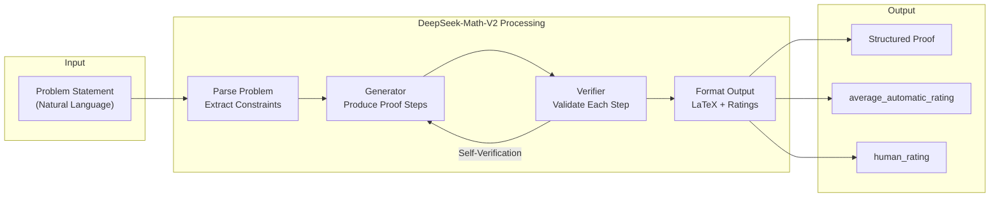
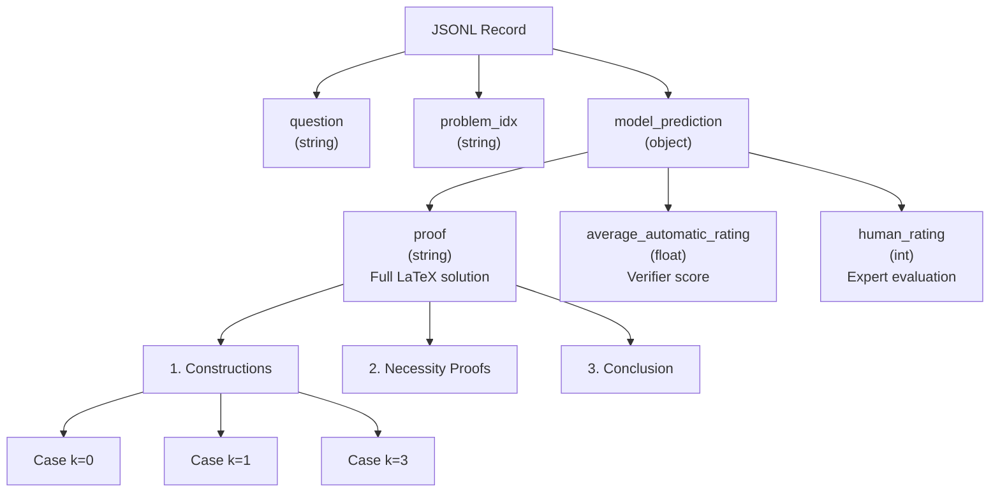
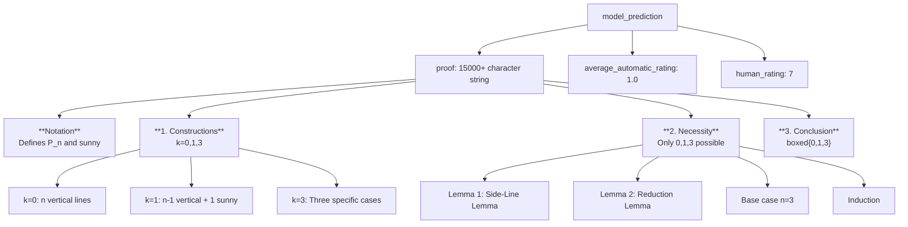
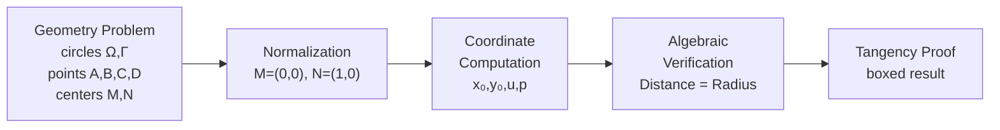
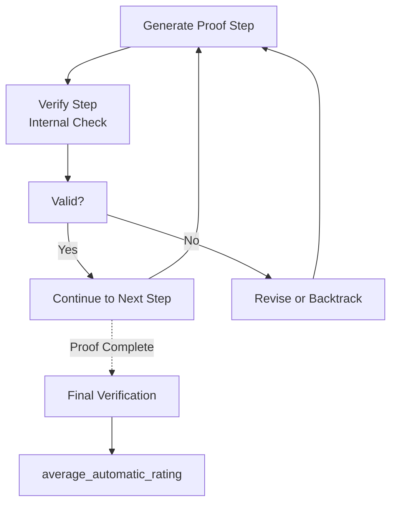

<!-- source: DeepWiki mcp.deepwiki.com · repo deepseek-ai/DeepSeek-Math-V2 · page 5.3 Example Usage · fetched 2026-10-30 -->

# Example Usage

<details>
<summary>Relevant source files</summary>

The following files were used as context for generating this wiki page:

- [README.md](README.md)
- [outputs/IMO2025.jsonl](outputs/IMO2025.jsonl)

</details>


This page provides concrete examples of using DeepSeek-Math-V2 for mathematical problem-solving, including input formats, output structures, and interpretation guidelines. For model download and access information, see [Model Access](#5.1). For setting up local inference, see [Inference Setup](#5.2).

---

## Overview

DeepSeek-Math-V2 takes mathematical problems as text input and produces detailed step-by-step proofs with automatic quality ratings. The system is designed for rigorous mathematical reasoning across multiple domains including number theory, geometry, combinatorics, algebra, and formal theorem proving.

**Key Characteristics:**
- Input: Natural language mathematical problem statements
- Output: Structured proofs with LaTeX formatting and quality metrics
- Supported formats: Competition problems, theorem proving tasks, formal verification
- Self-verifiable: Each proof includes verification signals from the built-in verifier

Sources: [README.md:30-45](), [outputs/IMO2025.jsonl:1-7]()

---

## Input-Output Flow



**Diagram: End-to-End Usage Flow**

Sources: [README.md:30-45](), [outputs/IMO2025.jsonl:1]()

---

## Input Format

### Problem Statement Structure

Mathematical problems are provided as plain text strings with LaTeX formatting for mathematical notation. The input should be clear, self-contained, and specify all constraints.

**Example Input:**
```
A line in the plane is called \emph{sunny} if it is not parallel to any of the 
$x$-axis, the $y$-axis, or the line $x + y = 0$.

Let $n \geq 3$ be a given integer. Determine all nonnegative integers $k$ such 
that there exist $n$ distinct lines in the plane satisfying both of the following:
\begin{itemize}
    \item for all positive integers $a$ and $b$ with $a + b \leq n + 1$, 
          the point $(a, b)$ lies on at least one of the lines; and
    \item exactly $k$ of the $n$ lines are sunny.
\end{itemize}
```

**Key Elements:**
- **Definitions**: New terms are defined explicitly (e.g., "sunny" lines)
- **Constraints**: All conditions are stated clearly (e.g., $n \geq 3$)
- **Question**: The specific task is unambiguous (e.g., "Determine all...")
- **LaTeX**: Mathematical symbols use standard LaTeX commands

Sources: [outputs/IMO2025.jsonl:1]()

### Problem Metadata

When using the JSONL format from the outputs directory, each problem includes:

| Field | Type | Description |
|-------|------|-------------|
| `question` | string | The problem statement with LaTeX formatting |
| `problem_idx` | string | Unique identifier (e.g., "IMO2025-1") |
| `model_prediction` | object | Contains proof and ratings |

Sources: [outputs/IMO2025.jsonl:1]()

---

## Output Format

### JSONL Schema



**Diagram: Output Data Structure**

Sources: [outputs/IMO2025.jsonl:1]()

### Proof Structure Components

The `proof` field contains a complete, self-contained mathematical argument structured as follows:

**1. Notation Section**
- Defines all symbols and conventions used
- Establishes coordinate systems or frameworks
- Example: `**Notation.** For an integer $n\ge 3$ set $P_n=\{(a,b)\in\mathbb Z_{>0}^{2}\mid a+b\le n+1\}$`

**2. Construction/Sufficiency**
- Explicit constructions proving achievability
- Multiple cases or subcases as needed
- Concrete examples with specific values

**3. Necessity/Impossibility**
- Proofs that certain values are impossible
- Often uses lemmas and induction
- Contradiction arguments

**4. Conclusion**
- Boxed final answer
- Summary of all possible values
- Example: `\boxed{\{0,\;1,\;3\}}`

Sources: [outputs/IMO2025.jsonl:1]()

---

## Detailed Example: IMO 2025 Problem 1

### Input

```json
{
  "question": "A line in the plane is called \\emph{sunny} if it is not parallel to any of the $x$-axis, the $y$-axis, or the line $x + y = 0$.\n\nLet $n \\geq 3$ be a given integer. Determine all nonnegative integers $k$ such that there exist $n$ distinct lines in the plane satisfying both of the following:\n\\begin{itemize}\n    \\item for all positive integers $a$ and $b$ with $a + b \\leq n + 1$, the point $(a, b)$ lies on at least one of the lines; and\n    \\item exactly $k$ of the $n$ lines are sunny.\n\\end{itemize}",
  "problem_idx": "IMO2025-1"
}
```

### Output Structure



**Diagram: Proof Component Hierarchy**

Sources: [outputs/IMO2025.jsonl:1]()

### Rating Interpretation

| Rating Field | Value | Meaning |
|--------------|-------|---------|
| `average_automatic_rating` | 1.0 | Perfect verifier score (range: 0.0-1.0) |
| `human_rating` | 7 | Expert evaluation (scale varies by benchmark) |

**Automatic Rating**: Generated by the built-in LLM-based verifier during inference. Values close to 1.0 indicate high confidence in proof correctness.

**Human Rating**: Post-hoc expert evaluation. For competition problems, this typically reflects:
- 0-3: Incomplete or incorrect
- 4-6: Partial progress
- 7-10: Complete or nearly complete solution

Sources: [outputs/IMO2025.jsonl:1]()

---

## Usage Patterns by Problem Type

### Geometry Problems (IMO 2025-2)

**Input Characteristics:**
- Circle configurations with centers and radii
- Intersection points and tangency conditions
- Orthocenter and circumcenter relationships

**Output Characteristics:**
- Coordinate system normalization
- Extensive algebraic manipulation
- Vector-based proofs



**Diagram: Geometry Problem Processing**

Sources: [outputs/IMO2025.jsonl:2]()

### Number Theory Problems (IMO 2025-3)

**Input Characteristics:**
- Functional equations over integers
- Divisibility conditions
- Finding all functions satisfying constraints

**Output Characteristics:**
- Systematic case analysis
- Construction of specific functions
- Proof of uniqueness via contradiction

**Example Pattern:**
1. **Basic Consequences**: Derive simple properties (e.g., $f(1)=1$)
2. **Value Determination**: Find $f(2)$, $f(3)$, etc.
3. **General Proof**: Extend to all positive integers
4. **Conclusion**: Characterize all solutions

Sources: [outputs/IMO2025.jsonl:3]()

### Combinatorics Problems (IMO 2025-4, 2025-6)

**Input Characteristics:**
- Sequence definitions with recursive rules
- Grid/tiling problems with constraints
- Determining possible values or optimal configurations

**Output Characteristics:**
- Explicit constructions for upper bounds
- Counting arguments for lower bounds
- Inductive proofs with multiple cases

Sources: [outputs/IMO2025.jsonl:4](), [outputs/IMO2025.jsonl:6]()

---

## LaTeX Formatting in Proofs

### Mathematical Notation

The `proof` field uses standard LaTeX commands extensively:

| Element | LaTeX Syntax | Example |
|---------|--------------|---------|
| Fractions | `\frac{a}{b}` | $\frac{13}{12}$ |
| Square roots | `\sqrt{x}` | $\sqrt{2}$ |
| Subscripts | `x_n` | $x_n$ |
| Superscripts | `a^{n}` | $a^{n}$ |
| Sets | `\{...\}` | $\{0,1,3\}$ |
| Logical symbols | `\mid`, `\ge`, `\le` | $n \mid k$, $n \ge 3$ |
| Boxed answers | `\boxed{...}` | $\boxed{4048}$ |

### Proof Structure Markers

```
**Notation.**  
Definition content...

**Lemma 1 (Name).**  
Statement and proof...

**Case 1: Condition.**  
Case analysis...

---

### Section Heading
Content...

\boxed{Final Answer}
```

Sources: [outputs/IMO2025.jsonl:1-6]()

---

## Common Output Patterns

### Pattern 1: Explicit Value Determination

```
**1. Determining possible values**
- Derive constraints from problem conditions
- Enumerate candidates (e.g., f(2) ∈ {1,2,4})
- Eliminate impossible values via contradiction

**2. Construction**
- Provide explicit construction for each valid value
- Verify all constraints are satisfied

**3. Proof of necessity**
- Show no other values are possible
- Often uses induction or infinite descent
```

### Pattern 2: Optimization Problems

```
**1. Upper bound**
- Explicit construction achieving value k
- Verify construction satisfies all constraints

**2. Lower bound**
- Prove k-1 is impossible
- Counting/pigeonhole arguments

**3. Conclusion**
- Boxed optimal value
```

### Pattern 3: Characterization Problems

```
**1. Necessary conditions**
- Derive properties any solution must have
- Narrow down possibilities

**2. Sufficiency**
- Verify each candidate works
- Construct explicit examples

**3. Complete characterization**
- Boxed set of all solutions
```

Sources: [outputs/IMO2025.jsonl:1-6]()

---

## Interpreting Verification Signals

### Self-Verification During Generation

The model performs internal verification while generating proofs:



**Diagram: Self-Verification Loop**

This loop operates during test-time compute and is invisible in the final output, but produces the `average_automatic_rating` score.

Sources: [README.md:41-43]()

### Rating Quality Indicators

**High Confidence** (`average_automatic_rating` ≥ 0.9):
- Complete logical flow
- All cases covered
- No apparent gaps

**Moderate Confidence** (0.7 ≤ `average_automatic_rating` < 0.9):
- Solution mostly complete
- Minor details may need checking
- Some steps may be terse

**Low Confidence** (`average_automatic_rating` < 0.7):
- Incomplete solution
- Possible logical gaps
- May require significant revision

Sources: [outputs/IMO2025.jsonl:1-6]()

---

## Practical Usage Tips

### 1. Problem Clarity

**Best Practice:**
- State all definitions explicitly
- Include all constraints and conditions
- Specify exactly what needs to be determined/proven

**Example:**
```
✓ "Determine all positive integers n such that n² + 1 is prime"
✗ "Find when n² + 1 is prime" (ambiguous scope)
```

### 2. LaTeX Formatting

**Best Practice:**
- Use standard LaTeX commands
- Avoid custom macros
- Test formatting in a LaTeX renderer first

### 3. Output Processing

**Best Practice:**
- Check `average_automatic_rating` first
- Review proof structure for completeness
- Verify final boxed answer matches the question

### 4. Multiple Runs

For difficult problems, consider:
- Running inference multiple times
- Comparing different generated proofs
- Using test-time compute scaling (if available)

Sources: [README.md:44](), [outputs/IMO2025.jsonl:1-6]()

---

## Reference Output Files

The `outputs/` directory contains complete example outputs for multiple benchmarks:

| File | Problems | Domain |
|------|----------|--------|
| `IMO2025.jsonl` | 6 problems | IMO 2025 competition |
| `CMO2024.jsonl` | 6 problems | Chinese Mathematical Olympiad |
| `Putnam2024.jsonl` | 12 problems | Putnam competition |
| `IMO-ProofBench-Basic.jsonl` | Various | Basic theorem proving |
| `IMO-ProofBench-Advanced.jsonl` | Various | Formal proofs with tactics |

**Usage:**
```python
import json

# Load example problems
with open('outputs/IMO2025.jsonl', 'r') as f:
    for line in f:
        example = json.loads(line)
        question = example['question']
        proof = example['model_prediction']['proof']
        rating = example['model_prediction']['average_automatic_rating']
        
        # Process or analyze
        print(f"Problem: {example['problem_idx']}")
        print(f"Rating: {rating}")
```

Sources: [outputs/IMO2025.jsonl:1-7](), [README.md:48-50]()

---

