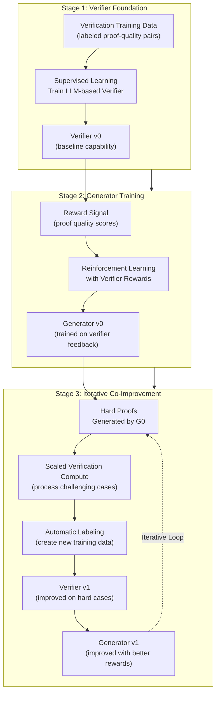
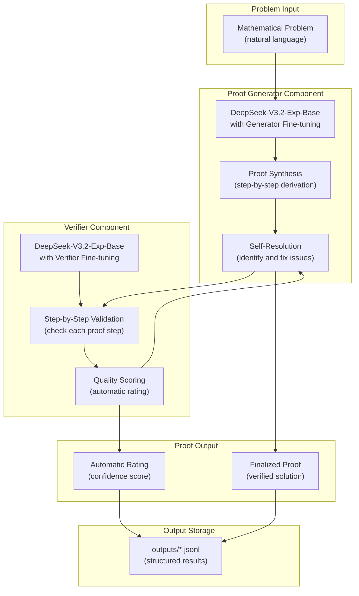
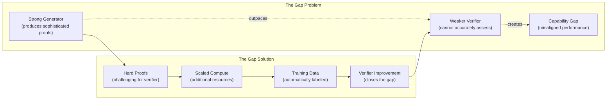
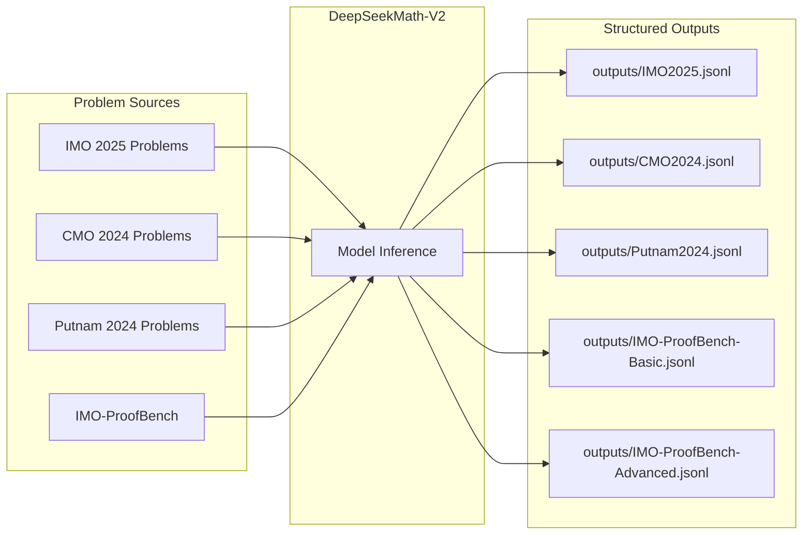

<!-- source: DeepWiki mcp.deepwiki.com · repo deepseek-ai/DeepSeek-Math-V2 · page 6 Technical Deep Dive · fetched 2026-10-30 -->

# Technical Deep Dive

Relevant source files

The following files were used as context for generating this wiki page:

- [DeepSeekMath_V2.pdf](DeepSeekMath_V2.pdf)
- [README.md](README.md)

## Purpose and Scope

This page provides detailed technical information for researchers and developers working with or building upon DeepSeekMath-V2. It covers the underlying research foundations, architectural design decisions, training methodologies, and implementation details that enable self-verifiable mathematical reasoning.

This document serves as the technical foundation for understanding how DeepSeekMath-V2 achieves gold-level performance on mathematical competitions through its verifier-generator architecture. For high-level system architecture, see [System Architecture](#2). For practical usage instructions, see [Getting Started](#5). For specific subsystem details:
- Research paper insights and findings: [Research Paper Summary](#6.1)
- Mixture-of-Experts and architectural patterns: [Model Architecture Details](#6.2)  
- Foundation model specifications: [Foundation Model](#6.3)

---

## Core Technical Approach

DeepSeekMath-V2 represents a fundamental shift from answer-focused reasoning to proof-focused reasoning. The system addresses two critical limitations of existing mathematical AI systems:

1. **Verification Gap**: Correct final answers do not guarantee correct reasoning paths
2. **Applicability Constraint**: Many mathematical tasks (theorem proving, formal proofs) require step-by-step derivation rather than numerical answers

The technical solution employs a **dual-model architecture** with an LLM-based verifier and a proof generator that engage in iterative self-improvement through scaled verification compute.

**Key Technical Innovation**: The system actively manages the generation-verification gap by scaling verification compute to automatically label hard-to-verify proofs, creating training data that allows the verifier to keep pace with generator improvements.

Sources: [README.md:30-45]()

---

## Training Methodology Architecture

The training process consists of three distinct stages that progressively build self-verification capabilities.

### Three-Stage Training Pipeline

**Stage 1: Verifier Foundation Training**

The initial verifier is trained via supervised learning on labeled proof-quality pairs. This creates a baseline capability to assess mathematical reasoning correctness.

**Stage 2: Generator Training with Verifier Rewards**

The proof generator is trained using reinforcement learning where the verifier acts as the reward model. The generator learns to:
- Produce step-by-step mathematical derivations
- Identify potential issues in its own reasoning
- Self-correct before finalizing proofs

**Stage 3: Iterative Co-Improvement Loop**

As the generator improves, it produces increasingly sophisticated proofs that may exceed the verifier's evaluation capability. The system addresses this through:

1. **Challenge Identification**: Generator produces proofs that are difficult for the verifier to assess
2. **Scaled Verification**: Additional computational resources are applied to properly evaluate challenging proofs
3. **Automatic Labeling**: Challenging proofs are automatically labeled as new training data
4. **Verifier Enhancement**: Verifier is retrained on hard cases to close the capability gap
5. **Generator Refinement**: Improved verifier provides better reward signals for further generator training

This creates a **virtuous cycle** where each component pushes the other toward higher performance.

Sources: [README.md:41-43]()

---

## Verifier-Generator Architecture

### Component Interaction Model

### Verification Loop Mechanics

The verifier and generator interact through a **self-verification loop** during proof generation:

| Phase | Generator Action | Verifier Action | Outcome |
|-------|-----------------|-----------------|---------|
| **Initial Draft** | Produces candidate proof with reasoning steps | — | Unverified proof draft |
| **Step Validation** | — | Evaluates logical validity of each step | Per-step quality scores |
| **Issue Identification** | Receives feedback on problematic steps | Highlights logical gaps, errors, or unclear reasoning | Issue localization |
| **Self-Correction** | Revises identified issues, clarifies reasoning | — | Improved proof draft |
| **Re-Verification** | — | Re-evaluates corrected steps | Updated quality scores |
| **Iteration/Finalization** | Decides to iterate or finalize based on verification scores | Provides final quality assessment | Verified proof with rating |

This loop continues until the generator determines the proof meets quality thresholds or iteration limits are reached.

Sources: [README.md:42]()

---

## Generation-Verification Gap Management

A critical technical challenge is the **generation-verification capability gap**: as the generator improves through training, it may produce proofs that exceed the verifier's ability to accurately assess.

### Gap Management Strategy

### Scaled Verification Compute

When the generator produces proofs that are difficult for the verifier to assess:

1. **Detection**: System identifies proofs where the verifier has low confidence or inconsistent evaluations
2. **Resource Allocation**: Additional computational resources are applied to these challenging cases
3. **Deep Analysis**: Multiple verification passes with increased reasoning depth
4. **Automatic Labeling**: High-confidence labels are generated for these hard cases through consensus mechanisms
5. **Dataset Augmentation**: Labeled hard cases are added to verifier training data
6. **Retraining**: Verifier is retrained to handle increasingly sophisticated proofs

This approach ensures the verifier's capability grows in tandem with the generator's, maintaining effective reward signal quality throughout training.

Sources: [README.md:43]()

---

## Technical Integration Points

### Foundation Model Integration

DeepSeekMath-V2 is built on `DeepSeek-V3.2-Exp-Base`, the foundation model that provides:
- Large-scale parameter capacity for complex mathematical reasoning
- Pre-trained knowledge of mathematical concepts and notation
- Transfer learning capabilities for specialized theorem-proving tasks

The foundation model serves as the initialization point for both the verifier and generator components, which are then fine-tuned for their specialized roles.

**Model Access**: The model is distributed via Hugging Face at `deepseek-ai/DeepSeek-Math-V2`.

**Inference Infrastructure**: The system depends on the `DeepSeek-V3.2-Exp` repository for inference support, which provides optimized serving infrastructure for the large-scale model.

Sources: [README.md:68-70]()

### Output Data Pipeline

All model outputs follow a standardized JSONL schema (detailed in [JSONL Schema](#4.1)) with the following structure:

- `question`: Original problem statement
- `problem_idx`: Unique identifier
- `model_prediction`: Object containing:
  - `proof`: Step-by-step solution with LaTeX formatting
  - `average_automatic_rating`: Verifier confidence score
  - `human_rating`: Manual quality assessment (where available)

Sources: [README.md:50]()

---

## Performance Optimization Considerations

### Test-Time Compute Scaling

DeepSeekMath-V2 employs **scaled test-time compute** for difficult problems:

- **Approach**: Allocate additional computational resources during inference for challenging problems
- **Benefit**: Enables deeper reasoning chains and more thorough self-verification
- **Result**: Gold-level performance on IMO 2025, CMO 2024, and 118/120 on Putnam 2024

The test-time compute scaling is particularly effective because the self-verification mechanism can utilize additional inference budget to:
1. Generate multiple proof candidates
2. Perform thorough verification of each candidate
3. Iteratively refine proofs based on verification feedback

Sources: [README.md:44]()

### Training Efficiency Techniques

The iterative training loop employs several efficiency optimizations:

| Technique | Purpose | Impact |
|-----------|---------|--------|
| **Automatic Labeling** | Reduce human annotation costs for hard cases | Enables continuous improvement without manual intervention |
| **Selective Retraining** | Focus verifier updates on capability gaps | Maintains training efficiency as model scales |
| **Reward Model Caching** | Cache verifier evaluations for common proof patterns | Reduces redundant computation during generator training |
| **Incremental Improvement** | Train on progressively harder cases | Builds robust capabilities without catastrophic forgetting |

Sources: [README.md:43]()

---

## Research Foundations

The technical approach of DeepSeekMath-V2 is grounded in several key research insights:

1. **Self-Verification Necessity**: For scaling test-time compute on open problems without known solutions, models must be able to verify their own reasoning.

2. **Beyond Answer Accuracy**: Correct final answers are insufficient—rigorous step-by-step derivation is essential for theorem proving and formal mathematical reasoning.

3. **Active Gap Management**: The generation-verification gap is not a problem to avoid but an opportunity to exploit for continuous improvement through scaled verification compute.

4. **Faithful Verification**: The verifier must be trained to assess comprehensive reasoning rigor, not just final answer correctness, to incentivize proper proof structure.

These foundations inform the architectural decisions and training methodologies that enable DeepSeekMath-V2's strong performance on mathematical reasoning benchmarks.

For detailed research paper findings, see [Research Paper Summary](#6.1). For architectural implementation details, see [Model Architecture Details](#6.2).

Sources: [README.md:34-45]()

---

## System Dependencies and Requirements

### External Dependencies

| Component | Purpose | Source |
|-----------|---------|--------|
| **DeepSeek-V3.2-Exp-Base** | Foundation model for verifier and generator | Hugging Face: `deepseek-ai/DeepSeek-Math-V2` |
| **DeepSeek-V3.2-Exp** | Inference infrastructure and serving | GitHub: `deepseek-ai/DeepSeek-V3.2-Exp` |
| **IMO-ProofBench** | Formal theorem proving benchmark | Google DeepMind: `google-deepmind/superhuman` |

### Computational Requirements

The system's computational profile varies significantly between training and inference:

**Training Phase**:
- Large-scale GPU clusters for foundation model fine-tuning
- Scaled verification compute for hard case labeling
- Iterative training cycles for verifier-generator co-improvement

**Inference Phase**:
- Standard large language model serving infrastructure
- Optional: Scaled test-time compute for difficult problems
- Memory requirements consistent with DeepSeek-V3.2-Exp-Base

For inference setup instructions, see [Inference Setup](#5.2).

Sources: [README.md:68-70]()

---

## Implementation Considerations

### Verifier Design Principles

The LLM-based verifier is designed with specific architectural constraints:

1. **Step-Level Granularity**: Evaluates individual proof steps rather than entire proofs
2. **Faithful Assessment**: Trained to reward rigorous reasoning, not just correct conclusions
3. **Confidence Calibration**: Provides calibrated confidence scores for reward signal quality
4. **Robustness**: Handles diverse mathematical notation and proof styles

### Generator Design Principles

The proof generator is optimized for:

1. **Self-Resolution**: Incentivized to identify and fix issues before finalization
2. **Structured Output**: Produces well-formatted proofs with clear logical flow
3. **Verification-Aware**: Understands what makes proofs verifiable by the assessment model
4. **Domain Coverage**: Handles diverse mathematical domains (geometry, number theory, combinatorics, etc.)

These design principles ensure the verifier-generator architecture works effectively in the self-verification loop.

Sources: [README.md:41-42]()

---

## Future Technical Directions

While DeepSeekMath-V2 demonstrates strong capabilities, the README acknowledges that "much work remains" [README.md:45](). Potential technical improvements include:

- **Formal Verification Integration**: Connecting to proof assistants for mechanically verified proofs
- **Multi-Step Planning**: Enhanced reasoning for problems requiring extended derivation chains
- **Cross-Domain Transfer**: Improving performance on mathematical domains with limited training data
- **Efficiency Optimization**: Reducing computational requirements while maintaining quality
- **Interactive Verification**: Supporting human-in-the-loop verification for complex proofs

These directions represent ongoing research areas in self-verifiable mathematical reasoning.

Sources: [README.md:45]()

---

