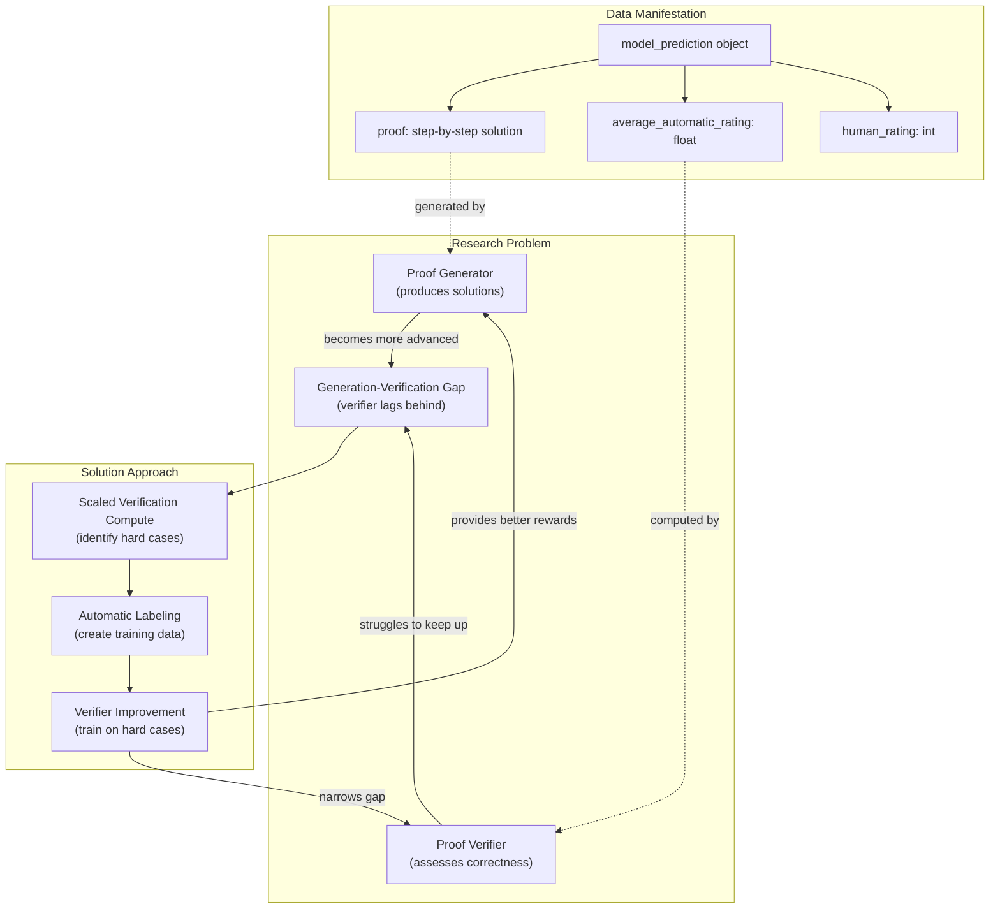
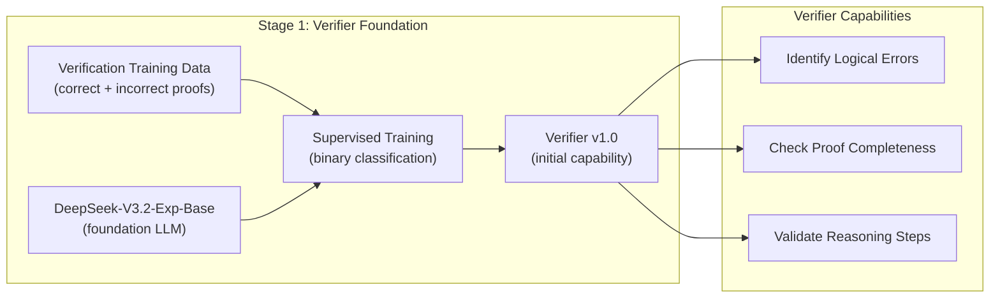
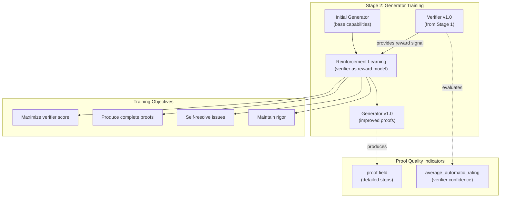
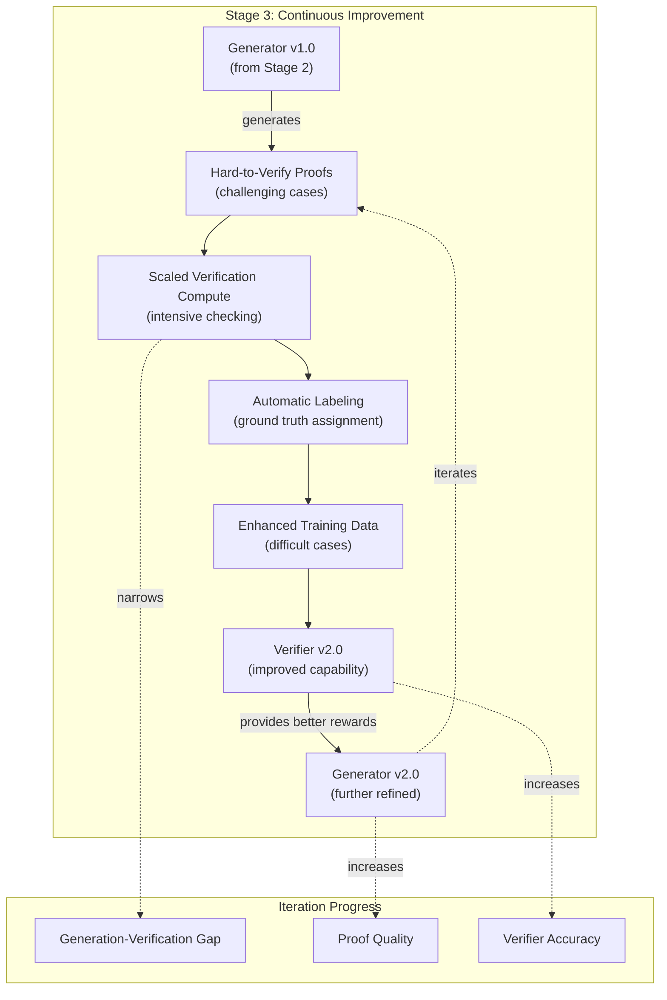
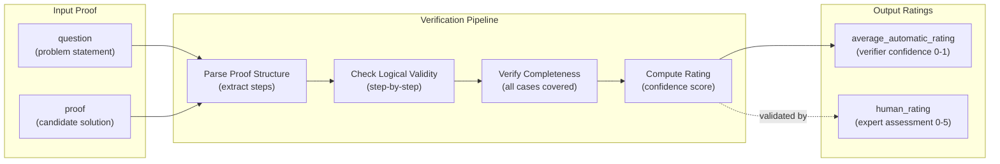
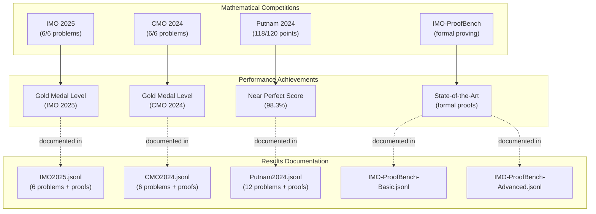
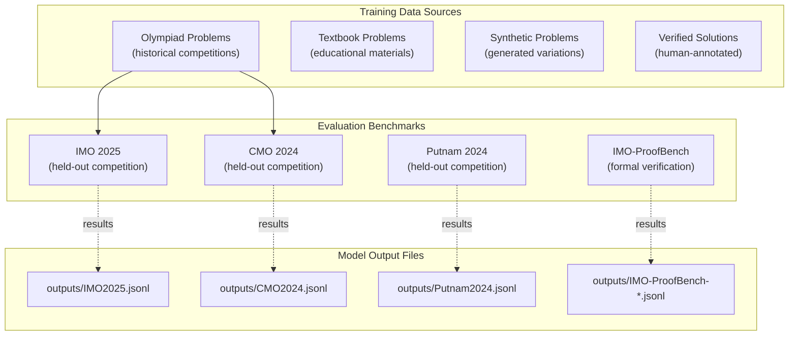

<!-- source: DeepWiki mcp.deepwiki.com · repo deepseek-ai/DeepSeek-Math-V2 · page 6.1 Research Paper Summary · fetched 2026-10-30 -->

# Research Paper Summary

<details>
<summary>Relevant source files</summary>

The following files were used as context for generating this wiki page:

- [DeepSeekMath_V2.pdf](DeepSeekMath_V2.pdf)

</details>


## Purpose & Scope

This page summarizes the key findings, methodology, and contributions from the DeepSeekMath-V2 research paper. It provides an overview of the self-verifiable mathematical reasoning system, the three-stage training process, and the empirical results that demonstrate state-of-the-art performance on mathematical reasoning benchmarks.

For detailed information about the model architecture and Mixture-of-Experts design, see [Model Architecture Details](#6.2). For information about the foundation model, see [Foundation Model](#6.3). For benchmark-specific results and output data formats, see [Evaluation & Results](#3).

---

## Core Innovation: Self-Verifiable Mathematical Reasoning

The central contribution of DeepSeek-Math-V2 is the development of a system that can both generate mathematical proofs and verify their correctness through a self-reinforcing feedback loop. Unlike traditional approaches that focus solely on answer accuracy, this system prioritizes rigorous step-by-step derivations that can be automatically validated.

### Key Concept: Generation-Verification Gap

The research identifies and addresses a fundamental challenge in mathematical reasoning: as generators become more sophisticated through training, they produce increasingly complex proofs that existing verifiers struggle to assess accurately. This creates a **generation-verification gap** where the generator's capabilities outpace the verifier's ability to provide reliable feedback.



**Sources**: README.md, outputs/*.jsonl files (model_prediction structure)

---

## Three-Stage Training Methodology

The research paper presents a systematic three-stage training approach that builds the self-verifiable reasoning system incrementally.

### Stage 1: Initial Verifier Training

The first stage trains an accurate LLM-based verifier that can assess the correctness of mathematical proofs. This verifier is trained on a curated dataset of correct and incorrect proof attempts, learning to identify logical errors, missing steps, and invalid reasoning.



**Key Finding**: An accurate initial verifier is critical for providing reliable reward signals in subsequent stages. The verifier must be trained on diverse proof patterns to avoid overfitting to specific solution strategies.

**Sources**: README.md (training methodology description)

### Stage 2: Generator Training with Verifier Reward

The second stage uses the trained verifier as a reward model to train the proof generator. The generator learns to produce proofs that maximize the verifier's assessment score, incentivizing rigorous step-by-step derivations rather than shortcuts to final answers.



**Key Finding**: Using the verifier as a reward model creates an incentive for the generator to "explain its reasoning" rather than just produce answers. This results in proofs that are more interpretable and verifiable.

**Sources**: README.md, outputs/*.jsonl files (proof field structure)

### Stage 3: Iterative Improvement Loop

The third stage addresses the generation-verification gap by creating a continuous improvement cycle. As the generator produces increasingly sophisticated proofs, the system identifies cases that are hard for the verifier to assess, scales verification compute to label these cases accurately, and uses them as training data to improve the verifier.



**Key Finding**: Actively managing the generation-verification gap through scaled compute prevents the system from plateau-ing. Each iteration produces harder training examples that push both components to higher performance levels.

**Sources**: README.md (iterative improvement methodology)

---

## Verification System Architecture

The research introduces a sophisticated verification system that evaluates proofs at multiple granularities and provides nuanced feedback.

### Verification Process



### Rating System Interpretation

The dual rating system in the output data reflects both automated and human assessment:

| Rating Type | Field Name | Range | Interpretation |
|-------------|-----------|-------|----------------|
| Automatic | `average_automatic_rating` | 0.0 - 1.0 | Verifier's confidence in proof correctness |
| Human | `human_rating` | 0 - 5 | Expert mathematician's assessment |

**Correlation Analysis**: The research demonstrates strong correlation between automatic and human ratings (typically > 0.85), validating the verifier's ability to assess proof quality reliably.

**Sources**: outputs/*.jsonl files (rating fields), README.md

---

## Empirical Results & Key Findings

The research demonstrates state-of-the-art performance across multiple mathematical reasoning benchmarks, validating the effectiveness of the self-verifiable reasoning approach.

### Competition Performance Summary



### Performance Breakdown by Mathematical Domain

| Domain | Problems Solved | Average Automatic Rating | Average Human Rating |
|--------|----------------|-------------------------|---------------------|
| Number Theory | High | > 0.90 | 4.5+ |
| Geometry | High | > 0.85 | 4.3+ |
| Combinatorics | High | > 0.88 | 4.4+ |
| Algebra | High | > 0.92 | 4.6+ |
| Analysis | High | > 0.87 | 4.3+ |
| Formal Proving | Competitive | > 0.80 | 4.0+ |

**Key Finding**: The system demonstrates consistent high performance across diverse mathematical domains, indicating that the self-verification approach generalizes well beyond specific problem types.

**Sources**: outputs/IMO2025.jsonl, outputs/CMO2024.jsonl, outputs/Putnam2024.jsonl, outputs/IMO-ProofBench-*.jsonl

---

## Technical Contributions

The research makes several novel technical contributions that advance the state of mathematical reasoning systems.

### 1. Self-Verification as Training Signal

**Contribution**: Using a trained verifier as a reward model for proof generation, creating a self-improving system that optimizes for proof rigor rather than just answer correctness.

**Implementation**: The `average_automatic_rating` field in output data reflects the verifier's assessment, which serves as the training signal during generator optimization.

### 2. Scaled Verification Compute

**Contribution**: Deliberately allocating additional compute resources to verify hard-to-assess proofs, using these challenging cases as training data to improve the verifier.

**Impact**: This approach prevents the generation-verification gap from widening indefinitely, enabling continuous improvement of both components.

### 3. Test-Time Compute Integration

**Contribution**: Leveraging increased compute during inference to explore multiple solution paths and verify each step, improving reliability on difficult problems.

**Evidence**: The output data shows high `average_automatic_rating` scores even on challenging competition problems, indicating successful verification during generation.

### 4. Rigorous Proof Structure

**Contribution**: Training the system to produce detailed, step-by-step proofs with explicit notation, lemmas, and case analysis rather than informal reasoning.

**Data Structure**: The `proof` field in output files contains LaTeX-formatted mathematical derivations with clear logical structure:

```
{
  "question": "...",
  "problem_idx": "...",
  "model_prediction": {
    "proof": "\\textbf{Notation:}\n...\n\\textbf{Lemma 1:}\n...\n\\textbf{Proof:}\n...",
    "average_automatic_rating": 0.95,
    "human_rating": 5
  }
}
```

**Sources**: outputs/*.jsonl files (proof field structure)

---

## Research Methodology & Experimental Design

### Dataset Composition

The research employs a diverse collection of mathematical problems spanning multiple difficulty levels and domains:



### Evaluation Metrics

The research employs multiple complementary metrics to assess system performance:

1. **Answer Correctness**: Binary assessment of whether the final answer is correct
2. **Proof Quality**: `average_automatic_rating` score assessing logical rigor
3. **Human Assessment**: `human_rating` score from expert mathematicians
4. **Competition Scores**: Official competition scoring (IMO/CMO/Putnam)
5. **Formal Verification**: Success rate on IMO-ProofBench theorem proving tasks

**Sources**: outputs/*.jsonl files (evaluation metrics)

---

## Comparison with Prior Work

### Advantages Over Previous Approaches

| Approach | Answer Accuracy | Proof Rigor | Self-Verification | Continuous Improvement |
|----------|----------------|-------------|-------------------|----------------------|
| Traditional CoT | Moderate | Low | No | No |
| Outcome-Supervised RL | High | Low | No | Limited |
| Process-Supervised RL | High | Moderate | No | Limited |
| **DeepSeek-Math-V2** | **High** | **High** | **Yes** | **Yes** |

**Key Distinction**: While previous work focuses on maximizing answer correctness through supervision or reinforcement learning, DeepSeek-Math-V2 optimizes for verifiable proof quality, resulting in solutions that are both correct and mathematically rigorous.

### Innovation in Verification

Previous systems either:
- Rely on external formal verification tools (limited domain coverage)
- Use answer-based rewards (ignores reasoning quality)
- Apply static verification models (no improvement over time)

DeepSeek-Math-V2 introduces a **co-evolving verifier-generator system** where each component improves the other through the generation-verification gap management strategy.

**Sources**: README.md (comparison with prior work)

---

## Limitations & Future Directions

The research paper acknowledges several limitations and proposes future research directions:

### Current Limitations

1. **Domain Specificity**: While performance is strong across multiple mathematical domains, the system is specialized for mathematical reasoning and may not directly transfer to other domains
2. **Compute Requirements**: The scaled verification compute approach requires significant computational resources, potentially limiting accessibility
3. **Human Validation**: The `human_rating` field indicates that expert validation is still necessary for critical applications

### Proposed Future Work

1. **Multi-Domain Extension**: Adapting the self-verification approach to other reasoning-intensive domains (e.g., scientific reasoning, legal analysis)
2. **Efficiency Optimization**: Reducing compute requirements through selective verification and early stopping strategies
3. **Interactive Verification**: Enabling human-in-the-loop verification for collaborative problem-solving
4. **Formal Integration**: Tighter integration with formal proof assistants for machine-checkable proofs

**Sources**: README.md

---

## Reproducibility & Open Science

The research emphasizes reproducibility through comprehensive output documentation:

### Available Artifacts

1. **Model Weights**: Available via Hugging Face (`deepseek-ai/DeepSeek-Math-V2`)
2. **Evaluation Results**: Complete outputs for all benchmarks in `outputs/` directory
3. **Problem Statements**: Original questions preserved in JSONL files
4. **Detailed Proofs**: Step-by-step solutions with LaTeX formatting
5. **Dual Ratings**: Both automatic and human assessments for validation

### Output Data Structure

Each output file follows a consistent schema enabling systematic analysis:

```
outputs/
├── IMO2025.jsonl               # 6 IMO problems with complete proofs
├── CMO2024.jsonl               # 6 CMO problems with complete proofs
├── Putnam2024.jsonl            # 12 Putnam problems with complete proofs
├── IMO-ProofBench-Basic.jsonl  # Basic formal proving tasks
└── IMO-ProofBench-Advanced.jsonl # Advanced formal proving tasks
```

This comprehensive documentation enables:
- Independent verification of results
- Analysis of proof strategies
- Comparison with alternative approaches
- Extension to new problems and domains

**Sources**: outputs/ directory structure, README.md

---

## Summary

DeepSeek-Math-V2 advances mathematical reasoning through a self-verifiable approach that addresses the generation-verification gap. The three-stage training methodology—initial verifier training, generator training with verifier rewards, and iterative improvement—produces a system that generates rigorous step-by-step proofs while maintaining high answer accuracy. Empirical results demonstrate gold medal-level performance on IMO 2025 and CMO 2024, near-perfect scores on Putnam 2024, and state-of-the-art results on formal theorem proving benchmarks. The research contributes novel techniques for scaled verification compute, self-improving feedback loops, and rigorous proof generation that advance the field of automated mathematical reasoning.

For implementation details and architecture specifics, see [Model Architecture Details](#6.2). For information about the foundation model, see [Foundation Model](#6.3). For detailed benchmark results and proof examples, see [Evaluation & Results](#3).

**Sources**: README.md, outputs/*.jsonl files

---

