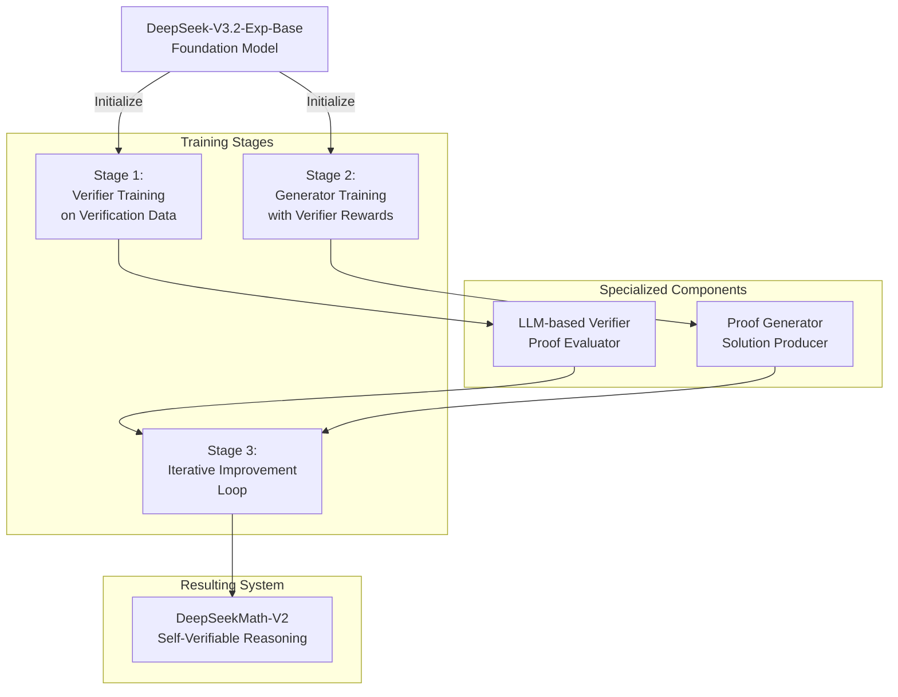
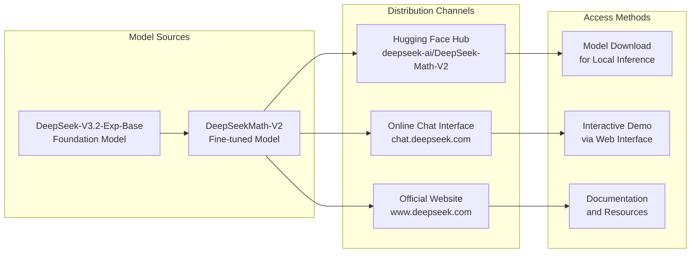
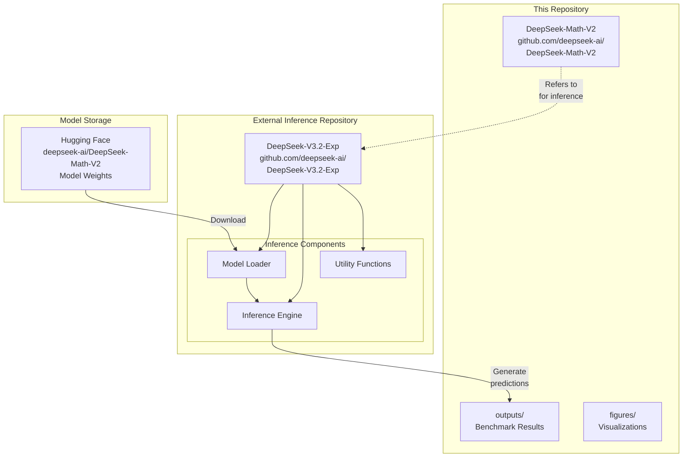
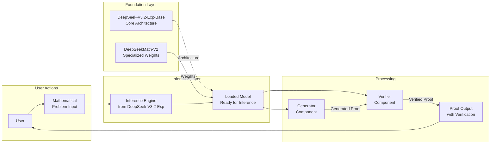

<!-- source: DeepWiki mcp.deepwiki.com · repo deepseek-ai/DeepSeek-Math-V2 · page 6.3 Foundation Model · fetched 2026-10-30 -->

# Foundation Model

Relevant source files

The following files were used as context for generating this wiki page:

- [DeepSeekMath_V2.pdf](DeepSeekMath_V2.pdf)
- [README.md](README.md)

## Purpose and Scope

This page documents the **DeepSeek-V3.2-Exp-Base** foundation model that serves as the base architecture for DeepSeekMath-V2. This page covers the model's specifications, its role in the system, distribution channels, and integration with inference infrastructure. For information about the training pipeline that uses this foundation model, see [Training Pipeline](#2.2). For details about the derived components (Verifier and Generator), see [Core Components](#2.1).

**Sources:** [README.md:30-45](), [README.md:69-70]()

---

## Overview

DeepSeekMath-V2 is built on top of the **DeepSeek-V3.2-Exp-Base** foundation model, a large language model that serves as the architectural backbone for both the proof generator and LLM-based verifier components. This foundation model provides the pre-trained capabilities that are specialized through the three-stage training pipeline to achieve self-verifiable mathematical reasoning.

The foundation model is not directly exposed to end users. Instead, DeepSeekMath-V2 represents the fine-tuned version with specialized mathematical reasoning capabilities.

**Sources:** [README.md:69]()

---

## Role in System Architecture

The foundation model serves as the initialization point for all specialized components in the DeepSeekMath-V2 system. Both the verifier and generator begin as instances of the base model and are then trained according to their respective objectives.

### Foundation Model as System Base

**Sources:** [README.md:41-43](), Diagram 1, Diagram 2

---

## Model Specifications

The DeepSeek-V3.2-Exp-Base model serves as the pre-trained foundation. While specific architectural parameters are not detailed in this repository, the model represents a large-scale language model capable of:

- Mathematical reasoning across multiple domains (number theory, geometry, combinatorics, algebra, analysis)
- Long-form proof generation with step-by-step derivations
- Rigorous logical verification of mathematical arguments
- Handling complex formal notation and LaTeX expressions

The base model provides the general language understanding and reasoning capabilities that are refined through domain-specific training on mathematical verification and proof generation tasks.

**Sources:** [README.md:34-45]()

---

## Model Distribution and Access

### Hugging Face Repository

The DeepSeekMath-V2 model (built on DeepSeek-V3.2-Exp-Base) is distributed through Hugging Face at the following location:

| Distribution Channel | URL/Identifier |
|---------------------|----------------|
| Hugging Face Model Hub | `deepseek-ai/DeepSeek-Math-V2` |
| Model License | Apache License 2.0 |
| Repository Type | Model Weights + Configuration |

**Sources:** [README.md:69](), [README.md:10-27]()

---

## Inference Infrastructure

### DeepSeek-V3.2-Exp Repository

Inference support for the foundation model and derived DeepSeekMath-V2 model is provided through a separate GitHub repository:

**Repository:** `github.com/deepseek-ai/DeepSeek-V3.2-Exp`

This repository contains:
- Inference code and utilities
- Model loading and configuration
- Optimization for efficient inference
- Integration examples

**Sources:** [README.md:70](), Diagram 5

---

## Integration Pattern

The foundation model integration follows this pattern:

1. **Model Download:** Users obtain model weights from Hugging Face
2. **Inference Setup:** Configure inference using DeepSeek-V3.2-Exp repository
3. **Model Loading:** Load DeepSeekMath-V2 weights into inference engine
4. **Problem Input:** Provide mathematical problems as input
5. **Proof Generation:** Model generates step-by-step proofs
6. **Self-Verification:** Built-in verification capability validates reasoning

### System Integration Flow

**Sources:** [README.md:69-70](), Diagram 1

---

## Model Licensing

The DeepSeekMath-V2 model, including its foundation model components, is released under the Apache License 2.0. The license file is located at:

**License Path:** [LICENSE]()

Key licensing terms:
- Model weights may be downloaded and used freely
- Commercial use is permitted
- Modifications and derivatives are allowed
- Attribution to DeepSeek AI is required
- No warranty is provided

**Sources:** [README.md:73](), [README.md:24-26]()

---

## Technical References

For detailed information about related components and systems:

- **Model Architecture Details:** See [Model Architecture Details](#6.2)
- **Inference Setup Guide:** See [Inference Setup](#5.2)
- **Model Access Instructions:** See [Model Access](#5.1)
- **External Dependencies:** See [External Dependencies](#7.2)

**Sources:** [README.md:69-70](), Table of Contents

---

