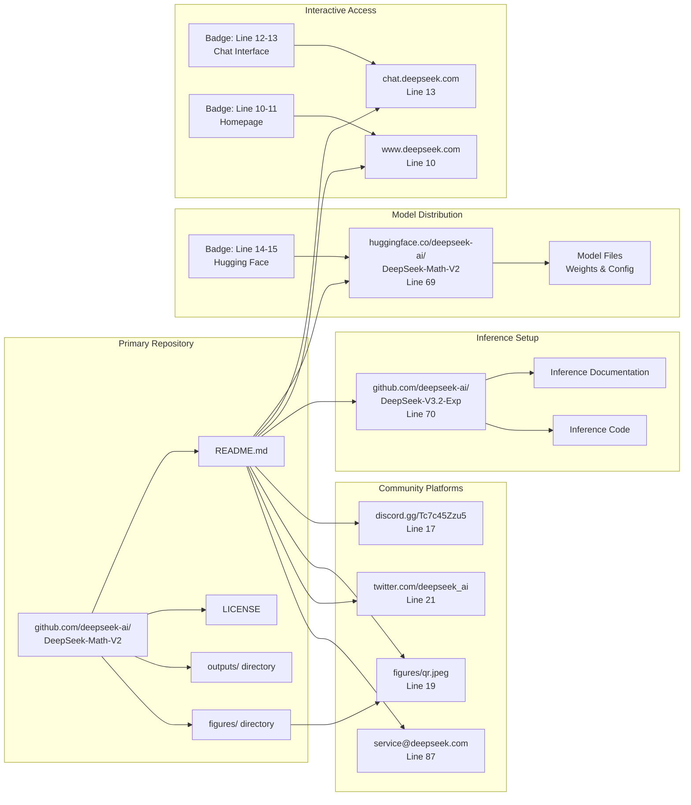

<!-- source: DeepWiki mcp.deepwiki.com · repo deepseek-ai/DeepSeek-Math-V2 · page 7 Reference · fetched 2026-10-30 -->

# Reference

<details>
<summary>Relevant source files</summary>

The following files were used as context for generating this wiki page:

- [LICENSE](LICENSE)
- [README.md](README.md)
- [outputs/README.md](outputs/README.md)

</details>


This page provides reference information for DeepSeek-Math-V2, including licensing terms, proper attribution and citation formats, external dependencies, and community resources. This material is essential for understanding the legal framework, properly crediting the work, and accessing support channels.

For detailed technical architecture and implementation details, see [System Architecture](#2). For information about using the model, see [Getting Started](#5).

## Overview of Reference Materials

The DeepSeek-Math-V2 repository provides several categories of reference information:

| Category | Location | Description |
|----------|----------|-------------|
| **License** | [LICENSE]() | Full Apache License 2.0 text governing model use |
| **Citation** | [README.md:77-82]() | BibTeX format for academic citations |
| **Model Access** | [README.md:69-70]() | Hugging Face download links and inference setup |
| **Attributions** | [outputs/README.md:1]() | Credit to IMO-ProofBench benchmark |
| **Community** | [README.md:17-22]() | Discord, WeChat, Twitter links |
| **Support** | [README.md:87]() | Email contact for technical assistance |

Sources: [README.md:1-88](), [LICENSE:1-202](), [outputs/README.md:1]()

## Reference Architecture

The following diagram shows the complete reference ecosystem, mapping logical reference categories to their concrete locations in the repository and external systems.

```mermaid
graph TB
    subgraph "Repository Files"
        LICENSE["LICENSE<br/>Apache 2.0 Full Text"]
        README["README.md<br/>Primary Documentation"]
        OUT_README["outputs/README.md<br/>Attribution"]
    end
    
    subgraph "Legal Framework"
        APL["Apache License 2.0<br/>Lines 2-202"]
        COPYRIGHT["Copyright Notice<br/>Line 190: DeepSeek 2023"]
        TERMS["Terms & Conditions<br/>Lines 7-177"]
    end
    
    subgraph "Citation Information"
        BIBTEX["BibTeX Entry<br/>Lines 78-82"]
        AUTHORS["Authors List<br/>Line 79: Shao et al."]
        TITLE["Title<br/>Line 80: Self-Verifiable Math"]
        YEAR["Year<br/>Line 81: 2025"]
    end
    
    subgraph "External Dependencies"
        BASE_MODEL["DeepSeek-V3.2-Exp-Base<br/>Foundation Model"]
        INF_REPO["DeepSeek-V3.2-Exp<br/>Inference Repository"]
        PROOFBENCH["IMO-ProofBench<br/>Google DeepMind"]
        PB_LICENSE["Apache 2.0<br/>Benchmark License"]
    end
    
    subgraph "Distribution Points"
        HF["huggingface.co/deepseek-ai/<br/>DeepSeek-Math-V2"]
        CHAT["chat.deepseek.com<br/>Interactive Interface"]
        WEBSITE["www.deepseek.com<br/>Documentation"]
    end
    
    subgraph "Community Channels"
        DISCORD["discord.gg/Tc7c45Zzu5<br/>Community Discussion"]
        WECHAT["WeChat Group<br/>QR in figures/qr.jpeg"]
        TWITTER["twitter.com/deepseek_ai<br/>Announcements"]
        EMAIL["service@deepseek.com<br/>Support Contact"]
    end
    
    LICENSE --> APL
    LICENSE --> COPYRIGHT
    LICENSE --> TERMS
    
    README --> BIBTEX
    README --> HF
    README --> CHAT
    README --> WEBSITE
    README --> DISCORD
    README --> WECHAT
    README --> TWITTER
    README --> EMAIL
    README --> INF_REPO
    
    BIBTEX --> AUTHORS
    BIBTEX --> TITLE
    BIBTEX --> YEAR
    
    OUT_README --> PROOFBENCH
    PROOFBENCH --> PB_LICENSE
    
    README --> BASE_MODEL
    BASE_MODEL --> HF
```



Sources: [README.md:1-88](), [LICENSE:1-202](), [outputs/README.md:1]()

## License Information

DeepSeek-Math-V2 is released under the **Apache License, Version 2.0**. The complete license text is available in [LICENSE:1-202](). Key aspects of the license include:

| License Term | Description | Reference |
|--------------|-------------|-----------|
| **License Type** | Apache License 2.0, January 2004 | [LICENSE:2-4]() |
| **Copyright Holder** | DeepSeek (2023) | [LICENSE:190]() |
| **Grant Type** | Perpetual, worldwide, non-exclusive, no-charge, royalty-free | [LICENSE:67-72]() |
| **Redistribution** | Permitted with conditions (see below) | [LICENSE:90-129]() |
| **Patent Grant** | Included with termination clause | [LICENSE:74-88]() |
| **Warranty** | Provided "AS IS" without warranties | [LICENSE:144-152]() |

### Redistribution Requirements

When redistributing DeepSeek-Math-V2 or derivative works, you must comply with the following conditions as specified in [LICENSE:90-129]():

1. **Include License Copy**: Provide recipients with a copy of the Apache 2.0 license [LICENSE:95-96]()
2. **Mark Modifications**: Carry prominent notices in modified files stating changes [LICENSE:98-99]()
3. **Preserve Notices**: Retain all copyright, patent, trademark, and attribution notices [LICENSE:101-105]()
4. **Include NOTICE File**: If present, include readable attribution notices in derivative works [LICENSE:107-122]()

### Model License Reference

The README explicitly states that model use is subject to the model license:

```markdown
The use of DeepSeekMath-V2 models is subject to the Model License.
```

This reference appears in [README.md:73](), linking to [LICENSE]().

Sources: [LICENSE:1-202](), [README.md:73]()

## Citation Format

To cite DeepSeek-Math-V2 in academic work, use the following BibTeX entry from [README.md:77-82]():

```bibtex
@misc{deepseek-math-v2,
  author = {Zhihong Shao, Yuxiang Luo, Chengda Lu, Z.Z. Ren, Jiewen Hu, Tian Ye, Zhibin Gou, Shirong Ma, Xiaokang Zhang},
  title = {DeepSeekMath-V2: Towards Self-Verifiable Mathematical Reasoning},
  year = {2025},
}
```

### Citation Components

| Component | Value | Line Reference |
|-----------|-------|----------------|
| **Entry Type** | `@misc` | [README.md:78]() |
| **Citation Key** | `deepseek-math-v2` | [README.md:78]() |
| **Authors** | Zhihong Shao, Yuxiang Luo, Chengda Lu, Z.Z. Ren, Jiewen Hu, Tian Ye, Zhibin Gou, Shirong Ma, Xiaokang Zhang | [README.md:79]() |
| **Title** | DeepSeekMath-V2: Towards Self-Verifiable Mathematical Reasoning | [README.md:80]() |
| **Publication Year** | 2025 | [README.md:81]() |

Sources: [README.md:77-82]()

## External Dependencies and Attributions

DeepSeek-Math-V2 builds upon and integrates with several external projects. Proper attribution is provided as follows:

### Foundation Model

DeepSeek-Math-V2 is built on top of **DeepSeek-V3.2-Exp-Base**, as stated in [README.md:69]():

```markdown
DeepSeekMath-V2 is built on top of DeepSeek-V3.2-Exp-Base
```

- **Model Location**: Hugging Face at `deepseek-ai/DeepSeek-Math-V2`
- **Reference**: [README.md:69-70]()

### Inference Support

For inference implementation, the system depends on the **DeepSeek-V3.2-Exp** repository:

- **Repository**: `github.com/deepseek-ai/DeepSeek-V3.2-Exp`
- **Purpose**: Inference support and runtime implementation
- **Reference**: [README.md:70]()

### IMO-ProofBench Attribution

The evaluation results in the `outputs/` directory use the **IMO-ProofBench** benchmark developed by Google DeepMind. The repository provides explicit attribution in [outputs/README.md:1]():

```markdown
This work makes use of IMO-ProofBench, developed by Google DeepMind, 
which is licensed under the Apache License, Version 2.0.
```

| Property | Value |
|----------|-------|
| **Benchmark Name** | IMO-ProofBench |
| **Developer** | Google DeepMind |
| **Repository** | `github.com/google-deepmind/superhuman/tree/main/imobench` |
| **License** | Apache License, Version 2.0 |
| **License URL** | `github.com/google-deepmind/superhuman/blob/main/LICENSE` |

Sources: [outputs/README.md:1](), [README.md:49](), [README.md:69-70]()

## Distribution and Access Points

The following diagram maps the specific URLs and identifiers used to access DeepSeek-Math-V2 across different platforms.



Sources: [README.md:10-22](), [README.md:69-70](), [README.md:87]()

## Community and Support Resources

DeepSeek-Math-V2 provides multiple channels for community engagement and technical support:

### Community Discussion Channels

| Platform | URL/Identifier | Badge Location | Purpose |
|----------|----------------|----------------|---------|
| **Discord** | `discord.gg/Tc7c45Zzu5` | [README.md:17-18]() | Community discussion and collaboration |
| **WeChat** | QR code in `figures/qr.jpeg` | [README.md:19-20]() | Chinese community support (中文社区) |
| **Twitter/X** | `twitter.com/deepseek_ai` (@deepseek_ai) | [README.md:21-22]() | Announcements and updates |

### Official Support

| Channel | Contact | Line Reference | Description |
|---------|---------|----------------|-------------|
| **Email** | `service@deepseek.com` | [README.md:87]() | Direct technical support for issues and questions |
| **GitHub Issues** | Repository issue tracker | [README.md:87]() | Public issue reporting and tracking |

### Badge Display in README

The README includes badge links for visual navigation:

```markdown
<a href="https://discord.gg/Tc7c45Zzu5">
  
</a>
<a href="figures/qr.jpeg">
  
</a>
<a href="https://twitter.com/deepseek_ai">
  
</a>
```

These badges appear in [README.md:17-22]() and provide direct links to community platforms.

Sources: [README.md:17-22](), [README.md:85-87]()

## Documentation Structure

The repository provides structured documentation across multiple files:

| File | Purpose | Key Sections |
|------|---------|--------------|
| **README.md** | Primary documentation | Introduction, evaluation results, download instructions, license, citation, contact |
| **LICENSE** | Legal terms | Apache 2.0 full text with DeepSeek copyright |
| **outputs/README.md** | Attribution for evaluation data | IMO-ProofBench acknowledgment |

### README Structure Reference

The main README follows this structure:

1. **Header**: Logo, badges, and links ([README.md:5-28]())
2. **Introduction**: Research context and capabilities ([README.md:30-45]())
3. **Evaluation Results**: Benchmark performance ([README.md:47-65]())
4. **Download & Quick Start**: Model access ([README.md:67-70]())
5. **License**: Legal framework ([README.md:72-73]())
6. **Citation**: BibTeX format ([README.md:75-82]())
7. **Contact**: Support information ([README.md:85-87]())

Sources: [README.md:1-88]()

## Related Documentation

For information about specific aspects of DeepSeek-Math-V2:

- **Licensing details**: See [License & Legal](#7.1)
- **External dependencies**: See [External Dependencies](#7.2)  
- **Community resources**: See [Community & Support](#7.3)
- **Model download and setup**: See [Model Access](#5.1)
- **Inference implementation**: See [Inference Setup](#5.2)
- **System architecture**: See [System Architecture](#2)
- **Evaluation benchmarks**: See [Evaluation & Results](#3)

## Contact Information

For technical questions, issues, or support:

- **Email**: service@deepseek.com ([README.md:87]())
- **GitHub Issues**: Raise an issue in the repository ([README.md:87]())

The README states:

```markdown
If you have any questions, please raise an issue or 
contact us at service@deepseek.com.
```

Sources: [README.md:85-87]()

---

